## **✅**  들어가며

- 물리 메모리보다 큰 프로세스들을 실행할 수 있지만, 그럼에도 물리 메모리의 크기는 한정되어 있다 
- 기존에 적재된 불필요한 페이지를 선별해 보조기억장치로 내보내고 프로세스들에게 적절한 수의 프레임을 할당해야 한다. 

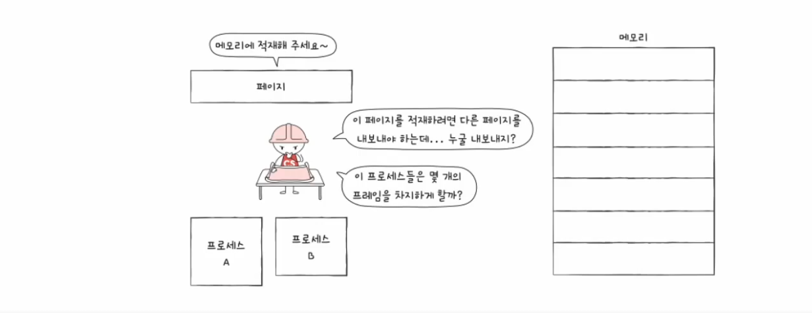

## **✅  요구 페이징** 

- 처음부터 모든 페이지를 적재하지 않고 필요한 페이지만을 메모리에 적재하는 기법
- **요구되는 페이지만 적재**하는 기법 
1. CPU가 특정 페이지에 접근하는 명령어를 실행한다. 
1. 해당 페이지가 현재 메모리에 있을 경우(유효 비트가 1일 경우) CPU는 페이지가 적재된 프레임에 접근한다. 
1. 해당 페이지가 현재 메모리에 없을 경우(유효 비트가 0일 경우) 페이지 폴트 발생 
1. 페이지 폴트 처리 루틴은 해당 페이지를 메모리에 적재하고 유효 비트를 1로 설정한다. 
1. 다시 1번을 수행한다. (폴트의 특징) 

### 이러한 요구 페이징 시스템이 안정적으로 작동하려면 해결해야 할 문제? 

- 페이지 교체 
- 프레임 할당 

## **✅  페이지 교체 알고리즘** 

- 요구 페이징 기법으로 페이지들을 적재하다보면 언젠가 메모리가 가득 차게 된다. 
- 당장 실행에 필요한 페이지를 적재하려면 적재된 페이지를 보조기억장치로 내보내야함 
- 이때, 어떤 페이지를 내보낼까? 
- 이를 결정하는 알고리즘이 페이지 교체 알고리즘 

### 무엇이 좋은 페이지 교체 알고리즘일까?

- 페이지 폴트가 적은 알고리즘
- 페이지 폴트가 발생하면 보조기억장치에 접근해야 해서 성능 저하

### 페이지 폴트 횟수는 어떻게 알 수 있을까?

- 페이지 참조열(page reference string)
- CPU가 참조하는 페이지들 중 연속된 페이지를 생략한 페이지열

```java
#CPU가 참조하는 페이지들 
2 2 2 3 5 5 5 3 3 7

#연속된 페이지 생략 
2 3 5 3 7
```

## **✅  FIFO 페이지 교체 알고리즘** 

- 가장 단순한 방식 
- 메모리에 가장 먼저 올라온 페이지부터 내쫓는 방식 → 오래 머물렀다면 나가라~

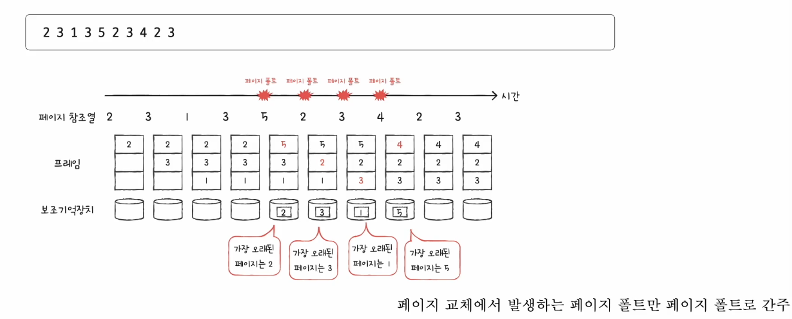

- 프로그램 실행 내내 사용될 페이지 ← 먼저 적재되었다고 내쫓아선 안된다 

### FIFO 페이지 교체 알고리즘 - 보완책 

- **2차 기회(second-chance) 페이지 교체 알고리즘** 
- 참조 비트 1: CPU가 한 번 참조한 적이 있는 페이지 
- 한 번 더 기회를 주기(참조 비트 0으로 초기화 후 적재 시간을 현재 시간으로 설정)
- 참조 비트 0: CPU가 참조한 적이 없는 페이지 
- Bye
- FIFO 페이지 교체 알고리즘과 마찬가지로 오래된 순서대로 내쫓는 방식이지만 참조 비트에 따라서 다르게 동작한다. 

## **✅  최적 페이지 교체 알고리즘** 

- CPU에 의해 참조되는 횟수를 고려 
- 메모리에 오래 남아야 할 페이지는 **자주 사용될 페이지** 
- 메모리에 없어도 될 페이지는 **오랫동안 사용되지 않을 페이지** 
- 앞으로의 사용 빈도가 가장 낮은 페이지를 교체하는 알고리즘 

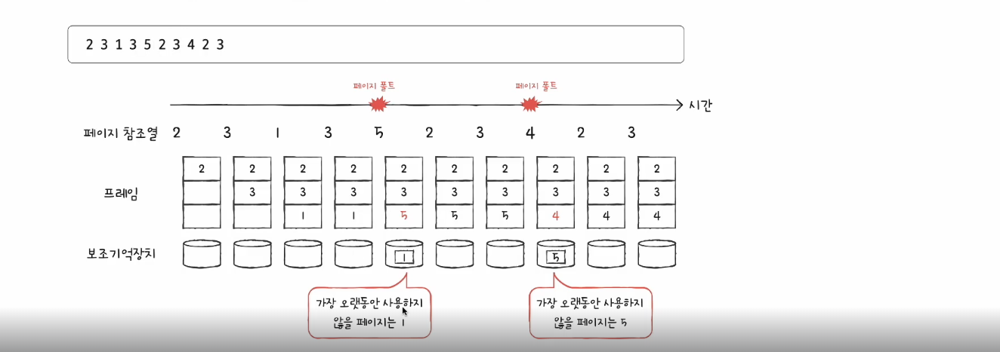

### 최적 페이지 교체 알고리즘 특징 

- **가장 낮은 페이지 폴트율을 보장**하는 페이지 교체 알고리즘 
- **하지만 실제 구현이 어렵다** 
- 앞으로 오랫동안 사용되지 않을 페이지? 어떻게 예측?
- 다른 페이지 교체 알고리즘 성능을 평가하기 위한 하한선으로 간주 

## **✅  LRU(Least-Recently-Used) 페이지 교체 알고리즘** 

- 최적 페이지 교체 알고리즘: 가장 오래 사용되지 **않을** 페이지 교체 
- LRU 페이지 교체 알고리즘: 가장 오래 사용되지 **않은** 페이지 교체 
- 최근에 사용되지 않은 페이지는 앞으로도 사용되지 않지 않을까?

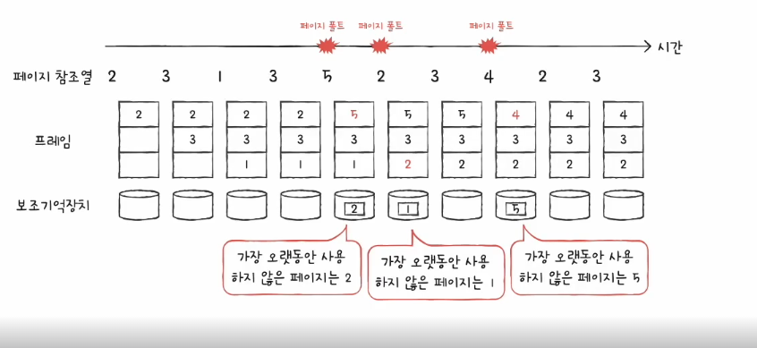

## **✅  기타 페이지 교체 알고리즘** 

- 이외에도 많은 페이지 교체 알고리즘들이 있다. 

## **✅  스래싱 문제** 

### 페이지 폴트가 자주 발생하는 이유 

- 비효율적인 페이지 알고리즘을 사용해서
- **프로세스가 사용할 수 있는 프레임 자체가 적어서** 

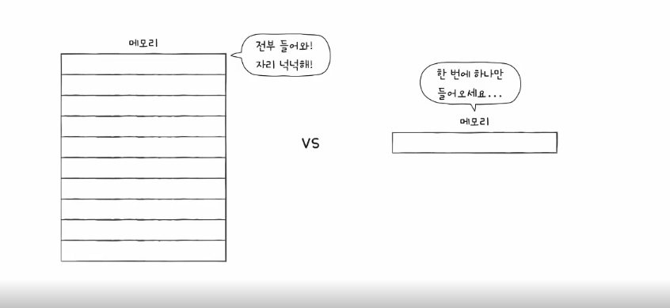

### 스래싱?

- 프로세스가 실행되는 시간보다 페이지 교체에 더 많은 시간을 소요하여 성능(CPU 이용률)이 저해되는 문제 

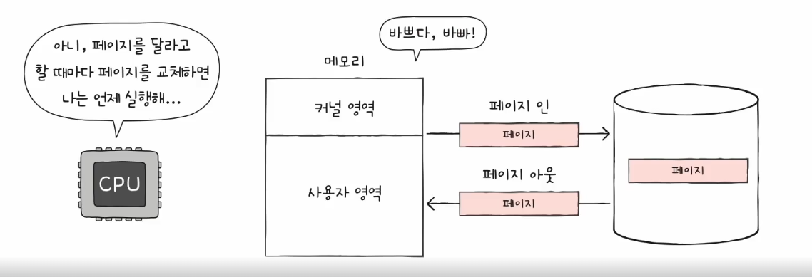

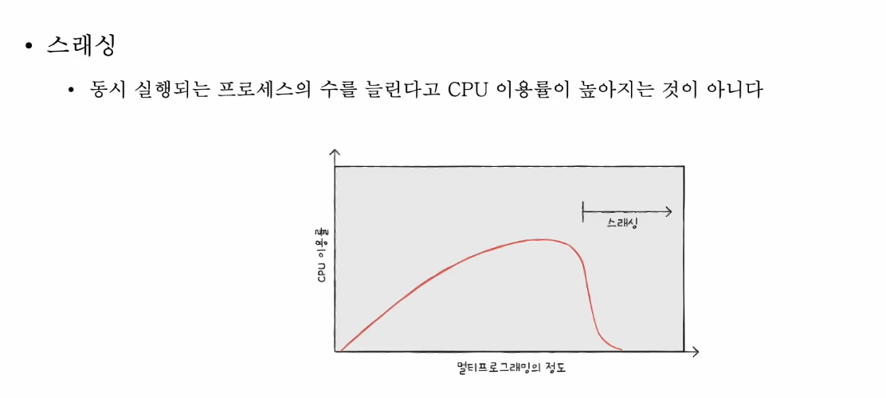

- 멀티프로그래밍의 정도: 메모리에 동시에 실행되는 프로세스의 수 

**스래싱 원인**

- 각 프로세스가 필요로 하는 최소한의 프레임 수가 보장되지 않았기 때문 
- 각 프로세스가 필요로 하는 최소한의 프레임 수를 파악하고 프로세스들에게 적절한 프레임을 할당해주어야 한다 
- 즉 프로세스를 많이 생성 → CPU 이용률 상승 X(각 프로세스 프레임 수 보장 X)

## **✅  프로세스** 프레임 할당 

### 균등 할당(equal allocation)

- 가장 단순한 할당 방식 
- 모든 프로세스들에게 균등하게 프레임을 할당하는 방식 
- 정적 할당 방식 

### 비례 할당(proportional allocation)

- 프로세스 크기를 고려 
- 프로세스 크기에 비례하여 프레임 할당 
- 정적 할당 방식 
- 문제점
- 크기가 큰 프로세스인데 막상 실행해보니 많은 프레임을 필요로 하지 않으면? 
  - 크기가 작은 프로세스인데 막상 실행해보니 많은 프레임이 필요로 하면? 
  - 결국 프로세스가 필요로 하는 프레임 수는 **실행해봐야 안다**

### 작업 집합 모델 

- 프로세스가 실행하는 과정에서 배분할 프레임 결정 (동적 할당 방식)
- 스래싱이 발생하는 이유는 빈번한 페이지 교체 때문 
- **CPU가 특정 시간 동안 주로 참조한 페이지 개수만큼만 프레임을 할당하면 된다**  
- 프로세스가 일정 기간 동안 참조한 페이지 집합을 기억하며 빈번한 페이지 교체를 방지 
- 작업 집합이란 실행 중인 프로세스가 일정 시간 동안 참조한 페이지의 집합

**작업 집합을 구하려면?**

- 프로세스가 참조한 페이지 
- 시간 간격 

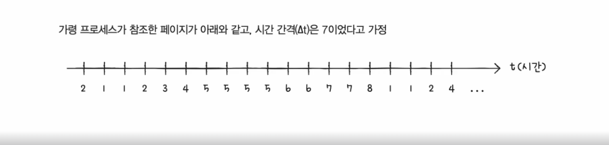

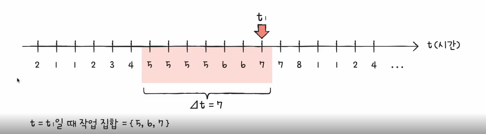

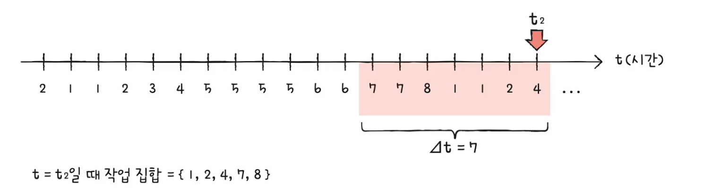

### 페이지 폴트 빈도 

- 프로세스가 실행하는 과정에서 배분할 프레임 결정 
- 두 개의 가정에서 생겨난 아이디어 
- 페이지 폴트율이 너무 높으면 그 프로세스는 너무 적은 프레임을 갖고 있다. 
  - 페이지 폴트율이 너무 낮으면 그 프로세스는 너무 많은 프레임을 갖고 있다.

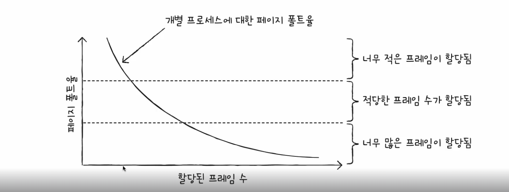

- 페이지 폴트율에 상한선과 하한선을 정하고, 그 내부 범위 안에서만 프레임을 할당하는 방식

