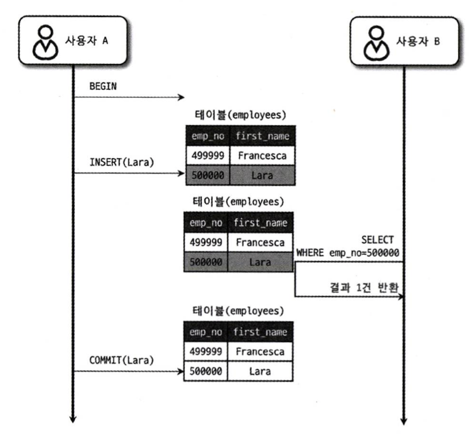
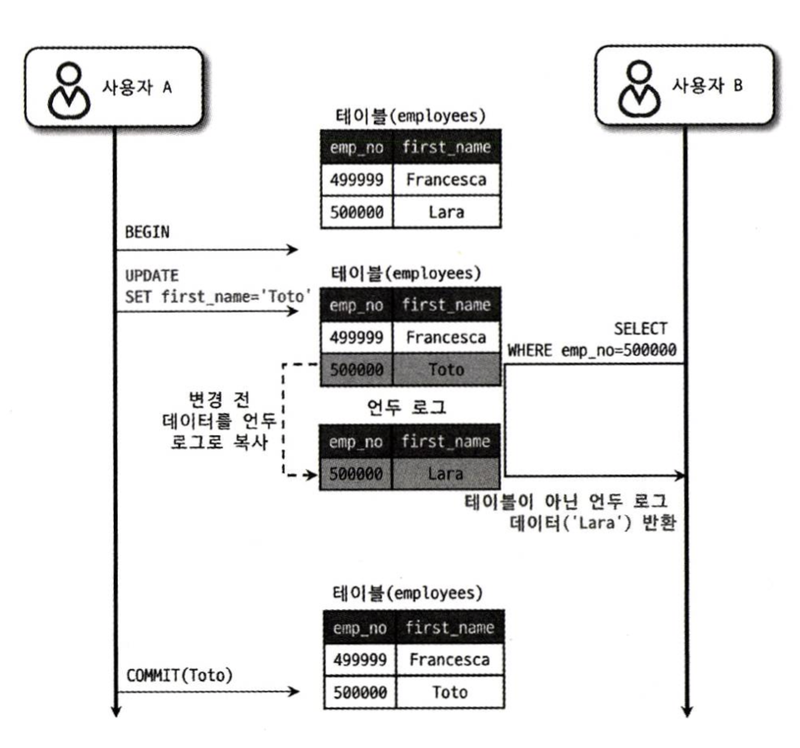
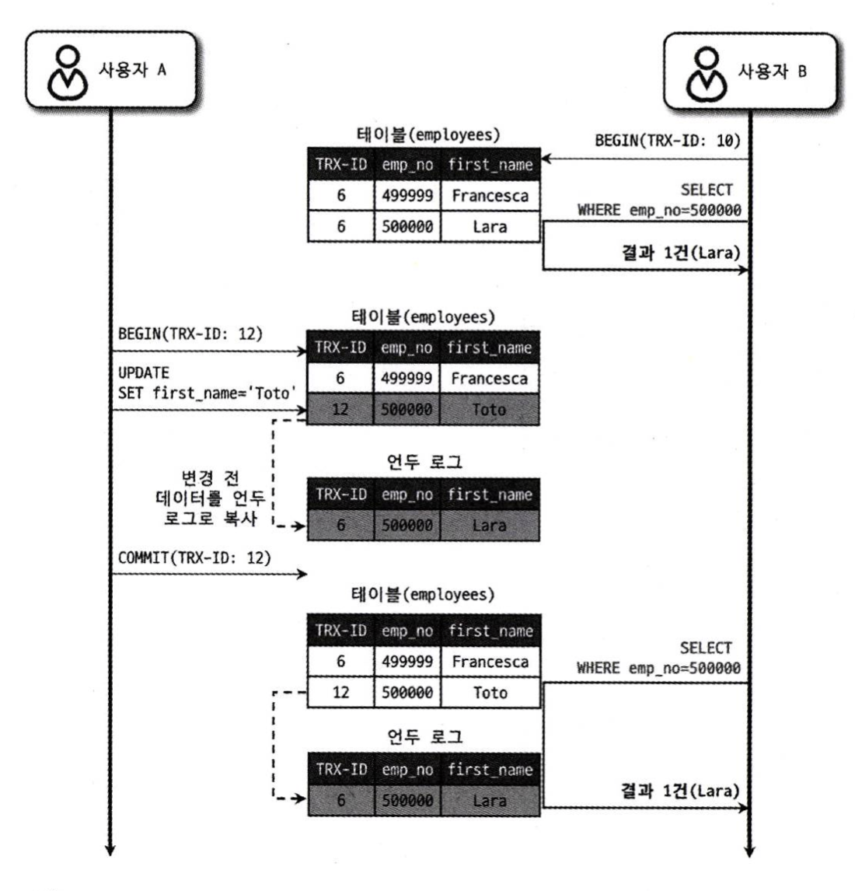

트랜잭션의 격리 수준(isolation level)이란 여러 트랜잭션이 동시에 처리될 때 특정 트랜잭션이 다른 트랜잭션에서 변경하거나 조회하는 데이터를 볼 수 있게 허용할지 말지를 결정하는 것이다.

| **격리 수준** | **DIRTY READ** | **NON-REPEATABLE READ** | **PHANTOM READ** |
| --- | --- | --- | --- |
| **READ UNCOMMITTED** | 발생 | 발생 | 발생 |
| **READ COMMITTED** | 발생하지 않음 | 발생 | 발생 |
| **REPEATABLE READ** | 발생하지 않음 | 발생하지 않음 | 발생 (InnoDB는 X) |
| **SERIALIZABLE** | 발생하지 않음 | 발생하지 않음 | 발생하지 않음 |

4개의 격리 수준에서 순서대로 뒤로 갈수록 트랜잭션 간의 데이터 격리(고립) 정도가 높아지며, 동시 처리 성능도 떨어지는 것이 일반적이지만 SERIALIZABLE 격리 수준이 아니라면 크게 성능의 개선이나 저하는 발생하지 않는다.

---

# 5.4.1 READ UNCOMMITTED

READ UNCOMMITED 격리 수준에서는 트랜잭션에서의 변경 내용이 COMMIT, ROLLBACK 여부에 상관없이 디른 트랜잭션에서 보인다.



어떤 트랜잭션에서 처리한 작업이 완료되지 않았는데도 다른 트랜잭션에서 볼 수 있는 현상을 **더티 리드(Dirty Read)**라 하고, 더티 리드는 READ UNCOMMITED 격리 수준에서만 나타난다.

더티 리드 현상은 데이터가 나타났다가 사라졌다 하는 현상을 초래하여 애플리케이션 개발자와 사용자를 상당히 혼란스럽게 만든다.

이런 이유로 RDBMS 표준에서는 트랜잭션의 격리 수준으로 인정하지 않을 정도로 정합성에 문제가 많다.

---

# 5.4.2 READ COMMITED

READ COMMITED 레벨은 오라클 DBMS에서 기본으로 사용되는 격리 수준이며, 많은 온라인 서비스에서 가장 많이 선택되는 격리 수준이다.

READ COMMITED 레벨에서는 더티 리드 현상은 발생하지 않는다. 

어떤 트랜잭션에서 데이터를 변경했더라도 오직 COMMIT이 완료된 데이터만 조회가 가능하다.



아직 사용자A가 커밋하지 않았기 때문에 사용자B는 언두 로그에 백업된 “Lara”를 조회한다.

즉, 언두 로그를 통해서 Dirty Read를 방지한다.

**InnoDB 아키텍처 복습**

```
1. 변경된 데이터는 버퍼 풀에 반영 (Dirty Page)
사용자 A가 데이터를 변경하면, 해당 페이지는 버퍼 풀(Buffer Pool) 내에서 
수정되고 더티 페이지(Dirty Page)가 된다.
즉시 디스크에 반영되지는 않으며, 플러시 대상이 되기 위해 플러시 리스트(Flush List)에 올라간다.

2. 이전 값은 Undo 로그에 기록
트랜잭션 롤백이나 Consistent Read를 위해 Undo 로그가 생성된다.
Undo는 로그 버퍼(Log Buffer)에 먼저 저장되고, 커밋과 상관없이 디스크로 플러시될 수 있다.
디스크에 있는 Undo는 모든 관련 트랜잭션이 끝나면 정리(Purge)된다.
만약 디스크 저장 전에 참조 중인 트랜잭션이 없다면, 디스크 저장 없이 버퍼에서 삭제될 수 있다.

3. 커밋 시점에 데이터 페이지는 디스크에 기록되지 않음
Redo 로그(Log Buffer)가 디스크로 fsync() 동기화되는 것이 커밋의 본질적 의미.
데이터 페이지는 이후 필요 시에 디스크로 플러시됨 (예: 체크포인트 발생, 버퍼 풀 압박 등).
이런 구조 덕분에 MySQL은 빠른 커밋이 가능하다.

4. Change Buffer (체인지 버퍼)
보조 인덱스 업데이트는 Change Buffer에 캐시 가능하다.
비유니크 보조 인덱스만 가능 (유니크 인덱스는 즉시 체크 필요 → Change Buffer 캐시 불가).
디스크 I/O를 줄이는 중요한 최적화 수단.
```


사용자B가 처음 조회 했을 때 일치하는 결과가 없었다.

사용자A가 이름을 “Toto”로 변경하고 커밋

사용자B가 같은 트랜잭션에서 똑같은 쿼리로 조회했더니 결과 반환

즉, 하나의 트랜잭션에서 **똑같은 SELECT 쿼리를 실행했을 때 항상 같은 결과를 가져와야 한다는 REPEATABLE READ 정합성에 어긋난다.**

## ✅ **Read Committed**

  - **원칙**: “커밋된 것만 읽는다.”
  - **동작 흐름**:
1. 레코드의 트랜잭션 ID(trx_id)를 보고 **커밋 여부 판단**
→ Redo 로그의 커밋 여부 + 트랜잭션 테이블에서 현재 트랜잭션 상태 확인
    1. **커밋된 트랜잭션이면** 레코드 값을 그대로 읽음
    1. **커밋되지 않았다면** → Undo 로그를 참조하여 **마지막으로 커밋된 버전**을 따라감
→ 즉, 읽기 시점의 최신 커밋된 값을 반환

## ✅ **Repeatable Read (InnoDB의 기본 격리 수준)**

  - **원칙**: “내 트랜잭션 동안 동일한 SELECT는 동일한 결과를 보장해야 한다.”
  - **동작 흐름**:
1. 트랜잭션 시작 시점에 **Consistent Read View (Read View)** 생성
→ 자신보다 **트랜잭션 ID가 이전**이고 **이미 커밋된 것만 보이도록** 설정
    1. 레코드의 트랜잭션 ID 확인
    1. **레코드의 trx_id가 나보다 이전이고**, 커밋된 트랜잭션이면 → 그대로 읽음
    1. 그렇지 않으면 → Undo 로그에서 **Read View에 부합하는 버전**을 찾을 때까지 따라감

---

## MVCC = Undo 로그 기반

InnoDB는 MVCC (Multi-Version Concurrency Control)를 지원하며, 이는 **Undo 로그를 통해 과거 버전의 데이터를 조회하는 방식**으로 동작한다. **언제 어떤 Undo 로그 버전을 보느냐**가 격리 수준에 따라 달라진다.

---

## **REPEATABLE READ (기본 InnoDB 레벨)**

### 원칙

  - 트랜잭션이 시작될 때 **Consistent Read View**를 생성
  - **본인보다 먼저 커밋된 트랜잭션**만 보인다. (트랜잭션 ID 기준)
  - 그 이후에 커밋된 트랜잭션은 **무시**.
  - 같은 SELECT는 같은 결과를 보장 (즉, repeatable)

### 내부 동작

  - InnoDB는 **현재 레코드가 본인보다 새로운 트랜잭션에 의해 커밋된 것인지 확인**하고,
  - 그렇다면 **Undo 로그를 따라가서 과거 버전**을 조회한다.

### 사용되는 것

  - **Undo 로그**: 과거 버전 보존
  - **Read View**: 트랜잭션 ID 범위 기반 필터링
  - **버퍼 풀**: 최신 데이터가 있을 수 있지만 무시됨 (Undo 기반 조회)

---

## **READ COMMITTED**

### 원칙

  - **쿼리 실행 시점에 커밋된 데이터만 조회**함 (트랜잭션 시작 시점 아님!)
  - 동일 트랜잭션 내에서 똑같은 SELECT를 반복해도 **결과가 달라질 수 있음**
  - 즉, repeatable read 정합성은 **보장되지 않음**

### 내부 동작

  - InnoDB는 쿼리 실행 시점에
- **현재 레코드가 “커밋된 상태”인지 확인**하고,
    - 커밋되었으면 **그 값을 반환**
    - 커밋되지 않았다면 Undo 로그를 따라가며 **직전 커밋된 버전**을 찾아냄

### 사용되는 것

  - **Undo 로그**: 여전히 사용됨! (이게 중요한 포인트)
  - 하지만 **트랜잭션 ID와 Read View는 고려하지 않음**
  - 버퍼 풀의 더티 페이지일지라도, **Undo 로그를 통해 커밋된 버전인지 판단**

---

## 헷갈리기 쉬운 포인트

| 구분 | REPEATABLE READ | READ COMMITTED |
| --- | --- | --- |
| **조회 기준** | 트랜잭션 시작 시점 | 쿼리 실행 시점 |
| **Read View 사용** | ✅ 사용 (트랜잭션 ID 필터링) | ❌ 사용하지 않음 |
| **Undo 로그 사용** | ✅ 사용 | ✅ 사용 |
| **버퍼 풀에서 직접 읽나?** | 아니오 (항상 Undo 체크) | 상황에 따라 가능 (변경된 값이 커밋되었으면 읽음) |
| **변경 커밋 후 재조회 결과** | 이전 값 유지 | 최신 커밋 값 반환 |

---

---

# 5.4.3 REPETABLE READ

REPEATABLE READ는 MySQL의 InnoDB 스토리지 엔진에서 기본으로 사용되는 격리 수준이다.

바이너리 로그를 가진 MySQL 서버에서는 최소 REPEATABLE READ 격리 수준 이상을 사용해야 한다.

이 격리 수준에서는 READ COMMITED 레벨에서 발생하는 NON-REPEATABLE READ 부정합이 발생하지 않는다. 

**두 격리 수준 모두 MVCC(언두 공간에 백업 & 실제 레코드 변경)을 하는데 왜 REPEATABLE READ 수준은 NON-REPEATABLE READ 부정합이 발생하지 않을까?**

모든 InnoDB 트랜잭션은 고유한 트랜잭션 번호(순차적으로 증가하는 값)을 가지며, 언두 영역에 백업된 모든 레코드에는 변경을 발생시킨 트랜잭션의 번호가 포함돼 있다.

언두 영역의 백업된 데이터는 InnoDB 스토리지 엔진이 불필요하다고 판단하는 시점(다른 트랜잭션에서 더이상 참조 X)에 주기적으로 삭제한다.



**해당 그림은 REPEATABLE READ 격리 수준의 동작 방식을 보여준다.**

초기 employees 테이블은 트랜잭션(TRX_ID 6)에 의해 INSERT

사용자B 트랜잭션(TRX-ID 10)을 시작하고 emp_no=500000 레코드를 읽는다. “Lara” 

사용자A 트랜잭션(TRX-ID 12)을 시작하고 emp_no=500000 레코드를 변경한다. “Toto”

이때 변경 전 데이터를 언두 로그로 복사한다.

복사한 데이터는 TRX-ID: 6 emp_no: 500000 first_name: “Lara”

사용자A 커밋

사용자B emo_no=500000 레코드 조회

이때 테이블의 커밋된 TRX_ID는 12 (참고로 커밋 여부도 판단도 가능하다)

**커밋된 TRX_ID 12 > 사용자B TRX_ID 10 ReadView 포함 X**

언두 로그중에 TRX_ID < 사용자B TRX_ID 10 레코드를 찾는다. “Lara”


**해당 그림은 REPEATABLE READ 격리 수준에서의 부정합을 보여준다.**

사용자B는 SELECT로 잠금 없는 읽기를 하였다. 결과: MangKyu(1건)

사용자A는 트랜잭션을 시작(TRX_ID 12), INSERT Martin

사용자A 커밋

사용자B는 SLECT … FOR UPDATE를 통해 쓰기 잠금 & 조회를 하였다. (이때 넥스크 키 락 사용)

쓰기 잠금을 걸고 조회는 락을 걸고 조회하기 때문에 테이블에서 바로 읽는다.

즉, MVCC 기능을 사용하지 않는다. 

결과는 (MangKyu, Martin)으로 2건이다.

즉, PHANTOM READ가 발생하였다.

**즉, 읽기 잠금, 쓰기 잠금 모두 MVCC를 우회해서 동작하여 테이블을 바로 읽고 팬텀 리드가 발생할 수 있다.**

하지만 이런 트랜잭션은 개발자 잘못이다. 

---

# 5.4.4 SERIALIZABLE

가장 단순하고 동시에 가장 엄격한 격리 수준이다. 그만큼 동시 처리 성능도 다른 트랜잭션의 격리 수준보다 떨어진다. InnoDB 테이블에서 기본적으로 순수한 SELECT 작업은 아무런 레코드 잠금도 설정하지 않고 실행된다.

Non-locking consistent read(잠금이 필요 없는 일관된 읽기)라는 말이 이를 의미한다.

하지만 SERIAILIZABLE 레벨에서는 순수한 읽기 작업도 공유 잠금(읽기 잠금)을 획득하고, 동시에 다른 트랜잭션은 그러한 레코드를 변경하지 못한다.

즉, SERIAILIZABLE 레벨에서는 PHANTOM READ 문제가 발생하지 않는다.

하지만 InnoDB 스토리지 엔진에서는 갭 락과 넥스트 키락 덕분에 REPETABLE READ 수준에서도 PHANTOM READ가 발생하지 않기 때문에 굳이 SERIAILIZABLE을 사용할 필요성은 없어 보인다.

---

# 추천 자료 

[https://mangkyu.tistory.com/299](https://mangkyu.tistory.com/299)

---

[https://dev.mysql.com/doc/refman/8.4/en/innodb-locking.html#innodb-gap-locks](https://dev.mysql.com/doc/refman/8.4/en/innodb-locking.html#innodb-gap-locks)

[https://medium.com/daangn/mysql-gap-lock-%EB%91%90%EB%B2%88%EC%A7%B8-%EC%9D%B4%EC%95%BC%EA%B8%B0-49727c005084](https://medium.com/daangn/mysql-gap-lock-%EB%91%90%EB%B2%88%EC%A7%B8-%EC%9D%B4%EC%95%BC%EA%B8%B0-49727c005084)

