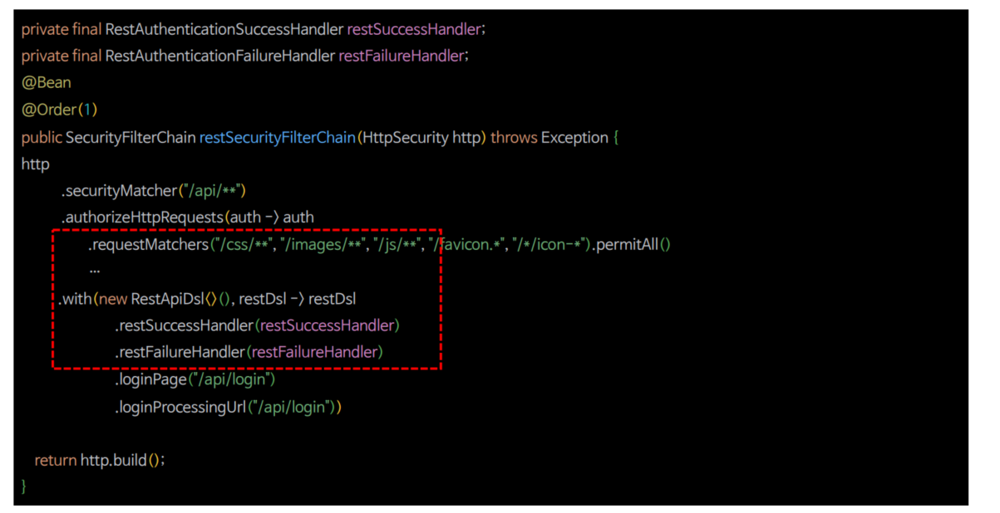
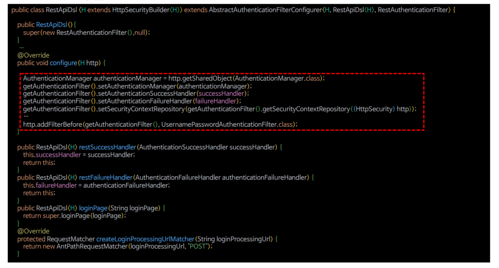

# ***Rest DSLs 설정***



# ***Rest DSLs 구현***



# *구현*

***RestAuthenticationFilter***

```java
public class RestAuthenticationFilter extends AbstractAuthenticationProcessingFilter {
    private final ObjectMapper objectMapper = new ObjectMapper();
    public RestAuthenticationFilter() {
        super(new AntPathRequestMatcher("/api/login", "POST"));
    }
    public SecurityContextRepository getSecurityContextRepository(HttpSecurity http) {
        SecurityContextRepository securityContextRepository = http.getSharedObject(SecurityContextRepository.class);
        if(securityContextRepository == null || securityContextRepository instanceof RequestAttributeSecurityContextRepository){
           return new DelegatingSecurityContextRepository(
                    new RequestAttributeSecurityContextRepository(), new HttpSessionSecurityContextRepository());
        }
        return securityContextRepository;
    }
    @Override
    public Authentication attemptAuthentication(HttpServletRequest request, HttpServletResponse response) throws AuthenticationException, IOException, ServletException {

        if(!HttpMethod.POST.matches(request.getMethod()) || !WebUtil.isAjax(request)){
            throw new IllegalArgumentException("Authentication method not supported");
        }

        AccountDto accountDto = objectMapper.readValue(request.getReader(), AccountDto.class);
        if(!StringUtils.hasText(accountDto.getUsername()) || !StringUtils.hasText(accountDto.getPassword())){
            throw new AuthenticationServiceException("Username or Password is not provided");
        }

        RestAuthenticationToken authenticationToken = [REDACTED] RestAuthenticationToken(accountDto.getUsername(), accountDto.getPassword());
        return getAuthenticationManager().authenticate(authenticationToken);
    }
}
```

***RestApiDsl***

```java
public class RestApiDsl <H extends HttpSecurityBuilder<H>> extends
        AbstractAuthenticationFilterConfigurer<H, RestApiDsl<H>, RestAuthenticationFilter> {
    private AuthenticationSuccessHandler successHandler;
    private AuthenticationFailureHandler failureHandler;
    public RestApiDsl(){
        super(new RestAuthenticationFilter(),null);
    }
    @Override
    public void init(H http) throws Exception {
        super.init(http);
    }
    @Override
    public void configure(H http) {
        AuthenticationManager authenticationManager = http.getSharedObject(AuthenticationManager.class);
        getAuthenticationFilter().setAuthenticationManager(authenticationManager);
        getAuthenticationFilter().setAuthenticationSuccessHandler(successHandler);
        getAuthenticationFilter().setAuthenticationFailureHandler(failureHandler);
        getAuthenticationFilter().setSecurityContextRepository(getAuthenticationFilter().getSecurityContextRepository((HttpSecurity) http));

        SessionAuthenticationStrategy sessionAuthenticationStrategy = http.getSharedObject(SessionAuthenticationStrategy.class);
        if (sessionAuthenticationStrategy != null) {
            getAuthenticationFilter().setSessionAuthenticationStrategy(sessionAuthenticationStrategy);
        }
        
        RememberMeServices rememberMeServices = http.getSharedObject(RememberMeServices.class);
        if (rememberMeServices != null) {
            getAuthenticationFilter().setRememberMeServices(rememberMeServices);
        }
        
        http.setSharedObject(RestAuthenticationFilter.class,getAuthenticationFilter());
        http.addFilterBefore(getAuthenticationFilter(), UsernamePasswordAuthenticationFilter.class);
    }
    public RestApiDsl<H> restSuccessHandler(AuthenticationSuccessHandler successHandler) {
        this.successHandler = successHandler;
        return this;
    }
    public RestApiDsl<H> restFailureHandler(AuthenticationFailureHandler authenticationFailureHandler) {
        this.failureHandler = authenticationFailureHandler;
        return this;
    }
    public RestApiDsl<H> loginPage(String loginPage) {
        return super.loginPage(loginPage);
    }
    public RestApiDsl<H> setSecurityContextRepository(SecurityContextRepository securityContextRepository) {
        return super.securityContextRepository(securityContextRepository);
    }
    @Override
    protected RequestMatcher createLoginProcessingUrlMatcher(String loginProcessingUrl) {
        return new AntPathRequestMatcher(loginProcessingUrl, "POST");
    }
}
```

***SecurityConfig***

```java
@EnableWebSecurity
@Configuration
@RequiredArgsConstructor
public class SecurityConfig {
    private final AuthenticationProvider authenticationProvider;
    private final AuthenticationProvider restAuthenticationProvider;
    private final AuthenticationDetailsSource authenticationDetailsSource;
    private final FormAuthenticationSuccessHandler successHandler;
    private final RestAuthenticationSuccessHandler restSuccessHandler;
    private final FormAuthenticationFailureHandler failureHandler;
    private final RestAuthenticationFailureHandler restFailureHandler;
    @Bean
    @Order(1)
    public SecurityFilterChain restSecurityFilterChain(HttpSecurity http) throws Exception {

        AuthenticationManagerBuilder authenticationManagerBuilder =
                http.getSharedObject(AuthenticationManagerBuilder.class);

        authenticationManagerBuilder.authenticationProvider(restAuthenticationProvider);

        AuthenticationManager authenticationManager = authenticationManagerBuilder.build();
        http
                .securityMatcher("/api/**")
                .authorizeHttpRequests(auth -> auth
                        .requestMatchers("/css/**", "/images/**",
                                "/js/**", "/favicon.*", "/*/icon/-*").permitAll()
                        .requestMatchers("/api", "/api/login").permitAll()
                        .requestMatchers("/api/user").hasAuthority("ROLE_USER")
                        .requestMatchers("/api/manager").hasAuthority("ROLE_MANAGER")
                        .requestMatchers("/api/admin").hasAuthority("ROLE_ADMIN")
                        .anyRequest().permitAll())
                // .csrf(AbstractHttpConfigurer::disable)
                .authenticationManager(authenticationManager)
                .exceptionHandling(exception -> exception
                        .authenticationEntryPoint(new RestAuthenticationEntryPoint())
                        .accessDeniedHandler(new RestAccessDeniedHandler()))
                .with(new RestApiDsl<>(), restDsl -> restDsl
                        .restSuccessHandler(restSuccessHandler)
                        .restFailureHandler(restFailureHandler)
                        .loginPage("/api/login")
                        .loginProcessingUrl("/api/login"));

        return http.build();
    }
    @Bean
    @Order(2)
    public SecurityFilterChain securityFilterChain(HttpSecurity http) throws Exception{
        http
                .authorizeHttpRequests(authorize -> authorize
                        .requestMatchers("/css/**", "/images/**",
                                "/js/**", "/favicon.*", "/*/icon/-*").permitAll()
                        .requestMatchers("/", "/signup", "/login*").permitAll()
                        .requestMatchers("/user").hasRole("USER")
                        .requestMatchers("/admin").hasRole("ADMIN")
                        .requestMatchers("/manager").hasRole("MANAGER")
                        .anyRequest().authenticated())
                .authenticationProvider(authenticationProvider)
                .formLogin(form -> form
                        .loginPage("/login")
                        .authenticationDetailsSource(authenticationDetailsSource)
                        .successHandler(successHandler)
                        .failureHandler(failureHandler)
                        .permitAll())
                .exceptionHandling(ex -> ex.accessDeniedHandler(
                        new FormAccessDeniedHandler("/denied")));
        return http.build();
    }
}
```

