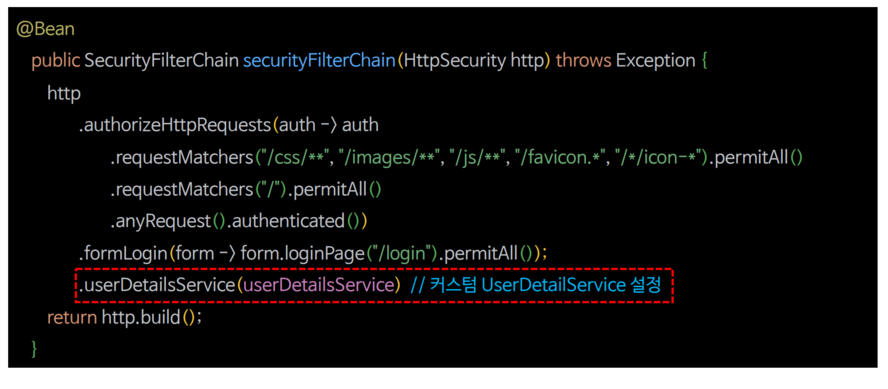
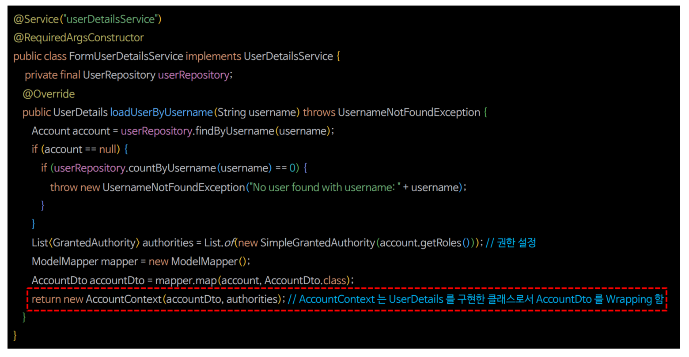

# *UserDetailsService 설정*



# ***UserDetailsService 구현***



# *구현*

***AccountContext - implements UserDetails***

```java
@RequiredArgsConstructor
public class AccountContext implements UserDetails {
    private final AccountDto accountDto;
    private final List<GrantedAuthority> authorities;
    @Override
    public boolean isAccountNonExpired() {
        return true;
    }
    @Override
    public boolean isAccountNonLocked() {
        return true;
    }
    @Override
    public boolean isCredentialsNonExpired() {
        return true;
    }
    @Override
    public boolean isEnabled() {
        return true;
    }
    @Override
    public Collection<? extends GrantedAuthority> getAuthorities() {
        return authorities;
    }
    @Override
    public String getPassword() {
        return accountDto.getPassword();
    }
    @Override
    public String getUsername() {
        return accountDto.getUsername();
    }
}
```

***FormUserDetailsService - implements UserDetailsService***

```java
@Service
@RequiredArgsConstructor
public class FormUserDetailsService implements UserDetailsService {
    private final UserRepository userRepository;
    @Override
    public UserDetails loadUserByUsername(String username) throws UsernameNotFoundException {
        Account account = userRepository.findByUsername(username)
                .orElseThrow(() -> new UsernameNotFoundException("Cant find User with username" + username));

        List<GrantedAuthority> authorities = List.of(new SimpleGrantedAuthority(account.getRoles()));
        ModelMapper modelMapper = new ModelMapper();
        AccountDto accountDto = modelMapper.map(account, AccountDto.class);

        return new AccountContext(accountDto, authorities);
    }
}
```

***SecurityConfig***

```java
@EnableWebSecurity
@Configuration
@RequiredArgsConstructor
public class SecurityConfig {
    private final FormUserDetailsService userDetailsService;
    @Bean
    public SecurityFilterChain securityFilterChain(HttpSecurity http) throws Exception{
        http
                .authorizeHttpRequests(authorize -> authorize
                        .requestMatchers("/css/**", "/images/**",
                                "/js/**", "/favicon.*", "/*/icon/-*").permitAll()
                        .requestMatchers("/", "/signup").permitAll()
                        .anyRequest().authenticated())

                .userDetailsService(userDetailsService)
                .formLogin(form -> form.loginPage("/login").permitAll());

        return http.build();
    }
    
    @Bean
    public PasswordEncoder passwordEncoder(){
        return PasswordEncoderFactories.createDelegatingPasswordEncoder();
    }
}
```

- *`.userDetailsService(userDetailsService)`*  *→ customUserDetailsService 설정*

