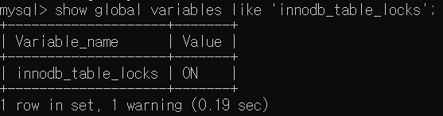
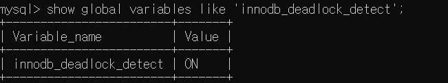
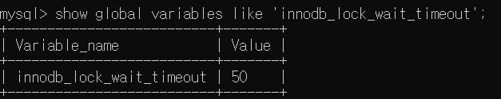
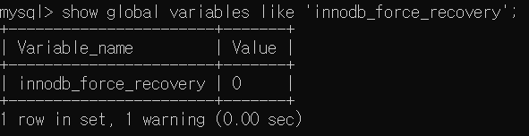
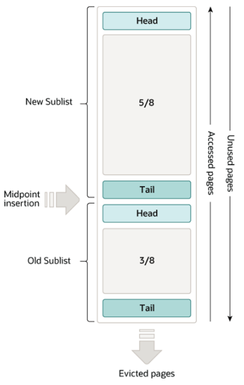

[https://20240228.tistory.com/401](https://20240228.tistory.com/401)

# ***참고 자료***

*RealMySQL 8.0 1권 - 백은빈, 이성욱 지음*

*해당 글은 책에서 나오는 내용을 나중에 편하게 보기 위해서 요약한 내용이다.*

# ***04장 아키텍처***

*MySQL 서버는 사람의 머리 역할을 하는 MySQL 엔진과 손발 역할을 담당하는 스토리지 엔진으로 구분할 수 있다.*

*스토리지 엔진은 핸들러 API를 만족하면 누구든지 스토리지 엔진을 구현해서 MySQL 서버에 추가해서 사용할 수 있다.*

*MySQL 엔진, MySQL 서버에서 기본으로 제공하는 InnoDB 스토리지 엔진,  MyISAM 스토리지 엔진에 대해서 알아보자*

# ***4.2 InnoDB 스토리지 엔진 아키텍처***

*InnoDB는 MySQL에서 사용할 수 있는 스토리지 엔진 중 거의 유일하게 레코드 기반의 잠금을 제공*

*그 때문에 높은 동시성 처리가 가능하며 안정적이고 성능이 뛰어나다.*


## ***4.2.1 프라이머리 키에 의한 클러스터링***

[*https://20240228.tistory.com/415*](https://20240228.tistory.com/415)

[*https://20240228.tistory.com/416*](https://20240228.tistory.com/416)

*InnoDB의 모든 테이블은 기본적으로 프라이머리 키를 기준으로 클러스터링되어 저장된다.*

*프라이머리 키 값의 순서대로 디스크에 저장된다는 뜻*

*모든 세컨더리 인덱스는 레코드의 주소 대신 프라이머리 키의 값을 논리적인 주소로 사용한다.*

*프라이머리 키가 클러스터링 인덱스이기 때문에 프라이머리 키를 이용한 레인지 스캔은 상당히 빨리 처리될 수 있다.*

→ *쿼리의 실행 계획에서 기본적으로 다른 보조 인덱스에 비해 비중이 높게 설정된다.*

***MyISAM 스토리지 엔진***

*MyISAM 스토리지 엔진은 클러스터링 키를 지원하지 않는다.*

*그래서 MyISAM 테이블에서는 프라이머리 키와 세컨더리 인덱스는 구조적인 차이가 없다.*

*프라이머리 키는 유니크 제약 조건이 걸린 세컨더리 인덱스와 똑같다.*

*MyISAM 테이블의 모든 인덱스(프라이머리 키 포함)는 물리적인 레코드의 주소(ROWID)를 가진다.*

## ***4.2.2 외래 키 지원***

*외래 키에 대한 지원은 InnoDB 스토리지 엔진 레벨에서 지원하는 기능이다.*

*MyISAM이나 MEMORY 테이블에서는 사용할 수 없다.*

*InnoDB에서 외래 키는 부모 테이블과 자식 테이블 모두 해당 칼럼에 인덱스 생성이 필요하다.*

*변경 시에는 반드시 부모 테이블이나 자식 테이블에 데이터가 있는지 체크하는 작업이 필요하므로 잠금이 여러 테이블로 전파되고, 그로 인해 데드락이 발생할 때가 많다. 주의하자!*

***외래 키 관계에 대한 체크 작업 ON/OFF***

*부모 테이블과 자식 테이블의 관계를 명확하게 파악해서 순서대로 작업하면 문제가 없지만 복잡한 경우 실패할 수 있다.*

*이런 경우* ***`foreign_key_checks`*** ***시스템 변수****를 off로 설정하면 외래 키 관계에 대한 체크 작업을 일시적으로 멈출 수 있다.*

*멈추면 레코드 적재나 삭제 등의 작업도 부가적인 체크가 필요 없기 때문에 훨씬 빠르게 처리할 수 있다.*

*참고: 체크 off면 외래 키 관계의 부모 테이블에 대한 작업(CASCADE) 옵션도 무시하게 된다.*

```sql
SET foreign_key_checks=OFF;

// 작업

SET foreign_key_checks=ON;
```

*외래 키 체크를 일시적으로 해제하고 작업을 처리한 이후 일관성을 맞춰준 후 꼭 다시 외래 키 체크 기능을 활성화 하자*

***foreign_key_checks 시스템 변수***

*적용 범위를 GLOBAL, SESSION 모두로 설정 가능한 변수다.*

*생략하면 SESSION 이다.*

```sql
// 동일한 SESSION 범위로 적용
SET foreign_key_checks=OFF;
SET SESSION foreign_key_checks=OFF;
```

*작업이 완료되면 반드시 현재 세션을 종료하거나 현재 세션의 외래 키 체크를 다시 활성화 하자*

## ***4.2.3 MVCC(Multi Version Concurrency Control)***

*일반적으로 레코드 레벨의 트랜잭션을 지원하는 DBMS가 제공하는 기능이다.*

*MVCC의 가장 큰 목적은 잠금을 사용하지 않는 일관적 읽기를 제공하는 데 있다.*

*InnoDB는 언두 로그 (Undo log)를 이용해 이 기능을 구현한다.*

### ***MySQL 서버 InnoDB MVCC 예제***

```sql
 create table member (
     m_id int not null,
     m_name varchar(20) not null,
     m_area varchar(100) not null,
     primary key (m_id),
     index ix_area (m_area)
 );
```

***트랜잭션 격리 레벨 조회*** 

```sql
SELECT @@transaction_isolation;
```

*해당 결과가* ***READ_COMMITTED*** *레벨이면 다음 작업은 필요 없다.*

- *트랜잭션 레벨 변경하기*

```sql
SET SESSION TRANSACTION ISOLATION LEVEL READ COMMITTED; // 현재 세션

SET GLOBAL TRANSACTION ISOLATION LEVEL READ COMMITTED;  // 전체
```

***데이터 삽입***

```sql
 INSERT INTO member values(12, '홍길동', '서울');
```


*INSERT 문이 실행되면 데이터베이스의 상태는 아래와 같은 상태이다.*


```sql
UPDATE member SET m_area='경기' WHERE m_area='서울';
```


*UPDATE 문장이 실행되면 커밋 실행 여부와 관계없이 InnoDB 버퍼 풀은 새로운 값인 '경기'로 업데이트 된다.*

*디스크의 데이터 파일은 체크포인트나 InnoDB의 Write 스레드에 의해 업데이트돼 있을 수도 있고 아닐 수도 있다. (InnoDB는* ***ACID****를 보장하기 때문에 일반적으로 InnoDB 버퍼 풀과 데이터 파일은 동일한 상태라고 가정해도 무방하다)*

[*https://20240228.tistory.com/406*](https://20240228.tistory.com/406)

[*https://velog.io/@qkrtkdwns3410/%EC%96%B8%EB%91%90%EB%A1%9C%EA%B7%B8-vs-%EB%A6%AC%EB%91%90-%EB%A1%9C%EA%B7%B8*](https://velog.io/@qkrtkdwns3410/%EC%96%B8%EB%91%90%EB%A1%9C%EA%B7%B8-vs-%EB%A6%AC%EB%91%90-%EB%A1%9C%EA%B7%B8)

*아직 COMMIT이나 ROLLBACK 되지 않은 상태에서* ***다른 사용자가*** *다음 쿼리로 작업 중인 레코드를 조회하면 어디에 있는 데이터를 조회할까?*

```sql
SELECT * FROM MEMBER WHERE m_id = 12;
```

*이 질문의 답은 MySQL 서버의 격리 수준에 따라 다르다는 것이다.*

***READ_UNCOMMITED****인 경우는 InnoDB 버퍼 풀이 현재 가지고 있는 변경된 데이터를 읽어서 반환한다.*

*그렇지 않고* ***READ_COMMITTED*** *레벨이나 그 이상의 격리 수준이면 아직 커밋되지 않았기 때문에 변경되기 이전의 내용을 보관하고 있는* ***언두 영역의 데이터****를 반환한다.*

→ '서울'을 반환한다.

*이러한 과정을 DBMS에서는* ***MVCC****라고 표현한다.*

*즉, 하나의 레코드(회원 번호 = 12)에 대해 2개의 버전이 유지되고, 필요에 따라 어느 데이터가 보여지는지 여러 가지 상황에 따라 달라지는 구조다.*

*여기서는 1개의 데이터만 가지고 설명했지만 관리해야 하는 예전 버전의 데이터는 무한히 많아질 수 있다.*

***COMMIT 실행***

*InnoDB는 더 이상의 변경 작업 없이 지금의 상태를 영구적인 상태로 만들어 버린다.*

***ROLLBACK 실행***

*InnoDB는 언두 영역에 있는 백업된 데이터를 InnoDB 버퍼 풀로 다시 복귀하고, 언두 영역의 내용을 삭제해버린다.*

*커밋이 된다고 언두 영역의 백업 데이터가 항상 바로 삭제되는 것은 아니다.*

*이 언두 영역을 필요로 하는 트랜잭션이 더는 필요 없을 때 삭제된다.*

## ***4.2.4 잠금 없는 일관된 읽기 (Non-Locking Consistent Read)***

*InnoDB 스토리지 엔진은 MVCC 기술을 이용해 잠금을 걸지 않고 읽기 작업을 수행한다.*

*잠금을 걸지 않기 때문에 InnoDB에서 읽기 작업은 다른 트랜잭션이 가지고 있는 잠금을 기다리지 않고, 읽기 작업이 가능하다.*

*격리 수준이 SERIALIZABLE을 제외하고 나머지 3개의 읽기 작업은 바로 실행된다.*


*특정 사용자가 레코드를 변경(Update)하고 커밋을 수행하지 않았다 하더라도 해당 변경 트랜잭션이 다른 사용자의 SELECT 작업을 방해하지 않는다. → Non-Locking Consistent Read*

*READ_UNCOMMITTED 레벨은 InnoDB 버퍼 풀에서 READ_COMMITTED & REPEATABLE 레벨은 언두 로그에서 읽는다.*

## *4.2.5 자동 데드락 감지*

*InnoDB 스토리지 엔진은 잠금이 교착 상태에 빠지지 않았는지 체크하기 위해* ***잠금 대기 목록을***

***그래프 형태로 관리****한다.* 

*InnoDB 스토리지 엔진은* ***데드락 감지 스레드****를 가지고 있고 해당 스레드가 잠금 대기 그래프를 검사해 교착상태에 빠진 트랜잭션을 찾고 그중 하나를 강제 종료한다.* 

***그렇다면 어떤 기준으로 트랜잭션을 강제 종료할까?***

*언두 로그 양을 기준으로 한다. 언두 로그 레코드를 적게 가진 트랜잭션은 롤백을 해도 언두 처리할 내용이 적다. → 트랜잭션 강제 롤백으로 인한 MySQL 서버 부하가 적다.* 

***테이블 잠금(LOCK TABLES)****은 MySQL 엔진에서 관리한다.* 

*그래서 InnoDB 스토리지 엔진은 테이블 잠금을 볼 수 없다. → 데드락 감지가 불확실* 

*`innodb_table_locks`* *시스템 변수를 활성화하면 InnoDB 스토리지 엔진 레코드 잠금뿐만 아니라 테이블 레벨의 잠금까지 감지할 수 있게 된다. → 특별한 이유가 없다면 활성화* 

```sql
SHOW GLOBAL VARIABLES LIKE 'innodb_table_locks';
```



  - *default: activate* 

*일반적인 상황에서는 데드락 감지 스레드가 데드락을 찾아내는 작업은 서버에 부담을 주지 않는다.*

*하지만 동시 처리 스레드가 많아지거나 각 트랜잭션이 가진 잠금이 많아지먄 데드락 감지 스레드가 느려진다.* 

*데드락 감지 스레드가 느려지면 서비스 쿼리를 처리 중인 스레드는 더는 작업을 진행하지 못하고 대기하면서 서비스에 악영향을 미친다.* 

*PK / Secondary Index 기반으로 매우 높은 동시성 처리를 요구하는 서비스가 있다면* 

***`innodb_deadlock_detect`*** *시스템 변수 off 설정을 고려하자* 

```sql
SHOW GLOBAL VARIABLES LIKE 'innodb_deadlock_detect';
```



  - *default: ON*

*그럼 데드락 상황에 대한 대처는 어떻게 할 것인가?* 

*→* ***`innodb_lock_wait_timeout`*** *시스템 변수를 통해서 요청 실패를 유도한다* 

*innodb_lock_wait_timeout는 기본값이 50초다 → 훨씬 낮은 시간으로 변경해서 사용하자* 

```sql
SHOW GLOBAL VARIABLES LIKE 'innodb_lock_wait_timeout';
```



  - *default: 50s*

## *4.2.6 자동화된 장애 복구* 

*InnoDB 스토리지 엔진은 매우 견고해서 데이터 파일이 손상되거나 MySQL 서버가 시작되지 못하는 경우는 거의 발생하지 않는다.* 

*MySQL 서버와 무관하게 디스크나 서버 하드웨어 이슈로 InnoDB 스토리지 엔진이 자동으로 복구를 하지 못 하는 경우가 발생할 수 있다.* 

*기본적으로  MySQL 서버가 시작될 때 InnoDB 데이터 파일은 자동 복구를 수행한다.* 

*만약 복구할 수 없는 손상이 있다면 MySQL 서버는 종료돼 버린다.* 

*이때는* *`innodb_force_recovery`* *시스템 변수를 설정해서 MySQL 서버를 시작해야 한다.* 

*이 설정값은 InnoDB 스토리지 엔진이 데이터 파일이나 로그 파일의 손상 여부 검사 과정을 선별적으로 진행할 수 있게 한다.* 

  - *InnoDB 로그 파일이 손상 → 6으로 설정 재시작* 
  - *InnoDB 데이터 파일이 손상 → 1로 설정 재시작* 
  - *어떤 문제인지 파악 불가능 → 1 ~ 6 차례대로 설정하고 재시작* 

```sql
SHOW GLOBAL VARIABLES LIKE 'innodb_force_recovery';
```



 *시스템 변수의 설정값이 커질수록 데이터 손실 가능성은 커지고 복구 가능성이 작아진다.*

*`innodb_force_recovery`* *시스템 변수가 0이 아닌 (1~6)복구 모드에서는 SELECT 이외에 다른 쿼리는 실행이 불가능*

***만약 MySQL 서버가 기동되고 InnoDB 테이블이 인식된다면?***

***mysqldump(****MySQL 제공 백업 유틸리티****)****를 이용해서 데이터를 백업하고 해당 데이터로 다시 DB와 테이블을 생성하는 것을 추천*

## *4.2.7 InnoDB 버퍼 풀* 

*InnoDB 스토리지 엔진의 핵심* 

*디스크의 데이터 파일 / 인덱스 정보를 메모리에 캐시해 두는 공간* 

*쓰기 작업을 지연시켜 일괄 작업으로 처리할 수 있게 해주는 버퍼 역할도 한다.* 

***쓰기 작업 지연의 효과*** 

*애플리케이션에서 INSERT, UPDATE, DELETE처럼 데이터를 변경하는 쿼리는 데이터 파일의 이곳저곳에 위치한 레코드를 변경하기 때문에 랜덤한 디스크 작업을 발생시킨다.* 

*하지만 버퍼 풀이 이러한 변경된 데이터를 모아서 처리하면 랜덤한 디스크 작업의 횟수를 줄일 수 있다.* 

*→ 디스크 작업은 오래 걸리는 작업 (메모리에 비해 엄청 느리다)*

*→ 디스크에 저장된 레코드들은 배열처럼 물리적으로 연속된 공간에 저장되지 않을 수 있다. (랜덤성)*

*→ 모아서 처리하면 동일 블록 내의 데이터 변경 가능성이 늘어난다. → 작업 횟수가 내려간다.*

### *4.2.7.1 버퍼 풀의 크기 설정* 

*MySQL 서버 내에서 메모리를 필요로 하는 부분은 크게 없지만 특정 경우 레코드 버퍼가 많은 메모리를 사용하기도 한다.* 

***레코드 버퍼****란 각 클라이언트 세션에서 테이블의 레코드를 읽고 쓸 때 버퍼로 사용하는 공간을 말한다. 커넥션이 많고 사용하는 테이블이 많다면 레코드 버퍼 공간이 많이 필요해진다.*

*MySQL 5.7 버전부터는 InnoDB 버퍼 풀의 크기를 동적으로 조절할 수 있게 개선했다.*

*버퍼 풀의 크기를 줄이는 작업은 서비스에 영향도가 크지만 크기를 늘리는 작업은 서비스에 영향이 적기 때문에 크기를 작은 값으로 설정해서 상태를 체크하면서 증가시키는 방법이 최적이다.*

***크기 설정 - 책에서 권장하는 방법***

*운영체제 메모리 공간 8GB 미만 → 50% 정도만 InnoDB 버퍼 풀로 설정* 

*메모리 전체 공간이 8GB 이상 → 50% 설정 이후 조금씩 올려서 최적점 찾기*

*운영체제 메모리 공간 50GB 이상 → 15 ~ 30 GB 다른 응용 프로그램 + 운영체제를 위해 남겨두고 나머지는 InnoDB 버퍼 풀 공간으로 활용* 

***어떻게 크기 변경?***

*`innodb_buffer_pool_size`* *시스템 변수로 크기를 설정할 수 있다.*

*InnoDB 버퍼 풀의 크기는 128MB 청크 단위이다. → 크기를 줄이거나 늘릴 때 128MB 단위로 처리* 

*꼭 메뉴얼을 참고하고 진행하자*

```sql
 SHOW GLOBAL VARIABLES LIKE 'innodb_buffer_pool_size';
```


### *4.2.7.2 버퍼 풀의 구조* 

*lnnoDB 스토리지 엔진은 버퍼 풀 공간을 설정된 페이지 크기(**`innodb_page_size`* *시스템 변수)조각으로 쪼개어서 데이터가 필요할 때 해당 데이터 페이지를 읽어서 각 조각에 저장한다.*

*버퍼 풀의 페이지 크기 조각을 관리하기 위해* ***LRU****(Least Recently Used)리스트,* ***플러시****(Flush) 리스트,* ***프리****(Free) 리스트 이렇게 3개의 자료 구조로 관리한다.*

***프리(Free)리스트*** 

*사용자의 쿼리가 새롭게 디스크의 데이터 페이지를 읽어와야 하는 경우 사용* 

***LRU 리스트***



*LRU 리스트는 LRU(Least Recently Used) + MRU(Most Recently Used) 2개의 리스트가 결합된 형태이다. Old Sublist가 LRU, New Sublist가 MRU에 해당한다.* 

***InnoDB 스토리지 엔진에서 데이터를 찾는 과정*** ⭐⭐


***1.*** *필요한 레코드가 저장된 데이터 페이지가 버퍼 풀에 있는지 검사* 

  - *InnoDB 어댑티브 해시 인덱스를 통해 페이지를 검사* 
  - *해당 테이블의 인덱스(B-Tree)를 이용해 버퍼 풀에서 페이지를 검사* 
  - *버퍼 풀에 이미 데이터 페이지가 있었다면 해당 페이지의 포인터를 MRU 방향으로 승급*

***2.*** *디스크에서 필요한 데이터 페이지를 버퍼 풀에 적재하고, 적재된 페이지에 대한 포인트를 LRU 헤더 부분에 추가한다*

***3.*** *버퍼 풀의 LRU 헤더 부분에 적재된 데이터가 실제로 읽히면 MRU 헤더 부분으로 이동한다* 

***4.*** *버퍼 풀에 상주하는 데이터 페이지는 사용자 쿼리가 얼마나 최근에 접근했는지에 따라 나이가 부여되며 버퍼 풀에 상주하는 동안 쿼리에서 오랫동안 사용되지 않으면 데이터 페이지에 부여된 나이가 오래되고 결국 해당 페이지는 버퍼 풀에서 제거된다****(Eviction)*** *버퍼 풀의 데이터 페이지가 쿼리에 의해 사용되면 다시 나이가 젊어지고 MRU의 헤더 부분으로 옮겨진다* 

***5.*** *필요한 데이터가 자주 접근됐다면 해당 페이지의 인덱스 키를 어댑티브 해시 인덱스에 추가*

*버퍼 풀의 공간이 가득 차면 마치 우선순위 큐처럼 나이가 많은 데이터 페이지를 제거한다.*

*간단하게 정리하면 자주 사용하는 데이터 페이지는 MRU 영역에서 계속 살아있고, 반대의 경우 LRU 끝으로 밀려나 결국은 InnoDB 버퍼 풀에서 제거될 것이다.*

***플러쉬(Flush)리스트*** 

*디스크로 아직 동기화되지 않은 데이터를 가진 데이터 페이지(더티 페이지)의 변경 시점 기준의 페이지 목록을 관리한다.*

*디스크에서 읽은 상태에서 전혀 변경이 없다면 플러시 리스트에 관리되지 않지만, 데이터 변경이 가해진 데이터 페이지는 플러시 리스트에 관리되고 특정 시점이 되면 디스크에 기록돼야 한다.* 

*데이터가 변경되면 InnoDB는 변경 내용을 리두 로그에 기록하고 버퍼 풀의 데이터 페이지에도 변경을 반영한다.* 

*리드 로그가 디스크에 기록됐다고 해서 데이터 페이지가 디스크로 기록됐다는 것을 항상 보장하지 않는다. 때로는 그 반대의 경우도 발생할 수 있는데*

*InnoDB 스토리지 엔진은 체크포인트를 발생시켜 디스크의 리두 로그와 데이터 페이지를 동기화 한다.*

*MySQL 서버가 시작될 때 InnoDB 스토리지 엔진은 리두 로그를 어느 부분부터 복구를 실행해야 할지 판단하는 기준점으로 삼는다.*

### *4.2.7.3 버퍼 풀과 리두 로그* 

*InnoDB 버퍼 풀은 DB 성능 향상을 위해서* ***데이터 캐시****와* ***쓰기 버퍼링****이라는 2가지 용도가 있다.*

*버퍼 풀의 메모리 공간을 단순히 늘리는 것은 데이터 캐시 기능만 향상시키는 것이다.* 

*InnobDB 버퍼 풀의 쓰기 버퍼링 기능까지 향상 시키려면 InnoDB 버퍼 풀과 리두 로그와의 관계를 먼저 이해해야 한다.* 


*InnoDB 버퍼 풀은 디스크에서 읽은 상태로 전혀 변경되지 않은 클린 페이지(Clean Page)와* 

*변경된 데이터를 가진 더티 페이지(Dirty Page)를 가지고 있다.* 

*리두 로그 파일의 공간은 계속 순환하면서 재사용 되기 때문에, 기록될 때마다 고유 번호인* ***LSN(Log Sequence Number)****가 증가한다.*

*더티 페이지는 디스크와 데이터 상태가 다르기 때문에 언젠가 동기화가 필요하다.* 

*버퍼 풀의 더티 페이지는 특정 리두 로그 공간과 1:1로 관계를 가지면서 체크포인트 이벤트가 발생하면 체크포인트의 LSN 보다 작은 리두 로그 엔트리와 관련된 더티 페이지는 모두 디스크로 동기화 시킨다.*

*이처럼 메모리에서만 변경 작업이 일어나다가, 체크 포인트 이벤트 발생 시점에 한번에 디스크로 반영되므로* ***쓰기 버퍼링****이라고 한다.*

***리두 로그의 적당한 크기?***

*당연히 버퍼 풀보다는 작은 크기를 가져야 한다. 버퍼 풀은 전체 데이터(캐싱된 데이터)를 갖고* 

*리두 로그는 버퍼 풀의 데이터에서 변경된 데이터(Dirty Page)만 가지기 때문이다.* 

*하지만 리두 로그가 너무 크면 특정 체크포인트에서 많은 Diry Page가 동시에 디스크로 I/O 작업이 일어나기 때문에 적당한 크기로 하는 게 좋다.* 

*책에서는 100GB 이하의 MySQL 서버에서는 리두 로그 파일의 전체 크기를 5 ~ 10 GB 수준으로 선택하고 필요할 때마다 조금씩 늘려가면서 최적값을 찾는 것을 추천한다.*

### *4.2.7.4 버퍼 풀 플러시(Buffer Pool Flush)*

*InnoDB 스토리지 엔진은 아직 디스크로 기록되지 않은 더티 페이지들을 성능상의 악영향 없이 디스크에 동기화하기 위해* ***플러시 리스트 플러시****,* ***LRU 리스트 플러시*** *2개의 플러시 기능을 백그라운드로 실행한다.* 

***플러시 리스트 플러시***

*InnoDB는 리두 로그 공간의 재활용을 위해 리두 공간을 비워야 한다.* 

*이때 반드시 InnoDB 버퍼 풀의 더티 페이지가 먼저 디스크로 동기화돼야 한다.*

*이를 위해 InnoDB는 주기적으로 플러시 리스트의 플러시 함수를 호출해서 변경 순서대로 디스크에 동기화 작업을 수행한다.* 

*이때 얼마나 많은 더티 페이지를 디스크로 I/O 작업을 하냐에 따라 사용자의 쿼리 처리가 달라진다.*

*이를 위해 제공되는 시스템 변수들* 

  - *`innodb_page_cleaners`* 
- *Cleaner 스레드: 더티 페이지를 디스크로 동기화하는 스레드*
    - *해당 변수는 Cleaner 스레드의 개수를 조정한다.* 
    - *하나의 클리너 스레드가 1개의 버퍼 풀 인스턴스를 처리하는게 이상적이다.*
    - *`innodb_page_cleaners`* *=* *`innodb_buffer_pool_instances`* *이렇게 설정하자*
  - *`innodb_max_dirty_pages_pct_lwm`* 
- *`innodb_io_capacity`* *기준에 따라서 더티 페이지 쓰기를 실행하지만 디스크에 기록되는 더티페이지 보다 더 많은 더티 페이지가 발생하면 버버 풀에 적재되는 더티 페이지가 계속 증가한다.* 
    - *그러다가 90%가 넘어가면 스토리지 엔진은 급작스럽게 디스크로 쓰기 작업을 해야한다고 판단한다. 그러다가* *디스크 쓰기 폭팔(Disk IO Burst)* *현상이 일어난다.* 
    - *이를 막기 위해 일정 수준 이상의 더티 페이지가 발생하면 조금씩 더티 페이지를 디스크로 기록하게 하는데 이때 사용하는 변수이다.* 
    - *기본값은 10%지만 디스크 쓰기 횟수를 줄이고 싶다면 조금 더 높이자.*
  - *`innodb_max_dirty_pages_pct`* 
- *버버풀이 가지는 더티 페이지의 비율을 설정* 
    - *일반적으로 버버 풀이 더티 페이지를 많이 가지고 있을수록 디스크 쓰기 작업을 버퍼링함으로써 여러 번의 디스크 쓰기를 한 번으로 줄이는 효과를 극대화가 가능하다.*
    - *그래서 책은 기본값을 추천한다.* 
    - *주의점: 버버 풀에 너무 많은 더티 페이지가 있으면* *디스크 쓰기 폭팔(Disk IO Burst)**현상이 발생할 수 있다.*
  - *`innodb_io_capacity`* 
- *더티 페이지를 디스크에 쓰기를 하는 기준 변수*
  - *`innodb_io_capacity_max`* 
- *디스크가 최대의 성능을 발휘할 때 어느 정도의 디스크의 읽고 쓰기가 가능한지를 설정*
  - *`innodb_flish_neighbors`* 
- *default: false*
    - *더지 페이지를 디스크에 기록할 때 디스크에 근접한 페이지 중에서 더티 페이지가 있다면 묶어서 기록하게 해주는 기능을 활성화 결정* 
    - *하드 디스크(HDD) → ON / 솔리드 스테이트 디스크(SSD) → OFF*
  - *`innodb_adaptive_flushing`* 
- *어댑티프 플러시 기능 on/off 사용 변수* 
    - *default: on*
  - *`innodb_adaptive_flushing_lwm`* 
- *default: 10%*
    - *어댑티브 플러시 알고리즘 활성화 기준점*

***어댑티브 플러시 알고리즘***

*리두 로그의 증가 속도를 분석해서 적절한 수준의 더티 페이지가 버퍼 풀에서 유지될 수 있도록* 

*디스크 쓰기를 실행한다.* 

***LRU 리스트 플러시*** 

*LRU 리스트에서 사용 빈도가 낮은 데이터 페이지를 제거해서 공간을 생성한다.*

*이때 LRU 리스트 플러시 함수를 사용하고* *`innodb_lru_scan_depth`* *시스템 변수에 설정된 개수만큼 페이지를 끝에서부터(가장 오래된) 스캔한다.* 

*더티 페이지는 디스크에 동기화하고 클린 페이지는 프리 리스트로 옮긴다.*

### *4.2.7.5 버퍼 풀 상태 백업 및 복구* 

*쿼리 요청이 빈번한 서버를 셧다운햇다가 다시 시작하면 서비스를 시작하면 쿼리 처리 성능이 매우 떨어진다. → 버퍼 풀에 캐싱된 데이터 페이지가 없기 때문*

*디스크의 데이터가 버퍼 풀에 적재돼 있는 상태를 워밍업(Warming up)이라고 표현한다.* 

***MySQL 5.6 버전 버퍼 풀 덤프 및 적재 기능 탑재 p118,p119***

*서버 점검/기타 작업을 위해 서버를 재시작해야 하는 경우 MySQL 서버를 셧다운하기 전에* *`innodb_buffer_pool_dumb_now`* *시스템 변수를 이용해 현재 InnoDB 버버 풀의 상태를 백업할 수 있다.*

*다시 시작하면* *`innodb_buffer_pool_load_now`* *시스템 변수를 이용해 백업된 버퍼 풀의 상태를 다시 복구할 수 있다.*

*버퍼 풀의 백업은 버퍼 풀의 크기가 커도 빠르게 완료된다.*

*→ LRU 리스트에 적재된 데이터 페이지의 메타 정보만 저장하기 때문* 

*백업된 버퍼 풀의 내용을 다시 버퍼 풀로 복구하는 작업은 버퍼 풀의 크기에 따라 상당한 시간이 소요 → 백업된 메타 정보를 기반으로 디스크 I/O 작업을 하기 때문이다.* 

*버퍼 풀 복구 작업 진행 확인 방법*

```sql
SHOW STATUS LIKE 'Innodb_buffer_pool_dump_status'\G
```

*버퍼 풀 복구 작업 중단 방법*

```sql
SET GOLBAL innodb_buffer_pool_load_abort=ON;
```

*정리*

*MySQL 서버를 재시작하고 버퍼 풀 복구 작업이 끝나고 서비스를 시작하자* 

*디스크의 많은 데이터가 버퍼풀로 저장되면 많은 부하가 일어난다.*

### *4.2.7.6 버퍼 풀의 적재 내용 확인 p119, p120 참고*

***information_schema 데이터베이스에 innodb_cached_indexes 테이블*** 

  - *테이블의 인덱스별로 데이터 페이지가 얼마나 InnoDB 버퍼 풀에 적재돼 있는지 확인할 수 있다.*

## *4.2.8 Double Write Buffer*

***파셜 페이지(Partial-page) 톤 페이지(Torn-page) 현상***

*InnoDB 스토리지 엔진이 더티 페이지를 디스크 파일로 플러시 할 때 하드웨어 오작동이나 시스템 비정상 종료 등의 원인으로 일부만 기록되는 현상*

*InnoDB는 이런 문제를 막기 위해* ***Double Write*** *기법을 이용한다.* 


***시나리오*** 

*버퍼 풀에 있는 A~E 더티 페이지를 디스크로 플러시* 

*실제 데이터 파일에 변경을 기록하기 전에 A~E까지의 더티 페이지를 묶어서 한 번의 디스크 쓰기로* 

*시스템 테이블스페이스의 DoubleWrite 버퍼에 기록한다.* 

*이후 각 더티 페이지를 파일의 적당한 위치에 하나씩 랜덤으로 쓰기를 실행한다.* 

*Double Write 버퍼는 정상적으로 디스크에 기록되면 필요없는 공간이다.* 

*Double Write 버퍼의 내용은 디스크에 쓰기가 중간에 실패할 때만 사용된다.* 

*해당 기능의 활성화는* *`innodb_doublewrite`* *시스템 변수로 제어할 수 있다*. 

*HDD는 어차피 한 번의 순차 디스크 쓰기를 해서 부담이 없지만 SSD 처럼 랜덤 IO나 순차 IO의 비용이 비슷한 저장 시스템에서는 이는 부담스럽다.* 

*만약 데이터 무결성이 중요한 서비스면 활성화를 고려하자* 

*리두 로그 동기화 설정(**`innodb_flush_log_at_trx_commit`**)을 1이 아닌 값이라면 Double wrtie 또한 비활성화 하자* 

*→ 데이터 무결성이 중요하지 않은 서비스를 의미한다.*

***From InnoDB 버퍼 풀 (리두 로그 동기화 설정1, Double write 활성화)***

*Double write → 리두 로그 → 특정 시점 플러시 → 디스크 파일 쓰기*  

## *4.2.9 언두 로그* 

*InnoDB 스토리지 엔진은 트랜잭션과 격리 수준을 보장하기 위해 변경되기 이전 버전의 데이터를 별도로 백업한다.* 

*이렇게 백업된 데이터를* ***언두 로그(Undo Log)****라고 한다.* 

***트랜잭션 보장*** 

  - *트랜잭션이 롤백되면 트랜잭션 도중에 변경된 데이터를 복구해야 하는데, 이때 언두 로그에 백업해둔 데이터를 이용해 복구한다.* 

***격리 수준 보장*** 

  - *특정 커넥션에서 데이터를 변경하는 도중에 다른 커넥션에서 데이터를 조회하면 트랜잭션 격리 수준에 맞게 변경 중인 레코드를 읽지 않고 언두 로그에 백업해둔 데이터를 읽어서 반환하기도 한다. 이는 격리 수준에 따라 다르다.*

### *4.2.9.1 언두 로그 모니터링*

*언두 영역은 DML 쿼리로 인한 데이터 변경되기 전의 데이터를 보관하는 곳이다.* 

*언두 로그의 데이터는 크게 두 가지 용도로 사용된다.* 

  - ***트랜잭션 롤백 대비용*** 
  - ***트랜잭션의 격리 수준을 유지하면서 높은 동시성을 제공***

***언두 로그 모니터링의 중요성***

*만약 애플리케이션 서버에서 트랜잭션을 시작하고 하루 동안 닫지 않았다면?*

*하루 동안 진행된 모든 트랜잭션 데이터(변경된)가 언두 로그에 기록된다.* 

*그렇다면 언두 로그가 차지하는 사용 공간은 무한정 늘어난다.* 

*이는 트랜잭션의 Recoverability 특성 때문에 그렇다.* 

***언두 로그 건수 확인 방법***

```sql
SHOW ENGINE INNODB STATUS \G
```


*언두 로그의 급증 여부를 모니터링 하자!*

***주의*** 

*MySQL 서버에서 INSERT 문장으로 인한 언두 로그와 UPDATE, DELETE 문장으로 인한 언두 로그는 별도로 관리된다. UPDATE, DELETE 문장으로 인한 언두 로그는 MVCC, 데이터 복구(롤백)에 모두 사용되지만 INSERT 같은 경우 데이터 복구에만 사용되기 때문이다.* 

*즉, 예제에서 보인 언두 로그의 건수에는 UPDATE, DELETE 문장으로 인한 언두 로그 개수만 표시된다* 

### *4.2.9.2 언두 테이블스페이스 관리*

*언두 테이블 스페이스 → 언두 로그 저장되는 공간* 


*하나의 언두 테이블스페이스는 1 ≤ 롤백 세그먼트 ≤ 128 가진다.* 

*롤백 세그먼트는 1개 이상의 언두 슬롯을 가진다.* 

## ***4.2.10 체인지 버퍼*** 

*RDBMS에서는 레코드가 INSERT / UPDATE 될 때 데이터 파일을 변경하는 작업뿐 아니라* 

*해당 테이블에 포함된 인덱스를 업데이트하는 작업도 필요하다.*

*인덱스를 업데이트하는 작업은 디스크 I/O 작업이 필요하므로 테이블에 인덱스가 많다면 이 작업은 많은 자원을 소비하게 된다.* 

*그래서 InnoDB는 변경해야 할 인덱스 페이지가 버퍼 풀에 있으면 바로 업데이트를 수행하지만 디스크로부터 읽어와서 업데이트해야 한다면* ***임시 공간 체인지 버퍼(Change Buffer)****에 저장해 두고 바로* 

*사용자에게 반환하는 형태로 성능을 향상시킨다.*

*유니크 인덱스 같은 경우 중복 검사가 필요하기 때문에 체인제 버퍼를 사용할 수 없다.* 

*임시 저장된 인덱스 레코드 조각은 백그라운드 스레드인 체인지 버퍼 머지 스레드에 의해 병합된다.*

`innodb_change_buffering` 시스템 변수로 작업의 종류에 따라 체인지 버퍼를 활성화할 수 있다.

  - all: 모든 작업
  - none: 모든 작업 버퍼링 X
  - inserts: 인덱스에 새로운 아이템 추가하는 작업만 버퍼링 
  - deletes: 인덱스에 기존 아이템이 삭제됐다는 마킹 작업만 버퍼링 
  - changes: 인덱스에 추가하고 삭제하는 작업만(inserts + deletes) 버퍼링 
  - purges: 인덱스 아이템을 영구적으로 삭제하는 작업만 버퍼링(백그라운드 작업)

***체인지 버퍼의 크기 설정과 모니터링은 책 p130 참고하자*** 

## ***4.2.11 리두 로그와 로그 버퍼*** 

*리두 로그는 하드웨어나 소프트웨어 등 여러 가지 문제점으로 인해 MySQL 서버가* 

*비정상적으로 종료됐을 때 데이터 파일에 기록되지 못한 데이터를 잃지 않게 해주는 안전장치이다.* 

*보통 DBMS에서의 데이터 파일은 쓰기보다 읽기 성능을 고려한 자료 구조를 가진다.* 

*그래서 데이터 파일의 쓰기는 랜덤 엑세스가 필요하다.*  

*MySQL 서버는 쓰기 비용이 낮은 자료 구조를 가진 리두 로그를 가진다.*

*MySQL 서버가 비정상 종료되는 경우 두 가지 종류의 일관되지 않은 데이터를 가질 수 있다.*

  1. *커밋됐지만 데이터 파일에 기록되지 않은 데이터* 
  1. *롤백됐지만 데이터 파일에 이미 기록된 데이터* 

*1번은 리두 로그에 있는 데이터를 디스크에 복사하기만 하면 된다.*

*2번 같은 경우 언두 로그에 있는 데이터를 가져와서 데이터 파일에 복사하면 된다.* 

*이때 리두 로그는 해당 트랜잭션의 상태를 확인하기 위해 필요하다.*  

*리두 로그의 시스템 변수 설정은 책 페이지 131, 132를 참고하자* 

## ***4.2.12 어댑티브 해시 인덱스*** 

***어댑티브 해시 인덱스(Adaptive Hash Index)****는 MySQL의 InnoDB 스토리지 엔진에서 사용하는 성능 최적화 기능 중 하나로, 자주 참조되는 데이터에 대해 자동으로 해시 인덱스를 생성하여 쿼리 성능을 개선한다.* 

*`innodb_dapative_hasn_index`* *시스템 변수를 통해 활성화/비활성화* 

*해시 인덱스는* ***KEY: 인덱스 키 값****과* ***VALUE: 인덱스 키 값이 저장된 데이터 페이지의 주소****로 구성된다.*

*어댑티브 해시 인덱스는 B Tree에 비해서 디스크의 루프 노드부터 리프 노드까지의 탐색이 없기 때문에 팔망미인처럼 보이지만 의도적으로 비활성화하는 경우도 많다.* 

*어댑티브 해시 인덱스 또한 저장 공간인 메모리를 사용하고 상당히 큰 메모리 공간을 사용할 수 있다. 또한 활성화되면 어댑티브 해시 인덱스에 없는 인덱스여도 있든 없든 검색해봐야 한다는 것이다.* 

*즉, 효율이 떨어져도 InnoDB는 해시 인덱스를 사용한다.* 

*또한 어떤 테이블을 삭제/변경 하려고 하면 이 테이블이 가진 모든 데이터 페이지를 어댑티브 해시 인덱스에서 제거해야 한다.* 

*즉, DDL이 성능에 큰 영향을 준다.* 

*중요한점은  MySQL 서버의 상태를 계속 체크해야 한다는 점이다.*

*해당 내용은 P140 ~ 141 참고하자*

## *4.2.13 InnoDB VS Memory, MyISAM*

*MySQL 서버는 InnoDB 스토리지 엔진에 대한 성능 향상을 꾸준히 해왔으며, 다른 스토리지 엔진은 도태되었다.* 

*메모리 공간을 사용하는 Memory 스토리지 엔진은 강점이 있어 보일듯하지만 테이블 수준의 락만 제공하기 때문에 싱글 스레드 환경에서는 괜찮겠지만 대부분 애플리케이션 서비스가 그렇듯이 멀티 스레딩 환경에서는 InnoDB 스토리지 엔진의 레코드 수준의 락보다 성능이 떨어진다.*

