# 4.1.1 MySQL 전체 구조 

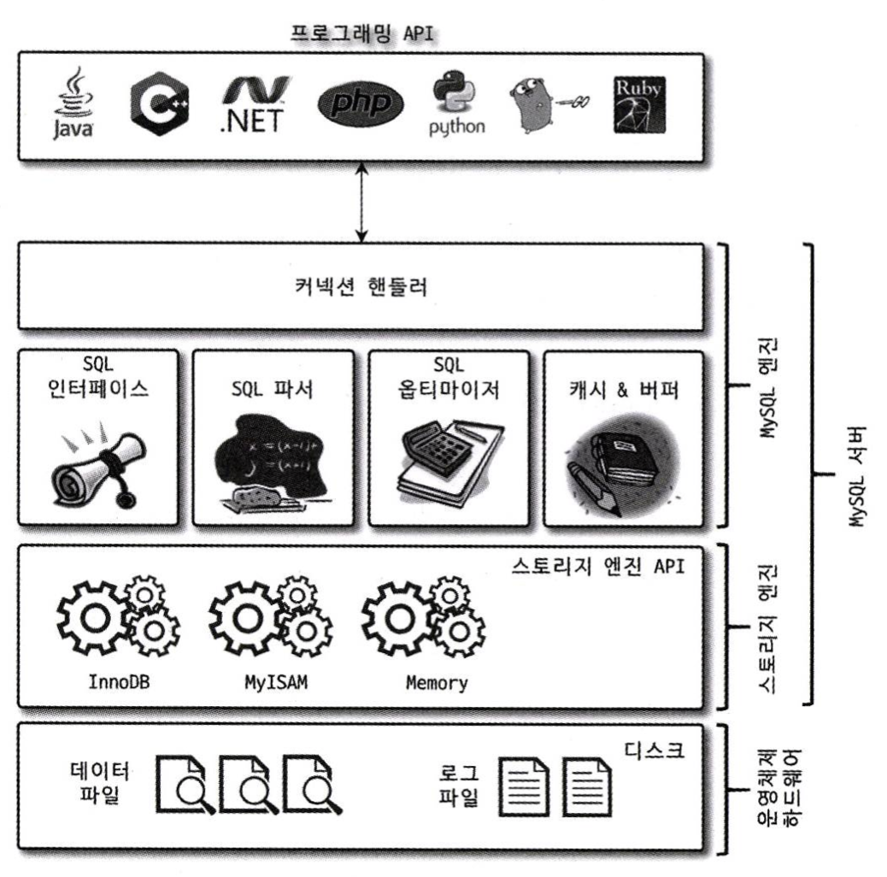

MySQL은 일반 사용 RDBMS와 같이 대부분의 프로그래밍 언어로부터 접근 방법을 모두 지원 

---

## 4.1.1.1 MySQL 엔진

**커넥션 핸들러 + (SQL 파서 및 처리기) + (옵티마이저) = MySQL 엔진** 

**커넥션 핸들러:** 클라이언트로부터 접속 및 쿼리 요청 처리

**옵티마이저:** 쿼리의 최적화된 실행

MySQL은 표준 SQL(ANSI SQL)문법을 지원

---

## 4.1.1.2 스토리지 엔진

MySQL 엔진은 요청된 SQL 문장을 분석하고 최적화하는 두뇌 역할

실제 데이터를 디스크 스토리지에 read/write 하는 부분은 스토리지 엔진이 전담

MySQL 서버에서 엔진은 하나지만 스토리지 엔진은 여러 개를 동시에 사용할 수 있다

**InnoDB 스토리지 엔진 사용 정의** 

```sql
mysql> CREATE TABLE test_table (fd1 INT, fd2 INT) ENGINE=INNODB;
```

테이블에 사용할 스토리지 엔진을 지정하면 이후 해당 테이블의 모든 read/write 작업은 정의된(InnoDB) 스토리지 엔진이 처리한다. 

각 스토리지 엔진은 성능 향상을 위해 키 캐시(MyISAM 스토리지 엔진)나 InnoDB 버퍼 풀(InnoDB 스토리지 엔진) 같은 기능을 내장한다. 

---

## 4.1.1.3 핸들러 API

MySQL 엔진의 쿼리 실행기에서 데이터 read/write 작업은 각 스토리지 엔진에 요청한다.

이러한 요청을 핸들러(Handler) 요청이라고 하고, 여기서 사용되는 API를 핸들러 API라고 한다.

핸들러 API 조회를 통해 얼마나 많은 데이터 작업이 있었는지 확인할 수 있다. 

```sql
mysql> SHOW GLOBAL STATUS LIKE 'Handler%';
```

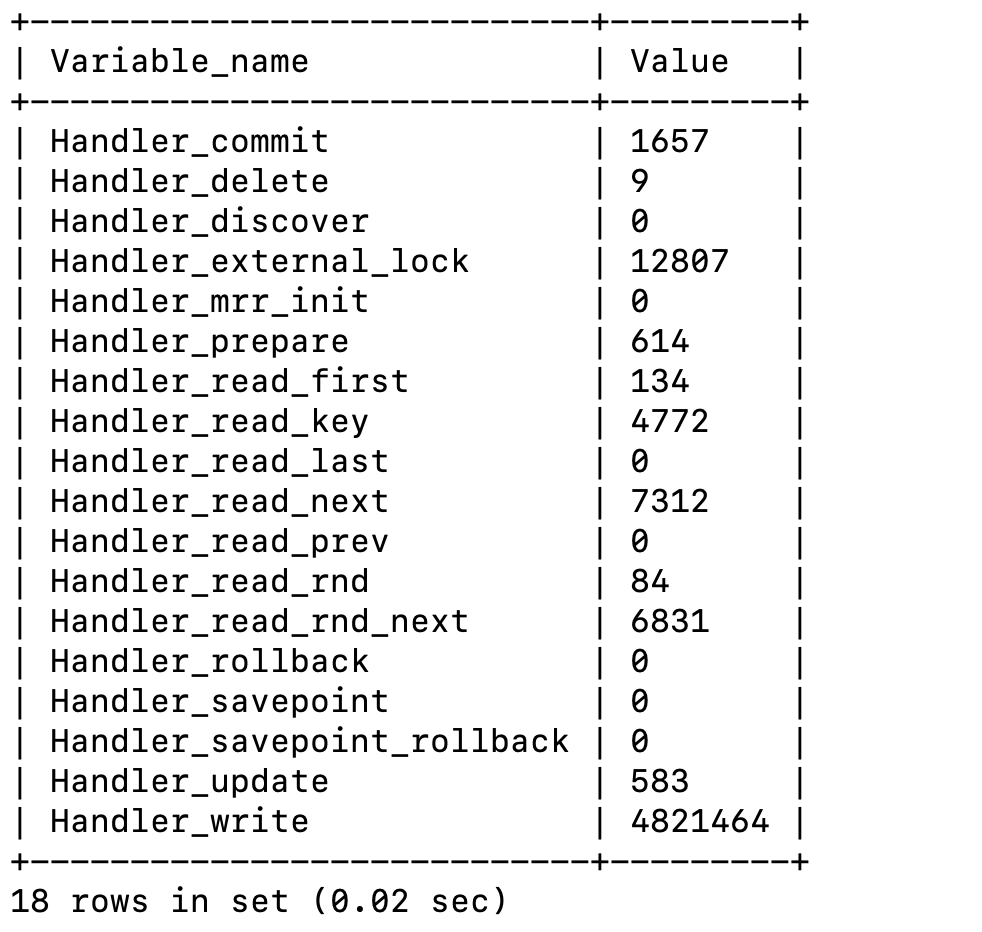

---

# 4.1.2 MySQL 스레딩 구조

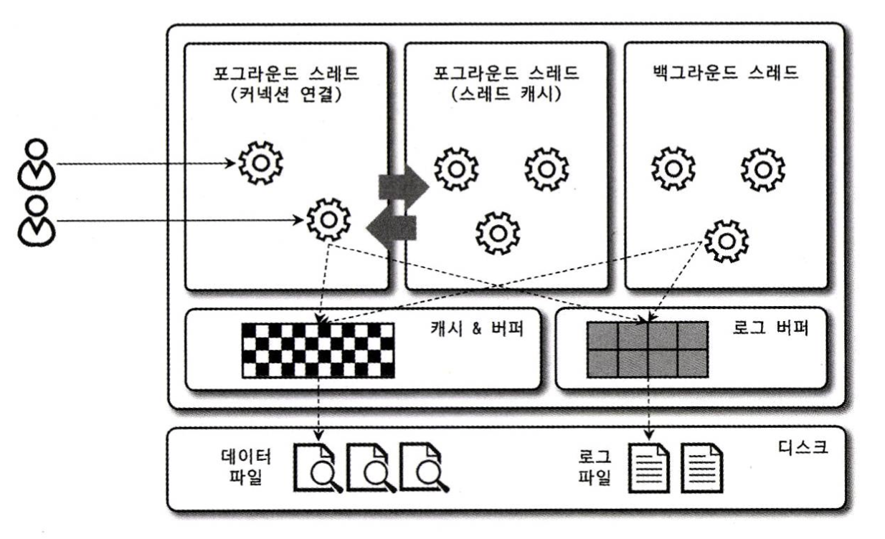

MySQL 서버는 스레드 기반으로 작동하고, **포그라운드 스레드**와 **백그라운드 스레드**로 구분할 수 있다.

MySQL 서버에서 실행 중인 스레드 목록은 **performance_schema** 데이터베이스의 **threads** 테이블을 통해 확인할 수 있다.

```sql
SELECT thread_id, name, type, processlist_user, processlist_host 
FROM performance_schema.threads 
ORDER BY type, thread_id;
```

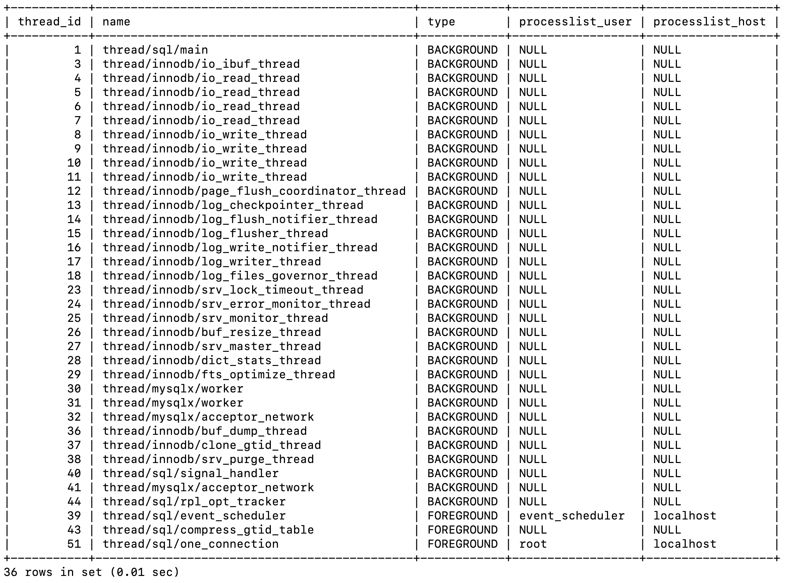

3개의 포그라운드 스레드가 존재하고 나머지는 백그라운드 스레드

**thread/sql/one_connection** 스레드만 실제 사용자의 요청을 처리하는 스레드다.

백그라운드 스레드의 개수는 서버 설정에 따라 가변적이다.

동일한 이름의 스레드가 2개 이상씩 보이는 것은 여러 스레드가 동일 작업을 병렬처리하는 경우

**참고** 

```
현재 설명은 MySQL 서버가 전통적으로 가지는 스레드 모델
즉, MySQL 커뮤니티 에디션에서 사용하는 모델이다.

MySQL 엔터프라이즈 에디션, Percona MySQL 서버에서는 스레드 풀 모델을 사용할 수 있다.

스레드 풀 vs 전통적인 스레드 모델
전통적인 스레드 모델은 커넥션별로 포그라운드 스레드가 하나씩 생성되고 할당된다.
스레드 풀은 커넥션과 포그라운드 스레드는 1:1 관계가 아니라 N:1 관계이다.
```

---

## 4.1.2.1 포그라운드 스레드(클라이언트 스레드)

포그라운드 스레드는 최소한 MySQL 서버에 접속된 클라이언트 수만큼 존재한다.

클라이언트가 작업을 마치고 커넥션을 종료하면 해당 스레드는 **스레드 캐시(Thread cache)**로 돌아간다.

이미 캐시에 일정 개수 이상의 대기 중인 스레드가 있으면 스레드 캐시에 넣지 않고 스레드를 종료시킨다.

스레드 캐시에 유지할 수 있는 최대 스레드 개수는 **thread_cache_size** 시스템 변수로 설정한다.

```sql
mysql> SHOW VARIABLES LIKE 'thread_cache_size';
```

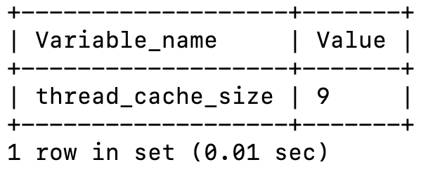

포그라운드 스레드는 데이터를 MySQL 데이터 버퍼나 캐시로부터 가져오며, 버퍼나 캐시에 없는 경우에는 

직접 디스크의 데이터나 인덱스 파일로부터 데이터를 읽는다.

MyISAM 테이블은 디스크 쓰기 작업까지 포그라운드 스레드가 처리한다.

InnoDB 테이블은 데이터 버퍼나 캐시까지만 포그라운드 스레드가 처리하고 디스크 쓰기 작업은 백그라운드 스레드가 처리한다. (지연된 쓰기)

---

## 4.1.2.2 백그라운드 스레드

InnoDB는 다음과 같이 여러 가지 작업이 백그라운드로 처리된다. 

- 인서트 버퍼(Insert Buffer)를 병합하는 스레드
- 로그를 디스크로 기록하는 스레드
- InnoDB 버퍼 풀의 데이터를 디스크에 기록하는 스레드
- 데이터를 버퍼로 읽어 오는 스레드
- 잠금이나 데드락을 모니터링하는 스레드

모두 중요한 역할이지만 가장 중요한 것은 **로그 스레드**와 버퍼의 데이터를 디스크에 기록하는 **쓰기 스레드**이다.

InnoDB에서도 데이터를 읽는 작업은 주로 클라이언트 스레드에서 동작하기 때문에 읽기 스레드(백그라운드 스레드)를 많이 설정할 필요 없지만 쓰기 스레드는 아주 많은 작업을 처리하기 때문에 일반적인 내장 디스크를 사용할 때는 2~4 정도, DAS나 SAN 같은 스토리지는 충분히 설정하는 것이 좋다.

사용자의 데이터 쓰기 작업은 지연되어 처리될 수 있지만 데이터의 읽기 작업은 지연될 수 없다. 

그래서 대부분의 RDBMS는 이런 쓰기 작업의 지연 처리를 지원하며 InnoDB 또한 이러한 방식으로 처리한다.

하지만 MyISAM에서는 사용자 스레드가 쓰기 작업까지 함께 처리하도록 설계돼 있다. 

→ 쓰기 버퍼링 기능을 사용 불가능

**innodb_write_io_threads, innodb_read_io_threads** 시스템 변수로 스레드의 개수를 설정한다.

```sql
 SHOW VARIABLES LIKE '%io_threads';
```

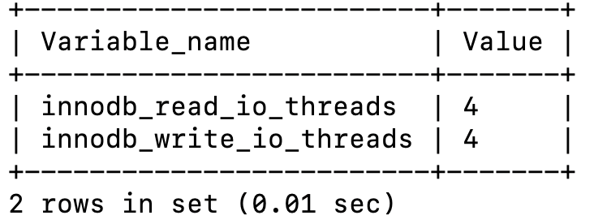

---

# 4.1.3 메모리 할당 및 사용 구조

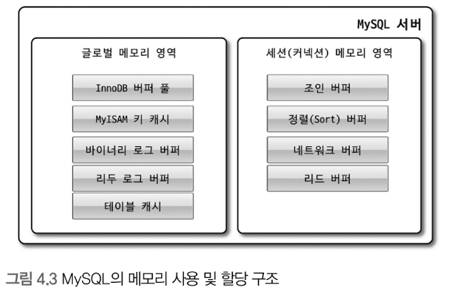

MySQL에서 사용되는 메모리 영역은 크게 글로벌 메모리 영역과 로컬 메모리 영역으로 구분된다. 

글로벌 메모리 영역과 로컬 메모리 영역은 스레드가 공유해서 사용하는 공간인지 여부에 따라 구분된다. 

---

## 4.1.3.1 글로벌 메모리 영역

일반적으로 클라이언트 스레드의 수와 무관하게 하나의 메모리 공간만 할당된다.

생성된 글로벌 영역이 N개라 하더라도 모든 스레드의 공유된다.

- 테이블 캐시
- InnoDB 버퍼 풀
- InnoDB 어댑티브 해시 인덱스
- InnoDB 리두 로그 버퍼

---

## 4.1.3.2 로컬 메모리 영역

MySQL 클라이언트 스레드가 쿼리를 처리하는 데 사용되는 메모리 영역이다.

대표적으로 커넥션(네트워크) 버퍼와 정렬 버퍼(소트) 등이 있다.

클라이언트가 MySQL 서버에 접속하면 클라이언트 커넥션으로부터 요청을 처리하기 위해 스레드를 하나씩 할당하게 되는데, 클라이언트 스레드가 사용하는 메모리 공간이라고 해서 **클라이언트 메모리 영역**이라고도 한다.

클라이언트와 MySQL 서버와의 커넥션을 세션이라고 하기 때문에 **세션 메모리 영역**이라고도 표현한다.

로컬 메모리는 스레드별로 독립적으로 할당되며 절대 공유되어 사용되지 않는다.

로컬 메모리 공간은 **커넥션 버퍼나 결과 버퍼** 같이 계속 할당된 상태로 남아있는 공간이 있고 **소트 버퍼나 조인 버퍼**처럼 쿼리를 실행하는 순간에만 할당했다가 다시 해제하는 공간이 있다.

**주의점** 

글로벌 메모리 영역의 크기는 주의해서 설정하지만 소트 버퍼 같은 로컬 메모리 영역은 크게 신경 쓰지 않고 설정한다. 최악의 경우 메모리 부족으로 멈춰 버릴 수도 있으니 적절한 메모리 공간을 설정하는 것이 중요하다.

---

# 4.1.4 플러그인 스토리지 엔진 모델

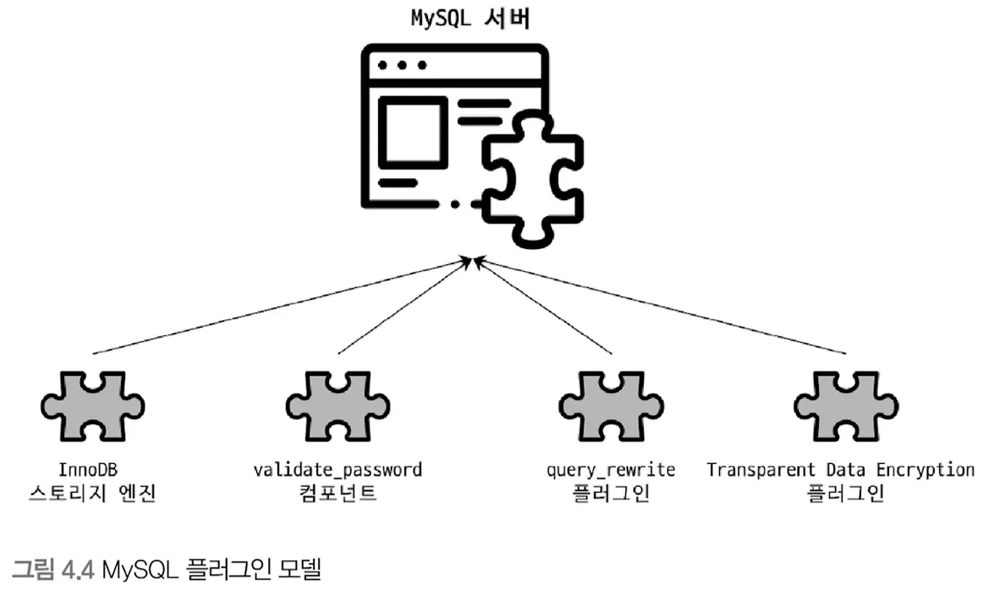

스토리지 엔진 플러그인 말고도 사용자 인증을 위한 플러그인을 포함하여 모두 플러그인으로 구현되어 제공된다. 

이런 플러그인(ex: 스토리지 엔진)은 기본적으로 많이 제공되지만 전문 개발 회사 또는 사용자가 직접 개발하여 사용할 수 있다.

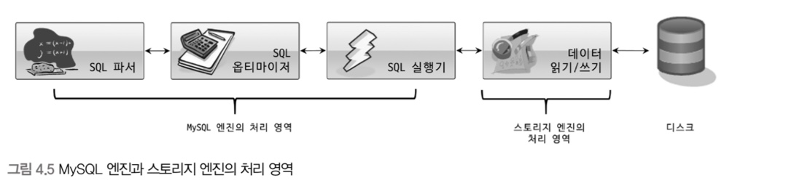

그림 4.5는 MySQL에서 쿼리가 실행되는 과정을 나타낸다.

대부분의 작업은 MySQL 엔진에서 처리되고, 마지막 데이터 읽기/쓰기 작업만 스토리지 엔진이 처리한다.

MySQL 서버에서 MySQL 엔진이 각 스토리지 엔진을 조정하기 위해 **핸들러**를 사용한다.

즉, 스토리지 엔진에게 데이터를 읽기/쓰기 하려면 반드시 **핸들러**를 통해야 한다.

MySQL에서 MyISAM이나 InnoDB 같이 다른 스토리지 엔진을 사용하는 테이블에 대해 쿼리를 실행하더라도 

MySQL의 처리 내용은 그림 4.5의 마지막 단계인 데이터 읽기/쓰기 영역의 처리만 차이가 있다.

GROUP BY, ORDER BY 같은 복잡한 처리는 스토리지 엔진이 아닌 MySQL 엔진에서 처리된다.

하지만 데이터 읽기/쓰기 영역의 처리 차이는 엄청나다.

**MySQL 서버에서 지원하는 스토리지 엔진** 

```sql
SHOW ENGINES;
```

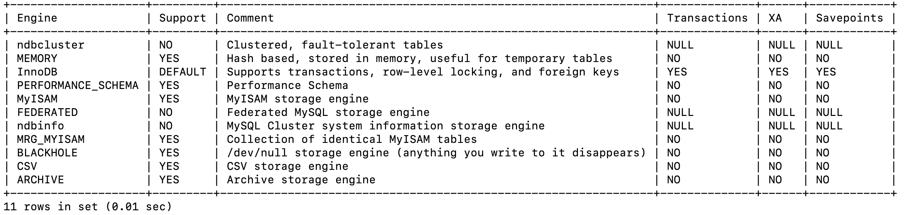

- **YES:** MySQL 서버에 스토리지 엔진 포함, 사용 가능으로 활성화 상태
- **DEFAULT:** YES + 필수 스토리지 엔진을 의미(없으면 서버 시작이 불가능)
- **NO:** MySQL 서버에 해당 스토리지 엔진이 포함 X
- **DISABLED:** 서버에 스토리지 엔진이 포함, 비활성화 상태

**MySQL 서버에서 지원하는 모든 플러그인(스토리지 엔진 포함)**

```sql
SHOW PLUGINS;
```

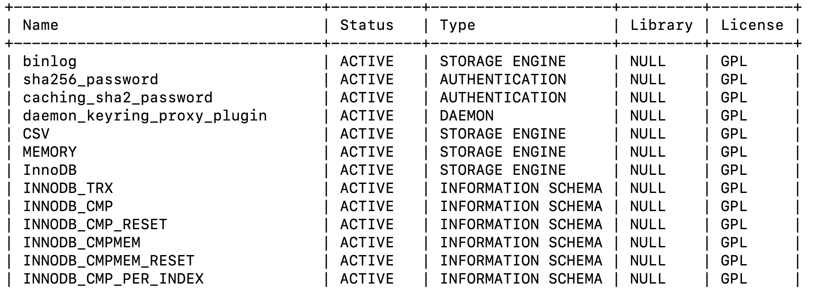

너무 많아서 생략

MySQL 서버에서는 스토리지 엔진뿐만 아니라 다양한 기능이 플러그인 형태로 지원한다. 

인증이나 전문 검색 파서 또는 쿼리 재작성, 비밀번호 검증, 커넥션 제어 등에 플러그인이 존재한다.

또한 MySQL 서버의 기능을 커스텀하게 확장할 수 있게 플러그인 API가 메뉴얼에 공개돼 있다.

---

# 4.1.5 컴포넌트

MySQL 8.0 부터는 기존의 플러그인 아키텍처를 대체하기 위해 컴포넌트 아키텍처가 지원된다.

플러그인 아키텍처의 단점은 다음과 같다. 

- 플러그인은 오직 MySQL 서버와 인터페이스할 수 있고, 플러그인끼리는 통신할 수 없다. 
- 플러그인은 MySQL 서버의 변수나 함수를 직접 호출하기 때문에 안전하지 않다(캡슐화 안 됨)
- 플러그인은 상호 의존 관계를 설정할 수 없어서 초기화가 어렵다

---

# 4.1.6 쿼리 실행 구조

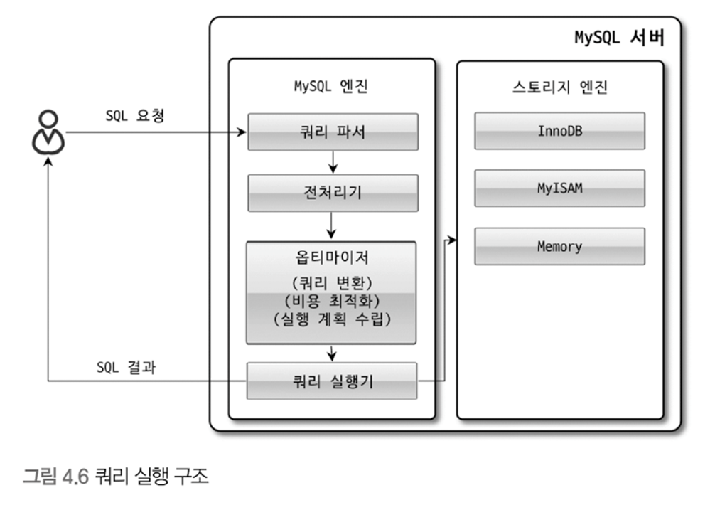

---

## 4.1.6.1 쿼리 파서

쿼리 파서는 사용자 요청으로 들어온 쿼리 문장을 **토큰(MySQL이 인식할 수 있는 최소 단위의 어휘나 기호)**으로 분리해 트리 형태의 구조로 만들어 내는 작업을 의미한다.

쿼리 문장의 기본 문법 오류는 이 과정에서 발견되고 사용자에게 오류 메시지를 전달하게 된다.

---

## 4.1.6.2 전처리기

쿼리 파서 과정에서 만들어진 파서 트리를 기반으로 쿼리 문장에 구조적인 문제점이 있는지 확인한다.

각 토큰을 테이블 이름이나 컬럼 이름, 내장 함수와 같은 객체를 매핑해 **해당 객체의 존재 여부**와 **객체의 접근 권한** 등을 확인하는 작업을 이 단계에서 수행한다.

---

## 4.1.6.3 옵티마이저

사용자의 요청으로 들어온 쿼리 문장을 어떻게 저렴한 비용으로 가장 빠르게 처리할지를 결정하는 역할을 담당한다

---

## 4.1.6.4 실행 엔진(쿼리 실행기)

**옵티마이저: 회사 경영진**

**실행 엔진: 중간 관리자**

**핸들러: 각 업무의 실무자**

**옵티마이저가 GROUP BY를 처리하기 위해 임시 테이블을 사용하기로 결정**

1. 실행 엔진이 핸들러에게 임시 테이블 만들라고 요청
1. 실행 엔진은 WEHRE 절에 일치하는 레코드를 읽어 오라고 핸들러에게 요청
1. 읽어온 레코드들을 준비한 임시 테이블로 저장하라고 핸들러에게 요청
1. 데이터가 준비된 임시 테이블에서 필요한 방식으로 데이터를 읽어오라고 핸들러에게 요청
1. 실행엔진은 결과를 사용자나 다른 모듈에게 넘긴다.

즉, 실행 엔진은 옵티마이저가 만들어준 계획대로 각 핸들러에게 요청해서 받은 결과를 또 다른 핸들러의 입력으로 연결하는 역할을 수행한다. 

---

## 4.1.6.5 핸들러(스토리지 엔진)

MySQL 서버의 가장 밑단에서 MySQL 실행 엔진의 요청에 따라 데이터를 디스크로 저장하고 디스크로부터 읽어 오는 역할을 담당한다. 즉, 핸들러는 스토리지 엔진을 의미한다.

---

# 4.1.9 스레드 풀 

MySQL 서버 커뮤니티 에디션은 스레드 풀 기능을 지원하지 않는다. 

하지만 MySQL 서버 엔터프라이즈 에디션은 스레드 풀 기능을 지원한다.

여기서는 **Percona Server**에서 제공하는 스레드 풀 기능에 대해서 알아본다. 

엔터프라이즈 에디션 스레드 풀 기능은 MySQL 서버에 내장돼 있지만 Percona Server 스레드 풀은 플러그인 형태로 구현돼 있다. 

즉, MySQL 커뮤니티 에디션에서도 스레드 풀 기능을 사용하고자 하면 Percona Server에서 **스레드 풀 플러그인 라이브러리(thread_pool.so 파일)**을 설치해서 사용하면 된다.

스레드 풀은 내부적으로 사용자의 요청을 처리하는 스레드 개수를 줄여서 동시 처리되는 요청이 많더라도 

MySQL 서버의 CPU가 제한된 개수의 스레드 처리에만 집중할 수 있게 해서 서버의 자원 소모를 줄이는 것이 목적이다. 

하지만 스레드 풀이 실제 서비스에서 눈에 띄는 성능 향상을 보여준 경우는 드물었다. 

물론 제한된 수의 스레드만으로 CPU가 처리하도록 적절히 유도한다면 CPU의 **프로세서 친화도(Processor affinity)**도 높이고 불필요한 컨텍스트 스위칭을 줄여서 오버헤드를 낮출 수 있다.

Percona Server의 스레드 풀은 기본적으로 CPU 코어의 개수만큼 스레드 그룹을 생성하는데, 그룹의 개수는 **thread_pool_size** 시스템 변수를 통해 조정할 수 있다.

하지만 일반적으로 코어의 개수와 맞추는 것이 CPU 프로세서 친화도를 높이는 데 좋다.

```
보통 i/o 작업이 많으면 코어 개수 보다 조금 더 많거나 비슷하게 
cpu 작업이 많으면 코어 개수 보다 조금 적거나 비슷하게 스레드 개수를 가지는 게 성능상 좋다 

그렇다면 mysql 스레드 풀 사용자 스레드는 왜 코어의 개수와 맞추는 것이 좋을까?

그렇다면 보통 MySQL 작업은 i/o burst cpu burst가 비슷한 작업이지 않을까?
조인, 정렬 등 cpu를 많이 사용하는 작업이 많아서 i/o 작업과 cpu 작업이 비슷한 작업량으로 혼합되어 
스레드 수를 코어 수에 맞추는 게 적합하다고 말하는듯하다.

**스레드 풀 튜닝 포인트는 책 94페이지 참고** 
```

Percona Server 스레드 풀 플러그인은 **선순위 큐와 후순위 큐를 이용해 특정 트랜잭션이나 쿼리를 우선적으로 처리**할 수 있는 기능을 제공한다.

먼저 시작된 트랜잭션 내에 속한 SQL을 빨리 처리해주면 해당 트랜잭션이 가지고 있던 잠금이 빨리 해제되어 전체적으로 처리 성능을 향상시킬 수 있다.

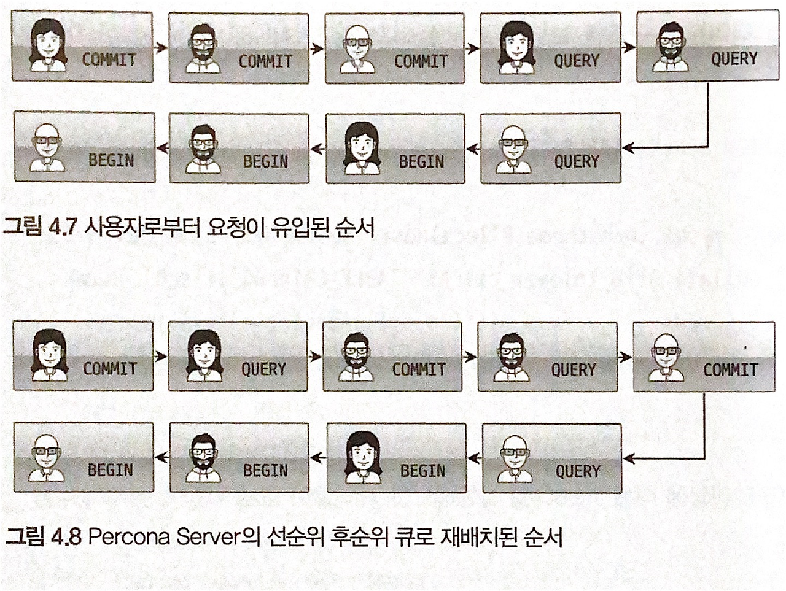

그림 4.7은 사용자의 요청 순서 그림 4.8은 선순위/후순위 큐로 재배치된 작업의 순서이다. 

---

# 생략한 내용 

**4.1.7 복제:** 16장에서 자세하게 설명

**4.1.8 쿼리 캐시:** MySQL 8.0 삭제된 기능

**4.1.9 스레드 풀 시스템 변수:** 스레드 풀 사용하면 공부

**4.1.10 트랜잭션 지원 메타데이터**

MySQL 8.0 부터 테이블 구조 정보, 스토어드 프로그램 정보를 InnoDB 테이블에 저장하도록 해서 메타 정보가 완전한 성공 또는 완전한 실패로 정리.

즉, 진행 중인 상태로 남으면서 문제를 유발하지 않도록 개선

---

