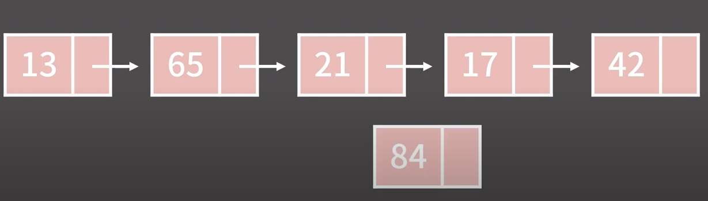

## 연결 리스트의 성질

1. k번째 원소를 확인/변경하기 위해 O(K)가 필요함

3번째 원소를 확인하고 싶으면 3 → 13 → 72 순서대로 접근 그래서 O(K)

1. 임의의 위치에 원소를 추가/ 임의 위치의 원소 제거는 O(1)
1. 원소들이 메모리 상에 연속해있지 않아 Cache hit rate가 낮지만 할당이 다소 쉽다.

## 연결 리스트의 종류 

1. 단일 연결 리스트(Singly Linked List)

  각 원소가 자신의 다음 원소의 주소를 들고 있는 연결 리스트이다.

1. 이중 연결 리스트(Doubly Linked List)

각 원소가 이전 원소와 다음 원소의 주소를 둘 다 들고 있다.

단일 연결 리스트에서는 원소의 이전 원소가 무엇인지를 알 수  없는데 이중 연결 리스트에서는 알 수 있다.

원소가 가지고 있어야 하는 정보가 1개 더 추가되니 메모리를 더 쓴다는 단점이 있다.

1. 원형 연결 리스트 (Circular Linked List)

원형 연결 리스트는 처음과 끝이 연결됨 

그림에서는 단일 연결 리스트로 표현했지만 각 원소가 이전과 다음 원소의 주소를 들고 있어도 상관이 없다.

## 배열 vs 연결 리스트 (선형 자료구조)

배열과 연결 리스트는 메모리 상에 원소를 놓는 방법이 다르다고 해도 

원소들 사이의 선후 관계가 일대일로 정의가 된다. 

즉 원소들 사이에서 첫 번째 원소, 두 번째 원소, …. 이런 개념이 존재한다. 

그래서 배열과 연결 리스트는 선형 자료구조라고 부른다. 

트리, 그래프, 해쉬 등은 비선형 자료구조의 예시이다. 

연결 리스트는 N에 비례하는 만큼 메모리가 추가적으로 발생한다.

## 시간 복잡도

**임의의 위치에 있는 원소를 확인 / 변경 O(N)**

**임의의 위치에 원소를 추가 O(1)**

21 뒤에 84를 추가하고 싶은 case

21의 원소가 저장하고 있던 다음 원소의 주소를 84로 변경하고 84 원소가 17원소의 주소를 
저장하면 끝이다. 

배열처럼 그 뒤의 원소를 전부 옮기는 작업을 할 필요가 없다.

단 추가하고 싶은 위치의 주소를 알고 있을 경우에만 O(1)에 가능하다.

여기 2가지 명령이 있다.

1. 21 뒤에 84를 추가해 O(N)
1. 3번 인덱스 뒤에 84를 추가해 O(1)

21번 뒤에 84를 추가하라는 첫 번째 명령은 21의 주소를 모르기 때문에
21의 주소를 찾는 시간인 O(N)이 추가적으로 필요하다. 

**임의의 위치에 원소를 제거 O(1)**

remove(int idx) —> O(1)
remove(Object obj) —→ O(N)

임의의 위치에 원소를 추가하거나 삭제하는 연산이 많은 경우에는 연결 리스트를 사용하는게 좋다!

자바에서 연결 리스트는 이중 연결리스트로 구현되어 있다.

