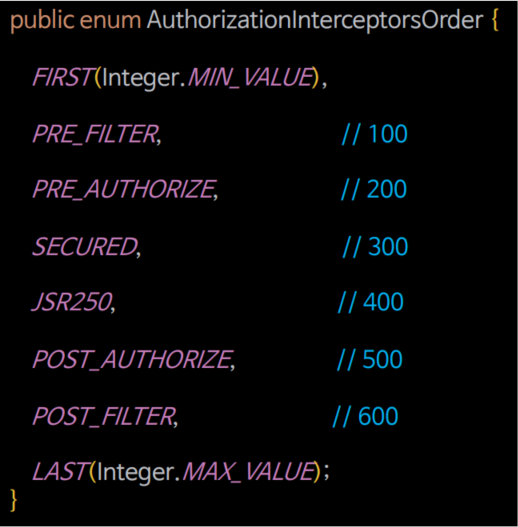

# **개요**

- 사용자 정의 `AuthorizationManager`를 생성함으로서 메소드 보안을 구현할 수 있다 

# 설정 클래스 정의

```java
@EnableMethodSecurity(prePostEnabled = false) 
public class MethodSecurityConfig {
		@Bean
		@Role(BeanDefinition.ROLE_INFRASTRUCTURE)
		public Advisor preAuthorize() {
				return AuthorizationManagerBeforeMethodInterceptor.preAuthorize(new MyPreAuthorizationManager());
		}
		@Bean
		@Role(BeanDefinition.ROLE_INFRASTRUCTURE)
		public Advisor postAuthorize() {
				return AuthorizationManagerAfterMethodInterceptor.postAuthorize(new MyPostAuthorizationManager());
		}
}
```

- `@EnableMethodSecurity(prePostEnabled = false)`
- 시큐리티가 제공하는 클래스들을 비활성화 한다. 그렇지 않으면 중복해서 검사하게 된다.

# **사용자 정의 AuthorizationManager 구현**

```java
public class MyPreAuthorizationManager implements AuthorizationManager<MethodInvocation> {
    @Override
    public AuthorizationDecision check(Supplier<Authentication> authentication, MethodInvocation object) {
        return new AuthorizationDecision(authentication.get().isAuthenticated());
    }
}

public class MyPostAuthorizationManager implements AuthorizationManager<MethodInvocationResult> {
    @Override
    public AuthorizationDecision check(Supplier<Authentication> authentication, MethodInvocationResult result) {
        Authentication auth = authentication.get();
        if(auth instanceof AnonymousAuthenticationToken) return new AuthorizationDecision(false);
        Account account = (Account) result.getResult();
        boolean isGranted = account.getOwner().equals(authentication.get().getName());
        return new AuthorizationDecision(isGranted);
    }
}
```

- 사용자 정의 `AuthorizationManager`는 여러 개 추가할 수 있으며 그럴 경우 체인 형태로 연결되어 각각 권한 검사를 하게 된다

# **인터셉터 순서 지정**



- 메서드 보안 어노테이션에 대응하는 AOP 메소드 인터셉터들은 AOP 어드바이저 체인에서 특정 위치를 차지한다
- 구체적으로 `@PreFilter` 메소드 인터셉터의 순서는 100, `@PreAuthorize`의 순서는 200 등으로 설정되어 있다
- 이것이 중요한 이유는 `@EnableTransactionManagement`와 같은 다른 AOP 기반 어노테이션들이
Integer.MAX_VALUE 로 순서가 설정되어 있는데 기본적으로 이들은 어드바이저 체인의 끝에 위치하고 있다
- 만약 스프링 시큐리티보다 먼저 다른 어드바이스가 실행 되어야 할 경우, 예를 들어 `@Transactional`과 `@PostAuthorize`가 함께 어노테이션 된 메소드가 있을 때 `@PostAuthorize`가 실행될 때 트랜잭션이 여전히 열려있어서 `AccessDeniedException`이 발생하면 롤백이 일어나게 하고 싶을 수 있다
- 그래서 메소드 인가 어드바이스가 실행되기 전에 트랜잭션을 열기 위해서는 `@EnableTransactionManagement`의 순서를 설정해야 한다
- **@EnableTransactionManagement(order = 0)**
- 위의 order = 0 설정은 트랜잭션 관리가 `@PreFilter` 이전에 실행되도록 하며 `@Transactional` 어노테이션이 적용된 메소드가 스프링 시큐리티의 @PostAuthorize 와 같은 보안 어노테이션보다 먼저 실행되어 트랜잭션이 열린 상태에서 보안검사가 이루어지도록 할 수 있다. 이러한 설정은 트랜잭션 관리와 보안 검사의 순서에 따른 의도하지 않은 사이드 이펙트를 방지할 수 있다
- `AuthorizationInterceptorsOrder`를 사용하여 인터셉터 간 순서를 지정할 수 있다

