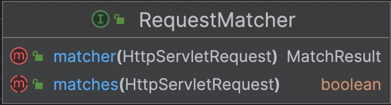

# **표현식 권한 규칙 설정**

- 스프링 시큐리티는 표현식을 사용해서 권한 규칙을 설정하도록 `WebExpressionAuthorizationManager`를 제공한다 
- 표현식은 시큐리티가 제공하는 권한 규칙을 사용하거나 사용자가 표현식을 커스텀하게 구현해서 설정 가능하다 

# **사용 방법**

`requestMatchers().access(new WebExpressionAuthorizationManager("expression"))`

# **적용 하기** 

```java
// 요청으로부터 값을 추출할 수 있다
requestMatchers("/resource/{name}").access(new WebExpressionAuthorizationManager("#name == authentication.name")

// 여러개의 권한 규칙을 조합할 수 있다
requestMatchers("/admin/db").access(new WebExpressionAuthorizationManager("hasAuthority('DB') or hasRole('ADMIN')"))

// 2번 예시와 동일한 적용 
requestMatchers("/admin/db").access(anyOf(hasAuthority("db"), hasRole("ADMIN")))
```

# **커스텀 권한 표현식 구현**

```java
// 사용자 정의 빈 
@Component("customWebSecurity")
public class CustomWebSecurity {
		public boolean check(Authentication authentication, HttpServletRequest request) {
				return authentication.isAuthenticated(); //사용자가 인증되었는지를 검사
		}
}

@EnableWebSecurity
@Configuration
public class SecurityConfig {
		 @Bean
	   public SecurityFilterChain securityFilterChain(HttpSecurity http, ApplicationContext context) throws Exception {
			  
			  DefaultHttpSecurityExpressionHandler expressionHandler = new DefaultHttpSecurityExpressionHandler();
				expressionHandler.setApplicationContext(context);
				
				WebExpressionAuthorizationManager expressManager = 
				// 빈 이름을 참조하고 접근 제어 로직을 수행한다 
				new WebExpressionAuthorizationManager("@customWebSecurity.check(authentication,request)");
				expressManager.setExpressionHandler(expressionHandler);
				
				http.authorizeHttpRequests(authorize -> authorize
							.requestMatchers("/resource/**").access(expressManager));
				
				return http.build();
		 }
}
```

# **커스텀 RequestMatcher 구현**



- `RequestMatcher`의 macher 및 matches 메서드를 사용하여 클라이언트의 요청객체로부터 값을 검증하도록 커스텀한 `RequestMatcher`를 구현하고 `requestMatchers()`메서드에 설정한다

**CustomRequestMatcher**

```java
public class CustomRequestMatcher implements RequestMatcher {
		private final String urlPattern;
		
		public CustomRequestMatcher(String urlPattern) {
				this.urlPattern = urlPattern;
		}
		
		@Override
		public boolean matches(HttpServletRequest request) {
				String requestURI = request.getRequestURI();
				return requestURI.startsWith(urlPattern);
		}
}

// Security Filter Chain 적용 
http .authorizeHttpRequests((authorize) -> authorize
		.requestMatchers(new CustomRequestMatcher("/api/**)).hasAuthority("USER")
		.anyRequest().authenticated());
```

# **실습 1 - Security 기본 제공 권한 표현식** 

```java
@EnableWebSecurity
@Configuration
public class SecurityConfig {
    @Bean
    public SecurityFilterChain securityFilterChain(HttpSecurity http) throws Exception {
        http
                .authorizeHttpRequests(authorize -> authorize
                        .requestMatchers("/user/{name}")
                        .access(new WebExpressionAuthorizationManager("#name == authentication.name"))

                        .requestMatchers("/admin/db")
                        .access(new WebExpressionAuthorizationManager("hasAuthority('ROLE_DB') or hasRole('ADMIN')"))
                        .anyRequest().authenticated());
        http

                .formLogin(Customizer.withDefaults())
                .csrf(AbstractHttpConfigurer::disable);

        return http.build();
    }
    @Bean
    public UserDetailsService userDetailsService(){
        UserDetails user = User.withUsername("user").password("{noop}1111").roles("USER").build();
        UserDetails manager = User.withUsername("manager").password("{noop}1111").roles("MANAGER").build();
        UserDetails admin = User.withUsername("admin").password("{noop}1111").roles("ADMIN","WRITE").build();
        return  new InMemoryUserDetailsManager(user, manager, admin);
    }
}
```

# **실습 2 - 커스텀 권한 표현식 구현**

```java
@Component("customWebSecurity")
public class CustomWebSecurity {
    public boolean check(Authentication authentication, HttpServletRequest request){
        return authentication.isAuthenticated();
    }
}

@EnableWebSecurity
@Configuration
public class SecurityConfig {
    
    @Bean
    public SecurityFilterChain securityFilterChain(HttpSecurity http, ApplicationContext context) throws Exception {

        DefaultHttpSecurityExpressionHandler expressionHandler = new DefaultHttpSecurityExpressionHandler();
        expressionHandler.setApplicationContext(context);

        WebExpressionAuthorizationManager authorizationManager =
                new WebExpressionAuthorizationManager("@customWebSecurity.check(authentication, request)");
        authorizationManager.setExpressionHandler(expressionHandler);

        http
                .authorizeHttpRequests(authorize -> authorize
                        .requestMatchers("/custom/**").access(authorizationManager)
                        .anyRequest().authenticated());
        http
                .formLogin(Customizer.withDefaults())
                .csrf(AbstractHttpConfigurer::disable);

        return http.build();
    }
    @Bean
    public UserDetailsService userDetailsService(){
        UserDetails user = User.withUsername("user").password("{noop}1111").roles("USER").build();
        UserDetails manager = User.withUsername("manager").password("{noop}1111").roles("MANAGER").build();
        UserDetails admin = User.withUsername("admin").password("{noop}1111").roles("ADMIN","WRITE").build();
        return  new InMemoryUserDetailsManager(user, manager, admin);
    }
}
```

# **실습 3 - CustomRequestMatcher**

```java
public class CustomRequestMatcher implements RequestMatcher {
    private final String urlPattern;
    public CustomRequestMatcher(String urlPattern) {
        this.urlPattern = urlPattern;
    }
    @Override
    public boolean matches(HttpServletRequest request) {
        String requestURI = request.getRequestURI();
        return requestURI.startsWith(urlPattern);
    }
}

@EnableWebSecurity
@Configuration
public class SecurityConfig {
    @Bean
    public SecurityFilterChain securityFilterChain(HttpSecurity http) throws Exception {
        http
                .authorizeHttpRequests(authorize -> authorize
                        .requestMatchers(new CustomRequestMatcher("/admin")).hasRole("ADMIN")
                        .anyRequest().authenticated());
        http
                .formLogin(Customizer.withDefaults())
                .csrf(AbstractHttpConfigurer::disable);

        return http.build();
    }
    @Bean
    public UserDetailsService userDetailsService(){
        UserDetails user = User.withUsername("user").password("{noop}1111").roles("USER").build();
        UserDetails manager = User.withUsername("manager").password("{noop}1111").roles("MANAGER").build();
        UserDetails admin = User.withUsername("admin").password("{noop}1111").roles("ADMIN","WRITE").build();
        return  new InMemoryUserDetailsManager(user, manager, admin);
    }
}
```

