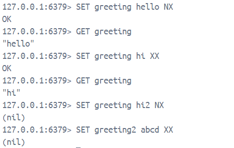

# ***Redis SET NX/XX?***

- *NX 해당 Key가 존재하지 않는 경우에만 SET*
- *XX 해당 Key가 이미 존재하는 경우에만 SET*
- *Null Reply:  SET이 동작하지 않은 경우 (nil) 응답*

# ***Redis SET NX/XX 실습***

```shell
SET greeting hello NX
SET greeting hello XX
```



- *SET greeting hello NX → greeting KEY가 존재하지 않아서 성공*
- *SET greeting hi XX → greeting KEY가 존재해서 성공*
- *SET greeting hi2 NX → greeting KEY가 존재해서 실패*
- *SET greeting2 abcd XX → greeting2 KEY가 존재하지 않아서 실패*

