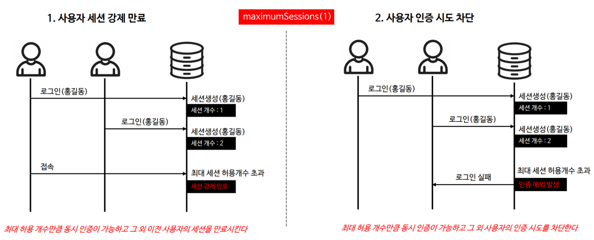
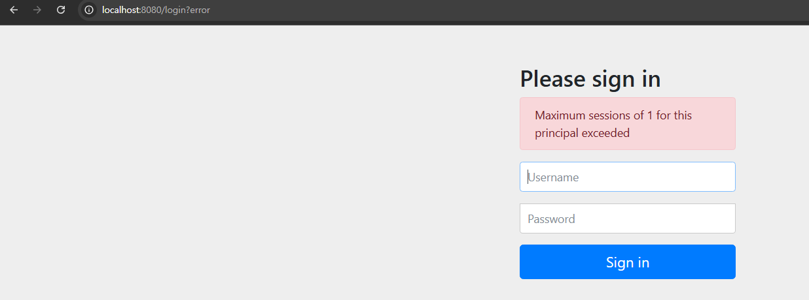
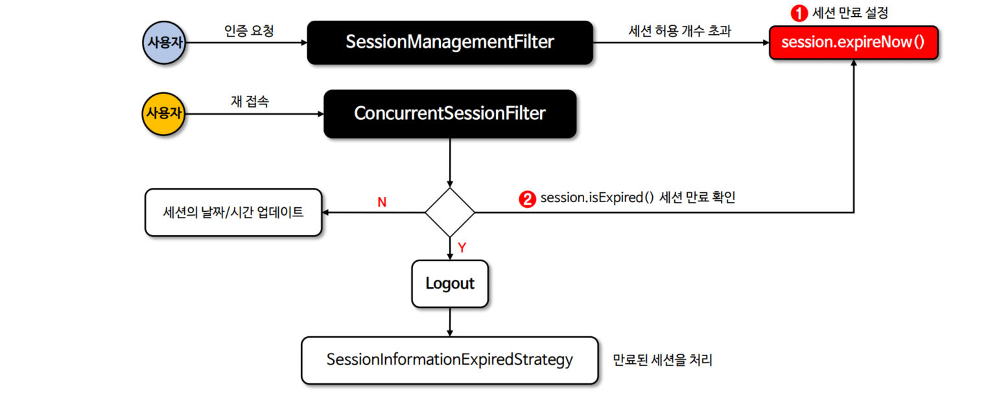
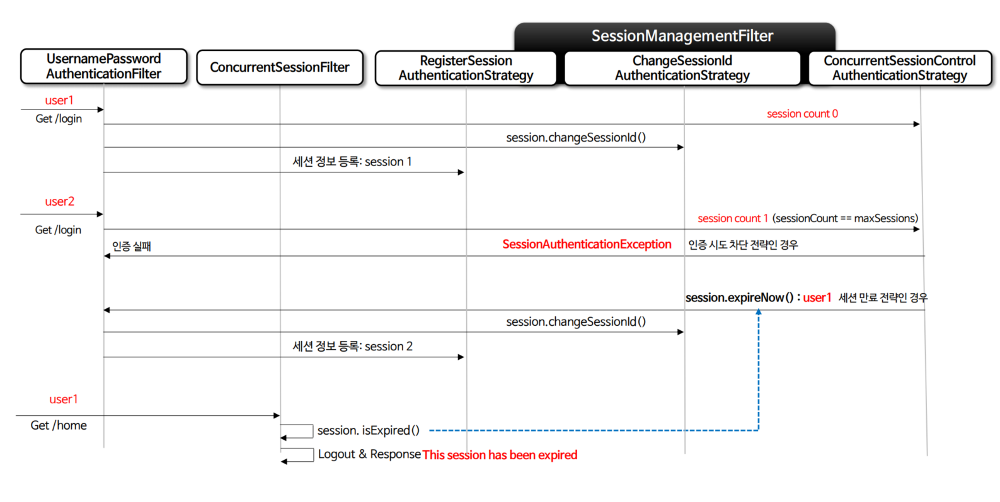

# **개요** 

  - 동시 세션 제어는 사용자가 동시에 여러 세션을 생성하는 것을 관리하는 전략이다 
  - 이 전략은 사용자의 인증 후에 활성화된 세션의 수가 설정된 `maximumSessions` 값과 비교하여 제어 여부를 결정한다 

# **동시 세션 제어 2 가지 유형**



# **sessionManagement() API ­ 동시 세션 제어**

```java
@Bean
public SecurityFilterChain securityFilterChain(HttpSecurity http) throws Exception {
	 http.sessionManagement(session -> session
				   .invalidSessionUrl("/invalidSessionUrl") 
					 .maximumSessions(1) 
					 .maxSessionsPreventsLogin(true) 
					 .expiredUrl("/expired") 
	 );
	 return http.build();
}
```

  - **invalidSessionUrl(String url)**
- 이미 만료된 세션으로 요청을 하는 사용자를 특정 엔드포인트로 리다이렉션 할 Url을 지정한다
  - **maximumSessions(int sessionCount)**
- 사용자당 최대 세션 수를 제어한다 
    - default: 무제한 세션을 허용
  - **maxSessionPreventsLogin(boolean)**
- `true`: 최대 세션 수(maximumSessions(int))에 도달했을 때 사용자의 인증을 차단한다
    - `false(default)`: 인증하는 사용자에게 접근을 허용하고 기존 사용자의 세션은 만료된다
  - **expiredUrl(String url)**
- 세션을 만료하고 나서 리다이렉션 할 Url을 지정한다

# **세션 만료 후 리다이렉션 전략**


`invalidSessionUrl`, `expiredUrl` API는 인증을 차단하는 전략과 관계가 없다. 

그래서 `maxSessionPreventsLogin(true)` 설정이면 항상 결과는 인증 차단이다 

만약 내가 인증 만료 방식을 사용하고 설정한다고 하면 `expiredUrl()`만 설정해서 

`expiredUrl()` 에 설정한 엔드 포인트로 리다이렉션 하도록 해야겠다 

# **테스트1**

**maxSession = 1, 인증 만료 전략** 

```java
@EnableWebSecurity
@Configuration
@Slf4j
public class SecurityConfig {
    @Bean
    public SecurityFilterChain securityFilterChain(HttpSecurity http, AuthenticationConfiguration configuration) throws Exception{
        http
                .authorizeHttpRequests(auth -> auth
                        .anyRequest().authenticated());
        http
                .formLogin(Customizer.withDefaults());

        http
                .sessionManagement(session -> session
                        .maximumSessions(1)
                        .maxSessionsPreventsLogin(false)
                );

        return  http.build();
    }
    @Bean
    public UserDetailsService userDetailsService(){
        UserDetails user = User
                .withUsername("user")
                .password("{noop}1111")
                .roles("USER")
                .build();
        return new InMemoryUserDetailsManager(user);
    }
}

@Slf4j
@RestController
@RequiredArgsConstructor
public class IndexController {
    @GetMapping("/")
    public  Authentication index(){
        Authentication authentication = SecurityContextHolder.getContextHolderStrategy().getContext().getAuthentication();
        log.info("authentication={}", authentication);
        return authentication;
    }
}
```

**사용자1**


현재 1개의 세션이 생성

**사용자2**


세션 최대 허용 개수는 1을 초과하는 상태 

**사용자1**


→ 처음 세션을 만들었던 크롬창을 새로고침 하니까 나오는 결과 

**사용자2**

크롬창을 새로고침해도 인증이 유지되어 있다 

# **테스트2**

**maxSession = 1, 인증 차단 전략** 

**Security Config 수정** 

```java
http
          .sessionManagement(session -> session
                  .maximumSessions(1)
                  .maxSessionsPreventsLogin(true)
          );
```

**사용자1**


**사용자2**



로그인 시도를 했지만 인증 차단 전략이기 때문에 로그인에 실패한다 

# **테스트3**

**maxSession = 1, 인증 만료 전략, 인증이 만료되면 로그인 페이지로 리다이렉트**

```java
@EnableWebSecurity
@Configuration
@Slf4j
public class SecurityConfig {
    @Bean
    public SecurityFilterChain securityFilterChain(HttpSecurity http, AuthenticationConfiguration configuration) throws Exception{
        http
                .authorizeHttpRequests(auth -> auth
                        .anyRequest().authenticated());
        http
                .formLogin(Customizer.withDefaults());

        http
                .sessionManagement(session -> session
                        .maximumSessions(1)
                        .maxSessionsPreventsLogin(false)
                        .expiredUrl("/login")
                );

        return  http.build();
    }
    @Bean
    public UserDetailsService userDetailsService(){
        UserDetails user = User
                .withUsername("user")
                .password("{noop}1111")
                .roles("USER")
                .build();
        return new InMemoryUserDetailsManager(user);
    }
}
```

**사용자1**


**사용자2**


세션 허용 개수 초과 → 사용자1: 세션 만료 

**사용자1**


새로고침 하니까 `expiredUrl("/login")` 경로로 리다이렉트 된다 

만약 실제 서비스에서 세션 만료 전략을 사용한다면 “다른 사용자가 계정에 접속했습니다” 같은 메시지를 만료된 사용자에게 보여줘야 할듯 싶다

# **세션 고정 보호 전략** 

  - 세션 고정 공격은 악의적인 사용자가 사이트에 접근하여 세션을 생성한 다음 다른 사용자가 같은 세션으로 로그인하도록 유도하는 위험을 말한다 
  - 스프링 시큐리티는 사용자가 로그인할 때 새로운 세션을 생성하거나 세션 ID를 변경함으로써 이러한 공격에 자동으로 대응한다 

# **세션 고정 공격 (Session Fixation Attack)**


  1. 공격자가 웹사이트 방문 세션 ID를 얻는다. 
  1. 공격자는 일반 사용자의 쿠키에 세션 ID를 설정한다
  1. 사용자는 쿠키에 공격자의 세션 ID를 가진 상태로 웹사이트에 로그인을 한다 
  1. 서버는 해당 세션 ID를 가지고 사용자의 세션을 생성해서 서버에 저장한다 
  1. 공격자는 이제 세션 ID를 통해서 사용자의 권한을 가지고 활동이 가능하다 

# **sessionManagement() API ­ 세션 고정 보호**

```java
@Bean
public SecurityFilterChain securityFilterChain(HttpSecurity http) throws Exception {
	 http.sessionManagement((session) -> session
		          .sessionFixation(sessionFixation -> sessionFixation.newSession()));
	 return http.build();
}
```

# **세션 고정 보호 전략**

  - **changeSessionId()**
- 기존 세션을 유지하면서 세션 ID만 변경해서 인증 과정에서 세션 고정 공격을 방지하는 방식이다 
    - 기본 값으로 설정되어 있다
  - **newSession()**
- 새로운 세션을 생성하고 기존 세션 데이터를 복사하지 않는 방식이다
  - **migrateSession()**
- 새로운 세션을 생성하고 모든 기존 세션 속성을 새로운 세션으로 복사한다
  - **none()**
- 기존 세션을 그대로 사용한다 
    - 세션 고정 공격에 무방비하다

- 스프링 시큐리티에서는 인증된 사용자에 대한 세션 생성 정책을 설정하여 어떻게 세션을 관리할지 결정할 수 있으며 이 정책은 `SessionCreationPolicy` 로 설정된다 

# **세션 생성 정책 전략** 

  - **SessionCreationPolicy.ALWAYS**
- 인증 여부에 상관없이 항상 세션을 저장한다 
    - `ForceEagerSessionCreationFilter` 클래스를 추가 구성하고 세션을 강제로 생성시킨다
  - **SessionCreationPolicy.NEVER**
- 스프링 시큐리티가 세션을 생성하지 않지만 애플리케이션이 이미 생성한 세션은 사용할 수 있다 
    - 애플리케이션이 이미 생성한 세션 → ex) 톰캣이 생성하는 세션
  - **SessionCreationPolicy.IF_REQUIRED**
- 필요한 경우에만 세션을 생성한다 
    - 인증이 필요한 자원에 접근할 때 세션을 생성한다
  - **SessionCreationPolicy.STATLESS**
- 세션을 전혀 생성하거나 사용하지 않는다 
    - 인증 필터는 인증 완료 후 `SecurityContext`를 세션에 저장하지 않으며 JWT 같이 세션을 사용하지 않는 방식으로 인증을 관리할 때 유용할 수 있다 
    - `SecurityContextHolderFilter`는 세션 단위가 아닌 요청 단위로 항상 새로운 `SecurityContext`를 생성하므로 컨텍스트 영속성이 유지되지 않는다

# **sessionManagement() API ­ 세션 생성 정책**

```java
@Bean
public SecurityFilterChain securityFilterChain(HttpSecurity http) throws Exception {
	 http.sessionManagement((session) -> session
						 .sessionCreationPolicy(SessionCreationPolicy.STATELESS));
	 return http.build();
}
```

# **STATELESS 설정에도 세션이 생성될 수 있다**

  - 스프링 시큐리티에서 CSRF 기능이 활성화 되어 있고 CSRF 기능이 수행 될 경우 사용자의 세션을 생성해서 CSRF 토큰을 저장하게 된다 
  - 세션은 생성되지만 CSRF 기능을 위해서 사용될 뿐 인증 프로세스의 `SecurityContext` 영속성에 영향을 미치지는 않는다.

# **SessionManagementFilter**

  - 요청이 시작된 이후 사용자가 인증되었는지를 검사하고, 인증된 경우에는 세션 고정 메커니즘을 활성화하거나 동시 다중 로그인을 확인하는 등 세션 관련 활동을 수행하기 위해 설정된 세션 인증 전략(SessionAuthenticationStrategy)을 호출하는 필터 클래스이다 
  - 스프링 시큐리티 6 이상에서는 `SessionManagementFilter` 가 기본적으로 설정되지 않으며 세션관리 API를 설정을 통해 생성할 수 있다 

# **세션 구성 요소**


# **ConcurrentSessionFilter**

  - 각 요청에 대해 `SessionRegistry` 에서 `SessionInformation` 을 검색하고 세션이 표시되었는지 확인하고 만료로 표시된 경우 로그아웃 처리를 수행한다(세션 무효화)
  - 각 요청에 대해 `SessionRegistry.refreshLastRequest(String)`를 호출하여 등록된 세션들이 항상 마지막 업데이트 날짜/시간을 가지도록 한다 

# **흐름도**



# **시퀀스 다이어그램**



