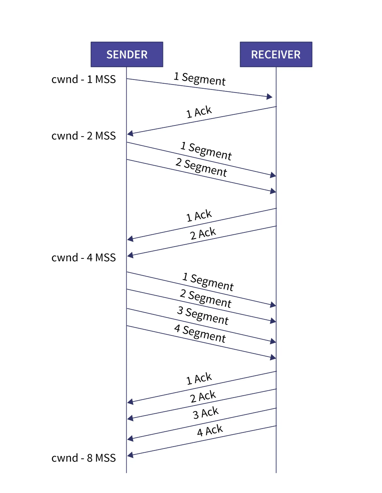
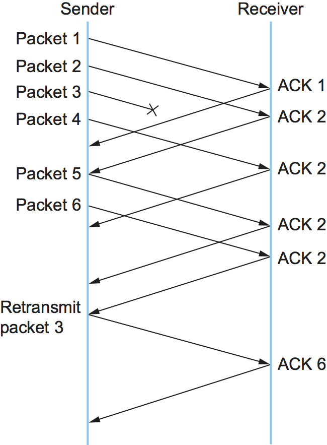
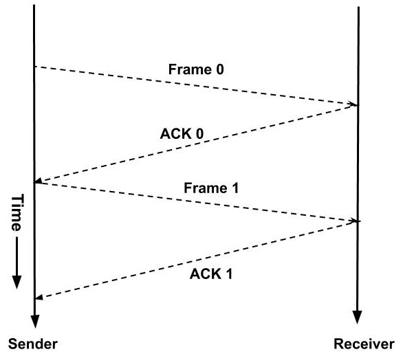
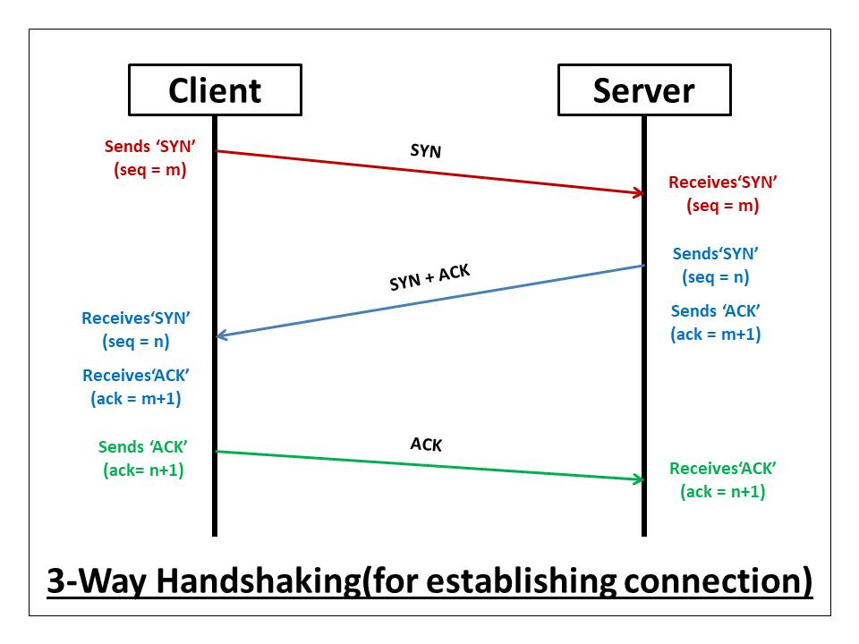
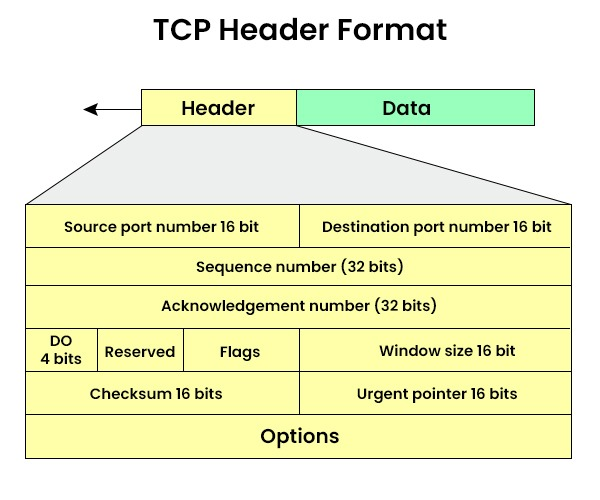
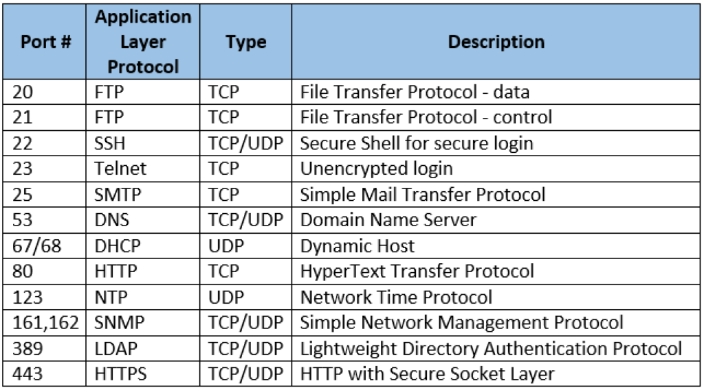
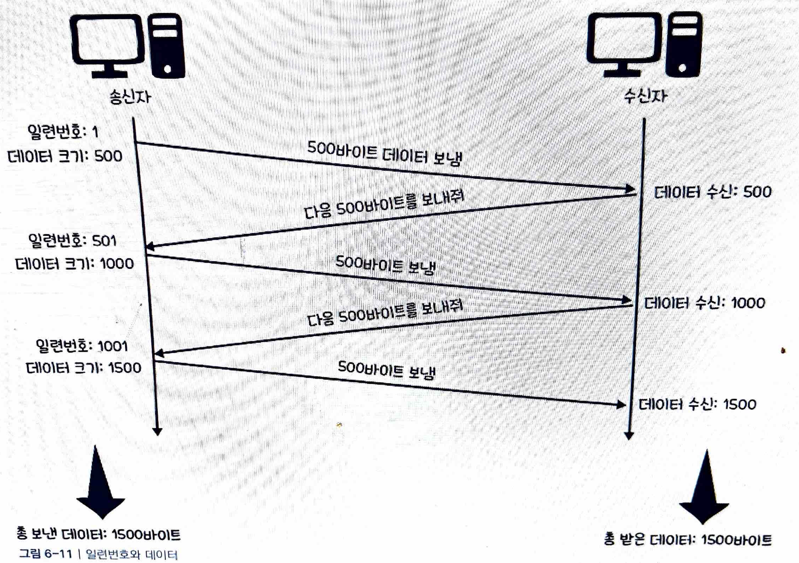
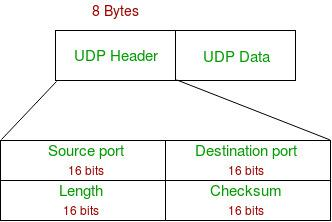

## 개요

전송 계층은 신뢰성 있는 통신을 보장하는 역할을 한다.

신뢰성을 보장하기 위한 방법과 포트 번호가 통신에 어떻게 이용되는지에 대해 알아본다. 

**키워드** 

- 전송 계층 
- 혼잡 제어
- 흐름 제어
- 오류 제어
- 3방향 핸드셰이크
- TCP 프로토콜 
- UDP 프로토콜

**목표** 

- 전송 계층의 역할을 이해
- 3 Way Handshake 구조에 대해 이해
- TCP, UDP 구조 이해
- 전송 계층의 로드 밸런서 구조에 대해 이해

---

## 내용정리 

전송 계층은 기본적으로 오류를 점검하는 기능과 컴퓨터가 제대로 데이터를 받았을 경우 어떤 애플리키에션으로 전달해야 하는지를 식별하는 기능을 한다.

### 혼잡 제어(Congestion Control)

**혼잡 제어(Congestion Control)는 네트워크로 들어가는 정보량을 조절하여 네트워크가 혼잡해지지 않게 조절하는 방법이다.** 

혼잡 제어 방식은 송신자가 먼저 하나의 데이터만 보내고 수신자 측에서 ACK가 오면 전송량을 2배씩 증가시켜 나간다. 그러다가 타임아웃이 발생하면 여러 개 보냈던 데이터를 줄여서 보낸다. 혹은 동일한 ACK를 여러 번 받은 경우에도 데이터를 줄여서 보내는 방식을 취한다. 타임아웃과 마찬가지로 동일한 ACK를 여러 번 받았다는 것은 네트워크가 데이터를 실어 나르느라 바쁘다는 뜻이기 때문이다.

이후 정상적인 ACK를 받게 되면 또다시 데이터를 배수로 전송함으로써 데이터 전송량을 조절한다.

아래 그림은 정상적으로 전송량이 2배씩 늘어난다.

아래 그림 Packet 3이 타임아웃으로 도착하지 않아 동일한 ACK를 보낸다.

그래서 다시 Packet3를 전송한다.

---

### 흐름 제어(Flow Control)

흐름 제어 방법 중에 하나인 정지-대기(Stop & Wait) 방식은 송신자가 하나의 데이터를 전송한 후 다음 데이터를 전달하기 전에 확인 응답을 기다리는 방법이다.

예를 들어 수신자 측에서 ACK 메시지가 송신자 측에 전달되어야만 다음 데이터를 보내는 방법이다.

---

### 오류 제어(Error Control)

오류를 검출하기 위해서 확인 응답과 시간 초과 방법을 사용한다.

  1. 확인 응답: 수신자 측으로부터 ACK라는 응답을 받아야 하지만 ACK가 없다면 오류로 판단한다.
  1. 시간 초과: 특정 시간 내에 ACK가 없으면 세그먼트에 오류가 있다고 판단한다.

오류가 발견되면 데이터를 재전송해야 하는데, 재전송이 필요한 상황은 아래와 같다.

  - 데이터가 중간에 손실될 때
  - 데이터 순서가 바뀌었을 때
  - 데이터가 훼손되었을 때

---

전송 계층은 데이터를 목적지에 문제없이 전달하는 것을 목표로 한다.

이때 데이터를 전달하는 목적에 따라 연결형과 비연결형 통신으로 나눈다.

  - **연결형 통신: 데이터를 정확하게 전달하는 것을 목표로 하는 통신으로, TCP 프로토콜을 사용한다.**
  - **비연결형 통신: 효율적으로 데이터를 보내는 통신으로, UDP 프로토콜을 사용한다.**

TCP 프로토콜은 3 Way Handshake 방법으로 통신을 시작한다. TCP 프로토콜이 데이터를 정확하게 전달하는 것을 목표로 하기 때문에 상대방이 내 신호를 받을 수 있는 상태인지 확인하고 전송하는 방식이다.

**즉, 3 Way Handshake는 TCP 통신을 하는 장치(컴퓨터)간에 서로 통신할 준비가 되었는지를 확인하는 과정이다.**

**3 Way Handshake**

  1. **먼저 송신자는 수신자에게 SYN(Synchronize Sequence Number)이라는 임의의 숫자를 보낸다.** 
  1. **수신자는 1번의 대답으로 ACK와 SYN를 보낸다. ACK는 앞에서 받았던 SYN에 1이 더해진 숫자이며, SYN은 임의의 숫자가 된다.**
  1. **송신자는 다시 ACK를 보낸다. 이때 ACK는 앞에서 받은 SYN에 1이 더해진 숫자이다.**

이렇게 3-Way HandShaking을 하면 송신자와 수신자 양쪽 모두 데이터를 전송할 준비가 되었다는 것을 보장한다.

### 포트 번호

전송 계층은 어떤 애플리케이션과 통신하는지 정의하는 곳이다. 그 기능을 하는 것이 포트 번호이다.

컴퓨터의 주소가 IP라면 프로그램의 주소는 포트 번호이다.

포트 번호는 총 65,536개가 존재하며 목적에 따라 다음과 같이 나위어져 있다.

  - **0~1023번:** **잘 알려진 포트(well-known port)**로, 특정한 쓰임을 위해 사용되는 포트이다.
- ex: HTTP 80
  - **1024~49151번:** 기관이나 기업들이 사용하는 포트로, **사전 등록된 포트(registered port)**라고도 한다.
  - **49152~65535번:** 일반 사용자들이 자유롭게 사용할 수 있는 포트로, **다이나믹 포트(dynamic port)**라고도 한다.

**well-known ports** 

---

### 일련번호와 확인 응답 번호

**일련번호(sequence number)**는 송신자가 수신자에게 보내려는 데이터가 몇 번째인지 알려주는 것이고, 반대로 **확인 응답 번호(Acknowledgement Number)**는 수신자가 몇 번째 데이터를 받았는지 송신자에게 알려주는 역할을 한다.

송신자가 수신자에게 데이터를 보내는 상황을 가정

  - 보내야 하는 총 데이터 크기: 1500바이트
  - 패킷의 크기: 500바이트

패킷의 크기란 한 번에 보낼 수 있는 데이터의 최대 크기이다. 즉, 한 번에 보낼 수 있는 최대 크기가 500바이트라는 것이다. 그러니 1500바이트의 데이터를 보내기 위해서는 총 3번에 걸쳐 보내야 한다.

---

### 윈도우 크기

수신자가 받을 수 있는 데이터의 양은 적은데, 송신자가 그것을 고려하지 않고 많은 양의 데이터를 보낸다면 어떤일이 발생할까?

송신자는 모든 데이터를 보냈다고 생각하겠지만, 수신자는 송신자가 보낸 모든 데이터를 받아들이지 못하고 일부는 튕겨나갈 것이다. 그래서 등장한 것이 윈도우 크기다.

**윈도우 크기(Window Size)란 송신자가 한 번에 보낼 수 있는 데이터의 최대 크기이다.**

즉, 수신자가 얼마나 데이터를 받아들일 수 있는지 확인한 후, 그 크기를 고려해서 데이터를 보내겠다는 의도이다.

수신자의 윈도우 크기는 3-way Handshake 과정에서 송,수신자의 윈도우 크기를 확인할 수 있다.

3-way Handshake 과정에서 SYN과 ACK 외에도 Window_Size 정보를 주고받게 된다.

---

### 코드 비트(Flags)

코드 비트들의 기본값은 0이고 비트가 활성화되면 1이된다. 

| **코드 비트(플래그)** | **항목 이름** | **설명** |
| --- | --- | --- |
| TURG | 긴급(URGENT) | URG 포인터 필드가 유효함을 알림 (긴급 데이터가 있음을 의미) |
| ACK | 확인(ACKNOWLEDGEMENT) | ACK 번호 필드가 유효함을 알림 (데이터 수신 확인) |
| PSH | 푸시(PUSH) | 데이터를 즉시 상위 계층에 전달하도록 요청 |
| RST | 리셋(RESET) | 연결을 강제로 초기화(재설정) |
| SYN | 동기화(SYNCHRONIZE) | 연결 설정 요청 (시퀀스 번호 동기화) |
| FIN | 종료(FINISH) | 연결 종료 요청 |

---

TCP는 데이터를 세그먼트 단위로 쪼갠 후 순서를 부여하여 전송한다.

또한 수신자 입장에서는 세그먼트의 순서가 뒤바뀌는 일이 없도록 오류를 제어하는 것도 중요하다.

즉, 신뢰성 있는 통신을 기반으로 하는 것이 TCP라면 **UDP(User Datagram Protocol)**는 데이터를 수신자 측에서 오류 없이 받던, 그렇지 않던 상관하지 않고 데이터를 보내기만 한다.

UDP가 신뢰성을 보장하지 않는다고 해서 쓸모가 없는 것은 아니다. 그만큼 데이터 전송 속도가 빠른 장점이 있다.

따라서 UDP 프로토콜은 주로 실시간 방송 등에 사용한다.

**UDP Header** 

| **항목 이름** | **설명** | **크기** |
| --- | --- | --- |
| Source Port | 송신자(출발지) 포트 번호 | 16비트 (2바이트) |
| Destination Port | 수신자(목적지) 포트 번호 | 16비트 (2바이트) |
| Length | UDP 헤더 + 데이터 전체 길이(바이트 단위) | 16비트 (2바이트) |
| Checksum | 오류 검출을 위한 체크섬 값 | 16비트 (2바이트) |

**로드 밸런서(Load Balancer)****는 여러 대의 서버를 두고 사용자가 한쪽으로 몰리는 것을 분산시켜주는 장치이다.**

**1대의 서버에서 여러 대로 늘리는 것을** **스케일 아웃(Scale Out)****이라고 하며, 부하를 분산시켜주는 작업을** **로드 밸런싱(Load Balancing)****이라고 한다.**

먼저 사용자가 보내온 연결 요청은 로드 밸런서가 받는다.

이후 로드 밸런서는 서버로 연결을 요청한다. 이때 서버가 3대라면 3대의 서버가 골고루 트래픽을 받도록 사용자 연결을 처리해야 한다.

  - **라운드 로빈(Round Robin):** 분배의 가장 기본적인 방식으로 각 서버별로 돌아가면서 연결을 처리한다.
  - **가중 라운드 로빈(Weighted Round Robin):** 각 서버별로 돌아가면서 연결을 처리하지만 일부 서버는 큰 트래픽을 몰아 받는 방식이다.
  - **랜덤(Random):** 무작위로 분배되는 방식
  - **해시(Hash):** 특정 클라이언트는 특정 서버에서만 처리하는 방식

또한, 로드 밸런서는 포트 번호를 이용하여 부하를 분산시킬 수도 있다. 

예를 들어 [http://www.a.com](http://www.a.com/)을 서비스하는 서버가 3대 있을 때, 로드 밸런서 IP 주소로 접속을 시도하는 것 중에 8001 포트를 사용하는 것은 172.16.2.201 서버로 전달하고, 8002번 포트를 사용하여 접속을 시도하는 것은 172.16.2.203으로 전달하도록 설정할 수 있다.

이걸 L4 로드 밸런서라고 하는데 실제 웹 서비스에서는 L7 로드 밸런서를 더 많이 사용한다.

---

## 복습하기

1. 혼잡 제어, 흐름 제어, 오류 제어
1. 타임 아웃
1. 혼잡 제어
1. 연결형, 비연결형
1. 포트 
1. 25
1. 스케일 아웃 
1. 라운드 로빈

3-way Handshake: TCP 통신을 하는 장치 간에 서로 잘 연결되어 있는지를 확인하는 과정

윈도우 크기: 윈도우 크기란 송신자가 한 번에 보낼 수 있는 데이터의 최대 크기

TCP: 데이터를 세그먼트 단위로 쪼갠 후 순서를 부여하여 전송하는 통신으로 신뢰성 있는 통신을 기반으로 한다.

UDP: 비연결현으로 실시간 방송과 같은 통신에 사용한다. (브로드캐스트)

로드 밸런서: 로드 밸런서는 여러 대의 서버를 두고 사용자 집중으로 인한 부하를 분산시켜주는 장치이다.

로드 밸런싱: 부하를 분산시켜주는 작업을 로드 밸런싱이라고 한다.

---

