# ***연관관계 매핑시 고려사항 3가지***

- ***다중성***
- ***N:1: @ManyToOne***
  - ***1:N: @OneToMany***
  - ***1:1: @OneToOne***
  - ***N:N: @ManyToMany***
- ***단방향, 양방향***
- *테이블* 
- *외래 키 하나로 양쪽 조인 가능*
    - *사실 방향이라는 개념이 존재하지 않는다.*
  - *객체*
- *참조용 필드가 있는 쪽으로만 참조 가능*
    - *한쪽만 참조하면 단방향* 
    - *양쪽이 서로 참조하면 양방향(단방향 2개 → 양방향)*
- ***연관관계의 주인***
- *테이블은 외래 키 하나로 두 테이블이 연관관계를 맺는다.*
  - *객체 양방향 관계는 A→B, B→A 참조가 2곳에 존재*
  - *즉, 테이블의 외래 키를 관리할 곳을 지정해야함*
  - *연관관계의 주인 → 외래 키를 관리하는 참조* 
  - *주인의 반대편: 외래 키에 영향을 주지 않는다, read only(단순히 조회만 한다)*

# ***다대일 [N:1]***

***다대일 단방향***

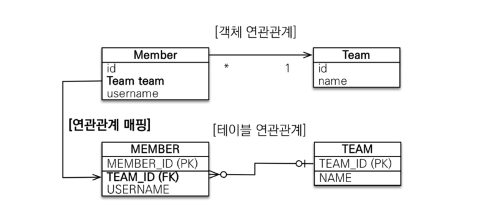

- *가장 많이 사용하는 연관관계*
- *반대는 일대다* 

```java
@Entity
@Getter @Setter
public class Member {
    @Id @GeneratedValue(strategy = GenerationType.IDENTITY)
    private Long id;
    @Column(name = "USERNAME")
    private String name;
    @ManyToOne
    @JoinColumn(name = "TEAM_ID")
    private Team team;
}

@Entity
@Getter @Setter
public class Team {
    @Id @GeneratedValue(strategy = GenerationType.IDENTITY)
    private Long id;
    private String name;
}
```

***다대일 양방향*** 

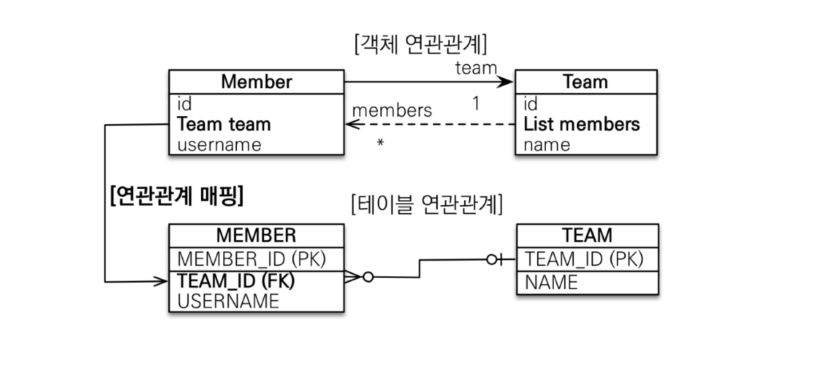

- *객체에서 단방향 관계에서 양방향 관계로 바꾼다고 해서 테이블은 전혀 바뀌지 않는다.*
- *데이터베이스 테이블의 외래 키가 있는 쪽이 연관관계의 주인이다.*

```java
@Entity
@Getter @Setter
public class Member {
    @Id @GeneratedValue(strategy = GenerationType.IDENTITY)
    private Long id;
    @Column(name = "USERNAME")
    private String name;
    @ManyToOne
    @JoinColumn(name = "TEAM_ID")
    private Team team;
}

@Entity
@Getter @Setter
public class Team {
    @Id @GeneratedValue(strategy = GenerationType.IDENTITY)
    private Long id;

    private String name;

    @OneToMany(mappedBy = "team")
    private List<Member> members = new ArrayList<>();
}
```

# ***일대다 [1:N]***

***일대다 단방향***

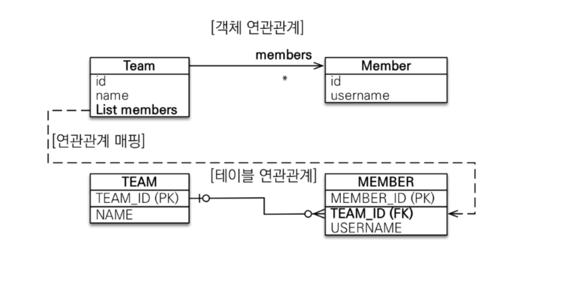

```java
@Entity
@Getter @Setter
public class Member {
    @Id @GeneratedValue(strategy = GenerationType.IDENTITY)
    private Long id;
    @Column(name = "USERNAME")
    private String name;
}

@Entity
@Getter @Setter
public class Team {
    @Id @GeneratedValue(strategy = GenerationType.IDENTITY)
    private Long id;

    private String name;

    @OneToMany
    @JoinColumn(name = "TEAM_ID")
    private List<Member> members = new ArrayList<>();
}
```

***일대다 단방향 - 쿼리 실행*** 

```java
try {
    Member member = new Member();
    member.setName("member1");
    em.persist(member);

    Team team = new Team();
    team.setName("teamA");
    // Member update Query
    team.getMembers().add(member);
    em.persist(team);

    tx.commit();
}
---------------------------------------------------------------------------------

Hibernate: 
    /* insert for
        hellojpa.domain.Member */insert 
    into
        Member (USERNAME, id) 
    values
        (?, default)
Hibernate: 
    /* insert for
        hellojpa.domain.Team */insert 
    into
        Team (name, id) 
    values
        (?, default)
Hibernate: 
    update
        Member 
    set
        TEAM_ID=? 
    where
        id=?
```

- *TEAM 엔티티가 외래 키를 관리하지만 데이터베이스에 외래 키가 존재하는 테이블은 MEMBER여서 UPDATE 쿼리가 날아간다.* 
- *이는 UPDATE 쿼리가 추가로 날아가는 문제점도 존재하지만 쿼리 예상을 하기가 어렵다는 게 더 큰 문제이다.*
- *분명히 TEAM에 대해 변경을 하는데 쿼리는 MEMBER 테이블로 날아간다.*

***일대다 단방향 정리***

- *일대다 단방향은 1:N에서 일(1)이 연관관계의 주인이다.*
- *데이터베이스 테이블 일대다 관계는 항상 다(N)쪽에 외래 키가 존재한다.*
- *객체와 테이블의 차이 때문에 반대편 테이블의 외래 키를 관리하는 특이한 구조이다.*
- *@JoinColumn을 꼭 사용해야 한다.*
- *그렇지 않으면 조인 테이블 방식을 사용한다(중간에 테이블을 추가)*

***일대다 단방향 매핑의 단점 정리***

- *엔티티가 관리하는 외래 키가 다른 테이블에 있다*
- *연관관계 관리를 위해서 추가로 UPDATE SQL 실행*
- *일대다 단방향 매핑보다는 다대일 양방향 매핑을 사용하자*
- *객체지향적으로 손해?로 볼 수 있지만 ORM을 좀 더 데이터베이스에 맞추는 방식이 더 좋다.*
  - *엔티티 설계로 날아가는 쿼리가 예상이 되지 않는 상황보단 예상이 되는 게 더 좋다*

***일대다 양방향***

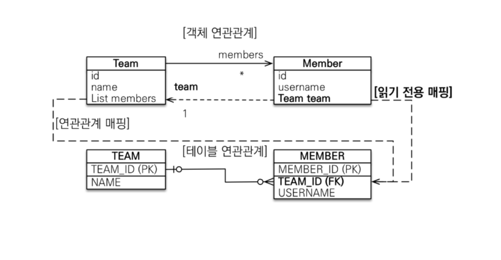

```java
@Entity
@Getter @Setter
public class Member {
    @Id @GeneratedValue(strategy = GenerationType.IDENTITY)
    private Long id;
    @Column(name = "USERNAME")
    private String name;

    @ManyToOne
    @JoinColumn(name = "TEAM_ID", insertable = false, updatable = false)
    private Team team;
}

@Entity
@Getter @Setter
public class Team {
    @Id @GeneratedValue(strategy = GenerationType.IDENTITY)
    private Long id;

    private String name;

    @OneToMany
    @JoinColumn(name = "TEAM_ID")
    private List<Member> members = new ArrayList<>();
}
```

- *연관관계의 주인은 여전히 TEAM이다.* 
- *일대다 양방향을 위해서 읽기 전용 필드를 사용한다*
- *@JoinColumn(name = "TEAM_ID", insertable = false, updatable = false)*
- *JPA 공식적으로 존재하지 않는 매핑이다.*
- ***그냥 다대일 양방향을 사용하자 ㅋㅋ***

# ***일대일 [1:1]***

***일대일 관계***

- *주 테이블이나 대상 테이블 중에 외래 키 선택 가능*
- *외래 키에 데이터베이스 유니크 제약조건 추가* 

***일대일: 주 테이블에 외래 키 단방향***

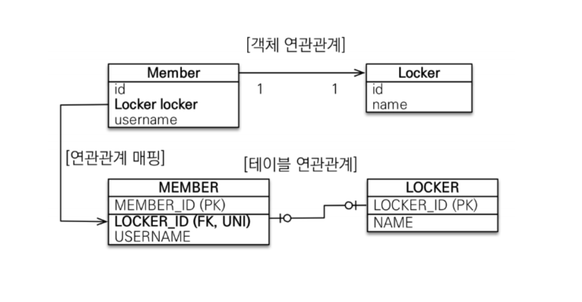

- *그림은 Member 테이블을 주 테이블이라고 가정* 

```java
@Entity
@Getter @Setter
public class Member {
    @Id @GeneratedValue(strategy = GenerationType.IDENTITY)
    private Long id;
    @Column(name = "USERNAME")
    private String name;

    @ManyToOne
    @JoinColumn(name = "TEAM_ID", insertable = false, updatable = false)
    private Team team;

    @OneToOne
    @JoinColumn(name = "LOCKER_ID", unique = true)
    private Locker locker;
}

@Entity
@Getter @Setter
public class Locker {
    @Id @GeneratedValue(strategy = GenerationType.IDENTITY)
    private Long id;
    private String name;
}
```

***일대일: 주 테이블에 외래 키 양방향***

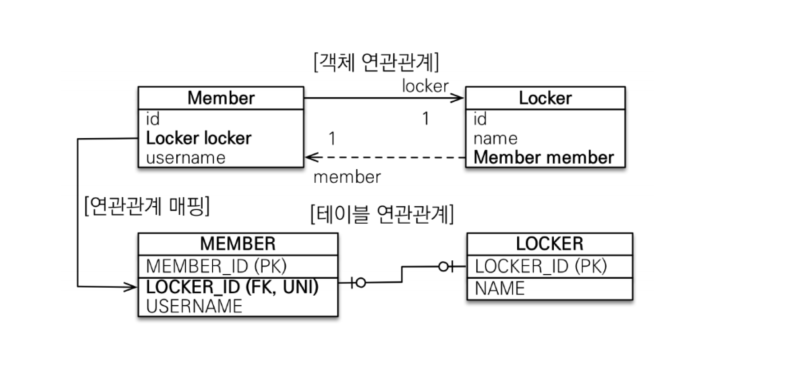

```java
@Entity
@Getter @Setter
public class Member {
    @Id @GeneratedValue(strategy = GenerationType.IDENTITY)
    private Long id;
    @Column(name = "USERNAME")
    private String name;

    @ManyToOne
    @JoinColumn(name = "TEAM_ID", insertable = false, updatable = false)
    private Team team;

    @OneToOne
    @JoinColumn(name = "LOCKER_ID", unique = true)
    private Locker locker;
}

@Entity
@Getter @Setter
public class Locker {
    @Id @GeneratedValue(strategy = GenerationType.IDENTITY)
    private Long id;
    private String name;
    
    @OneToOne(mappedBy = "locker")
    private Member member;
}
```

***일대일: 주 테이블에 외래 키 양방향 정리***

- *다대일 양방향 매핑처럼 외래 키가 있는 곳이 연관관계의 주인*
- *반대편은 mappedBy 적용*

***일대일: 대상 테이블에 외래 키 단방향***

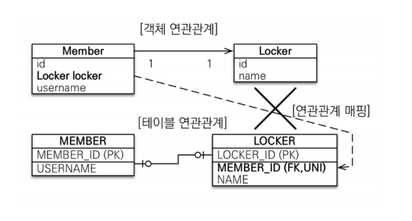

- *단방향 관계는 JPA에서 지원하지 않는다.*
- *양방향 관계는 지원한다.*
- *즉, 일대일 관계에서는 자신의 엔티티에 있는 외래키만 관리가 가능하다.*

***일대일: 대상 테이블에 외래 키 양방향***

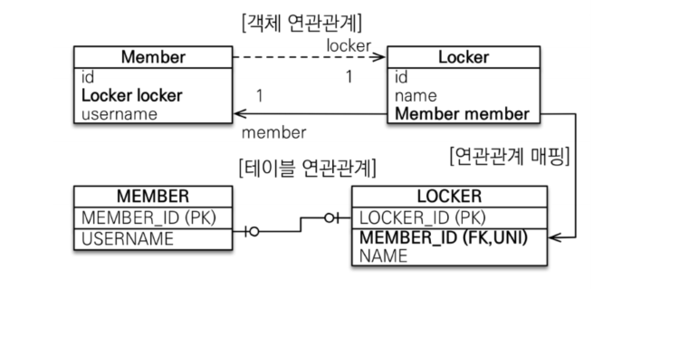

***일대일 정리***

- *주 테이블에 외래 키*
- *주 객체가 대상 객체의 참조를 가지는 것처럼 주 테이블에 외래 키를 두고 대상 테이블을 찾음*
  - *객체지향 개발자가 선호한다*
  - *JPA 매핑 편리 → 양방향 단방향 모두 가능*
  - *장점: 주 테이블만 조회해도 대상 테이블에 데이터가 있는지 확인 가능*
  - *단점: 값이 없으면 외래 키에 null 허용*
- *대상 테이블에 외래 키*
- *대상 테이블에 외래 키가 존재*
  - *전통적인 데이터베이스 개발자가 선호한다*
  - *장점: 주 테이블과 대상 테이블을 일대일에서 일대다 관계로 변경할 때 테이블 구조 유지* 
  - *단점: 프록시 기능의 한계로 지연 로딩으로 설정해도 항상 즉시 로딩됨*

# ***다대다 [N:M]***

- *관계형 데이터베이스는 정규화된 테이블 2개로 다대다 관계를 표현할 수 없다*
- *연결 테이블을 추가해서 일대다, 다대일 관계로 풀어내야한다*

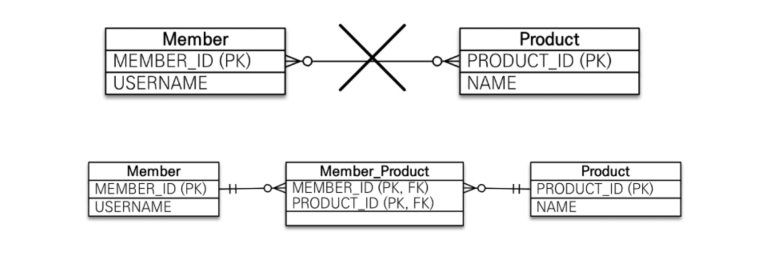

- *@ManyToMany 사용*
- *@JoinTable로 연결 테이블 지정*
- *단방향, 양방향 모두 가능*

***다대다 매핑의 한계***

- *실무에서 사용 X*
- *연결 테이블이 단순히 연결만 하고 끝나지 않는다*
- *비즈니스적으로 만약 중간 테이블에 대한 컬럼이 추가되어야 한다면?*

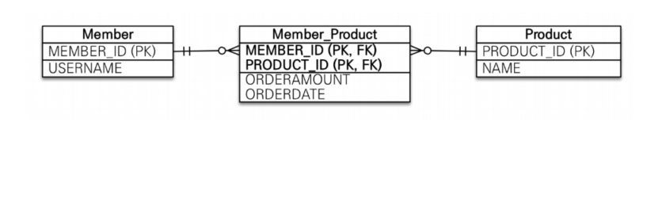

***다대다 한계 극복*** 

- *연결 테이블용 엔티티 추가(연결 테이블을 엔티티로 승격)*
- *@ManyToMany → @OneToMany, @ManyToOne*

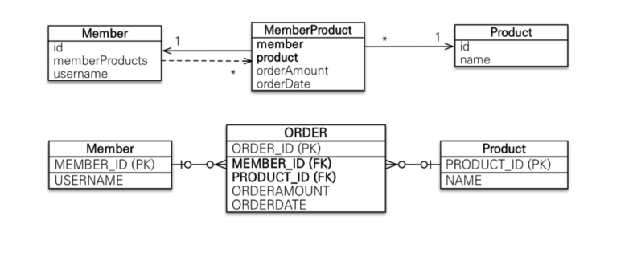

