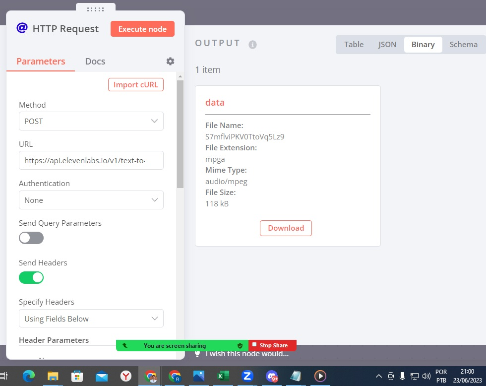
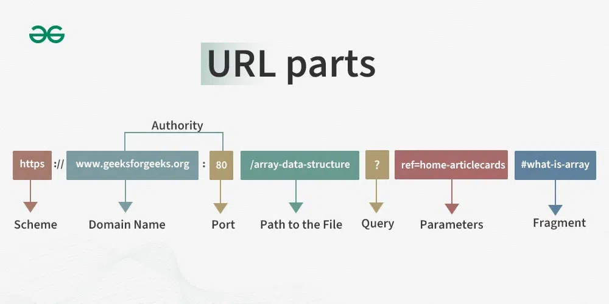

# 1장 HTTP 개관 

현대 인터넷의 공용어 HTTP(Hypertext Transfer Protocol)

---

# 1.1 HTTP: 인터넷의 멀티미디어 배달부 

이미지, HTML 페이지, 텍스트 파일 같은 수많은 데이터가 인터넷을 항해한다.

웹 서버 → (HTTP) → PC(웹 브라우저) 

**HTTP는 신뢰성 있는 데이터 전송 프로토콜을 사용한다. → TCP 기반** 

이를 통해 개발자는 인터넷의 결함이나 약점에 대한 걱정 없이 애플리케이션의 고유의 기능을 구현하는 데 집중할 수 있다.

---

# 1.2 웹 클라이언트와 서버

웹 서버 = HTTP 서버

---

# 1.3 리소스

웹 서버는 웹 리소스를 관리하고 제공

**여러가지 웹 리소스** 

- 정적 콘텐츠
- 정적 파일 
  - JPEG 이미지, HTML 파일, 텍스트 파일 등등…
- 동적 콘텐츠
- 사용자의 요청에 따라 다른 콘텐츠 생성
  - 카메라 라이브 영상, 검색 엔진, 주식 거래, 부동산 데이터베이스 검색 등등 ..

---

## 1.3.1 미디어 타입

인터넷은 수천 가지 데이터 타입을 다룬다. **HTTP는 객체 각각의 타입을 구별하기 위해서 MIME 타입이라는 데이터 포멧 라벨을 붙인다.**

MIME(Multipurpose Internet Mail Extensions, 다목적 인터넷 메일 확장)은 원래 각기 다른 전자메일 시스템 사이에서 메시지가 오갈 때 겪는 문제점을 해결하기 위해 설계되었다.

HTTP에서도 멀티미디어 콘텐츠를 기술하고 라벨을 붙이기 위해 채택되었다.

웹 서버는 모든 HTTP 객체 데이터에 MIME 타입을 뭍인다.

웹 브라우저는 서버로부터 객체를 돌려받을 때, 다룰 수 있는 객체인지 MIME 타입을 통해 확인한다.

대부분의 웹브라우저는 수백 가지의 MIME 타입을 다룰 수 있다.

MIME 타입은 사선(/)으로 구분된 주 타입(primary object type)과 부 타입(specific subtype)으로 이루어진 문자열 라벨이다.

- HTML 텍스트 문서 → text/html
- plain ASCII 텍스트 문서 → text/plain
- JPEG 이미지 → image/jpeg
- GIF 이미지 → image/gif

---

## 1.3.2 URI

웹 서버 리소스는 각자 이름을 갖고 있다. 

서버 리소스 이름은 통합 자원 식별자(Uniform Resource Identifier) 혹은 URI라고 부른다.

URI는 인터넷의 우편물 주소 같은 것으로, 정보 리소스를 고유하게 식별하고 위치를 지정할 수 있다.

URI에는 두 가지 종류가 있다.

- URL
- URN

---

## 1.3.3 URL

통합 자원 지시자(Uniform Resource Locator, URL)는 리소스 식별자의 가장 흔한 형태이다.

URL은 특정 서버의 한 리소스에 대한 구체적인 위치를 서술한다.

대부분의 URL은 세 부분으로 이루어진 표준 포맷을 따른다.

- URL의 첫 번째 부분은 스킴(scheme)이라고 불리는데, 리소스에 접근하기 위해 사용되는 프로토콜을 서술한다. HTTP, HTTPS 프로톨콜을 사용한다.
- 두 번째 부분은 서버의 인터넷 주소를 제공한다. 그림에서 Authority 부분이다. Domain Name + PORT 또는 IP Address + PORT로 구성된다. Domain Name 같은 경우 DNS Server 질의를 통해 해당 도메인의 IP 주소를 얻어온다.
- 마지막은 웹 서버의 리소스를 가리킨다. Path + Query(Parameters) + Fragment

오늘날 대부분의 URI는 URL이다.

---

## 1.3.4 URN

URI의 두 번째 종류는 유니폼 리소스 이름(Uniform Resource Name, URN)이다.

URN은 여전히 실험 중인 상태고 아직 널리 채책되지 않았다.

책에서는 특별한 언급이 없다면, URI = URL

---

# 1.4 트랜잭션 

HTTP 트랜잭션은 요청 명령과 응답 결과로 구성된다.

해당 상호작용은 HTTP 메시지라고 불리는 정형화된 데이터를 이용해 이루어진다.

---

## 1.4.1 메서드

HTTP는 HTTP 메서드라고 불리는 여러 가지 종류의 요청 명령을 지원한다.

**HTTP 요청 메시지는 한 개의 메서드를 갖는다.**

메서드는 서버에게 어떤 동작이 취해져야 하는지 말해준다.

example: GET, PUT, DELETE, POST, HEAD

---

## 1.4.2 상태 코드

모든 HTTP 응답 메시지는 상태 코드와 함께 반환된다.

상태 코드는 클라이언트에게 요청이 성공했는지 아니면 추가 조치가 필요한지 알려주는 세 자리 숫자다.

example: 200, 302, 404 

HTTP는 각 숫자 상태 코드에 텍스트로 된 사유 구절(reason phase)도 함께 보낸다.

---

## 1.4.3 웹페이지는 여러 객체로 이루어질 수 있다

애플리케이션은 보통 하나의 작업을 수행하기 위해 여러 HTTP 트랜잭션을 수행한다.

예를 들어, 웹 브라우저는 웹페이지를 가져올 때 대량의 HTTP 트랜잭션을 수행한다.

페이지 레이아웃을 서술하는 HTML 뼈대를 먼저 가져오고 이후에 첨부된 이미지, 그래픽 조각 등을 가져오기 위해 추가로 HTTP 트랜잭션들을 수행한다.

즉, 웹페이지는 보통 하나의 리소스가 아닌 리소스의 모음이다.

---

# 1.5 메시지

**HTTP 요청 메시지 구조**

**시작줄(Status Line)**

메시지의 첫 줄이다. 요청이라면 무엇을 해야 하는지 응답이라면 무슨 일이 일어났는지(상태 코드)를 나타낸다.

**헤더(Headers)**

시작줄 다음에는 0개 이상의 헤더 필드가 이어진다. 각 헤더 필드는 쌍점(:)으로 구분되어 있는 하나의 이름과 하나의 값으로 구성된다. 헤더 필드를 추가하려면 그저 한 줄을 더하기만 하면 된다. 

**빈 줄(Empty Line)**

헤더와 바디 사이의 공백 

**본분(Body)**

어떤 종류의 데이터든 들어갈 수 있다. 문자열인 시작줄이나 헤더와 다르게 본문은 임의의 이진 데이터를 포함할 수 있다. 물론 텍스트도 포함할 수 있다.

---

# 1.6 TCP 커넥션

TCP(Transmission Control Protocol, 전송 제어 프로토콜)

---

## 1.6.1 TCP/IP

HTTP는 애플리케이션 계층 프로토콜이다. HTTP는 네트워크 통신의 핵심적인 세부사항에 대해서 신경 쓰지 않는다. 즉, 네트워크 통신의 핵심은 전송 계층인 Transport Layer(TCP/IP)에 맡긴다.

**TCP의 특징**

- 오류 없는 데이터 전송
- 순서에 맞는 전달
- 조각나지 않는 데이터 스트림
- 언제든 어떤 크기로든 보낼 수 있다
  - **TCP는 byte-stream-protocol UDP는 message-oriented-protocol** 
  - TCP는 원본 메시지를 byte-stream으로 바꿔서 TCP 세그먼트 단위로 전송한다. 
  - 즉, TCP 위에서 동작하는 HTTP 프로토콜은 메시지 경계를 구분해야 하는 책임을 가진다.
- HTTP 버전 마다 다르지만 Content Length, Chunked Encoding 같은 헤더 정보를 통해서 메시지 경계를 구분한다.

오류 없는 데이터 전송, 순서에 맞는 전달 

→ ACK(확인 응답) + 시퀀스 번호를 통해서 순서에 맞게 전달 및 재전송 매커니즘 활용

일단 TCP 커넥션(3-way handshake)이 맺어지면, 클라이언트와 서버 컴퓨터 간에 교환되는 메시지가 없어지거나, 손상되거나, 순서가 뒤바뀌어 수신되는 일은 결코 없다.

Application Layer: HTTP

Transport Layer: TCP

Internet Layer: IP

(Data Link + Physical) Layer

즉, TCP 특징을 정리하면 바이트 스트림 프로토콜, 연결 지향 프로토콜이다.

---

## 1.6.2 접속, IP 주소 그리고 포트번호

HTTP 클라이언트가 서버에 메시지를 전송할 수 있게 되기 전에, 인터넷 프로토콜(IP) 주소와 포트번호를 사용해 클라이언트와 서버 사이에 TCP/IP 커넥션을 맺어야 한다.

HTTP 서버의 IP 주소와 포트번호를 어떻게 알아낼 수 있을까?

→ URL을 이용하면 된다.

**DNS 질의 과정**

1. **웹 브라우저 DNS 캐싱 확인:** 브라우저 자체 캐시에 IP가 있으면 바로 사용
1. **OS DNS 캐싱 확인:** 브라우저 캐시에 없으면, 운영체제(OS) DNS 캐시에서 확인
1. **DNS Resolver 캐싱 확인(공유기 = Local DNS → ISP DNS)**
1. **DNS Server(네임 서버) 계층 구조에 DNS 질의**
- **로컬 DNS Resolver**에 캐시가 없으면, 계층 구조를 따라 질의가 진행
- **루트 네임 서버**: 최상위 DNS 서버로, TLD 서버의 위치를 안내
    - **TLD(Top Level Domain) 서버**: **.com**, **.kr** 등 각 도메인 확장자를 담당
    - **도메인 네임 서버**: 예를 들어 **naver.com**의 네임 서버가 실제 IP 정보를 제공
    - **서브 도메인**: 필요하다면 하위 도메인 네임 서버까지 질의가 이어진다.

**포트 번호가 없는 URL의 경우 기본값이 80이다.**

---

## 1.6.3 텔넷(Telnet)을 이용한 실제 예제 

[www.joes-hardware.com:80](http://www.joes-hardware.com:80/) 접속이 불가능하다.

---

# 1.7 프로토콜 버전

**HTTP/0.9**

1991년의 HTTP 프로토타입은 HTTP/0.9로 알려져 있다. 해당 버전은 디자인 결함이 많고 구식 클라이언트하고만 같이 사용할 수 있다. 또한 오직 GET 메서드만 지원하고, 멀티미디어 콘텐츠에 대한 MIME 타입이나, HTTP 헤더, 버전 번호는 지원하지 않는다. 그래서 금방 HTTP/1.0으로 대체되었다.

**HTTP/1.0** 

HTTP/1.0은 버전 번호, HTTP 헤더, 추가 메서드, 멀티미디어 객체 처리를 추가했다. HTTP/1.0은 시각적으로 매력적인 웹페이지와 상호작용하는 폼을 실현했고 이는 월드 와이드 웹을 대세로 만들었다.

하지만 잘 정의된 명세서는 아니고, 잘 동작하는 용례들의 모음에 가깝다.

**HTTP/1.0+** 

빠르게 발전하는 클라이언트(브라우저) 서버 들은 그에 따른 요구를 만족시키기 위해 발 빠르게 HTTP에 기능을 추가했다. 오래 지속되는 “keep-alive” 커넥션, 가상 호스팅 지원, 프록시 연결 지원을 포함해 공식적이지 않지만 사실상의 표준으로 HTTP에 추가되었다.

**HTTP/1.1** 

HTTP 설계의 구조적 결함 교정, 성능 최적화, 잘못된 기능에 집중했다. 또한 더 복잡해진 웹 애플리케이션 배포를 지원한다. HTTP/1.1은 현재의 HTTP 버전이다.

**HTTP/2.0**

HTTP/1.1 성능 문제를 개선하기 위해 구글의 SPDY 프로토콜을 기반으로 설계가 진행 중인 프로토콜이다.

자세한 내용은 10장을 보자

---

# 1.8 웹의 구성요소

**프록시: 클라이언트와 서버 사이에 위치한 HTTP 중개자**

**캐시: 많이 찾는 웹페이지를 클라이언트 가까이에 보관하는 HTTP 창고**

**게이트웨이: 다른 애플리케이션과 연결된 특별한 웹 서버**

**터널: 단순히 HTTP 통신을 전달하기만 하는 특별한 프록시**

**에이전트: 자동화된 HTTP 요청을 만드는 웹 클라이언트**

---

## 1.8.1 프록시

웹 보안, 애플리케이션 통합, 성능 최적화의 중요한 구성 요소인 HTTP 프록시 서버에 대해 살펴보자.

프록시는 클라이언트와 서버 사이에 위치하여, 클라이언트의 모든 HTTP 요청을 받아 서버에 전달한다.

해당 프록시는 클라이언트(사용자)를 대신해서 서버에 접근한다.

프록시는 주로 보안을 위해 사용된다. 즉, 웹 트래픽 흐름 속에서 신뢰할 만한 중개자 역할을 한다.

또한 프락시는 요청과 응답을 필터링한다.

예를 들어서 회사에서 무엇인가를 다운 받을 때 애플리케이션 바이러스를 검출하거나 초등학교 학생들에게서 성인 콘텐츠를 차단한다.

클라이언트 ↔ 프록시 ↔ 인터넷 ↔ 서버(origin)

---

## 1.8.2 캐시

캐시는 특별한 종류의 HTTP 프록시 서버다. 클라이언트가 캐시 서버에 존재하는 문서를 요청한다면(캐시 히트) 그 캐시가 갖고 있는 사본을 받을 수 있다. 물론 캐시 서버에 문서가 존재하지 않는다면(캐시 미스) 서버에 요청을 한다.

이렇게 별도의 프록시 서버를 두는 이유는 멀리 떨어진 웹 서버보다 근처의 캐시에서 훨씬 더 빨리 문서를 비롯한 다양한 콘텐츠를 다운 받을 수 있기 때문이다.

---

## 1.8.3 게이트웨이

게이트웨이는 다른 서버들의 중재자로 동작하는 특별한 서버다.

**게이트웨이는 주로 HTTP 트래픽을 다른 프로토콜로 변환하기 위해 사용된다.**

게이트웨이의 핵심은 클라이언트가 자신이 게이트웨이와 통신하고 있음을 알아채지 못하는 것이다.

**네이버 SMTP 게이트웨이**

네이버 이메일 전송(HTTP) → 네이버 이메일 게이트웨이(SMTP) → SMTP 서버 → 네이버 이메일 게이트웨이 → 네이버 이메일 수신(HTTP)

---

## 1.8.4 터널

터널은 두 커넥션 사이에서 날(raw) 데이터를 열어보지 않고 그대로 전댈해주는 HTTP 애플리케이션이다.

HTTP 터널은 주로 비 HTTP 데이터를 하나 이상의 HTTP 연결을 통해 그대로 전송해주기 위해 사용된다.

대표적으로 암호화된 SSL/TLS, SSH 트래픽을 HTTP 커넥션으로 전송함으로써 웹 트래픽만 허용하는 사내 방화벽을 통과시키는 것이 있다.

**사설망과의 차이점**

사설망(Private Network, VPN)은 외부 인터넷과 분리된 네트워크로, 외부에서 내부망에 안전하게 접근하기 위해 터널링 기술을 사용한다. VPN 터널링은 사설망과 외부망(Public Network) 사이에 암호화된 가상 통로(터널)를 만들어 데이터를 안전하게 주고받도록 한다.

이때 NAT(private IP ↔ public IP) 사용, 추가적으로 보안을 위한 SSL/TLS 기술이 사용될 수 있다.

정리하면 책에서 설명하는 터널은 비 HTTP를 HTTP로 캡슐화를 의미하고 사설망은 네트워크 격리가 목표이고 마찬가지로 터널링을 사용한다.

---

## 1.8.5 에이전트

사용자 에이전트는 사용자를 위해 HTTP 요청을 만들어주는 클라이언트 프로그램이다.

사용자 에이전트에는 웹 브라우저도 있지만, 사람의 통제 없이 스스로 웹을 돌아다니며 HTTP 트랜잭션을 통해 컨텐츠를 받아오는 자동화된 사용자 에이전트가 있다.

자동화된 에이전트의 종류로는 ‘스파이더’, ‘웹로봇’ 등이 있다.

이런 에이전트는 크롤링, 데이터 수집 및 스크래핑에 사용된다.

---

