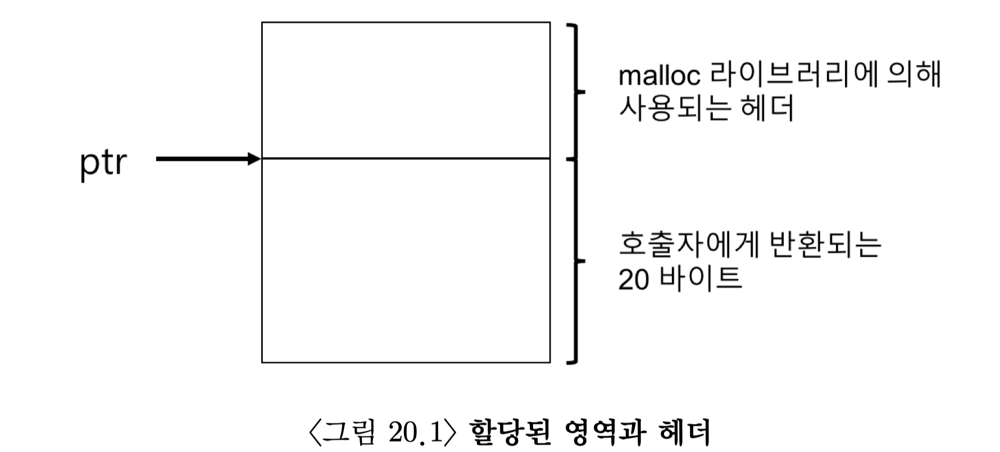
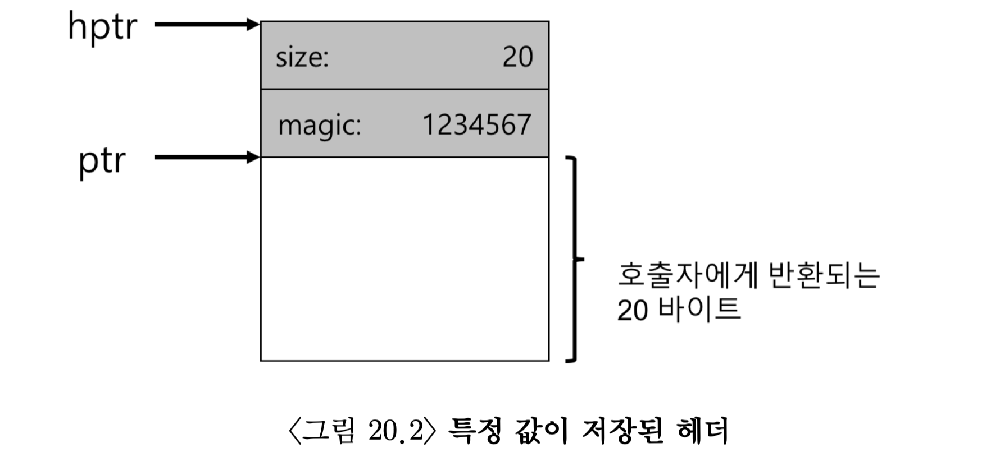
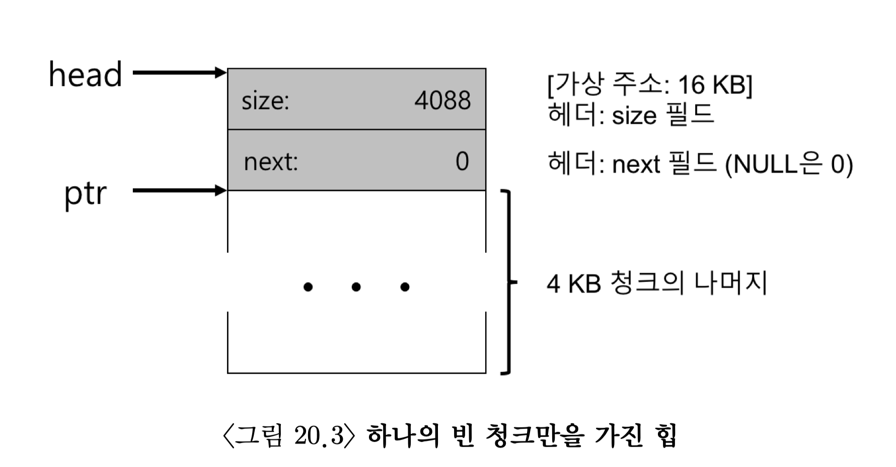
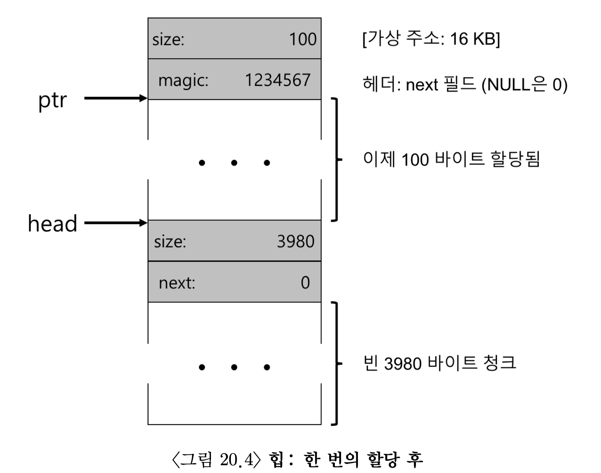
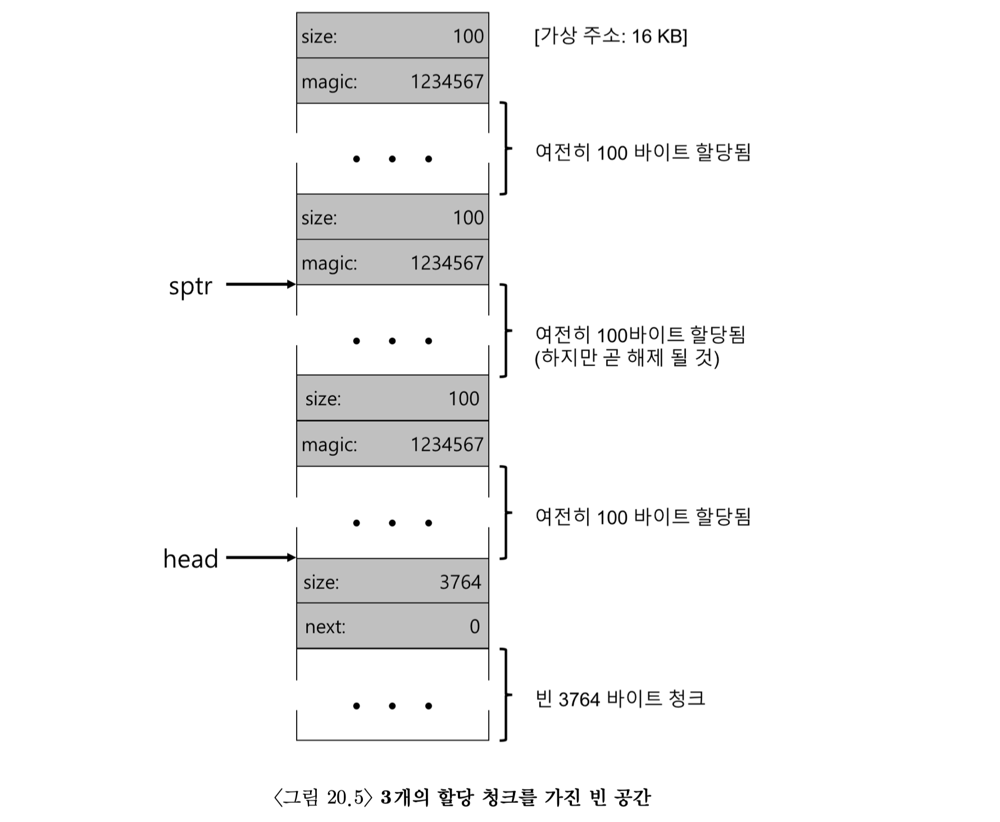
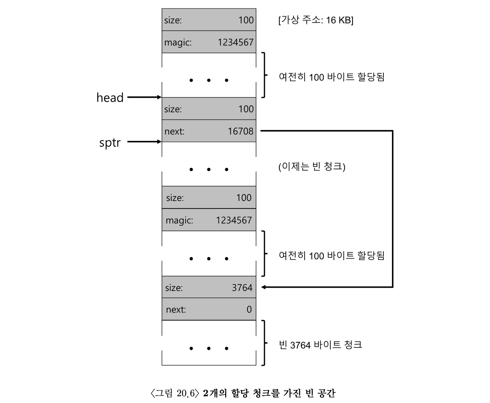
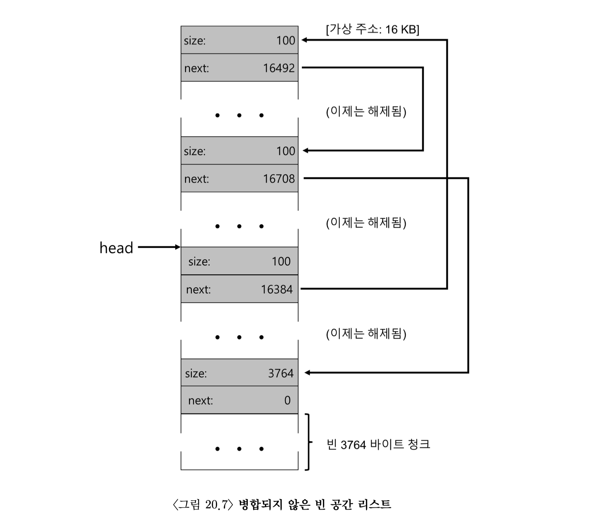

## 20 빈 공간 관리 개요

관리하고 있는 공간이 고정 크기의 단위로 나누어져 있는 경우 빈 공간 관리는 쉬울 수 있다. 

그냥 이 고정 크기 단위의 리스트를 유지하고 클라이언트가 그 중 하나를 요청하면 첫 번째 항목을 반환하면 된다. 

공간이 가변-크기 빈 공간들의 집합으로 구성되어 있는 경우 빈 공간 관리가 더 어렵다. 

이 경우 malloc(), free()에서 처럼 사용자-수준 메모리 할당 라이브러리 또는 세그멘테이션으로 물리 메모리를 가변-크기로 관리하는 운영체제에서 발생한다. 어느 경우에도 외부 단편화가 존재한다.

또한 빈 공간들의 전체 크기가 요청된것보다 크더라도 하나의 연속된 영역이 존재하지 않으면 요청은 실패할 수 있다.


빈 공간의 전체 크기는 20바이트이지만 10바이트 크기로 두 조각이 존재한다.

만약 15바이트 요청이 들어오면 실패한다.

---

## 20.1 가정

### **메모리 할당 인터페이스에 대한 가정**

- 기본 인터페이스는 malloc()과 free()를 따른다.
- void* malloc(size_t size)는 사용자가 요청한 바이트 수를 인자로 받아, 요청한 크기 이상인 메모리 영역의 포인터를 반환한다.
- void free(void* ptr)는 포인터만을 인자로 받아 해당 영역을 해제한다.
→ 크기 정보는 사용자가 제공하지 않으며, 라이브러리가 포인터만으로 크기를 파악해야 한다.

### **단편화(Fragmentation)에 대한 가정**

- 외부 단편화(external fragmentation) 방지를 주로 논의한다.
(내부 단편화도 있을 수 있으나, 본 논의의 초점 X)

### **메모리 이동(재배치)에 대한 가정**

- 한 번 malloc()으로 할당된 메모리는 다른 위치로 옮겨질 수 없다.
- 프로그램이 malloc()을 통해 받은 포인터는 free()가 호출될 때까지 고정된 메모리 공간을 가리킨다.
  - 따라서 빈 공간의 압축(compaction)은 사용할 수 없다.

---

## 20.2 저수준 기법들

### **학습 목표** 

1. 분할(splitting) & 병합(coalescing) 기초 
1. 할당된 영역의 크기를 빠르고 상대적으로 쉽게 파악할 수 있는 방법
1. 빈 공간과 사용 중인 공간을 추적하기 위한 빈 공간 내에 간단한 리스트를 구현하는 방법

### 분할과 병합

빈 공간 리스트는 힙에 있는 빈 공간들의 집합 (30바이트 힙)


- 2개의 원소
- 원소1: 첫 번째 10바이트의 빈 세그멘트(바이트0-9)
- 원소2: 두 번째 10바이트의 빈 세그멘트(바이트20-29)

**Q: 10바이트를 초과하는 모든 요청은 실패하여 NULL 반환**

→ 요청한 크기에 해당하는 메모리 청크가 없기 때문이다. 

**Q: 10바이트보다 적은 요청은? (메모리를 1바이트만 요청했다고 가정)**

→ 할당기는 분할 작업을 수행 

**분할 작업** 

```
청크 = 메모리 할당 단위 

요청을 만족시킬 수 있는 빈 청크를 찾아 이를 둘로 분할 
첫 번째 청크는 호출자에서 반환, 두 번째 청크는 빈 공간 리스트에 남는다.

즉, 요청이 특정 빈 청크의 크기보다 작은 경우 분할 기법을 사용한다.
```

**2번 원소 분할 예시**  


- malloc()은 20(1바이트가 할당된 영역의 주소)를 반환

**병합 before**


응용 프로그램이 free(10)을 호출하여 힙의 중간에 존재하는 공간을 반환한다

깊게 생각하지 않고 빈 공간을 다시 리스트에 추가할 경우 다음과 같은 모양


이제 힙 전체가 비어 있지만, 10바이트 길이의 청크 3개로 나누어져 있다. 

사용자가 20바이트를 요청하는 경우 단순한 리스트 탐색은 빈 청크를 발견하지 못하고 실패(NULL)를 반환

할당기는 이 문제를 방지하기 위해 메모리 청크가 반환될 때 빈 공간들을 병합한다.

해제되는 청크의 주소와 인접합 양쪽 빈 청크의 주소를 살펴본다. 

새로 해제된 빈 공간 청크와 바로 인접해 있다면 그들은 하나의 더 큰 빈 청크로 병합한다. 

병합 경우의 수는 4가지(왼쪽 / 왼쪽 오른쪽 모두/ 오른쪽 / X)

**병합 after** 


병합 기법을 사용하여 할당기가 커다란 빈 공간을 응용 프로그램에게 제공할 수 있다는 것을 더 보장할 수 있다.

### 할당된 공간의 크기 파악

free(void *ptr) 인터페이스는 크기를 매개변수로 받지 않는다.

포인터가 인자로 전달되면 **malloc 라이브러리**는 해제되는 메모리 영역의 크기를 신속히 파악하여 그 공간을 빈 공간 리스트에 추가시킬 수 있다. 

이 작업을 위해 대부분의 할당기는 추가 정보를 **헤더(header)블럭**에 저장한다.



헤더 블럭은 메모리에 유지되며 보통 해제된 청크 바로 직전에 위치한다.



사용자가 malloc()을 호출하고 그 결과를 ptr에 저장했다고 가정

```c
ptr = malloc (20);
```

헤더는 할당된 공간의 크기(size), 해제 속도를 향상시키기 위한 추가적인 포인터, 부가적인 무결성 검사를 위한 매직 넘버, 기타 정보를 저장할 수 있다.

```c
typedef struct __header_t {
	 int size; 
	 int magic; 
} header_t;
```

- 간단한 헤더 구조 example
- 할당된 공간 크기와 매직 넘버를 갖는다.

사용자가 free(ptr) 호출

```c
void free(void *ptr) {
		header_t *hptr = (void *)ptr − sizeof(header_t); 
		// 안정성 검사 
		// 해제된 영역의 크기 계산 
```

1. 라이브러리는 헤더의 시작 위치를 파악하기 위해 포인터 연산을 한다.
1. 라이브러리는 매직 넘버가 기대하는 값과 일치하는지 비교하여 **안정성 검사(sanity check)**를 실시
1. 새로 해제된 영역의 크기를 계산
→ 빈 영역의 크기 = 헤더 크기 + 사용자에게 할당된 영역의 크기

→ 사용자가 N 바이트의 메모리 청크를 요청하면 라이브러리는 N + 헤더의 크기인 청크를 탐색한다.

### 빈 공간 리스트 내장 

빈 공간 리스트를 어떻게 구현할 수 있는가?

**가정 정리** 

- 4096바이트 크기의 메모리 청크 존재 → 힙의 크기는 4KB 가정
- 힙은 시스템 콜 mmap()을 호출하여 얻어진 영역에 구축된다고 가정

빈 공간 리스트로 관리하기 위해서는 먼저 리스트를 초기화해야 한다.

리스트는 4096(빼기 헤더 크기) 길이의 항목(노드) 하나를 가지고 있다. 

**노드** 

```c
typedef struct __node_t { 
		int size; 
		struct __node_t *next; 
} node_t;
```

**힙을 초기화하고 힙에 빈 공간 리스트의 첫 번째 원소를 넣는 코드** 

```c
// mmap()이 빈 공간의 청크에 대한 포인터를 반환
node_t *head = mmap(NULL , 4096 , PROT_READ|PROT_WRITE, 
											MAP_ANON|MAP_PRIVATE , −1, 0); 
head−>size = 4096 − sizeof(node_t); 
head−>next = NULL;
```

이 코드의 실행 후 리스트는 크기 4088의 항목(노드) 하나만을 가진다.



100 바이트 메모리 청크 요청

라이브러리는 먼저 충분한 크기의 청크를 찾는다. → 하나의 빈 청크(크기: 4088)

요청을 처리하기에 충분히 큰 크기 = 빈 영역의 크기(100바이트) + 헤더의 크기(8바이트 가정)

라이브러리는 108바이트 청크, 나머지 빈 청크 2개로 분할 

결과 → 그림 20.4 



100바이트씩(헤더 포함 108바이트)할당된 3개의 공간이 존재하는 힙 그림 20.5



힙의 시작 부분 324바이트(108 * 3)가 현재 할당되어 있다. 

이때 프로그램이 free()를 통해 일부 메모리를 반환하면 어떤 일이 벌어질까?

free(16500) 호출

힙의 시작 주소 = 가상 주소: 16384바이트 

시작 주소(16384) + 이전 메모리 청크 크기(108) + 해제되는 청크의 헤더(8) = 16500 → 그림 20.5 sptr



라이브러리는 빈 청크를 빈 공간 리스트에 삽입한다.

이제 빈 공간 리스트의 첫 번째 원소는 작은 빈 청크(100바이트 크기)

두 번째 원소는 큰 청크(3764바이트)이다.

추가적으로 2개의 사용 중인 청크를 해제한다. 

병합이 없다면, 작은 단편으로 이루어진 빈 공간 리스트가 될 것이다

108 → 108 → 108 → 3764 → NULL

해결책은 리스트를 순회하면서 인접한 청크를 병합하면 된다. 

병합이 완료되면 힙은 전체 하나의 큰 청크가 된다.

그림 20.7 병합되지 않은 빈 공간 리스트 



### 힙의 확장

힙 공간이 부족한 경우에 어떻게 할 것인가?

대부분의 전통적인 할당기는 적은 크기의 힙으로 시작하여 모두 소진하면 운영체제로부터 더 많은 메모리를 요청한다. 할당기는 힙을 확정하기 위해 특정 시스템 콜(sbrk)을 호출한다.

그런 후 새로운 청크를 할당한다. sbrk 요청을 수행하기 위해 운영체제는 빈 물리 페이지를 찾아 요청 프로세스의 주소 공간에 매핑한 후, 새로운 힙의 마지막 주소를 반환한다.

---

## 20.3 기본 전략 

이상적인 할당기는 속도가 빠르고 단편화를 최소로 해야 한다. 

불행하게도 할당과 해제 요청 스트림은 결국 프로그래머에게 결정되기 때문에, 어느 특정 전략도 잘 맞지 않는 입력을 만나면 성능이 매우 좋지 않을 수 있다.

몇 가지 기본 정책에 대해 알아보고 장단점을 정리하자.

### 최적 적합(Best Fit)

먼저 빈 공간 리스트를 검색하여 요청한 크기와 같거나 더 큰 빈 메모리 청크(후보자)를 찾는다.

후보자 그룹에서 가장 작은 크기의 청크를 반환한다. 

이 청크는 최적 청크(최소 적합)이라고 불린다.

- 장점: 큰 빈 공간의 낭비를 줄일 수 있음
- 단점: 리스트 전체를 다 검색해야 하므로 느림

### **최초 적합(First-Fit)**

- 가장 먼저 발견된, 요청한 크기보다 크거나 같은 빈 공간에 할당.
- 검색은 항상 리스트의 처음부터 시작.
- 남은 빈 공간이 있다면 분할하여 빈 공간 리스트에 다시 추가.
- 장단점
- 장점: 빠름 (처음 찾는 게 목표이므로 중간에 멈출 수 있다)
  - 단점: 앞부분에 작은 조각들이 많이 생겨 **외부 단편화**가 심해질 수 있음

### **최적 적합(Best-Fit)**

- 요청한 크기와 **가장 근접한(작은 차이의)** 빈 공간에 할당.
- 리스트 전체를 검색해서 가장 **딱 맞는** 빈 공간을 찾음.
- 장단점
- 장점: 큰 빈 공간의 낭비를 줄일 수 있음
  - 단점
- 리스트 전체를 다 검색해야 하므로 느림
    - 할당하고 남은 빈 공간이 매우 작아서 쓸 수 없는 미세 조각들이 많이 생길 수 있음 
→ 오히려 외부 단편화를 악화

### **최악 적합(Worst-Fit)**

- 가장 **큰** 빈 공간에 할당.
- 큰 빈 공간을 쪼개어 사용하면, 남는 공간도 쓸 만한 크기일 가능성이 있음.
- 장점: 미세 조각이 줄어들 수 있음
- 단점
- 리스트 전체를 다 검색해야 하므로 느림
  - 큰 공간이 계속 나눠지면 결국 최악의 상황이 되기도 함

### 다음 적합(Next Fit)

- 항상 리스트의 처음부터 탐색하는 대신 마지막으로 찾았던 원소를 가리키는 추가의 포인터를 유지
- 빈 공간 탐색을 리스트 전체에 더 균등하게 분산시키는 것
- 장점: 리스트 첫 부분에만 단편이 집중적으로 발생하는 것을 방지
- 성능: 최적 적합과 비슷 

---

