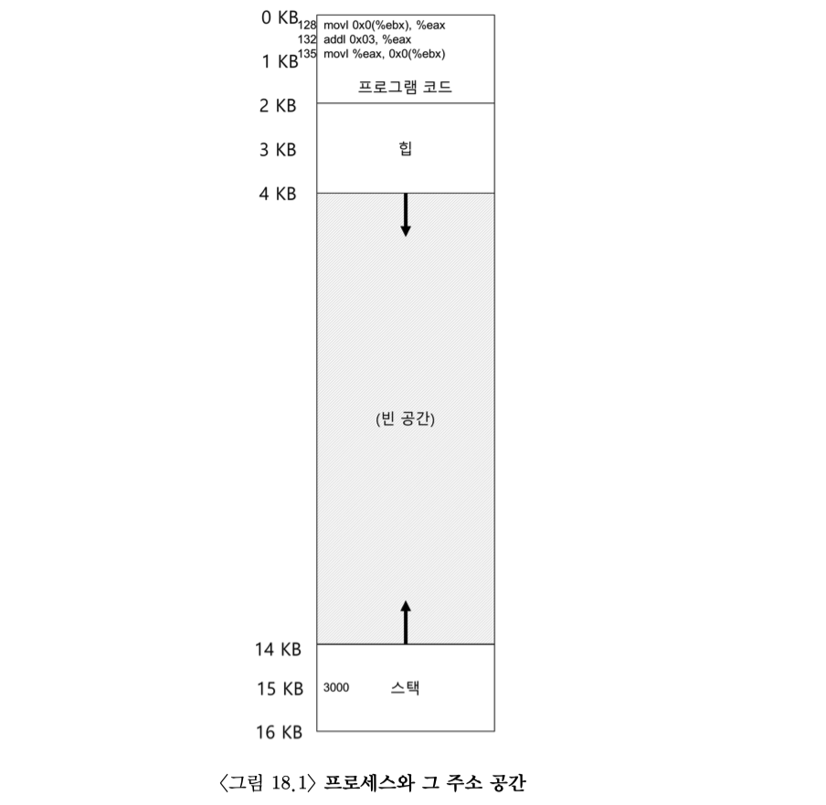
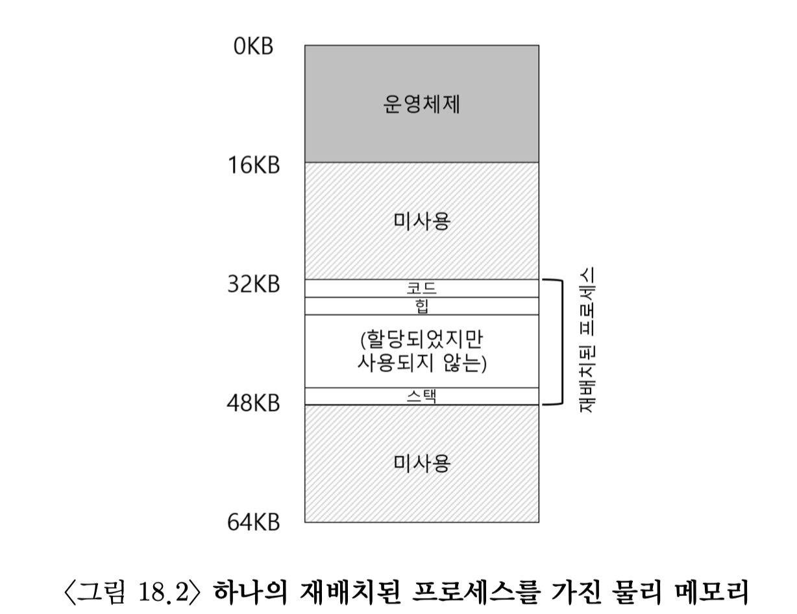
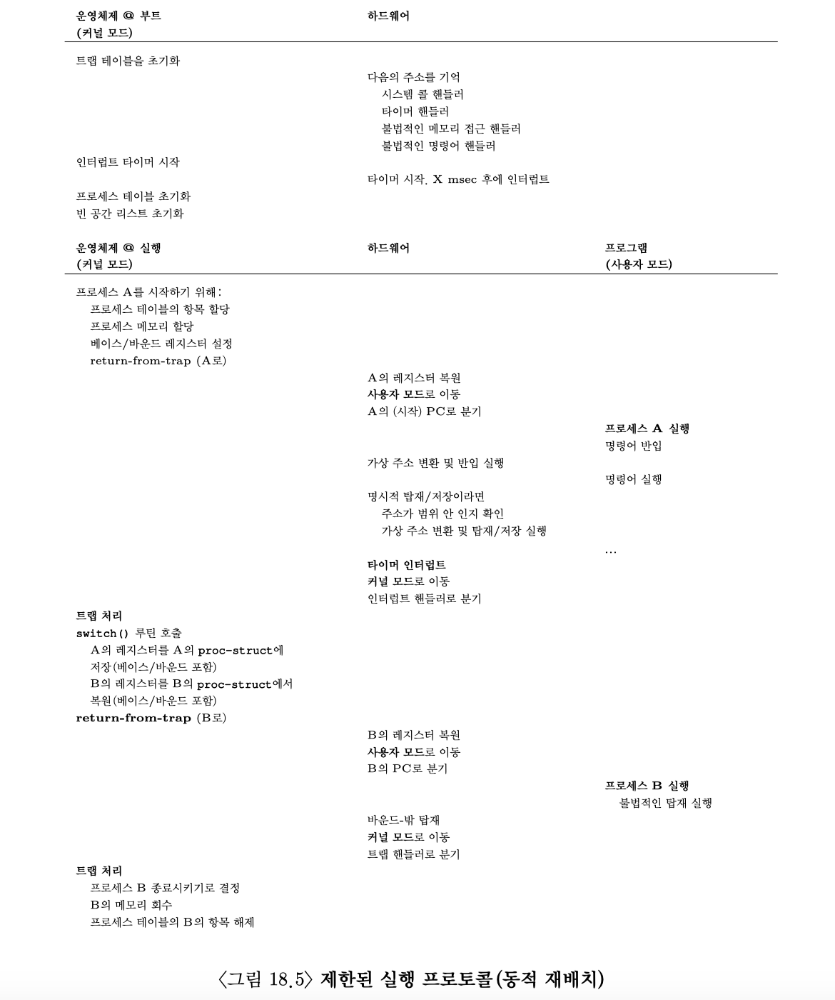

## 18 주소 변환의 원리 개요

CPU 가상화 부분에서, 제한적 직접 실행(LDE) 기법을 공부했다.

대부분의 경우 프로그램은 하드웨어에서 직접 실행된다.

하지만 프로세스가 시스템 콜을 호출하거나 타이머 인터럽트가 발생할 때 등의 특정 순간에는 운영체제가 개입하여 문제가 발생하지 않도록 한다. → 듀얼 모드

운영체제는 중요한 순간에 운영체제가 관여하여 하드웨어를 직접 제어한다 또한 효율성과 제어가 운영체제의 목표

메모리 가상화에서도 마찬가지로 효율성, 제어 모두를 추구한다.

제어란 응용 프로그램이 자기자신의 메모리 이외에는 다른 메모리에 접근하지 못한다는 것을 운영체제가 보장하는 것을 의미.

이런 효율성 측면과 제어 측면 모두를 제공하면서 어떻게 유연하게 메모리를 가상화할까?

이런 문제를 해결하기 위해서 이번장에서 배우는 기법은 **하드웨어-기반 주소 변환(hardware-based address translation)** 짧게 **주소 변환(address translation)**이다.

주소 변환을 통해서 하드웨어는 가상 주소를 정보가 실제 존재하는 물리 주소로 변환한다.

## 18.1 가정

당분간 사용자 주소 공간은 물리 메모리에 연속적으로 배치되어야 한다고 가정한다. 

논의를 단순화하기 위해 주소 공간의 크기가 너무 크지 않다고 가정한다.

또한 각 주소 공간의 크기는 같다고 가정한다.

## 18.2 사례



**example**

```c
void func() {
	  int x = 3000;
	  x = x + 3; 
}

x = x + 3 분석!

컴파일러는 x = x + 3 코드를 어셈블리 코드로 변환한다.

128: movl 0x0(\%ebx) , \%eax ; -> 0+ebx를 eax에 저장
132: addl \$0x03 , \%eax ;     -> eax레지스터에 3을 더한다  
135: movl \%eax , 0x0(\%ebx) ; -> eax레지스터를 메모리에 다시 저장 
```

그림 18.1 그림에서 해당 명령어들은 다음과 같은 메모리 접근이 일어난다.

- 주소 128의 명령어를 반입(fetch)
- 이 명령어 실행(주소 15 KB에서 탑재) → 스택에 할당된 3000을 가져온다.
- 주소 132의 명령어를 반입(fetch)
- 이 명령어 실행(메모리 참조 없음) → ALU 계산 (3000 + 3) & 레지스터 저장
- 주소 135의 명령어를 반입(fetch)
- 이 명령어 실행(15 KB에 저장) → 스택에 3003 저장

프로그램 관점에서 주소 공간은 0부터 시작하여 최대 16KB까지이다. 프로그램이 생성하는 모든 메모리 참조는 이 범위 내에서 있어야 한다.  

## 18.3 동적(하드웨어-기반) 재배치 

### 소프트웨어-기반 재배치 

**소프트웨어 - 기반 재배치 개념** 

하드웨어 지원이 제공되기 전, 일부 시스템은 소프트웨어만 사용해서 재배치를 수행 

→ 정적 재배치(static relocation)

**실행 방식** 

**로더(loader)**라고 불리는 소프트웨어가 실행하고자 하는 실행 파일의 모든 주소를 물리 메모리 오프셋으로 변경한다. 프로그램 주소 공간이 주소 3000부터 탑재되었다면, 로더는 명령어의 모든 주소를 3000씩 이동한 주소로 다시 작성한다. 즉, 기계어에 정적으로 주소 변환 

**소프트웨어 기반 / 정적 재배치 한계**

정적 재배치는 보호 기능이 없다. 잘못된 주소를 생성하여 다른 프로세스나 운영체제의 메모리에 불법적으로 접근할 수 있다. 제대로 보호하기 위해서는 하드웨어의 지원이 필요하다.
또한 한 번 배치되면 추후 주소 공간을 재배치하는 것이 어렵다.

---

### 하드웨어 - 기반 재배치 / 동적 재배치



**동적 재배치(dynamic relocation)**

해당 기술은 각 CPU 마다 2개의 하드웨어 레지스터가 필요하다. 

- 베이스(base) 레지스터
- 바운드(bound) 레지스터 / 한계(limit) 레지스터

**동작 원리** 

각 프로그램은 주소 0에 탑재되는 것처럼 작성되고 컴파일된다.

프로그램 시작 시, 운영체제가 프로그램이 탑재될 물리 메모리 위치를 결정하고 베이스 레지스터를 그 주소로 지정 한다. → <그림 18.2> 베이스 레지스터 값은 32KB(32768)

프로세스의 의해 생성되는 모든 주소가 다음과 같은 방법으로 프로세서의 의해 변환된다. (주소 변환)

```
physical address = virtual address + base
```

이 주소의 재배치는 실행 시에 일어나고, 프로세스가 실행을 시작한 이후에도 주소 공간을 이동할 수 있기 때문에

**동적 재배치(dynamic relocation)**라고 불린다.

**그렇다면 바운드(한계) 레지스터는 어디에 사용?**

바운드 레지스터는 보호를 지원하기 위해 존재한다. 

그림<18.2> 바운드 레지스터는 16KB로 설정, 이 설정은 프로세스가 할당받는 물리 주소 크기이다.   

프로세스가 바운드보다 큰 가상 주소 또는 음수인 가상 주소를 참조하 CPU는 예외를 발생시키고 종료될것이다. 

즉, 바운드의 요점은 프로세스가 생성한 모든 주소가 합법적이고 프로세스의 범위에 있다는 것을 확인하는 것

**하드웨어 구조 측면** 

베이스 레지스터, 바운드 레지스터는 CPU 칩 상에 존재하는 하드웨어 구조이다. 

주소 변환에 도움을 주는 프로세서의 일부를 **메모리 관리 장치(memory management unit, MMU)**라고 부른다.

베이스 + 바운드 기법말고 더 정교한 메모리 관리 기법을 적용하면 MMU에 더 많은 회로가 추가된다.

**추가 내 정리 (fault → abort)** 

```
책에서는 가상 주소가 너무 크거나 음수일 경우 폴트(fault)가 발생한다고 설명하지만,  
나는 이 상황은 폴트가 아니라 abort가 발생한다고 보는 것이 더 정확하다고 생각한다.  

fault는 복구 가능성이 있는 예외 상황을 의미한다.  
예를 들어, 페이지 폴트(page fault)는 요청한 페이지가 메모리에 없어서 디스크에서 해당 페이지를 불러온 후  
다시 명령어를 재실행할 수 있는 구조이기 때문에 복구 가능한 예외에 해당한다.  

반면, abort는 복구 불가능한 오류를 의미한다.  
예를 들어 OOM(Out of Memory)이나 bound 레지스터를 초과한 메모리 접근처럼  
해당 오류는 운영체제가 해결할 수 없고, 프로세스를 즉시 종료해야 한다.  

따라서 특정 프로세스가 자신에게 할당된 메모리 영역이 아닌 다른 영역을 접근하려 할 경우,  
이는 보호 메커니즘 위반으로 복구 불가능한 오류(abort)이며,  
운영체제는 해당 프로세스를 종료시키는 것이 올바른 동작이다
```

## 전체 동작 설명 



## 정리 (내부 단편화와 세그멘테이션 도입의 필요성)

```
그림 18.2에서 볼 수 있듯이, 재배치된 프로세스는 물리 메모리의 32KB부터 48KB까지를 사용한다.  
하지만 이 프로세스의 스택과 힙이 충분히 크지 않기 때문에, 
이들 사이의 많은 공간이 사용되지 않은 채 낭비되고 있다.

이처럼 할당된 메모리 블록 내부에서 사용되지 않는 공간이 발생하는 현상을 
내부 단편화(internal fragmentation)라고 한다.  
즉, 고정 크기의 슬롯에 주소 공간을 배치하는 현재의 방식에서는  
비록 시스템 전체로는 여유 메모리가 있더라도 각 슬롯 내 낭비로 인해 메모리 사용률이 떨어진다.

이러한 비효율을 줄이고 물리 메모리의 활용률을 높이기 위해서는  
기존의 base-and-bound 기법보다 더 정교한 메모리 관리 방식이 필요하다.

바로 세그멘테이션(segmentation)이며, 이는 다음 장에서 자세히 논의될 것이다.
```

