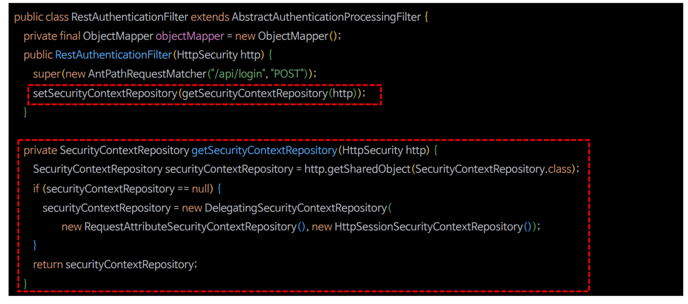
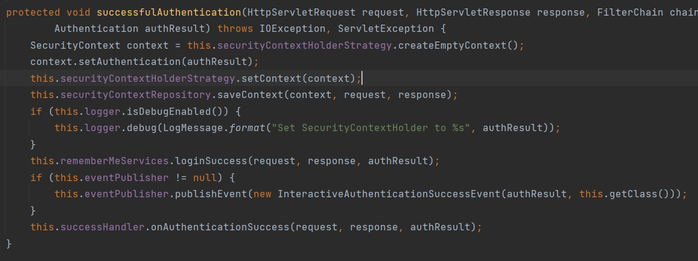

# *인증 성공 이후 작업*

1. *인증 객체를 Thread Local에 저장해서 요청 스코프 전체에서 SecurityContextHolder 통해 가져올 수 있게 한다.*
1. *인증 객체를 세션에 저장(영속화)해서 다음 요청에 대한 인증처리를 하지 않게 해준다.*

# *SecurityContextRepository 설정* 



- *인증 필터에서 인증에 성공한 이후 인증 객체를 세션에 저장할 수 있도록* ***HttpSessionSecurityContextRepository****를 지정 한다*
- ***AbstractAuthenticationProcessingFilter****를 상속하면* ***RequestAttributesSecurityContextRepository****가 기본으로 설정 된다*

***AbstractAuthenticationProcessingFilter 인증 성공 이후 처리 로직*** 



[SecurityContextRepository / SecurityContextHolderFilter](https://app.notion.com/p/26b7d6692ca881459116c46b8082cca7) 

# *구현*

***SecurityConfig***

```java
@EnableWebSecurity
@Configuration
@RequiredArgsConstructor
public class SecurityConfig {
    private final AuthenticationProvider authenticationProvider;
    private final AuthenticationProvider restAuthenticationProvider;
    private final AuthenticationDetailsSource authenticationDetailsSource;
    private final FormAuthenticationSuccessHandler successHandler;
    private final RestAuthenticationSuccessHandler restSuccessHandler;
    private final FormAuthenticationFailureHandler failureHandler;
    private final RestAuthenticationFailureHandler restFailureHandler;
    @Bean
    @Order(1)
    public SecurityFilterChain restSecurityFilterChain(HttpSecurity http) throws Exception {

        AuthenticationManagerBuilder authenticationManagerBuilder =
                http.getSharedObject(AuthenticationManagerBuilder.class);

        authenticationManagerBuilder.authenticationProvider(restAuthenticationProvider);

        AuthenticationManager authenticationManager = authenticationManagerBuilder.build();
        http
                .securityMatcher("/api/**")
                .authorizeHttpRequests(auth -> auth
                        .requestMatchers("/css/**", "/images/**",
                                "/js/**", "/favicon.*", "/*/icon/-*").permitAll()
                        .anyRequest().permitAll())
                .csrf(AbstractHttpConfigurer::disable)
                .addFilterBefore(
                        restAuthenticationFilter(http, authenticationManager),
                        UsernamePasswordAuthenticationFilter.class)
                .authenticationManager(authenticationManager);

        return http.build();
    }
    private RestAuthenticationFilter restAuthenticationFilter(HttpSecurity http, AuthenticationManager authenticationManager) {
        RestAuthenticationFilter restAuthenticationFilter = new RestAuthenticationFilter(http);
        restAuthenticationFilter.setAuthenticationManager(authenticationManager);
        restAuthenticationFilter.setAuthenticationSuccessHandler(restSuccessHandler);
        restAuthenticationFilter.setAuthenticationFailureHandler(restFailureHandler);
        return restAuthenticationFilter;
    }
    @Bean
    @Order(2)
    public SecurityFilterChain securityFilterChain(HttpSecurity http) throws Exception{
        http
                .authorizeHttpRequests(authorize -> authorize
                        .requestMatchers("/css/**", "/images/**",
                                "/js/**", "/favicon.*", "/*/icon/-*").permitAll()
                        .requestMatchers("/", "/signup", "/login*").permitAll()
                        .requestMatchers("/user").hasRole("USER")
                        .requestMatchers("/admin").hasRole("ADMIN")
                        .requestMatchers("/manager").hasRole("MANAGER")
                        .anyRequest().authenticated())
                .authenticationProvider(authenticationProvider)
                .formLogin(form -> form
                        .loginPage("/login")
                        .authenticationDetailsSource(authenticationDetailsSource)
                        .successHandler(successHandler)
                        .failureHandler(failureHandler)
                        .permitAll())
                .exceptionHandling(ex -> ex.accessDeniedHandler(
                        new FormAccessDeniedHandler("/denied")));
        return http.build();
    }
}
```

***RestAuthenticationFilter***

```java
public class RestAuthenticationFilter extends AbstractAuthenticationProcessingFilter {
    private final ObjectMapper objectMapper = new ObjectMapper();
    public RestAuthenticationFilter(HttpSecurity http) {
        super(new AntPathRequestMatcher("/api/login", "POST"));
        setSecurityContextRepository(getSecurityContextRepository(http));
    }
    private SecurityContextRepository getSecurityContextRepository(HttpSecurity http) {
        SecurityContextRepository securityContextRepository = http.getSharedObject(SecurityContextRepository.class);
        if(securityContextRepository == null || securityContextRepository instanceof RequestAttributeSecurityContextRepository){
           return new DelegatingSecurityContextRepository(
                    new RequestAttributeSecurityContextRepository(), new HttpSessionSecurityContextRepository());
        }
        return securityContextRepository;
    }
    @Override
    public Authentication attemptAuthentication(HttpServletRequest request, HttpServletResponse response) throws AuthenticationException, IOException, ServletException {

        if(!HttpMethod.POST.matches(request.getMethod()) || !WebUtil.isAjax(request)){
            throw new IllegalArgumentException("Authentication method not supported");
        }

        AccountDto accountDto = objectMapper.readValue(request.getReader(), AccountDto.class);
        if(!StringUtils.hasText(accountDto.getUsername()) || !StringUtils.hasText(accountDto.getPassword())){
            throw new AuthenticationServiceException("Username or Password is not provided");
        }

        RestAuthenticationToken authenticationToken = [REDACTED] RestAuthenticationToken(accountDto.getUsername(), accountDto.getPassword());
        return getAuthenticationManager().authenticate(authenticationToken);
    }
}
```

