# **폼 인증** 

  - HTTP 기반의 폼 로그인 인증 메커니즘을 활성화하는 API
  - 사용자 인증을 위한 사용자 정의 로그인 페이지를 쉽게 구현할 수 있다 
  - 기본적으로 스프링 시큐리티가 제공하는 기본 로그인 페이지를 사용하며 사용자 이름과 비밀번호 필드가 포함된 간단한 로그인 양식을 제공한다 
  - 사용자는 웹 폼을 통해 자격 증명(사용자 이름과 비밀번호)를 제공하고 Spring Security는 HttpServletRequest에서 이 값을 읽어 온다 

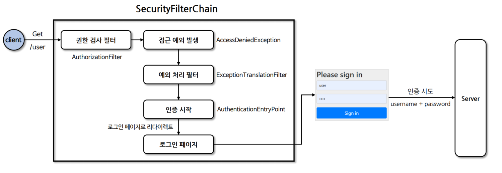

# **formLogin() API**

**FormLoginConfigurer** 설정 클래스를 통해 여러 API를 설정할 수 있다 

내부적으로 **UsernamePasswordAuthenticationFilter**가 생성되어 폼 방식의 인증 처리를 담당하게 된다 

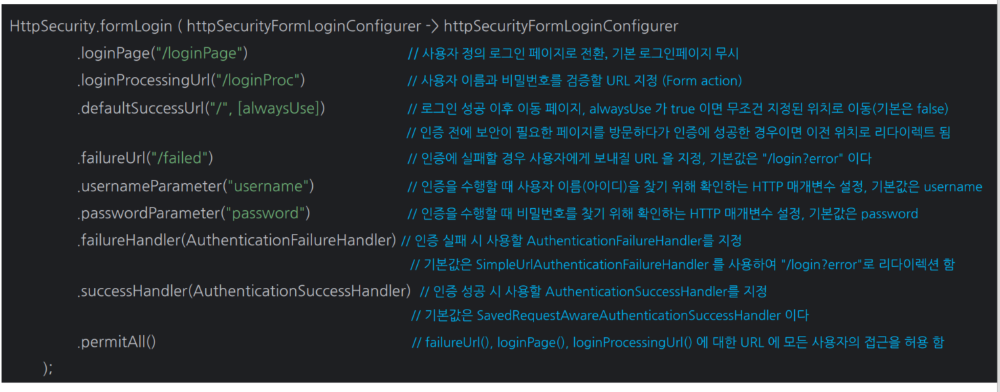

```java
@EnableWebSecurity(debug = false) // default: false
@Configuration
public class SecurityConfig {
    @Bean
    public SecurityFilterChain securityFilterChain(HttpSecurity http) throws Exception{
        http
                .authorizeHttpRequests(auth -> auth.anyRequest().authenticated())
                .formLogin(form -> form
                        .loginPage("/loginPage")
                        .loginProcessingUrl("/loginProc")
                        .defaultSuccessUrl("/", true)
                        .failureUrl("/failed")
                        .usernameParameter("userId")
                        .passwordParameter("passwd")
                        .successHandler((request, response, authentication) -> {
                            System.out.println("authentication = " + authentication);
                            response.sendRedirect("/home");
                        })
                        .failureHandler((request, response, exception) -> {
                            System.out.println("exception = " + exception.getMessage());
                            response.sendRedirect("/login");
                        })
                        .permitAll()
                );

        return  http.build();
    }
    @Bean
    public UserDetailsService userDetailsService(){
        UserDetails user = User.withUsername("user12")
                .password("{noop}1111")
                .roles("USER").build();
        return new InMemoryUserDetailsManager(user);
    }
}
```

**defaultSuccessUrl("/", true) vs successHandler**

`defaultSuccessUrl` 도 내부에서 `SavedRequestAwareAuthenticationSuccessHandler`를 사용한다.

내가 `successHanlder`를 커스텀하게 구현하면 해당 동작이 우선이다.

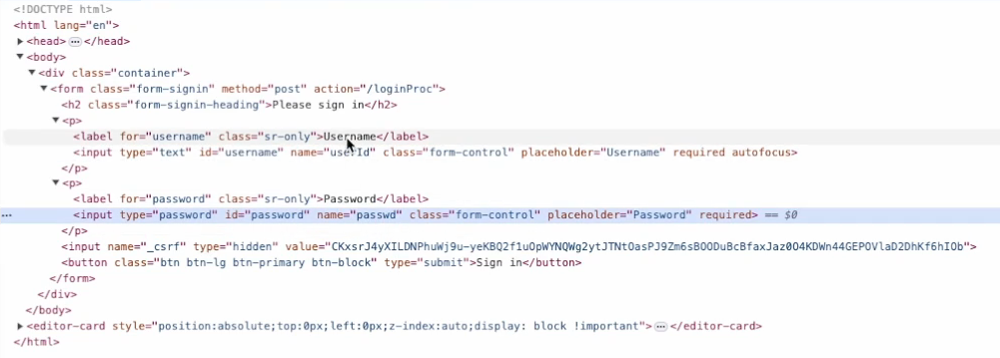

<form> 태그의 action을 보면 `processingUrl`인 `/loginProc` 이고

<input> 태그의 `name=userId, name=passwd` 이다. 

이는 `.usernameParameter("userId") .passwordParameter("passwd")` 2개의 설정 결과

- 스프링 시큐리티는 `AbstractAuthenticationProcessingFilter` 클래스를 사용자의 자격 증명을 인증하는 기본 필터로 사용 한다 
  - `UsernamePasswordAuthenticationFilter` 는 `AbstractAuthenticationProcessingFilter` 를 확장한 클래스로서 HttpServletRequest에서 제출된 사용자 이름과 비밀번호로부터 인증을 수행한다 
  - 인증 프로세스가 초기화 될 때 로그인 페이지와 로그아웃 페이지 생성을 위한 `DefaultLoginPageGeneratingFilter` 와 `DefaultLogoutPageGeneratingFilter` 가 초기화 된다 

# **구조** 

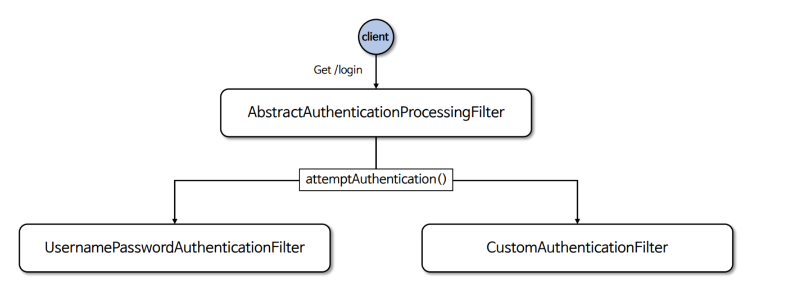

만약 Custom한 인증 필터를 만들고 싶으면 `AbstractAuthenticationProcessingFilter` or `UsernamePasswordAuthenticationFilter` 클래스를 확장하고 `attemptAuthentication()` 메소드를 재정의(오버라이딩)해야 한다 

또한 해당 필터를 SecurityConfig를 통해 추가해야 한다 

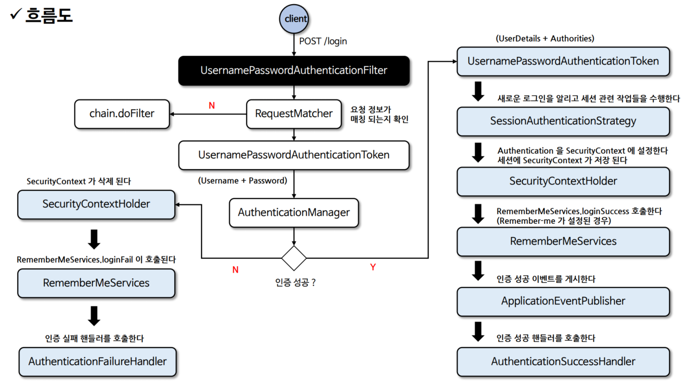

client가 `loginProcessingUrl()에 설정한 url`이거나 `시큐리티가 제공하는 기본 url: login`으로 요청을 하면 `UsernamePasswordAuthenticationFilter`는 인증을 시도하고 아니라면 바로 다음 filter로 넘어간다 

이 요청 URL에 대한 확인은 `RequestMatcher`를 통해서 한다

- HTTP는 액세스 제어와 인증을 위한 프레임워크를 제공하며 가장 일반적인 인증 방식은 `Basic` 인증 방식이다 
  - `RFC 7235 표준`이며 인증 프로토콜은 HTTP 인증 헤더에 기술되어 있다

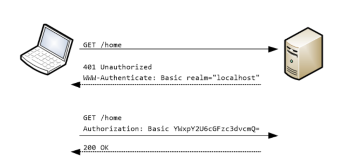

**HTTP basic 인증 프로세스** 

  1. 클라이언트는 인증 정보 없이 서버로 접속을 시도
  1. 서버가 클라이언트에게 인증 요구를 보낼 때 `401 Unauthorized` 응답과 함께 `WWW-Authenticate` 헤더를 기술해서 realm(보안 영역)과 Basic 인증 방법을 보낸다 
  1. 클라이언트가 서버로 접속할 때 Base64로 username과 password를 인코딩하고 `Authorization`헤더에 담아서 요청한다 
  1. 성공적으로 완료되면 정상적인 상태 코드를 반환한다 

**주의 사항** 

  - base-64 인코딩된 값은 디코딩이 가능하기 때문에 인증정보가 노출된다 
  - HTTP basic 인증은 반드시 `HTTPS` 같이 `TLS`기술과 함께 사용해야 한다 

# **httpBasic() API**

  - `HttpBasicConfigurer` 설정 클래스를 통해 여러 API들을 설정할 수 있다 
  - 내부적으로 `BasicAuthenticationFilter`가 생성되어 기본 인증 방식의 인증 처리를 담당하게 된다 

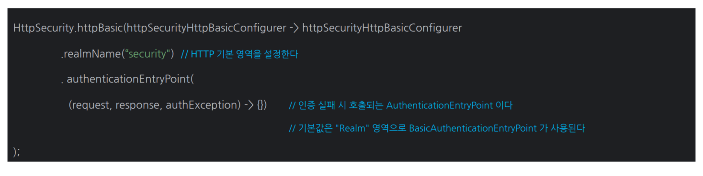

**CustomAuthenticationEntryPoint** 

```java
public class CustomAuthenticationEntryPoint implements AuthenticationEntryPoint {
    @Override
    public void commence(HttpServletRequest request, HttpServletResponse response, AuthenticationException authException) throws IOException, ServletException {
        response.setHeader("WWW-Authenticate", "Basic realm=security");
        response.sendError(HttpStatus.UNAUTHORIZED.value(), HttpStatus.UNAUTHORIZED.getReasonPhrase());
    }
}
```

`AuthenticationEntryPoint` 인터페이스를 구현하는 `CustomAuthenticationEntryPoint`  클래스 

응답 헤더에 `WWW-Authenticate` 를 설정한다 

만약 해당 응답 헤더가 잘못 설정되면 로그인 창이 뜨지 않는다. 

**CustomAuthenticationEntryPoint 등록** 

```java
@Bean
public SecurityFilterChain securityFilterChain(HttpSecurity http) throws Exception{
    http
            .authorizeHttpRequests(auth -> auth.anyRequest().authenticated())
            .httpBasic(basic -> basic.authenticationEntryPoint(new CustomAuthenticationEntryPoint()));

    return  http.build();
}
```

- 기본 인증 서비스를 제공하는 데 사용된다 
  - `BasicAuthenticationConverter`를 사용해서 요청 헤더에 기술된 인증정보의 유효성을 체크하며 Base64 인코딩된 username, password를 추출한다 
  - 인증 이후 세션을 사용하는 경우와 사용하지 않는 경우에 따라 처리되는 흐름에 차이가 있다.
세션을 사용하는 경우 매 요청 마다 인증과정을 거치지 않으나 세션을 사용하지 않는 경우 매 요청마다 인증과정을 거쳐야 한다

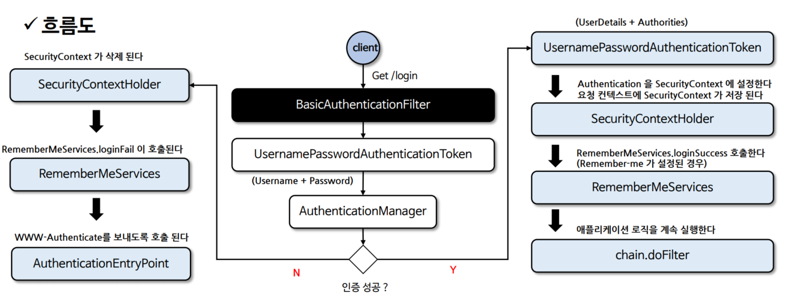

# **RememberMe 인증** 

  - 사용자가 웹 사이트나 애플리케이션에 로그인할 때 자동으로 인증 정보를 기억하는 기능이다 
  - `UsernamePasswordAuthenticationFilter` 와 함께 사용되며, `AbstractAuthenticationProcessingFilter` 슈퍼 클래스에서 훅을 통해 구현된다 
- 인증 성공 시 `RememberMeServices.loginSuccess()`를 통해 RememberMe 토큰을 생성하고 쿠키로 전달한다 
    - 인증 실패 시 `RememberMeServices.loginFail()`를 통해 쿠키를 지운다 
    - `LogoutFilter`와 연계해서 로그아웃 시 쿠키를 지운다

# **RememberMe 토큰** 

  - 기본적으로 암호화된 토큰으로 생성되어 브라우저에 쿠키를 보내고, 향후 세션에서 이 쿠키를 감지하여 자동 로그인이 이루어지는 방식으로 달성된다 
  - `base64(username + ":" + expirationTime + ":" + algorithmName + ":" + algorithmHex(username + ":" + expirationTime + ":" + password + ”:” + key))`
- username: UserDetailsService로 식별 가능한 사용자 이름 
    - password: [REDACTED] UserDetails에 일치하는 비밀번호 
    - expirationTime: remember-me 토큰이 만료되는 날짜와 시간, 밀리초로 표현 
    - key: remember-me 토큰의 수정을 방지하기 위한 개인 키 
    - algorithmName: remember-me 토큰 서명을 생성하고 검증하는 데 사용되는 알고리즘(SHA-256 알고리즘)

# **RememberMeServices 구현체** 

  - `TokenBasedRememberMeServices` - 쿠키 기반 토큰의 보안을 위해 해싱을 사용 
- 메모리 방식
  - `PersistentTokenBasedRememberMeServcies` - 생성된 토큰을 저장하기 위해 DB나 다른 영구 저장 매체를 사용한다 
  - 두 구현 모두 사용자의 정보를 검색하기 위한 `UserDetailsService`가 필요하다 

# **rememberMe() API**

  - `RememberMeConfigurer` 설정 클래스를 통해 여러 API들을 설정할 수 있다. 
  - 내부적으로 `RememberMeAuthenticationFilter`가 생성되어 자동 인증 처리를 담당하게 된다 

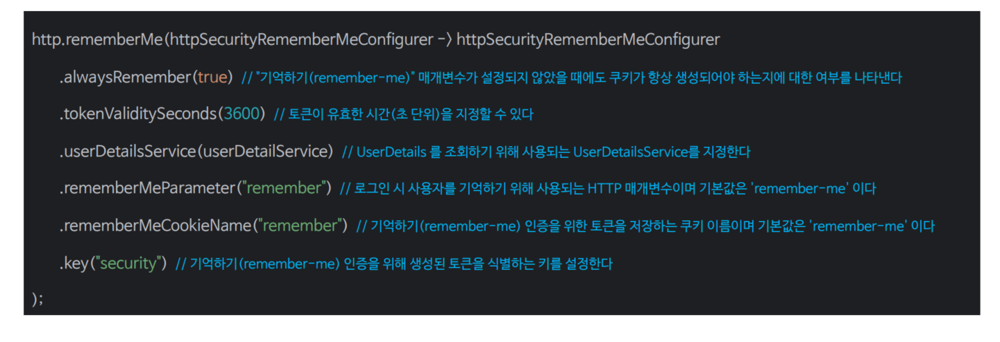

```java
@EnableWebSecurity
@Configuration
public class SecurityConfig {
    @Bean
    public SecurityFilterChain securityFilterChain(HttpSecurity http) throws Exception{
        http
                .authorizeHttpRequests(auth -> auth
                        .requestMatchers("/").permitAll()
                        .anyRequest().authenticated()
                )
                .formLogin(Customizer.withDefaults())
                .rememberMe(auth -> auth
                        // .alwaysRemember(true)
                        .tokenValiditySeconds(3600) // 1시간
                        .userDetailsService(userDetailsService())
                        .rememberMeParameter("remember")
                        .rememberMeCookieName("remember")
                        .key("security")
                );
        return  http.build();
    }
    @Bean
    public UserDetailsService userDetailsService(){
        UserDetails user = User.withUsername("user12")
                .password("{noop}1111")
                .roles("USER").build();
        return new InMemoryUserDetailsManager(user);
    }
}
```

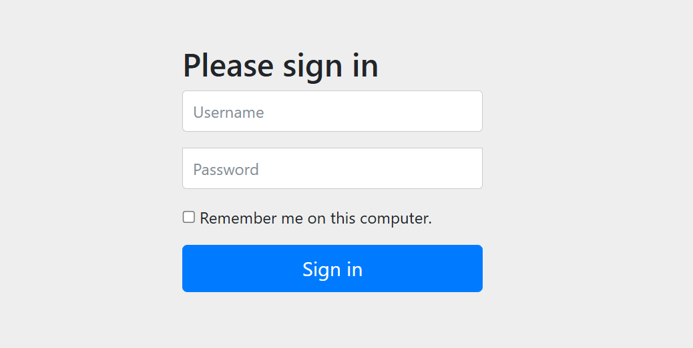

**alwaysRemeber(): default false**

remember me 체크박스 체크 여부에 상관 없이 항상 쿠키에 remember me 토큰이 저장된다 


**rememberMeParameter: default “remember-me”**

 “remember”로 설정해서 “remember”로 나온다.

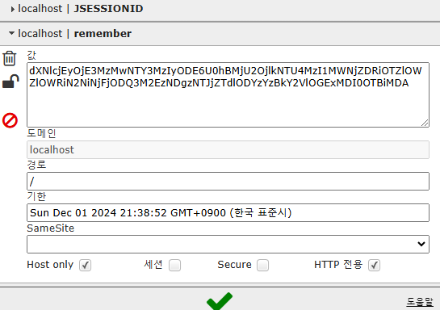

remember me 체크박스를 체크하고 로그인 하였다. 

현재 쿠키를 보면 `JSESSIONID (세션 ID)`와 `remember`쿠키가 보인다 

쿠키 이름은 default: “remember-me”이지만 “remember”로 설정했다.

또한 기한을 보면 2024년 9시 38분까지인데 내가 로그인 한 시각이 8시 38분이어서 

1시간 이후 만료되도록 설정했기 때문에 그렇다. 

세션 쿠키를 삭제해도 remember me 쿠키가 존재하면 별도의 로그인 과정 없이 

다시 로그인 된다. (세션 ID가 새로 생긴다.)

세션 쿠키, remember me 쿠키를 모두 삭제하면 인증을 요구한다 .

- `SecurityContextHolder`에 `Authenticaion`이 포함되지 않은 경우 실행되는 필터이다 
  - 세션이 만료되었거나 애플리케이션 종료로 인해 인증 상태가 소멸된 경우 토큰 기반 인증을 사용해 유효성을 검사하고 토큰이 검증되면 자동 로그인 처리를 수행한다 

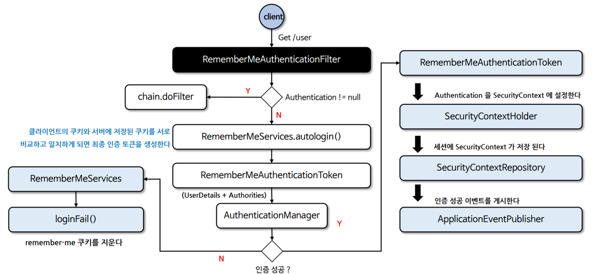

# **익명 사용자**

  - 스프링 시큐리티에서 `익명으로 인증된` 사용자와 인증되지 않은 사용자 간에 실제 개념적 차이는 없으며 단지 엑세스 제어 속성을 구성하는 더 편리한 방법을 제공한다고 볼 수 있다 
  - `SecurityContextHolder`가 항상 `Authentication` 객체를 포함하는 규칙을 세우게 되면 클래스를 더 견고하게 작성할 수 있다 
  - 인증 사용자와 익명 인증 사용자를 구분해서 어떤 기능을 수행하고자 할 때 유용할 수 있으며 익명 인증 객체를 세션에 저장하지 않는다 
  - 익명 인증 사용자의 권한을 별도로 운용할 수 있다. 즉 인증 된 사용자가 접근할 수 없도록 구성이 가능하다 

# **익명 사용자 API 및 구조**

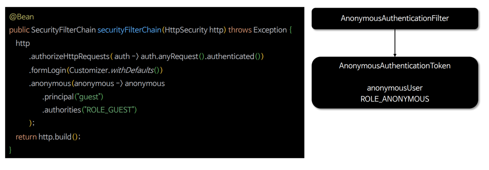

principal default: anonymousUser

authorities default: ROLE_ANONYMOUS

# **스프링 MVC 에서 익명 인증 사용하기**

**SecurityConfig**

```java
@EnableWebSecurity
@Configuration
public class SecurityConfig {
    @Bean
    public SecurityFilterChain securityFilterChain(HttpSecurity http) throws Exception{
        http
                .authorizeHttpRequests(auth -> auth
                        .requestMatchers("/").permitAll()
                        .requestMatchers("/test").permitAll()
                        .anyRequest().authenticated())
                .formLogin(Customizer.withDefaults())
                .anonymous(anonymous -> anonymous
                        .principal("guest")
                        .authorities("ROLE_GUEST"));

        return  http.build();
    }
    @Bean
    public UserDetailsService userDetailsService(){
        UserDetails user = User.withUsername("user12")
                .password("{noop}1111")
                .roles("USER").build();
        return new InMemoryUserDetailsManager(user);
    }
}
```

**IndexController**

```java
@Slf4j
@RestController
@RequiredArgsConstructor
public class IndexController {
    @GetMapping("/")
    public String index(Authentication authentication, HttpServletRequest request){
        log.info("request.getUserPrincipal={}", request.getUserPrincipal());
        log.info("authentication={}", authentication);
        if(authentication instanceof AnonymousAuthenticationToken) return "anonymous";
        return "not anonymous";
    }
    @GetMapping("/test")
    public String test(@CurrentSecurityContext SecurityContext context){
        log.info("authentication={}", context.getAuthentication());
        return context.getAuthentication().getName();
    }
}
```

현재 `/` , `/test` 경로는 인증 없이 접근이 가능한 상태

`/` 경로 

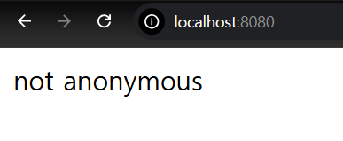

```java
request.getUserPrincipal=null
authentication=null
```

별도의 애노테이션 없이 `Authentication`객체를 받아오면 스프링 MVC는 `HttpServletRequest#getUserPrincipal`을 사용하여 파라미터를 해결하는데 요청이 익명일 때 이 값은 null 이다.

인증된 사용자

```java
authentication=UsernamePasswordAuthenticationToken [Principal=org.springframework.security.core.userdetails.User [Username=user12, Password=[REDACTED], Enabled=true, AccountNonExpired=true, CredentialsNonExpired=true, AccountNonLocked=true, Granted Authorities=[ROLE_USER]], Credentials=[PROTECTED], Authenticated=true, Details=WebAuthenticationDetails [RemoteIpAddress=0:0:0:0:0:0:0:1, SessionId=944B25A14F056107A4F71EA09FBBD787], Granted Authorities=[ROLE_USER]]
```

인증된 사용자는 `usernamePasswordAuthenticationToken`

`/test` 경로 

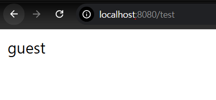

```java
authentication=AnonymousAuthenticationToken [Principal=guest, Credentials=[PROTECTED], Authenticated=true, Details=WebAuthenticationDetails [RemoteIpAddress=0:0:0:0:0:0:0:1, SessionId=944B25A14F056107A4F71EA09FBBD787], Granted Authorities=[ROLE_GUEST]]
```

  - 익명 요청에서 `Authentication`을 얻고 싶으면 `@CurrentSecurityContext` 를 사용하면 된다 
  - `CurrentSecurityContextArgumentResolver` 에서 요청을 가로채서 처리한다 

인증된 사용자

```java
authentication=UsernamePasswordAuthenticationToken [Principal=org.springframework.security.core.userdetails.User [Username=user12, Password=[REDACTED], Enabled=true, AccountNonExpired=true, CredentialsNonExpired=true, AccountNonLocked=true, Granted Authorities=[ROLE_USER]], Credentials=[PROTECTED], Authenticated=true, Details=WebAuthenticationDetails [RemoteIpAddress=0:0:0:0:0:0:0:1, SessionId=944B25A14F056107A4F71EA09FBBD787], Granted Authorities=[ROLE_USER]]
```

인증된 사용자는 `usernamePasswordAuthenticationToken`

# **AnonymousAuthenticationFilter**

`SecurityContextHolder`에 `Authentication` 객체가 없을 경우 감지하고 필요한 경우 새로운 

`Authentication` 객체로 채운다

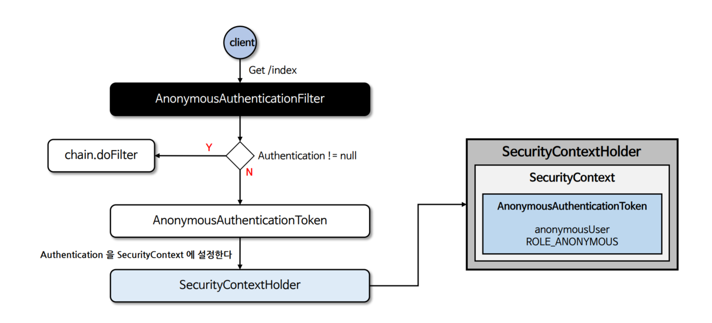

# **로그아웃**

  - 스프링 시큐리티는 기본적으로 `DefaultLogoutPageGeneratingFilter` 를 통해 로그아웃 페이지를 제공하며 `GET /logout` URL로 접근이 가능하다.
  - 로그아웃 실행은 기본적으로 `POST /logout` 으로만 가능하나 CSRF 기능을 비활성화 할 경우 혹은 `RequestMatcher` 를 사용할 경우 GET, PUT, DELETE 모두 가능하다 
  - 로그아웃 필터를 거치지 않고 스프링 MVC에서 커스텀 하게 구현할 수 있으며 로그인 페이지가 커스텀하게 생성될 경우 로그아웃 기능도 커스텀하게 구현해야 한다 

# **logout() API**

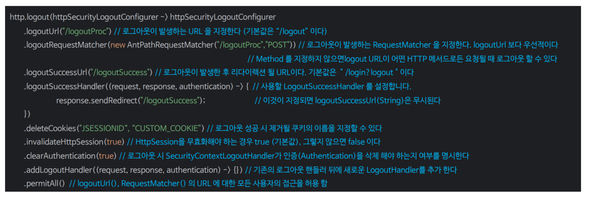

# **LogoutFilter**

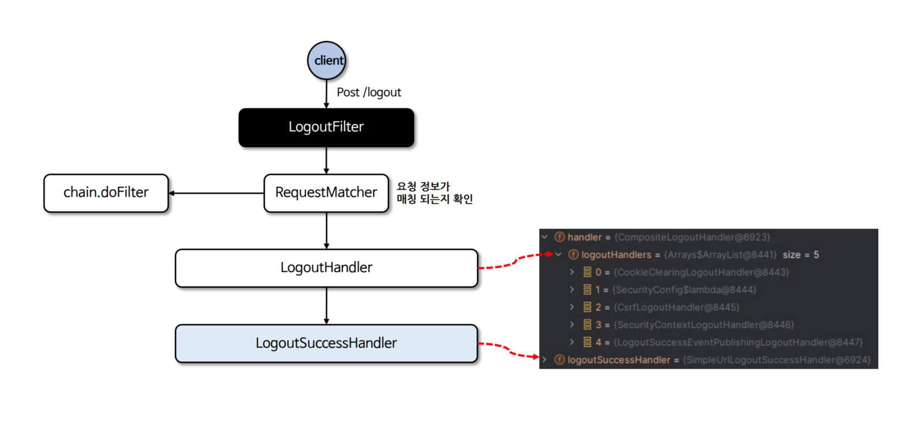

# **RequestCache**

인증 절차 문제로 리다이렉트 된 후에 이전에 했던 요청 정보를 담고 있는 `SavedRequest` 객체를 쿠키 or 세션에 저장하고 필요시 다시 가져와 실행하는 캐시 메커니즘이다 

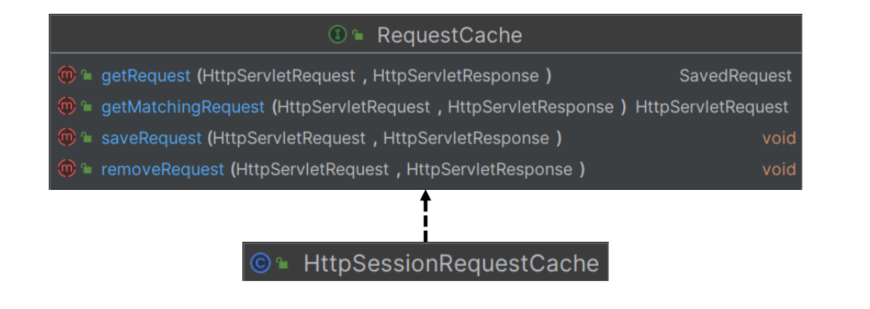

`HttpSessionRequestCahe`: 세션에(SavedRequest) 저장 

# **SavedRequest**

로그인 같은 인증 절차 이후 사용자를 인증 이전의 원래 페이지로 안내하며 이전 요청과 관련된 여러 정보를 저장한다 

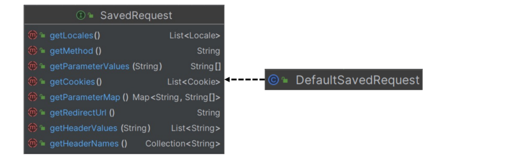

# **동작 방식**

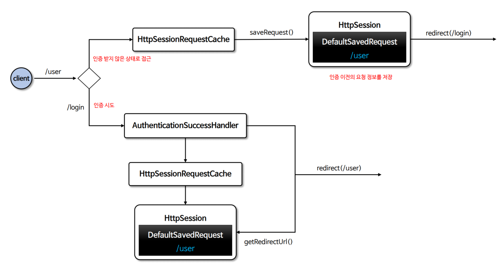

# **requestCache() API**

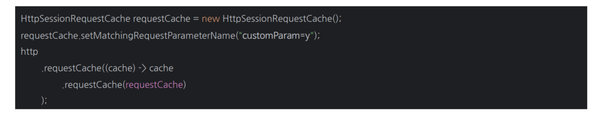

요청 Url에 `customParam=y` 라는 이름의 매개변수가 있는 경우에만 `HttpSession`에 저장된 

`SavedRequest`을 꺼내오도록 설정할 수 있다 (기본값은 `continue`)

즉, 인증에 성공하면 `localhost:8080/user?customParam=y` 형태로 보내준다. 

기본값은 `localhost:8080/user?continue` 

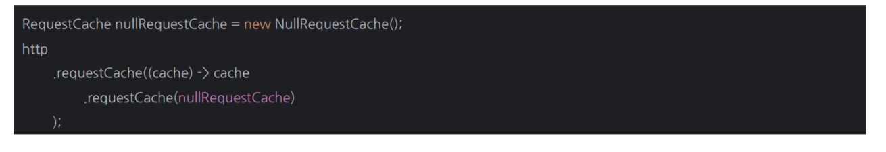

요청을 저장하지 않도록 하려면 `NullRequestCache` 구현을 사용할 수 있다.

# **RequestCacheAwareFilter**

`RequestCacheAwareFilter`는 이전에 저장했던 웹 요청을 다시 불러오는 요청을 한다 

`SavedRequest` 가 현재 Request와 일치하면 `SavedRequest` 요청을 필터 체인의 doFilter 메소드에 전달하고 `SavedRequest`가 없으면 필터는 원래 Request를 그대로 진행시킨다 

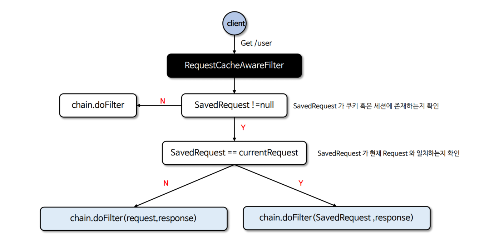

`SavedRequest`가 쿠키 혹은 세션에 존재하는지 확인은 

custom한 파라미터나 기본값인 continue 파라미터가 존재하면 동작한다 

# **흐름 정리1** 

`ExceptionTranslationFilter` 

```java
private void doFilter(HttpServletRequest request, HttpServletResponse response, FilterChain chain)
			throws IOException, ServletException {
		try {
			chain.doFilter(request, response);
		}
		catch (IOException ex) {
			throw ex;
		}
		catch (Exception ex) {
			// 생략 ...
		}
		handleSpringSecurityException(request, response, chain, securityException);
}		
```

인증 없이 인증이 필요한 경로에 접근하면 `AuthenticationException`이 발생한다.

즉, 다음 필터들에서 `AuthenticationException` 예외가 올라온다 

```java
/// 호출1
private void handleSpringSecurityException(HttpServletRequest request, HttpServletResponse response,
		FilterChain chain, RuntimeException exception) throws IOException, ServletException {
		if (exception instanceof AuthenticationException) {
			handleAuthenticationException(request, response, chain, (AuthenticationException) exception);
		}
		else if (exception instanceof AccessDeniedException) {
			handleAccessDeniedException(request, response, chain, (AccessDeniedException) exception);
		}
}

// 호출2
private void handleAuthenticationException(HttpServletRequest request, HttpServletResponse response,
			FilterChain chain, AuthenticationException exception) throws ServletException, IOException {
		this.logger.trace("Sending to authentication entry point since authentication failed", exception);
		sendStartAuthentication(request, response, chain, exception);
}
	
// 호출3
protected void sendStartAuthentication(HttpServletRequest request, HttpServletResponse response, FilterChain chain,
			AuthenticationException reason) throws ServletException, IOException 
		SecurityContext context = this.securityContextHolderStrategy.createEmptyContext();
		this.securityContextHolderStrategy.setContext(context);
		this.requestCache.saveRequest(request, response);
		this.authenticationEntryPoint.commence(request, response, reason);
}	
```

호출 순서대로 메소드를 나열했다. 

`this.requestCache.saveRequest(request, response)`

`RequestCache`기본 구현체는 `HttpSessionRequestCache` 

`SecurityConfig` 에서 `RequestCache` 구현체를 바꿀 수 있다. 

`HttpSessionRequestCache`

```java
  @Override
	public void saveRequest(HttpServletRequest request, HttpServletResponse response) {
		if (!this.requestMatcher.matches(request)) {
			if (this.logger.isTraceEnabled()) {
				this.logger
					.trace(LogMessage.format("Did not save request since it did not match [%s]", this.requestMatcher));
			}
			return;
		}

		if (this.createSessionAllowed || request.getSession(false) != null) {
			// Store the HTTP request itself. Used by
			// AbstractAuthenticationProcessingFilter
			// for redirection after successful authentication (SEC-29)
			DefaultSavedRequest savedRequest = new DefaultSavedRequest(request, this.portResolver,
					this.matchingRequestParameterName);
			request.getSession().setAttribute(this.sessionAttrName, savedRequest);
			if (this.logger.isDebugEnabled()) {
				this.logger.debug(LogMessage.format("Saved request %s to session", savedRequest.getRedirectUrl()));
			}
		}
		else {
			this.logger.trace("Did not save request since there's no session and createSessionAllowed is false");
		}
	}
```

세션에 `DefaultSavedRequest` 객체를 저장한다.

**세션에 SavedRequest 저장 흐름 정리** 

인증 없이 페이지에 접근 → Exception(Authentication) 발생 →  `ExceptionTranslationFilter`  →

`HttpSessionRequestCache` 세션에 저장 

# **흐름 정리2**

`RequestCacheAwareFilter`

```java
public class RequestCacheAwareFilter extends GenericFilterBean {

	private RequestCache requestCache;

	public RequestCacheAwareFilter() {
		this(new HttpSessionRequestCache());
	}

	public RequestCacheAwareFilter(RequestCache requestCache) {
		Assert.notNull(requestCache, "requestCache cannot be null");
		this.requestCache = requestCache;
	}

	@Override
	public void doFilter(ServletRequest request, ServletResponse response, FilterChain chain)
			throws IOException, ServletException {
		HttpServletRequest wrappedSavedRequest = this.requestCache.getMatchingRequest((HttpServletRequest) request,
				(HttpServletResponse) response);
		chain.doFilter((wrappedSavedRequest != null) ? wrappedSavedRequest : request, response);
	}

}
```

`RequestCache 인터페이스` `getMatchingRequest()` 를 통해서 

반환하는 HttpServletRequest 객체가 null 이면 기존 request를 다음 필터로 넘기고 아니라면 

RequestCache가 반환하는 HttpServletRequest 즉, 이전 요청에 대한 정보가 담긴 객체를 다음 필터로 넘긴다. 

`HttpSessionRequestCache`

```java
@Override
public HttpServletRequest getMatchingRequest(HttpServletRequest request, HttpServletResponse response) {
	if (this.matchingRequestParameterName != null) {
		if (!StringUtils.hasText(request.getQueryString())
				|| !UriComponentsBuilder.fromUriString(UrlUtils.buildRequestUrl(request))
					.build()
					.getQueryParams()
					.containsKey(this.matchingRequestParameterName)) {
			this.logger.trace(
					"matchingRequestParameterName is required for getMatchingRequest to lookup a value, but not provided");
			return null;
		}
	}
	SavedRequest saved = getRequest(request, response);
	if (saved == null) {
		this.logger.trace("No saved request");
		return null;
	}
	if (!matchesSavedRequest(request, saved)) {
		if (this.logger.isTraceEnabled()) {
			this.logger.trace(LogMessage.format("Did not match request %s to the saved one %s",
					UrlUtils.buildRequestUrl(request), saved));
		}
		return null;
	}
	removeRequest(request, response);
	if (this.logger.isDebugEnabled()) {
		this.logger.debug(LogMessage.format("Loaded matching saved request %s", saved.getRedirectUrl()));
	}
	return new SavedRequestAwareWrapper(saved, request);
}
```

getMatchingRequest 에서는 현재 요청에 쿼리 스트링 default: continue가 존재하는지 확인하고 

저장된 요청 객체 가져오기 가져온 요청 객체 비교까지 통과하면 이전에 요청했던 객체를 반환(세션에 저장된) 아니라면 null을 반환한다.

