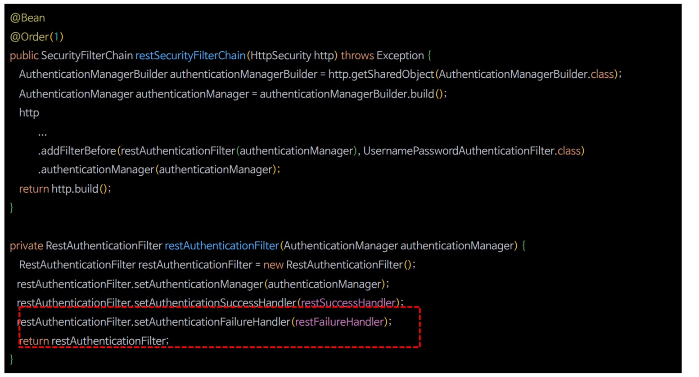
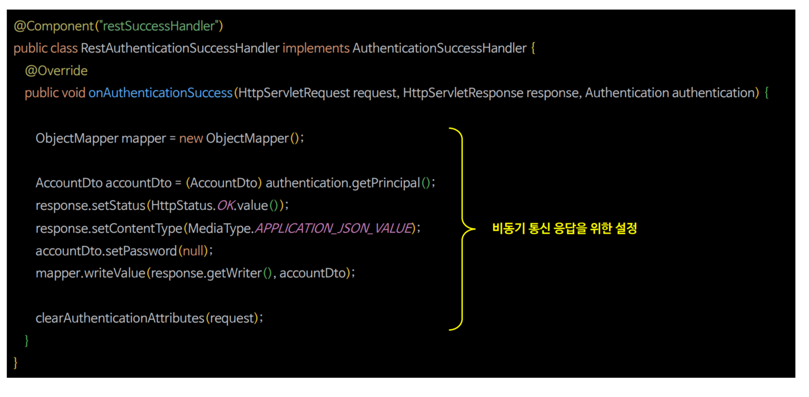
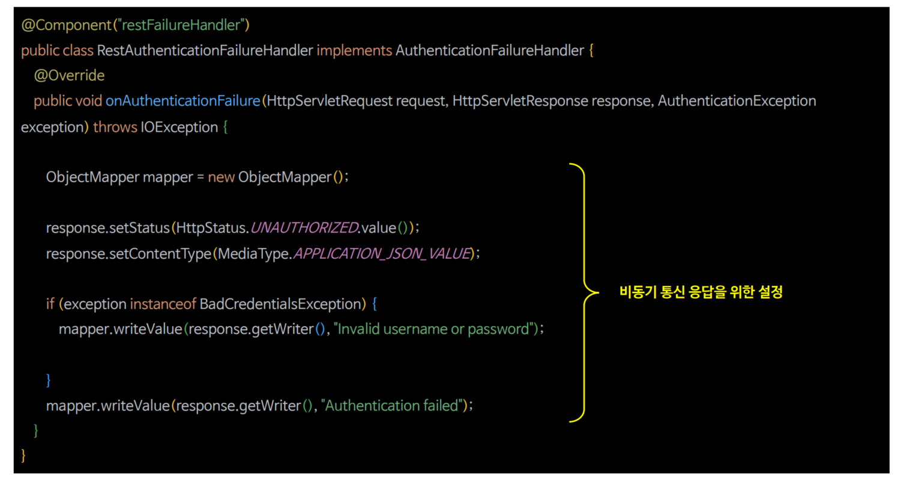

# ***필터 설정***



# ***RestAuthenticationSuccessHandler 구현***



# ***RestAuthenticationFailureHandler 구현***



# *구현* 

***RestAuthenticationSuccessHandler***

```java
@Component("restSuccessHandler")
public class RestAuthenticationSuccessHandler implements AuthenticationSuccessHandler {
    @Override
    public void onAuthenticationSuccess(HttpServletRequest request, HttpServletResponse response, Authentication authentication) throws IOException, ServletException {
        ObjectMapper mapper = new ObjectMapper();

        AccountDto principal = (AccountDto) authentication.getPrincipal();
        principal.setPassword(null);

        response.setContentType(MediaType.APPLICATION_JSON_VALUE);
        response.setStatus(HttpStatus.OK.value());

        mapper.writeValue(response.getWriter(),principal);

        clearAuthenticationAttributes(request);
    }
    private void clearAuthenticationAttributes(HttpServletRequest request) {
        HttpSession session = request.getSession(false);
        if(session == null) return;
        session.removeAttribute(WebAttributes.AUTHENTICATION_EXCEPTION);
    }
}
```

***RestAuthenticationFailureHandler*** 

```java
@Component("restAuthenticationFailureHandler")
public class RestAuthenticationFailureHandler implements AuthenticationFailureHandler {
    @Override
    public void onAuthenticationFailure(HttpServletRequest request, HttpServletResponse response, AuthenticationException exception) throws IOException, ServletException {
        ObjectMapper mapper = new ObjectMapper();

        response.setStatus(HttpStatus.UNAUTHORIZED.value()); // 인증 실패 401 / 권한 부족 403
        response.setContentType(MediaType.APPLICATION_JSON_VALUE);

        if(exception instanceof BadCredentialsException){
            mapper.writeValue(response.getWriter(), "Invalid username or password");
            return;
        }

        mapper.writeValue(response.getWriter(), "Authentication failed");
    }
}
```

***SecurityConfig***

```java
@EnableWebSecurity
@Configuration
@RequiredArgsConstructor
public class SecurityConfig {
    private final AuthenticationProvider authenticationProvider;
    private final AuthenticationProvider restAuthenticationProvider;
    private final AuthenticationDetailsSource authenticationDetailsSource;
    private final FormAuthenticationSuccessHandler successHandler;
    private final RestAuthenticationSuccessHandler restSuccessHandler;
    private final FormAuthenticationFailureHandler failureHandler;
    private final RestAuthenticationFailureHandler restFailureHandler;
    @Bean
    @Order(1)
    public SecurityFilterChain restSecurityFilterChain(HttpSecurity http) throws Exception {

        AuthenticationManagerBuilder authenticationManagerBuilder =
                http.getSharedObject(AuthenticationManagerBuilder.class);

        authenticationManagerBuilder.authenticationProvider(restAuthenticationProvider);

        AuthenticationManager authenticationManager = authenticationManagerBuilder.build();
        http
                .securityMatcher("/api/**")
                .authorizeHttpRequests(auth -> auth
                        .requestMatchers("/css/**", "/images/**",
                                "/js/**", "/favicon.*", "/*/icon/-*").permitAll()
                        .anyRequest().permitAll())
                .csrf(AbstractHttpConfigurer::disable)
                .addFilterBefore(
                        restAuthenticationFilter(authenticationManager),
                        UsernamePasswordAuthenticationFilter.class)
                .authenticationManager(authenticationManager);

        return http.build();
    }
    private RestAuthenticationFilter restAuthenticationFilter(AuthenticationManager authenticationManager) {
        RestAuthenticationFilter restAuthenticationFilter = new RestAuthenticationFilter();
        restAuthenticationFilter.setAuthenticationManager(authenticationManager);
        restAuthenticationFilter.setAuthenticationSuccessHandler(restSuccessHandler);
        restAuthenticationFilter.setAuthenticationFailureHandler(restFailureHandler);
        return restAuthenticationFilter;
    }
    @Bean
    @Order(2)
    public SecurityFilterChain securityFilterChain(HttpSecurity http) throws Exception{
        http
                .authorizeHttpRequests(authorize -> authorize
                        .requestMatchers("/css/**", "/images/**",
                                "/js/**", "/favicon.*", "/*/icon/-*").permitAll()
                        .requestMatchers("/", "/signup", "/login*").permitAll()
                        .requestMatchers("/user").hasRole("USER")
                        .requestMatchers("/admin").hasRole("ADMIN")
                        .requestMatchers("/manager").hasRole("MANAGER")
                        .anyRequest().authenticated())
                .authenticationProvider(authenticationProvider)
                .formLogin(form -> form
                        .loginPage("/login")
                        .authenticationDetailsSource(authenticationDetailsSource)
                        .successHandler(successHandler)
                        .failureHandler(failureHandler)
                        .permitAll())
                .exceptionHandling(ex -> ex.accessDeniedHandler(
                        new FormAccessDeniedHandler("/denied")));
        return http.build();
    }
}
```

