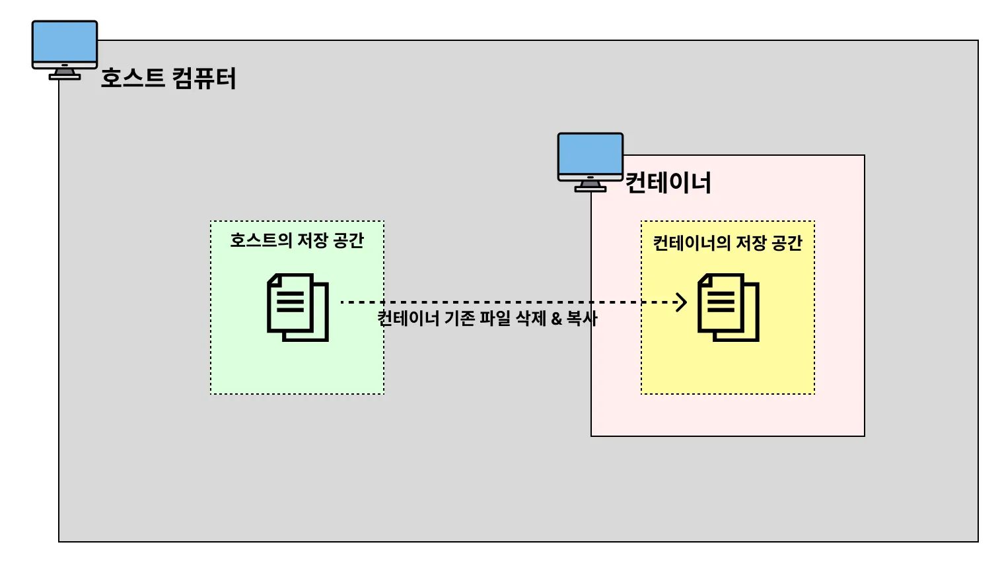
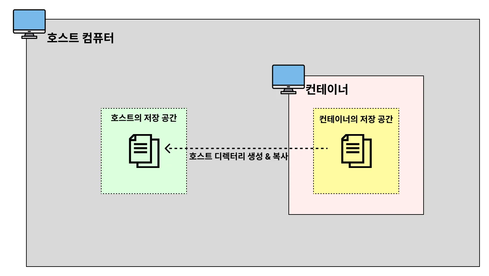
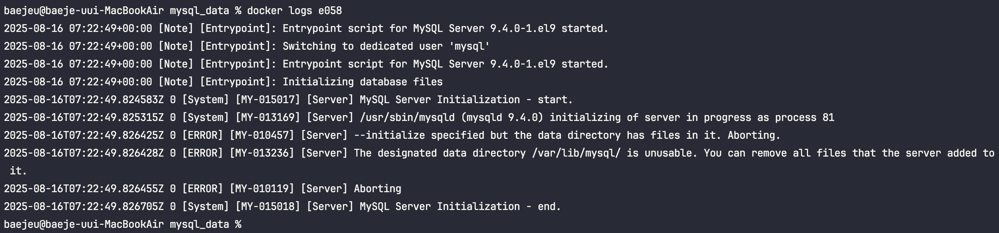

### 컨테이너가 가진 문제점

Docker 컨테이너를 교체하면, 기존 컨테이너 내부에 있던 데이터도 같이 삭제된다.

만약 컨테이너가 MySQL을 실행시키는 컨테이너 였다면 MySQL에 저장된 데이터도 같이 삭제 돼버린다.

**따라서 컨테이너 내부에 저장된 데이터가 삭제되면 안 되는 경우에는 볼륨(Volume)이라는 개념을 활용해야 한다.**

---

### 도커 볼륨이란?

컨테이너 자체의 저장 공간을 사용하지 않고, 호스트 자체의 저장 공간을 공유해서 사용하는 형태이다.

---

### 도커 볼륨 사용 2가지 케이스

**호스트의 디렉터리 절대 경로에 디렉토리가 이미 존재할 경우, 호스트의 디렉토리가 컨테이너의 디렉토리를 덮어씌운다.**



**호스트의 디렉토리 절대 경로에 디렉토리가 존재하지 않을 경우, 호스트의 디렉토리 절대 경로에 디렉토리를 새로 만들고 컨테이너의 디렉토리에 있는 파일들을 호스트의 디렉토리로 복사해온다.**



---

### 볼륨을 활용해서 MySQL 실행

```bash
# 현재 디렉토리 경로 출력
pwd

# docker 볼륨 활용해서 컨테이너 실행
docker run -e MYSQL_ROOT_PASSWORD=[REDACTED] -d -p 3306:3306 --name mysql_docker -v /Users/baejeu/Desktop/Study/docker/docker-mysql/mysql_data:/var/lib/mysql 
mysql 
```

-  /Users/baejeu/Desktop/Study/docker/docker-mysql/mysql_data [호스트 디렉토리 경로]
- /var/lib/mysql [컨테이너 디렉토리 경로]

**데이터베이스 생성 및 컨테이너 날리기**

```bash
# mysql 접속 
docker exec -it [컨테이너 ID] mysql -u root -p 

# 데이터베이스 생성 

# 컨테이너 삭제 
docker rm -f [컨테이너 ID]
```

**다시 컨테이너 실행 후 확인하기**

```bash
# 컨테이너 실행
docker run -e MYSQL_ROOT_PASSWORD=[REDACTED] -d -p 3306:3306 --name mysql_docker -v /Users/baejeu/Desktop/Study/docker/docker-mysql/mysql_data:/var/lib/mysql 
mysql 


# mysql 접속 
docker exec -it [컨테이너 ID] mysql -u root -p 

# 데이터베이스 확인
```

### **자주하는 실수1**

처음 MySQL 컨테이너를 실행할 때 v옵션으로 볼륨을 마운트하여 데이터가 호스트 디렉토리에 저장된다.

MySQL 초기 설정(루트 비밀번호 포함)은 첫 실행 때만 적용되어 데이터베이스 데이터 디렉토리에 저장된다.

이후 컨테이너를 삭제하고 다시 같은 호스트 볼륨을 마운트해 컨테이너를 새로운 비밀번호로 실행해도,

기존 데이터베이스 데이터에 저장된 비밀번호가 유지되어 새로운 비밀번호가 적용되지 않는다.

이렇게 동작하는 이유는 MySQL 공식 도커 이미지는 초기화 스크립트를 최초 데이터 디렉토리가 비어 있을 때만 실행하기 때문이다.  즉, 기존 데이터가 이미 있다면 환경변수로 넘긴 비밀번호 설정이 무시되고, 기존 데이터(과거 비밀번호)가 그대로 사용된다.

호스트 볼륨 또는 디렉토리를 비우고 컨테이너를 새로 실행하면 초기화 과정에서 새 비밀번호가 적용된다.

### 자주하는 실수2

```bash
# 현재 경로에 빈 파일 생성
vi empty.txt

# 빈 파일을 가지고 컨테이너 실행 
docker run -d -p 3306:3306 --name test -e MYSQL_ROOT_PASSWORD=[REDACTED] -v /Users/baejeu/Desktop/Study/docker/docker-mysql/mysql_data:/var/lib/mysql mysql

# 컨테이너 조회
docker ps 
```

**조회하면 컨테이너 정보가 나오지 않는다.**

로그를 살펴보자



MySQL 컨테이너가 초기화 과정에서 /var/lib/mysql/ 데이터 디렉토리에 이미 파일이 존재하는 것을 감지했습니다. 이 디렉터리가 비어 있어야만 MySQL이 제대로 초기화(설치)됩니다.

기존 데이터가 남아 있어서, 새로 시작할 수 없고 서버가 중단(aborting)되었습니다.

즉, 호스트 볼륨에 empty.txt가 있어서 호스트 볼륨에 있는 empty.txt가 컨테이너 볼륨 경로인 var/libs/mysql

에 복사됐다. 즉, 초기화에 필요한 데이터가 존재하지 않는다.

**즉, 컨테이너를 올바르게 초가화하고 컨테이너의 데이터를 호스트 볼륨에 백업을 하려면 해당 디렉토리가 비어있어야 한다.**

