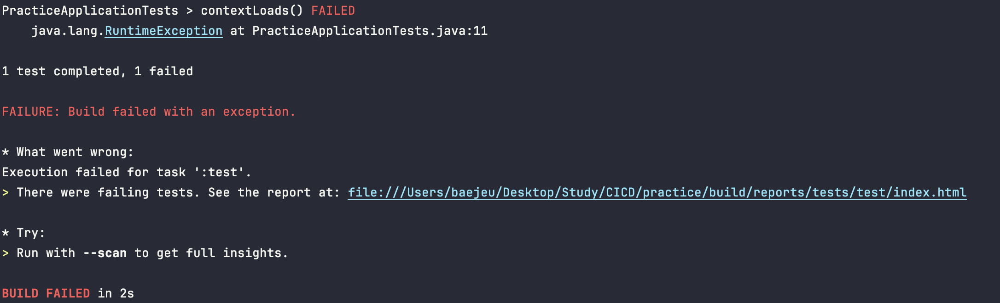
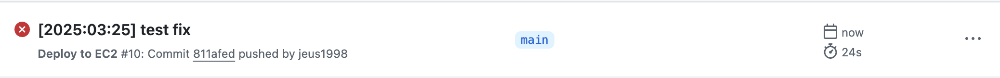
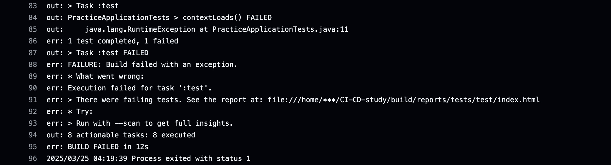

# **테스트 코드 실패하면 CI/CD 과정이 실패하는 지 확인하기**

### **테스트 실패 코드 작성** 

```java
@SpringBootTest
class PracticeApplicationTests {

    @Test
    void contextLoads() {
        throw new RuntimeException();
    }

}
```

### **로컬에서 테스트 실패 확인** 

```shell
./gradlew test
```



### **확인하기** 

**git commit & push** 





**테스트에 실패하여 배포 실패**
