# **개요**

- 스프링 시큐리티는 요청 기반의 인증된 사용자 및 특정권한을 가진 사용자의 자원접근 허용여부를 결정하는 인가 관리자 클래스들을 제공한다
- 대표적으로 `AuthorityAuthorizationManager`, `AuthenticatedAuthorizationManager` 와 대리자인 `RequestMatcherDelegatingAuthorizationManager` 가 있다

# **스프링 시큐리티 인가처리**

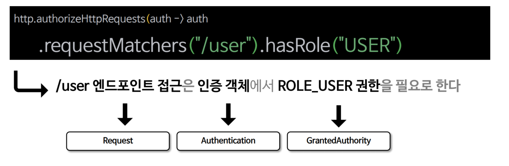

# **내부 구조 이해** 

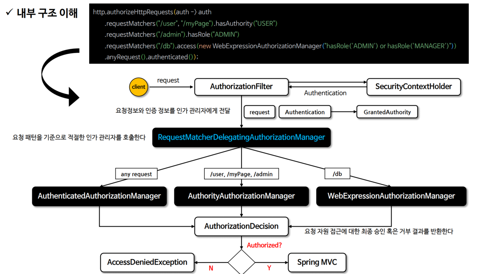

# **AuthenticatedAuthorizationManager 구조**

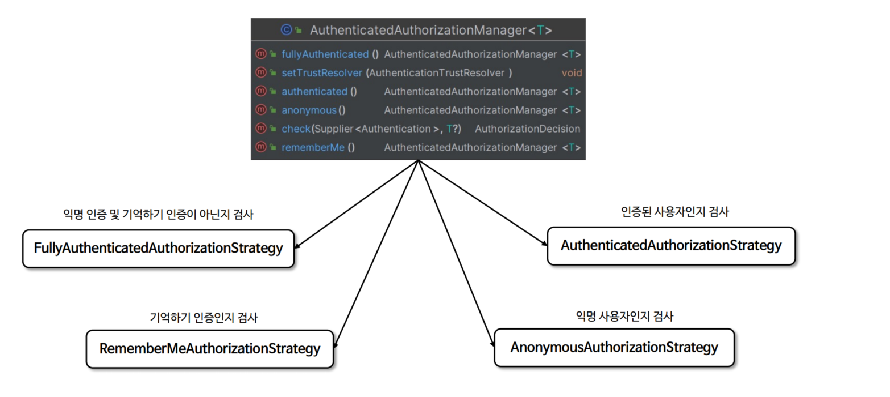

- `AuthenticatedAuthorizationManager`는 내부적으로 네 개의 `AbstractAuthorizationStrategy` 구현을 통해 인증 여부 확인 전략을 세운다
- `FullyAuthenticatedAuthorizationStrategy` → `anyRequest().fullyAuthenticated()` 
- 아이디, 비밀번호
  - `AuthenticatedAuthorizationStrategy` → `anyRequest().authenticated()` 
- 어떤 방식이든 인증을 받은 경우
  - `RememberMeAuthorizationStrategy` → `anyRequest().rememberMe()`
- 기억하기 인증을 통해 인증 받은 경우
  - `AnonymousAuthorizationStrategy` → `anyRequest().anonymous()` 
- 익명 사용자 인증 (로그인 X 사용자)

# **AuthenticatedAuthorizationManager 매핑**

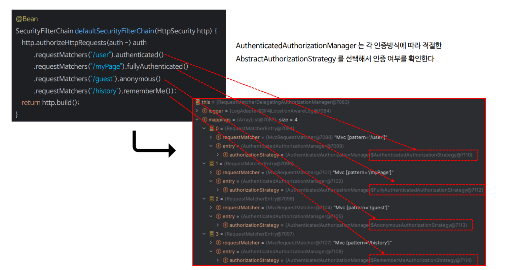

# **AuthenticatedAuthorizationManager 흐름도**

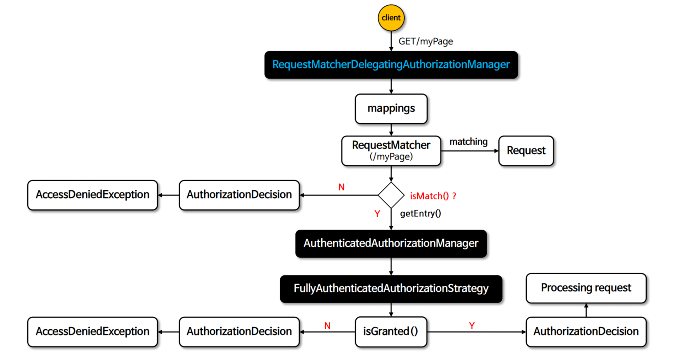

```
현재 그림에서는 mappings에 존재하는 RequestMatcher가 isMatch() -> fasle 결과라면 
바로 AccessDeniedException 예외가 던져지는 것처럼 보일 수 있지만
mappings = ArrayList 이고 List를 순회하면서 모든 RequestMatcher가 isMatch() -> false면  
AccessDeniedException 예외가 던져진다. 

isMatch() -> true -> getEntry() 
AuthenticatedAuthorizationManager가 가지고 있는 전략에 따라서 다르게 동작한다 
```

# 
**AuthorityAuthorizationManager 구조**

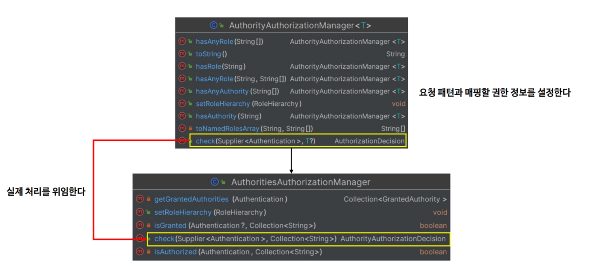

- `AuthorityAuthorizationManager`는 내부적으로 `AuthoritiesAuthorizationManager`를 사용하여 권한 여부 결정을 위임한다

# **AuthorityAuthorizationManager 매핑**

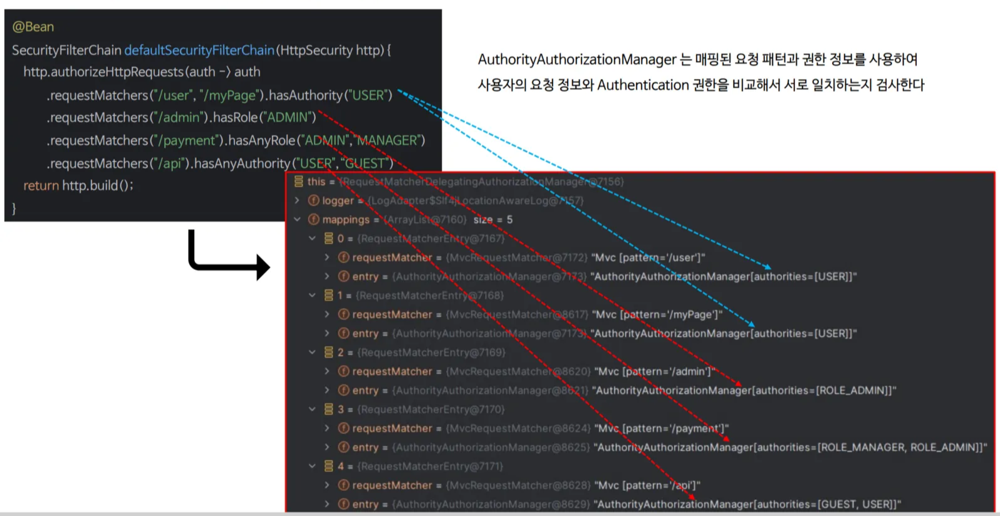

# **AuthorityAuthorizationManager 흐름도**

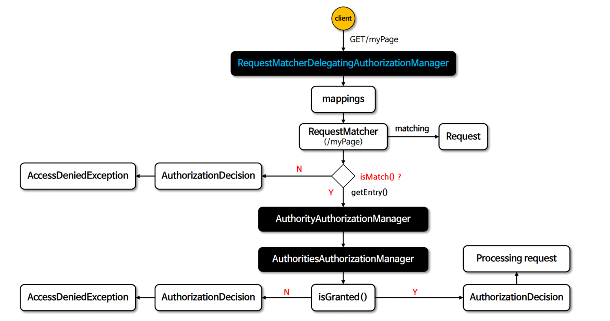

# **디버깅을 통해서 초기화 과정 이해** 

**SecurityConfig**

```java
@EnableWebSecurity
@Configuration
public class SecurityConfig {
    @Bean
    public SecurityFilterChain securityFilterChain(HttpSecurity http) throws Exception{

        http.authorizeHttpRequests(authorize -> authorize
                .requestMatchers("/user").hasRole("USER")
                .requestMatchers("/db").access(new WebExpressionAuthorizationManager("hasRole('DB')"))
                .requestMatchers("/admin").hasAuthority("ROLE_ADMIN")
                .anyRequest().authenticated())
                .formLogin(Customizer.withDefaults())
                .csrf(AbstractHttpConfigurer::disable);
        return http.build();
    }
    @Bean
    public UserDetailsService userDetailsService(){
        UserDetails user = User.withUsername("user").password("{noop}1111").roles("USER").build();
        UserDetails db = User.withUsername("db").password("{noop}1111").authorities("ROLE_DB").build();
        UserDetails admin = User.withUsername("admin").password("{noop}1111").roles("ADMIN","SECURE").build();
        return  new InMemoryUserDetailsManager(user, db, admin);
    }
}
```

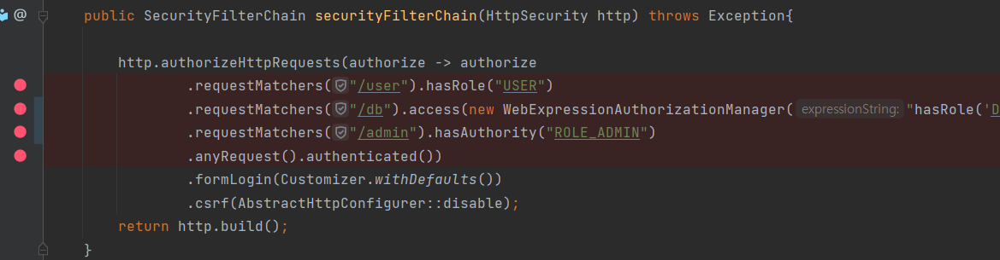

 **RequestMatcherDelegatingAuthorizationManager**

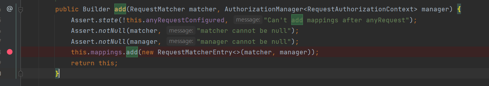

**.requestMatchers("/user").hasRole("USER")**

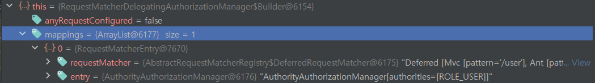

- mappings size = 1
- requestMatcher = “/user”
- entry = AuthroityAuthorizationManager [ROLE_USER]

**.requestMatchers("/db").access(new WebExpressionAuthorizationManager("hasRole('DB')"))**

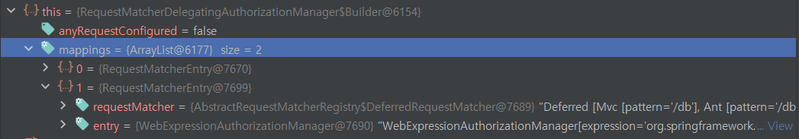

- mappings size = 2
- requestMatcher = “/db”
- entry = WebExpressionAuthorizationManager 

**.requestMatchers("/admin").hasAuthority("ROLE_ADMIN")**

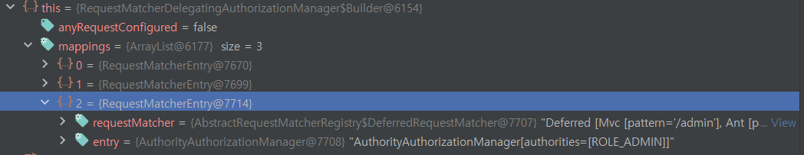

- mappings size = 3
- requestMatcher = “/admin”
- entry = AuthroityAuthorizationManager [ROLE_ADMIN]

**.anyRequest().authenticated()**

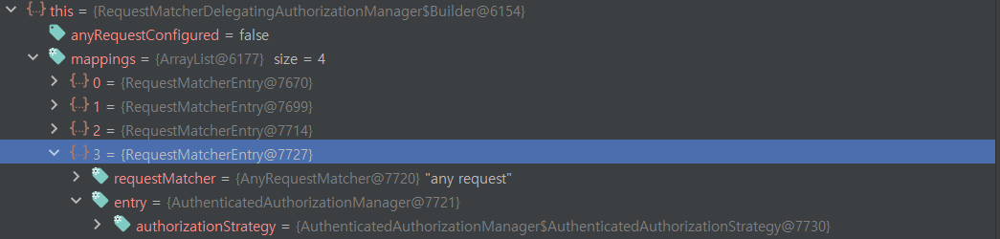

- mappings size = 4
- requestMatcher = “any request”
- entry = AuthenticatedAuthorizationManager
- authorizationStrategy = AuthenticatedAuthorizationStrategy(인증을 받으면 AuthorizationDecision = true)

