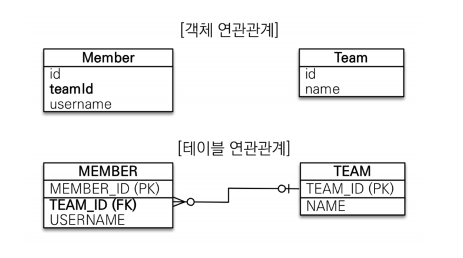
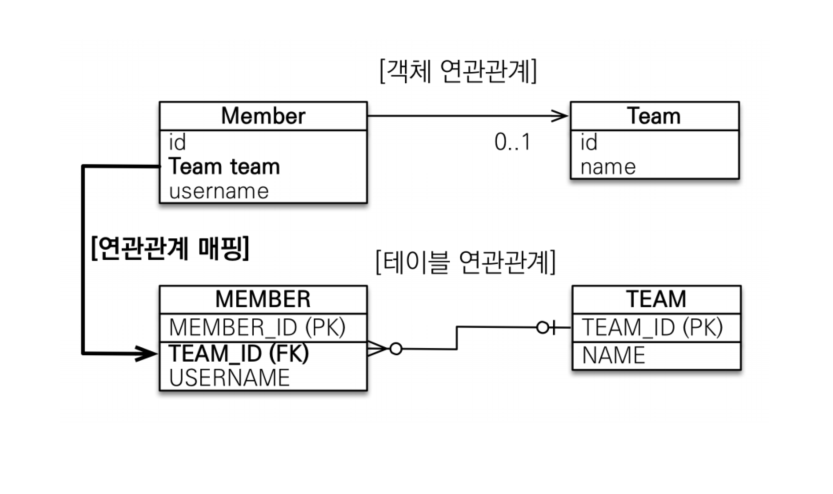
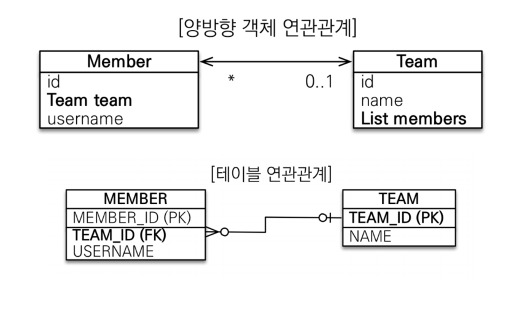
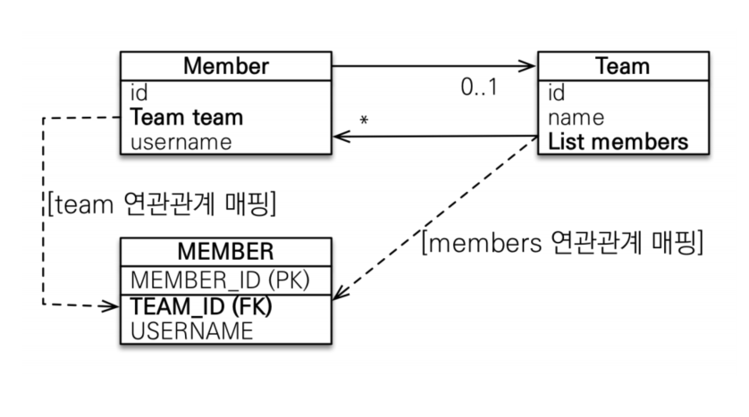
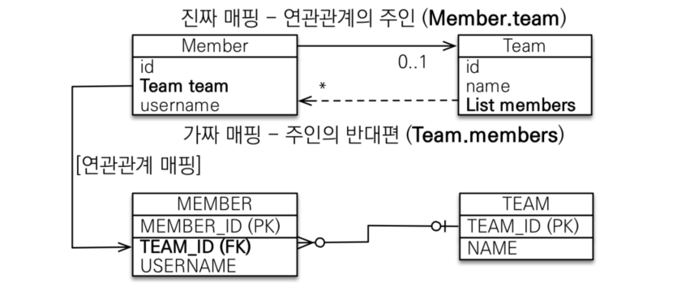
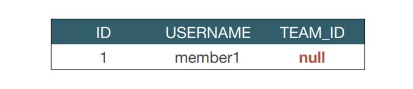

# ***객체를 테이블에 맞추어 모델링***

*회원과 팀이 있다.*

*회원은 하나의 팀에만 소속될 수 있다.*

*즉, 팀과 회원은 1:N 관계이다.*

***객체를 테이블에 맞추어 모델링***



```java
@Entity
public class Member { 
		@Id @GeneratedValue(strategy = GenerationType.IDENTITY)
		private Long id;
		
		@Column(name = "USERNAME")
		private String name;
		
		@Column(name = "TEAM_ID")
		private Long teamId; 
}

@Entity
public class Team {
		@Id @GeneratedValue(strategy = GenerationType.IDENTITY)
		private Long id;
		
		private String name; 
}
```

- *객체를 테이블에 맞추어 모델링 (외래 키 식별자를 직접 다룬다)*

```java
Member findMember = em.find(Member.class, member.getId());
Team findTeam = em.find(Team.class, findMember.getTeamId());
```

- *전혀 객체지향스럽지 않다.*

***객체를 테이블에 맞추어 데이터 중심으로 모델링하면, 협력 관계를 만들 수 없다.***

- *테이블은 외래 키로 조인을 사용해서 연관된 테이블을 찾는다.*
- *객체는 참조를 사용해서 연관된 객체를 찾는다.*
- *테이블과 객체 사이에 이런 패러다임 불일치가 존재한다.*

# ***단방향 연관관계***

***객체 지향 모델링***



```java
@Entity
@Getter @Setter
public class Member {
    @Id @GeneratedValue(strategy = GenerationType.IDENTITY)
    private Long id;
    @Column(name = "USERNAME")
    private String name;
    @ManyToOne
    @JoinColumn(name = "TEAM_ID")
    private Team team;
}
```

- *Member(N) : Team(1)*
- *N:1 관계*
- ***@ManyToOne + @JoinColumn(name = “TEAM_ID”)***
- *@JoinColumn 외래키를 지정하는 역할*

```java
try {
	  // 팀 저장
	  Team team = new Team();
	  team.setName("TeamA");
	  em.persist(team);
	
	  // 회원 저장
	  Member member = new Member();
	  member.setName("member1");
	  member.setTeam(team);
	  em.persist(member);
	
	  em.flush();
	  em.clear();
	
	  Member findMember = em.find(Member.class, member.getId());
	
	  Team findTeam = findMember.getTeam();
	  System.out.println("findTeam = " + findTeam.getName());
	  tx.commit();
}
```

- *이제야 객체지향스럽다.*

# ***양방향 연관관계와 연관관계의 주인***

***양방향 매핑*** 



- *이전 단방향 관계와 데이터베이스 테이블은 달라지는 게 없다.*
- *데이터베이스 테이블에서는 방향이라는 개념이 존재하지 않는다. 
한 곳의 외래 키 설정으로 Member → Team FK로 조인 또는 Team → Member PK로 조인 
어느 방향이든 조인을 하면 다 데이터를 얻어올 수 있다.*
- *반면 객체에서는 방향이 존재한다. Team에 속한 Member를 알려면 이전 단방향 매핑만으로는 알 수 없다. → 추가로 매핑이 필요하다.*
- *즉, 객체지향적 관점에서는 방향성을 명확히 설정해야 하고, 데이터베이스는 외래키를 통한 관계를 설정할 뿐이다.*

```java

@Entity
@Getter @Setter
public class Member {
    @Id @GeneratedValue(strategy = GenerationType.IDENTITY)
    private Long id;
    @Column(name = "USERNAME")
    private String name;
    @ManyToOne
    @JoinColumn(name = "TEAM_ID")
    private Team team;
}

@Entity
@Getter @Setter
public class Team {
    @Id @GeneratedValue(strategy = GenerationType.IDENTITY)
    private Long id;

    private String name;

    @OneToMany(mappedBy = "team")
    private List<Member> members = new ArrayList<>();
}
```

- *@OneToMany(mappedBy = “team”)*

***양방향 매핑 - 반대 방향으로 객체 그래프 탐색***

```java
Member findMember = em.find(Member.class, member.getId());
List<Member> members = findMember.getTeam().getMembers();
for (Member m : members) {
    System.out.println("m = " + m.getName());
}
```

## *연관관계의 주인과 mappedBy*

***객체와 테이블이 관계를 맺는 차이***


- ***객체 연관관계 2개***
- *회원 → 팀 1개 (단방향)*
  - *팀 → 회원 1개(단방향)*
- ***테이블 연관관계 1개***
- *회원 ↔ 팀 연관관계 1개(양방향)*
- *(TEAM_ID)외래키 하나로 연관관계 끝*

***객체의 양방향 관계***

*객체의 양방향 관계는 사실 양방향 관계가 아니라 서로 다른 단방향 2개다.*

*즉, 양방향으로 참조하려면 단방향 연관관계를 2개 만들어야 한다.*

***테이블의 양방향 관계***

*테이블은 외래 키 하나로 두 테이블의 연관관계를 관리*

*MEMBER.TEAM_ID 외래 키 하나로 양방향 관계를 가진다(양쪽으로 조인할 수 있다)*

```sql
SELECT *
FROM MEMBER M
JOIN TEAM T ON M.TEAM_ID = T.TEAM_ID

SELECT *
FROM TEAM T
JOIN MEMBER M ON T.TEAM_ID = O.TEAM_ID
```

***둘 중 하나로 외래 키를 관리해야 한다.***



***연관관계의 주인 (Owner) - 양방향 매핑 규칙*** 

- *객체의 두 관계중 하나를 연관관계의 주인으로 지정*
- *연관관계의 주인만이 외래 키를 관리(등록, 수정)*
- *주인이 아닌쪽은 읽기만 가능*
- *주인은 mappedBy 속성 사용 X*
- *주인이 아니면 mappedBy 속성으로 주인 지정*

***누구를 주인으로?***

- ***외래 키가 있는 있는 곳을 주인으로 정해라***
- *여기서는 Member.team이 연관관계의 주인*



***양방향 매핑시 가장 많이 하는 실수***

- *연관관계의 주인에 값을 입력하지 않음*

```java
Team team = new Team();
team.setName("TeamA");
em.persist(team);

Member member = new Member();
member.setName("member1");

//역방향(주인이 아닌 방향)만 연관관계 설정
team.getMembers().add(member);
em.persist(member);
```



***양방향 매핑시 연관관계의 주인에 값을 입력해야 한다.*** 

- *순수한 객체 관계를 고려하면 양쪽 다 값을 입력해야 한다.*
- *하지만 연관관계의 주인에만 값을 입력해도 데이터베이스에 정상적으로 들어간다.*

```java
Team team = new Team();
team.setName("TeamA");
em.persist(team);

Member member = new Member();
member.setName("member1");

// team.getMembers().add(member); *순수한 객체 관계를 고려하면 양쪽 다 값을 입력해야 한다*
member.setTeam(team);

em.persist(member);
```


***양방향 연관관계 주의*** 

- *순수 객체 상태를 고려해서 항상 양쪽에 값을 설정하자* 

```java
Team team = new Team();
team.setName("TeamA");
em.persist(team);

Member member = new Member();
member.setName("member1");
member.setTeam(team);

em.persist(member);
List<Member> members = team.getMembers();
System.out.println("members = " + members);

tx.commit();

--------------------------------------------------------------------------------------
members = []
```

- *기대하는값: members = {member1} 이다.*
- *현재 1차 캐시에 team이 존재하기 때문에 JPA는 데이터베이스에 쿼리를 날리지 않고 연관관계 매핑에서 members에 넣어주지 않았기 때문에 해당 결과가 나온다.*
- *또한 JPA 없이 테스트를 하는 케이스를 생각하자* 
- ***연관관계 편의 메소드를 생성하자***

```java
/**
 * 연관관계 편의 메소드
 */
public void changeTeam(Team team){
    this.team = team;
    team.getMembers().add(this);
}
```

- ***양방향 매핑시에 무한 루프를 조심하자*** 
- ***toString(), lombok, JSON 생성 라이브러리***
- *JSON 생성 라이브러리는 문제가 없는 게 컨트롤러에 엔티티를 직접 반환하지 않으면 된다.*
    - *lombok toString() 사용 XX*

***양방향 매핑 정리***

- *단방향 매핑만으로도 이미 연관관계 매핑(테이블 설계)은 완료*
- *양방향 매핑은 반대 방향으로 조회 기능이 추가된 것 뿐*
- *JPQL에서 역방향으로 탐색할 일이 많음*
- *단방향 매핑을 잘 하고 양방향은 필요할 때 추가해도 됨(테이블에 전혀 영향을 주지 않는다)*

