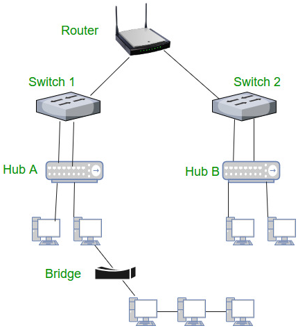

## 1장 개요 

네트워크를 처음 배우는 초급자가 꼭 알아야 할 네트워크 기초 지식을 다룬다.

**키워드**

- 네트워크
- 랜(LAN)
- 왠(WAN)
- 허브
- 스위치
- 비트

**목표**

- 네트워크 이해
- 네트워크 필요성 이해
- LAN, WAN 의미와 종류에 대해 이해

---

## 내용 정리 

**네트워크란?** 

각종 통신 장비들이 서로 그물망처럼 연결되어 데이터를 교환하거나 협력하여 일할 수 있게 해주는 통신망

주변 장치, 데이터 공유, 공동 작업

### LAN(Local Area Network)

건물 안이나 특정 지역을 범위로 하는 네트워크, 주로 짧은 거리 내에 컴퓨터나 주변 장치(프린터)를 연결해 사용한다. 

### LAN 연결 방식, 랜의 구성 방법, 네트워크 접속 형태

  1. 스타(star)형: 하나의 허브에 여러 대의 컴퓨터를 연결하는 방식
  1. 링(ring)형: 개별 컴퓨터가 서로 원처럼 연결되어 있는 구성
  1. 버스(bus)형: 하나의 긴 선(케이블)에 컴퓨터를 포함한 모든 주변 장치를 연결하는 방식

| 구분 | 스타형 | 링형 | 버스형 |
| --- | --- | --- | --- |
| 장점 | 확장하기 쉽다 | 초기 구성이 쉽다. | 비용이 저렴하고 설치가 쉽다. |
| 단점 | 허브에 문제가 발생하면 전체 통신이 안된다.  | 컴퓨터를 한 대 추가할 경우 기존의 링을 절단하고 다시 연결해야 한다. | 케이블에 문제가 생기면 전체 통신이 불가능하다. |

일반적으로 버스형을 많이 사용한다.

---

### WAN(Wide Area Network) 

2개 이상의 LAN은 연결 즉, 넓은 지역에서 광범위하게 통신하고자 할 때 사용하는 네트워크

랜과는 다르게 별도의 ‘네트워크 접속 형태’는 없다. 단지, 랜 사이에 통신이 잘 이루어지도록 연결만 해주면 된다.

## 네트워크 구성 장치 정리

**허브(Hub)**

  - **정의:** 여러 대의 컴퓨터를 물리적으로 연결할 때 사용하는 장치
  - **역할:** 들어온 데이터를 연결된 모든 포트(컴퓨터)에 그대로 전송 브로드캐스트
  - **특징**
- 저렴하고 설치가 간단
    - 보안성이 낮다 모든 노드가 모든 데이터를 받는다
    - 데이터 충돌이 많고, 네트워크가 커질수록 속도 저하가 심하다

**스위치(Switch)**

  - **정의**: 허브와 비슷하게 여러 컴퓨터를 연결하지만, 더 똑똑하게 동작하는 장치
  - **역할**: 데이터가 목적지 컴퓨터로만 전달되도록 하여 대역폭을 효율적으로 사용
  - **특징**
- 각 포트별로 데이터를 분리해 충돌을 최소화
    - 네트워크 속도와 효율이 허브보다 훨씬 높음
    - 대규모 네트워크에 적합

**라우터** 

  - **정의**: 서로 다른 네트워크(LAN)를 연결해주는 장치
  - **역할**: 데이터가 목적지 네트워크로 갈 수 있도록 최적의 경로(길)를 찾아주는 역할
  - **특징**
- IP 주소를 기반으로 데이터 패킷을 라우팅(길 안내)
    - 인터넷 연결의 필수 장비
    - 방화벽, DHCP 등 다양한 부가 기능 제공

**브리지** 

  - **정의**: 두 개 이상의 네트워크 구간(세그먼트)을 연결하는 장치
  - **역할**: 네트워크를 분할하거나 확장할 때, 데이터를 필요한 곳으로만 전달
  - **특징**
- 네트워크 트래픽을 줄이고, 충돌 도메인을 분리
    - 계층 2(데이터 링크 계층)에서 동작
    - 예시: 1층과 2층의 네트워크를 연결할 때 사용

---

## **대역폭(bandwidth), 기본 단위**

1초당 처리할 수 있는 데이터의 양, 아래 그림에서 원통이 대역폭

대역폭과 시간당 데이터의 처리량은 비례한다.

**대역폭을 구하는 수식**

**대역폭(bps, bit per second) = (용량 * 8) / 처리 시간**

수식에서 8을 곱하는 이유는 바이트(용량) → 비트(대역폭) 변환 

대역폭을 의미하는 단위가 bps 그중 b가 비트(bit)를 의미한다.

비트는 컴퓨터가 의사 소통하는 언어이다.

비트는 0과 1로 구성되어 있고 이것은 전기 신호로 변환되어 전송된다.

‘a’, ‘b’, ‘c’ 같은 로마자는 문자 하나가 1바이트 ‘가’, ‘나’ 같은 한글, 일본어의 문자는 하나가 2바이트

**바이트(byte) → 킬로바이트(Kilobyte) → 메가바이트(Megabyte) → 기가바이트(Gigabyte) → 테라바이트(Terabyte)**  각 단계는 1024배(2^10)를 곱한다.

| 단위 | 예시 |
| --- | --- |
| 비트 | 예/아니오 |
| 바이트 | 알파벳 1개 |
| 킬로바이트 | 몇 개의 텍스트 문단 |
| 메가바이트 | 1분 정도의 음원 |
| 기가바이트 | 30분 정도의 영화 |
| 테라바이트 | 영화 100~200편 |

---

---

## 연습 문제 

- LAN
- 버스형
- 하나의 허브를 두고 연결된 형태 → 스타형
  - 컴퓨터 ↔ 컴퓨터 원형 → 링형
  - 하나의 케이블로 연결 → 버스형
- WAN
- bps(bit per second) → 대역폭
- 0, 1
- 비트
- 바이트

---

## 용어 정리 

**네트워크**

→ 각종 통신 장비들이 서로 그물망처럼 연결되어 데이터를 교환하거나 협력하여 일할 수 있게 해주는 통신망

**LAN**

→ 짧은 거리의 컴퓨터 혹은 주변 장치를 연결할 때 사용하는 네트워크

**WAN**

→ 2개 이상의 LAN 연결한 네트워크. 넓은 지역에서 광범위하게 통신 하고자 할 때 사용

**Hub**

→ 컴퓨터와 컴퓨터 사이, 네트워크 장비와 장비를 연결해주는 장치 

**대역폭(Babdwidth)**

→ 네트워크가 1초당 처리할 수 있는 데이터의 양

**스위치(Switch)**

→ 대역폭을 확대해주는 장치? 

**비트(Bit)**

→ 네트워크 통신에 있어서 가장 기본적인 단위

---

