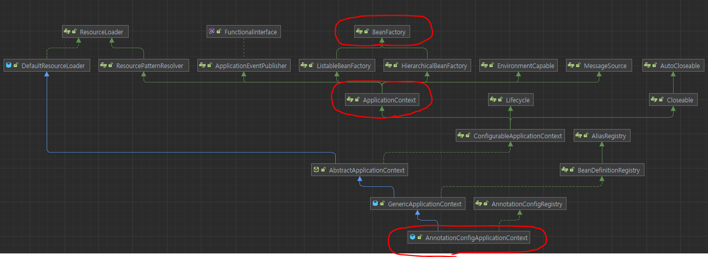
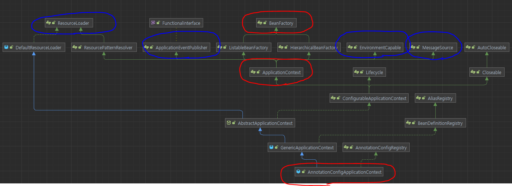
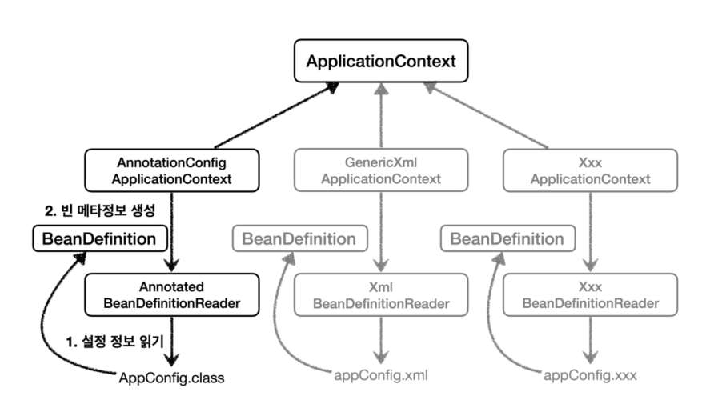

# ***스프링 빈 조회*** 

***빈 이름 직접 부여하기*** 

```java
@Bean(name = "customBeanName")
```

- *빈 이름은 항상 다른 이름을 부여하자* 
- *직접 부여하지 않으면 메소드 이름을 사용한다.* 

***스프링 컨테이너에 등록된 모든 빈 조회***

```java
class BeanDefinitionTest {
    AnnotationConfigApplicationContext ac = new AnnotationConfigApplicationContext(AppConfig.class);
   
    @Test
    @DisplayName("빈 설정 메타정보 확인")
    void findApplicationBean() {
        String[] beanDefinitionNames = ac.getBeanDefinitionNames();
        for (String beanDefinitionName : beanDefinitionNames) {
            BeanDefinition beanDefinition = ac.getBeanDefinition(beanDefinitionName);
            if (beanDefinition.getRole() == BeanDefinition.ROLE_APPLICATION) {
                System.out.println("beanDefinitionName" + beanDefinitionName +
                        " beanDefinition = " + beanDefinition);
            }
        }
    }
}
```

- *`ac.getBeanDefinitionNames()`* *: 스프링에 등록된 모든 빈 이름을 조회*
- *`ac.getBean()`* *: 빈 이름으로 빈 객체(인스턴스)를 조회*
- *`ac.getRole()`* *: 스프링 빈 역할 조회하기* 
- *`ROLE_APPLICATION`**: 사용자가 정의한 빈* 
  - *`ROLE_INFRASTRUCTURE`* *: 스프링이 내부에서 사용하는 빈*

***스프링 빈 조회***

- *`ac.getBean(String name, Class<T> requiredType)`*
- *`ac.getBean(Class<T> requiredType)`*
- *조회 대상 스프링 빈이 없으면 예외 발생*
- *`NoSuchBeanDefinitionException`*

***스프링 빈 조회 - 동일한 타입이 둘 이상***

- *타입으로 조회시 같은 타입의 스프링 빈이 둘 이상이면 오류가 발생*
- *`NoUniqueBeanDefinitionException`*
  - *빈 이름을 지정하자*
- *`ac.getBeansOfType()`* *: 해당 타입의 모든 빈을 조회*
- *return:* ***Map<key: String name | value: Class<T>>***

***스프링 빈 조회 - 상속 관계***

- *부모 타입으로 조회하면, 자식 타입도 함께 조회*

# *스프링 컨테이너 구조* 



***BeanFactory***

- *스프링 컨테이너의 최상위 인터페이스*
- *스프링 빈을 관리하고 조회하는 역할을 담당*
- *`getBean()`**을 제공*

***ApplicationContext***

- *빈을 관리하고 검색하는 기능을 BeanFactory가 제공해주는데, 그러면 둘의 차이가 뭘까?*
- *애플리케이션을 개발할 때는 빈을 관리하고 조회하는 기능은 물론이고, 수 많은 부가기능이 필요*



- *메시지소스를 활용한 국제화 기능* 
- *환경변수*
- *로컬, 개발, 운영등을 구분해서 처리*
- *애플리케이션 이벤트*
- *이벤트를 발행하고 구독하는 모델을 편리하게 지원*
- *편리한 리소스 조회*
- *파일, 클래스패스, 외부 등에서 리소스를 편리하게 조회*

***ApplicationContext 구현체***

- *AnnotationConfigApplicationContext*
- *애노테이션 기반 자바 코드 설정 사용*
- *GenericXmlApplicationContext*
- *xml 설정 파일*

*스프링 컨테이너는 다양한 형식의 설정을 사용할 수 있게 유연하게 설계* 

***스프링 빈 설정 메타 정보 - BeanDefinition***

- *다양한 설정 형식을 BeanDefinition 이라는 추상화를 통해 한다.* 
- *XML →  BeanDefinition*
  - *자바 코드 →  BeanDefinition*
  - *스프링 컨테이너 → BeanDefinition (의존)*



***BeanDefinition 정보***

- *`BeanClassName`**: 생성할 빈의 클래스 명*
- *@Bean으로 등록되는 빈 → 존재 X / @Component → 존재 O*
- *`factoryBeanName`**: 팩토리 역할의 빈을 사용할 경우 이름*
- *AppConfig*
- *`factoryMethodName`**: 빈을 생성할 팩토리 메서드 지정*
- *@Bean 메소드 이름*
- *`Scope`**: default: singleton*
- *`lazyInit`**: 스프링 컨테이너를 생성할 때 빈을 생성하는 것이 아니라, 실제 빈을 사용할 때 까지 최대한 생성을 지연 처리 하는지 여부*
- *default: null → 즉시 초기화*
- *`InitMethodName`**: 빈을 생성하고, 의존관계를 적용한 뒤에 호출되는 초기화 메서드 명*
- ***@PostCustruct***
- *`DestroyMethodName`**: 빈의 생명주기가 끝나서 제거하기 직전에 호출되는 메서드 명*
- ***@PreDestory***
- *`Constructor arguments, Properties`**: 의존관계 주입에서 사용한다. (자바 설정 처럼 팩토리 역할의 빈을 사용하면 없음)*

