# ***One-Time Password?***

  - 인증을 위해 사용되는 임시 비밀번호
- *6자리 랜덤 숫자*

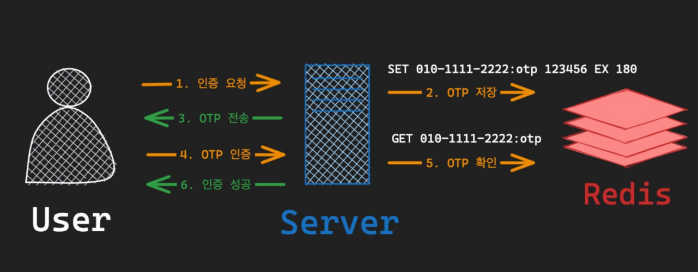

  - *Redis 데이터 만료 기능 활용 (전화번호, 이메일 인증)*

# *Redis Distributed Lock?*

  - *분산 환경의 다수의 프로세스에서 동일한 자원에 접근할 때, 동시성 문제 해결*

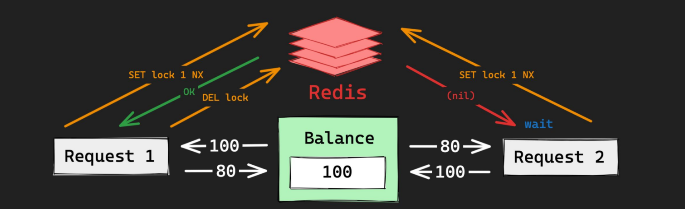

# ***Rate Limiter?***

  - *시스템 안정성/보안을 위해 요청의 수를 제한하는 기술, 
IP-Based, User-Based, Application-Based, etc*
  - ***Fixed-window Rate Limiting:*** *고정된 시간(e.g. 1분) 안에 요청 수를 제한하는 방법*

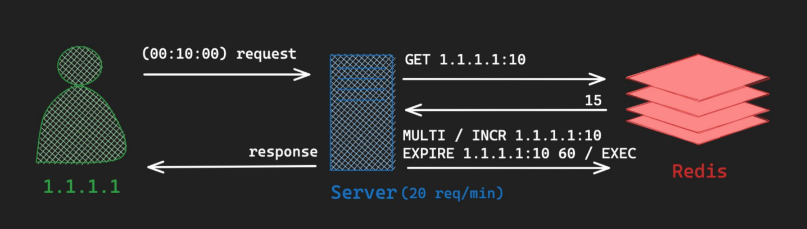

# *Activity Feed ?*

  - *사용자 또는 시스템과 관련된 활동이나 업데이트를 시간순으로 정렬하여 보여주는 기능*
  - ***Fan-Out:*** *단일 데이터를 한 소스에서 여러 목적지로 동시에 전달하는 메시징 패턴*

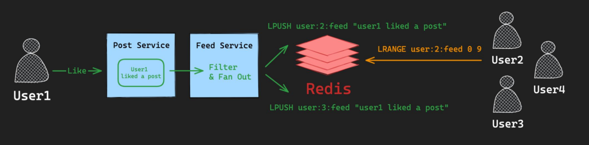

# ***Shopping Cart?***

  - *사용자가 구매를 원하는 상품을 임시로 모아두는 가상의 공간*
  - *수시로 변경이 발생할 수 있고, 실제 구매로 이어지지 않을 수도 있다*

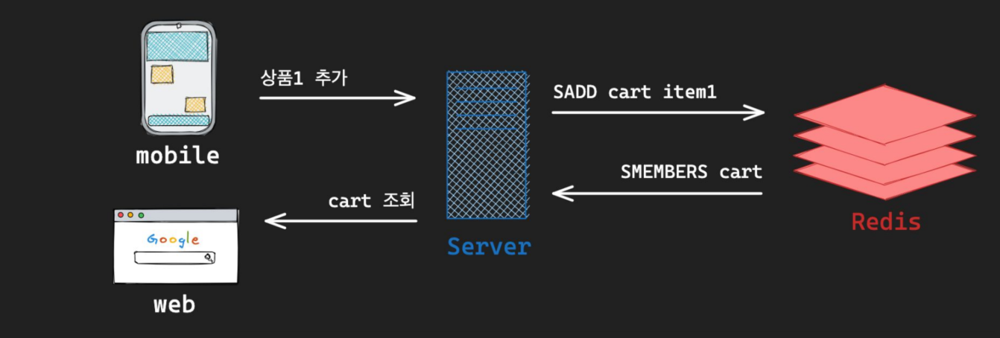

# ***Login Session?***

  - *사용자의 로그인 상태를 유지하기 위한 기술*
  - ***동시 로그인 제한:*** *로그인시 세션의 개수를 제한하여, 동시에 로그인 가능한 디바이스 개수
제한*

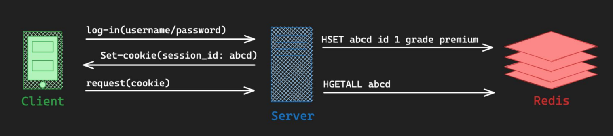

# ***Sliding Window Rate Limiter?***

  - *시간에 따라 Window를 이동시켜 동적으로 요청수를 조절하는 기술*
  - ***vs. Fixed Window***
- *Fixed Window는 window 시간마다 허용량이 초기화 되지만,
Sliding Window는 시간이 경과함에 따라 window가 같이 움직인다*

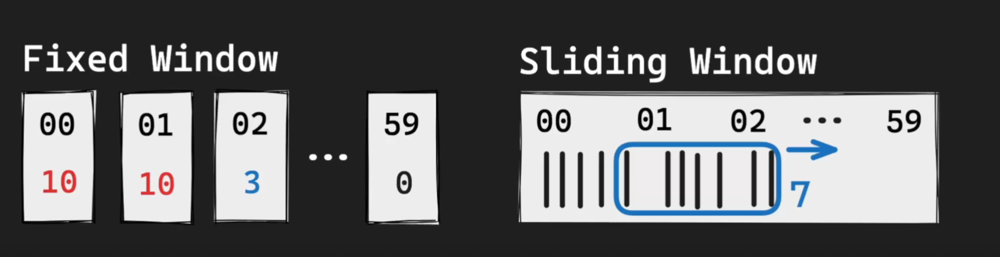

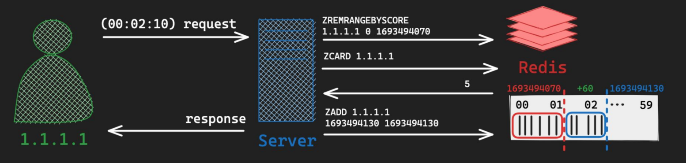

# ***Geofencing?***

  - *위치를 활용하여 지도 상의 가상의 경계 또는 지리적 영역을 정의하는 기술*

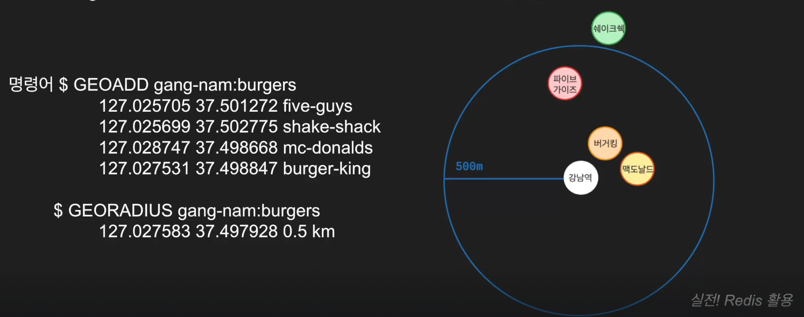

# ***Online Status?***

  - *사용자의 현재 상태를 표시하는 기능*
  - *특징: 실시간성을 완벽히 보장하지는 않는다. 수시로 변경되는 값이다.*

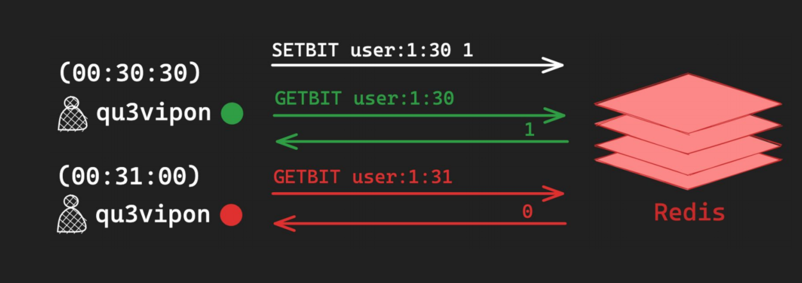

# ***Visitors Count Approximation?*** 

  - *방문자 수(또는 특정 횟수)를 대략적으로 추정하는 경우*
  - *정확한 횟수를 셀 필요 없이 대략적인 어림치만 알고자 하는
경우*

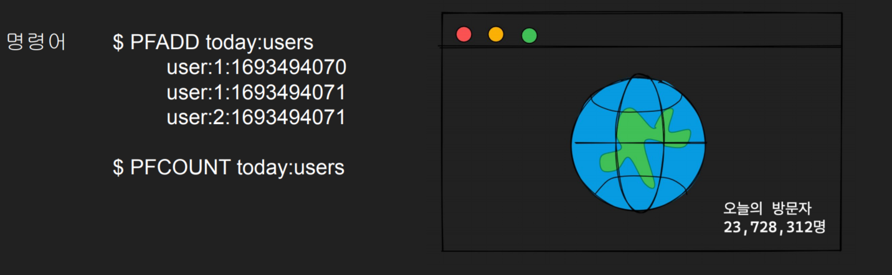

# ***Unique Events ?***

  - *동일 요청이 중복으로 처리되지 않기 위해 빠르게 해당 item이 중복인지 확인하는
방법*

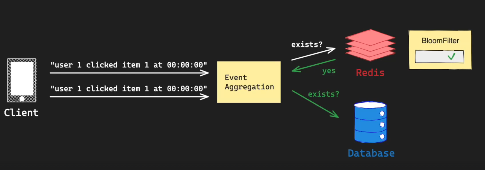

