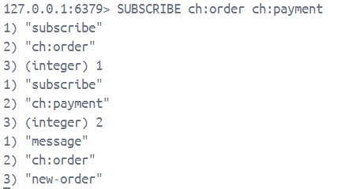
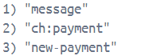

# ***Redis Pub/Sub?***

- *Publisher와 Subscriber가 서로 알지 못해도 통신이 가능하도록 decoupling 된 패턴*
- *Publisher는 Subscriber에게 직접 메시지를 보내지 않고, Channel에 Publish*
- *Subscriber는 관심이 있는 Channel을 필요에 따라 Subscribe하며 메시지 수신*
- *vs. Stream 메시지가 보관되는 Stream과 달리 Pub/Sub은 Subscribe 하지 않을 때 발행된 메시지
수신 불가*

# ***Redis Pub/Sub 실습, 명령어***

***Terminal1 - Subscriber***

```shell
SUBSCRIBE ch:order ch:payment
```

- *Consumer주문, 결재 채널 구독*

***Terminal2 - Publisher***

```shell
PUBLISH ch:order new-order
```

- *주문 채널에 new-order 발행*



- ***Subscriber****는 주문 채널을 구독하고 있어서 new-order 메시지를 받는다.* 

***Terminal2 - Publisher***

```shell
PUBLISH ch:payment new-payment
```



***Terminal2 - Publisher***

```shell
PUBLISH ch:delivery new-delivery
```

- ***Subscriber****는 배달 채널을 구독하지 않아서 메시지를 받지 못한다.*

