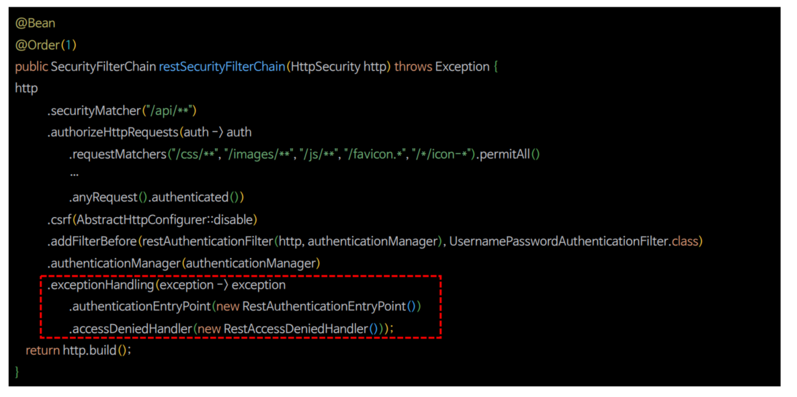
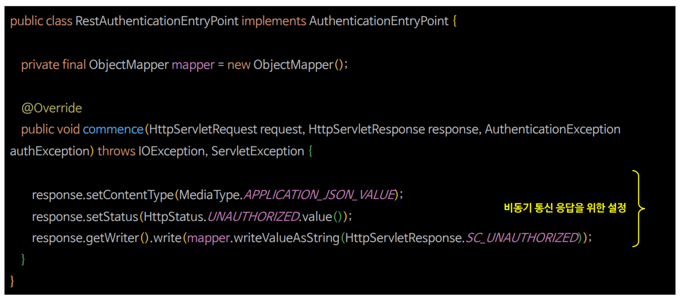
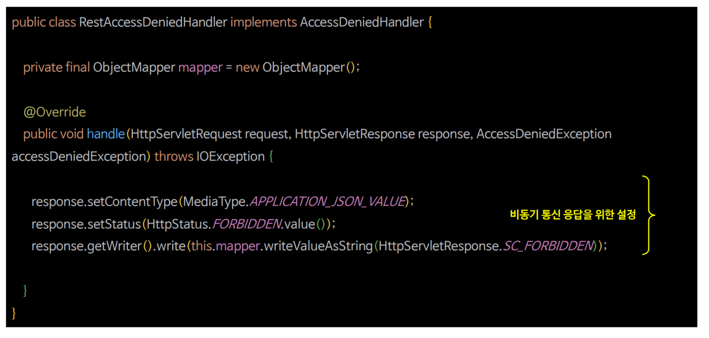
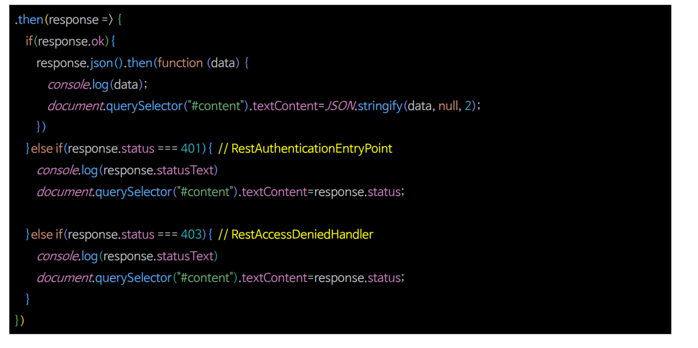
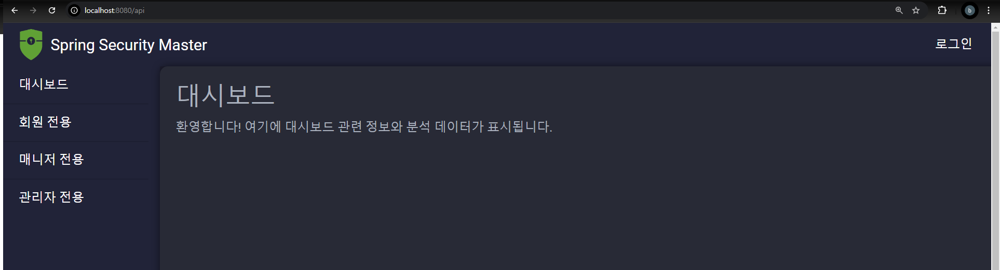

# *개요*

- *AuthenticationEntryPoint: 인증을 받지 않고 접근을 거부 당했을 때 동작 (401)*
*login page 이동*
- *AccessDeniedHandler: 인증을 받았지만 권한이 부족할 때 (403)
Denied Page 이동*

# *RestAuthenticationEntryPoint / RestAccessDeniedHandler 설정*



# ***RestAuthenticationEntryPoint 구현***



# ***RestAccessDeniedHandler 구현***



# ***login.html 구현***



# ***구현***

***RestAuthenticationEntryPoint***

```java
public class RestAuthenticationEntryPoint implements AuthenticationEntryPoint {
    private final ObjectMapper mapper = new ObjectMapper();
    @Override
    public void commence(HttpServletRequest request, HttpServletResponse response, AuthenticationException authException) throws IOException, ServletException {
        response.setStatus(HttpStatus.UNAUTHORIZED.value());
        response.setContentType(MediaType.APPLICATION_JSON_VALUE);
        response.getWriter().write(mapper.writeValueAsString(HttpServletResponse.SC_UNAUTHORIZED));
    }
}
```

***RestAccessDeniedHandler***

```java
public class RestAccessDeniedHandler implements AccessDeniedHandler {
    private final ObjectMapper mapper = new ObjectMapper();
    @Override
    public void handle(HttpServletRequest request, HttpServletResponse response, AccessDeniedException accessDeniedException) throws IOException, ServletException {
        response.setStatus(HttpStatus.FORBIDDEN.value());
        response.setContentType(MediaType.APPLICATION_JSON_VALUE);
        response.getWriter().write(mapper.writeValueAsString(HttpServletResponse.SC_FORBIDDEN));
    }
}
```

***SecurityConfig***

```java
@EnableWebSecurity
@Configuration
@RequiredArgsConstructor
public class SecurityConfig {
    private final AuthenticationProvider authenticationProvider;
    private final AuthenticationProvider restAuthenticationProvider;
    private final AuthenticationDetailsSource authenticationDetailsSource;
    private final FormAuthenticationSuccessHandler successHandler;
    private final RestAuthenticationSuccessHandler restSuccessHandler;
    private final FormAuthenticationFailureHandler failureHandler;
    private final RestAuthenticationFailureHandler restFailureHandler;
    @Bean
    @Order(1)
    public SecurityFilterChain restSecurityFilterChain(HttpSecurity http) throws Exception {

        AuthenticationManagerBuilder authenticationManagerBuilder =
                http.getSharedObject(AuthenticationManagerBuilder.class);

        authenticationManagerBuilder.authenticationProvider(restAuthenticationProvider);

        AuthenticationManager authenticationManager = authenticationManagerBuilder.build();
        http
                .securityMatcher("/api/**")
                .authorizeHttpRequests(auth -> auth
                        .requestMatchers("/css/**", "/images/**",
                                "/js/**", "/favicon.*", "/*/icon/-*").permitAll()
                        .requestMatchers("/api", "/api/login").permitAll()
                        .requestMatchers("/api/user").hasAuthority("ROLE_USER")
                        .requestMatchers("/api/manager").hasAuthority("ROLE_MANAGER")
                        .requestMatchers("/api/admin").hasAuthority("ROLE_ADMIN")
                        .anyRequest().permitAll())
                .csrf(AbstractHttpConfigurer::disable)
                .addFilterBefore(
                        restAuthenticationFilter(http, authenticationManager),
                        UsernamePasswordAuthenticationFilter.class)
                .authenticationManager(authenticationManager)
                .exceptionHandling(exception -> exception
                        .authenticationEntryPoint(new RestAuthenticationEntryPoint())
                        .accessDeniedHandler(new RestAccessDeniedHandler()));

        return http.build();
    }
    private RestAuthenticationFilter restAuthenticationFilter(HttpSecurity http, AuthenticationManager authenticationManager) {
        RestAuthenticationFilter restAuthenticationFilter = new RestAuthenticationFilter(http);
        restAuthenticationFilter.setAuthenticationManager(authenticationManager);
        restAuthenticationFilter.setAuthenticationSuccessHandler(restSuccessHandler);
        restAuthenticationFilter.setAuthenticationFailureHandler(restFailureHandler);
        return restAuthenticationFilter;
    }
    @Bean
    @Order(2)
    public SecurityFilterChain securityFilterChain(HttpSecurity http) throws Exception{
        http
                .authorizeHttpRequests(authorize -> authorize
                        .requestMatchers("/css/**", "/images/**",
                                "/js/**", "/favicon.*", "/*/icon/-*").permitAll()
                        .requestMatchers("/", "/signup", "/login*").permitAll()
                        .requestMatchers("/user").hasRole("USER")
                        .requestMatchers("/admin").hasRole("ADMIN")
                        .requestMatchers("/manager").hasRole("MANAGER")
                        .anyRequest().authenticated())
                .authenticationProvider(authenticationProvider)
                .formLogin(form -> form
                        .loginPage("/login")
                        .authenticationDetailsSource(authenticationDetailsSource)
                        .successHandler(successHandler)
                        .failureHandler(failureHandler)
                        .permitAll())
                .exceptionHandling(ex -> ex.accessDeniedHandler(
                        new FormAccessDeniedHandler("/denied")));
        return http.build();
    }
}

```

- *exceptionHandling: entryPoint, accessDeniedHandler 추가*

***HomeController - @Controller***

```java
@GetMapping(value = "/api")
public String restDashboard(){
    return "/rest/dashboard";
}
```

- *view 랜더링*

***/rest/dashboard.html 일부*** 



```html
<script>
function restCall(url) {

  fetch(url, {
    method: 'GET',
    headers: {
      'Content-Type': 'application/json',
      'X-Requested-With': 'XMLHttpRequest'
    }
  })
          .then(response => {
            if(response.ok){
              response.json().then(function (data) {
                console.log(data);
                document.querySelector("#content").textContent=JSON.stringify(data, null, 2);
              })
            }else if(response.status === 401){
              console.log(response.statusText)
              document.querySelector("#content").textContent=response.status;
            }else if(response.status === 403){
              console.log(response.statusText)
              document.querySelector("#content").textContent=response.status;
            }
          })
          .catch(error => {
            console.error('Error during login:', error);
          });
}
</script>
<body>
<div th:replace="~{rest/layout/header::header}"></div>
<div class="container-fluid">
  <div class="row">
    <div class="col-md-2 sidebar">
      <div th:replace="~{rest/layout/sidebar::sidebar}"></div>
    </div>
    <div class="col-md-10 content">
      <div>
        <h2>대시보드</h2>
        <p id="content">환영합니다! 여기에 대시보드 관련 정보와 분석 데이터가 표시됩니다.</p>
      </div>
    </div>
  </div>
</div>
<div class="footer" th:replace="~{layout/footer::footer}"></div>
</body>
```

- *header: 익명 사용자, 인증 사용자에 따라 다르게 로그아웃, 로그인 버튼을 보여준다.*
- *sidebar: /api/user, /api/manager, /api/admin 경로 버튼 존재*

