# **Authorization**

  - 인가 즉 권한 부여는 특정 자원에 접근할 수 있는 사람을 결정하는 것을 의미한다 
  - Spring Security는 `GrandAuthority` 클래스를 통해 권한 목록을 관리하고 있으며 사용자의 `Authentication` 객체와 연결한다 

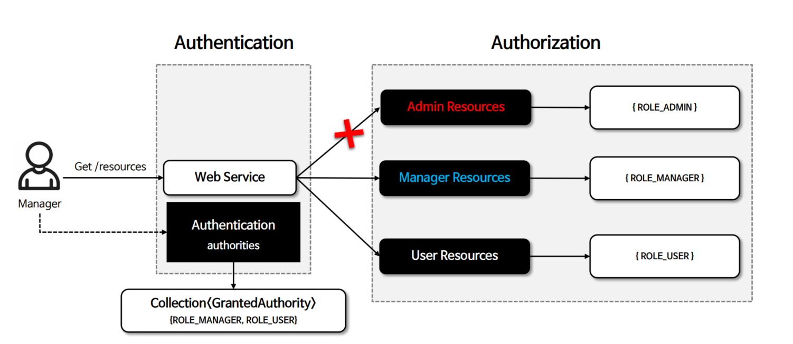

# **GrantedAuthority**

  - 스프링 시큐리티는 `Authentication`에 `GrantedAuthority` 권한 목록을 컬렉션 타입으로 저장하며 이를 통해 인증 주체에게 부여된 권한을 사용하도록 한다 
  - `GrantedAuthority` 객체는 `AuthenticationManager` 에 의해 `Authentication` 객체에 삽입되며 스프링 시큐리티는 인가 결정을 내릴 때 `AuthorizationManager` 를 사용하여 `Authentication` 즉, 인증 주체로부터 `GrantedAuthority` 객체를 읽어들여 처리하게 된다 

# **구조**

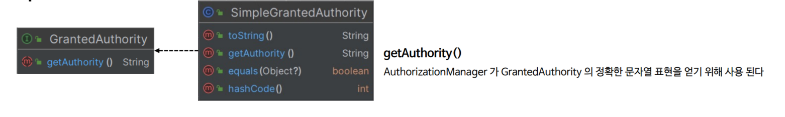

# **사용자 정의 역할 접두사**

  - 기본적으로 역할 기반의 인가 규칙은 역할 앞에 `ROLE_`를 접두사로 사용한다.
  - 즉, `USER` 역할을 가진 보안 컨텍스트가 필요한 인가 규칙이 있다면 Spring Security는 기본적으로 `ROLE_USER`를 반환하는 `GrantedAuthority#getAuthority`를 찾는다
  - `GrantedAuthorityDefaults`로 사용자 지정할 수 있으며 `GrantedAuthorityDefaults`는 역할 기반 인가 규칙에 사용할 접두사를 사용자 정의하는 데 사용된다

```java
@Bean
static GrantedAuthorityDefaults grantedAuthorityDefaults() {
	 return new GrantedAuthorityDefaults("MYPREFIX_");
}
```

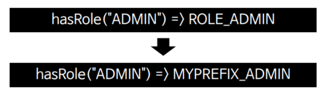

# **실습** 

```java
@EnableWebSecurity
@Configuration
public class SecurityConfig {
    @Bean
    public SecurityFilterChain securityFilterChain(HttpSecurity http) throws Exception{

        http.authorizeHttpRequests(authorize -> authorize
                .requestMatchers("/user").hasRole("USER")
                .requestMatchers("/db").hasRole("DB")
                .requestMatchers("/admin").hasRole("ADMIN")
                .anyRequest().authenticated())
                .formLogin(Customizer.withDefaults())
                .csrf(AbstractHttpConfigurer::disable);
        return http.build();
    }
    @Bean
    public UserDetailsService userDetailsService(){
        UserDetails user = User.withUsername("user").password("{noop}1111").roles("USER").build();
        UserDetails db = User.withUsername("db").password("{noop}1111").authorities("ROLE_DB").build();
        UserDetails admin = User.withUsername("admin").password("{noop}1111").roles("ADMIN","SECURE").build();
        return  new InMemoryUserDetailsManager(user, db, admin);
    }
}
```

  - roles → 접두사로 `ROLE_`가 붙는다.
- `roles("USER")` → `ROLE_USER`
  - authorities → 그대로 사용 
- `authorities("ROLE_DB")` → `ROLE_DB`

# **사용자 정의 역할 접두사** 

```java
@EnableWebSecurity
@Configuration
public class SecurityConfig {
    @Bean
    public SecurityFilterChain securityFilterChain(HttpSecurity http) throws Exception{

        http.authorizeHttpRequests(authorize -> authorize
                .requestMatchers("/user").hasRole("USER")
                .requestMatchers("/db").hasRole("DB")
                .requestMatchers("/admin").hasRole("ADMIN")
                .anyRequest().authenticated())
                .formLogin(Customizer.withDefaults())
                .csrf(AbstractHttpConfigurer::disable);
        return http.build();
    }
    @Bean
    public GrantedAuthorityDefaults grantedAuthorityDefaults(){
        return new GrantedAuthorityDefaults("PREFIX_");
    }
    @Bean
    public UserDetailsService userDetailsService(){
        UserDetails user = User.withUsername("user").password("{noop}1111").roles("USER").build();
        UserDetails db = User.withUsername("db").password("{noop}1111").authorities("ROLE_DB").build();
        UserDetails admin = User.withUsername("admin").password("{noop}1111").roles("ADMIN","SECURE").build();
        return  new InMemoryUserDetailsManager(user, db, admin);
    }
}
```

  - `GrantedAuthorityDefaults` 객체를 빈으로 만들었다. 
  - 접두사를 `PREFIX_` 로 바꿨다. 
  - **UserDetails** 
- `roles("USER")` → `ROLE_USER`
    - `authorities("ROLE_DB")` → `ROLE_DB` 
    - `roles("ADMIN","SECURE")` → `ROLE_ADMIN, ROLE_SECURE`
  - **authorizeHttpRequests**
- `.requestMatchers("/user").hasRole("USER")` → `PREFIX_USER`
    - `.requestMatchers("/db").hasRole("DB")` → `PREFIX_DB` 
    - `.requestMatchers("/admin").hasRole("ADMIN")` → `PREFIX_ADMIN`

즉, `GrantedAuthorityDefaults` 는 인가쪽 접두사를 바꾸지 `UserDetails`에서 사용하는 roles() 메소드의 접두사는 고정이다

# **개요**

  - `AuthorizationManager`는 인증된 사용자가 요청 자원에 접근할 수 있는지 여부를 결정하는 인터페이스로서 인증된 사용자의 권한 정보와 요청 자원의 보안 요구 사항을 기반으로 권한 부여 결정을 내린다
  - `AuthorizationManager`는 Spring Security 의 요청 기반, 메소드 기반의 인가 구성 요소에서 호출되며 최종 액세스 제어 결정을 수행한다
  - `AuthorizationManager`는 Spring Security의 필수 구성 요소로서 권한 부여 처리는 `AuthorizationFilter`를 통해 이루어지며 `AuthorizationFilter`는 `AuthorizationManager`를 호출하여 권한 부여 결정을 내린다

# **구조**

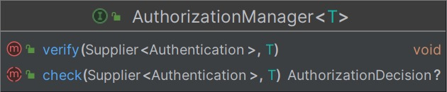

  - **check()**
- 권한 부여 결정을 내릴 때 필요한 모든 관련 정보(인증객체, 체크 대상(권한정보, 요청정보, 호출정보 등..)가 전달된다
    - 액세스가 허용되면 `true`를 포함하는 `AuthorizationDecision`, 거부되면 `false`를 포함하는 `AuthorizationDecision`, 결정을 내릴 수 없는 경우 `null`을 반환한다
  - **verify()**
- **check()**를 호출해서 반환된 값이 `false` 가진 `AuthorizationDecision`인 경우 `AccessDeniedException`을 throw 한다

# **AuthorizationManager 클래스 계층 구조**

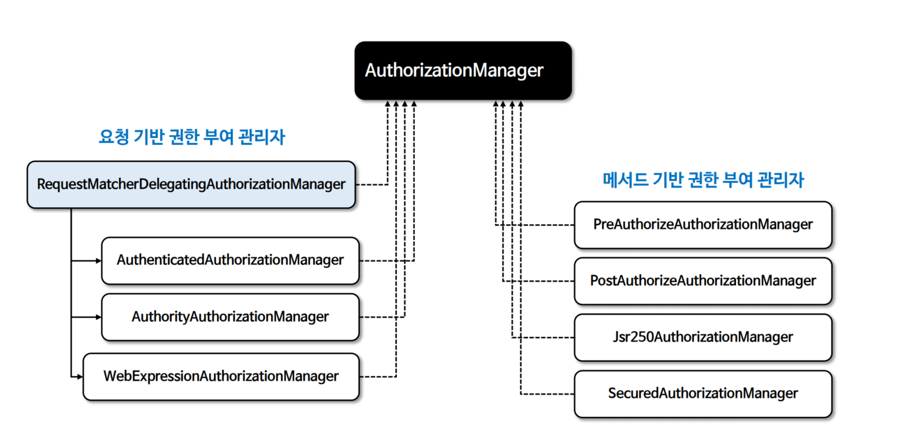

  - `RequestMatcherDelegatingAuthorizationManager` 
- 3가지의 인가 매니저를 참조한다 
    - 인가 심사를 하는 매니저가 아닌 클라이언트의 요청을 확인하고 가장 적합한 인가 매니저를 호출(위임)하는 역할을 한다

# **AuthorizationManager 구현체 종류 및 특징**

**요청 기반 권한 부여 관리자** 

  - `AuthorityAuthorizationManager` 
- 특정 권한을 가진 사용자에게만 접근을 허용한다.
    - 주로 사용자의 권한(예: ROLE_USER, ROLE_ADMIN)을 기반으로 접근을 제어한다
  - `AuthenticatedAuthorizationManager` 
- 인증된 사용자에게 접근을 허용한다. 이 클래스는 사용자가 시스템에 로그인했는지 여부를 기준으로 결정한다
    - ex: `anyRequest().authenticated()`
  - `WebExpressionAuthorizationManager` 
- 웹 보안 표현식을 사용하여 권한을 관리한다.
    -  `"hasRole('ADMIN')` 또는 `hasAuthority('WRITE_PERMISSIONS')`과 같은 표현식을 사용할 수 있다
  - `RequestMatcherDelegatingAuthorizationManager` 
- 인가설정에서 지정한 모든 요청패턴과 권한 규칙을 매핑한 정보를 가지고 있으며 권한 검사 시 가장 적합한 `AuthorizationManager`구현체를 선택해 위임한다

**메소드 기반 권한 부여 관리자** 

  - `PreAuthorizeAuthorizationManager` 
- 메소드 실행 전에 권한을 검사한다. 
    - `@PreAuthorize`어노테이션과 함께 사용되며, 메소드 실행 전에 사용자의 권한을 확인한다
  - `PostAuthorizeAuthorizationManager` 
- 메소드 실행 후에 권한을 검사한다. 
    - `@PostAuthorize` 어노테이션과 함께 사용되며, 메소드 실행 후 결과에 따라 접근을 허용하거나 거부한다
  - `Jsr250AuthorizationManager` 
- JSR-250 어노테이션(`@RolesAllowed`, `@DenyAll`, `@PermitAll`)을 사용하여 권한을 관리한다
  - `SecuredAuthorizationManager` 
- `@Secured` 어노테이션을 사용하여 메소드 수준의 보안을 제공한다.
    - 이 어노테이션은 특정 권한을 가진 사용자만 메소드에 접근할 수 있게 한다

# **개요**

  - 스프링 시큐리티는 요청 기반의 인증된 사용자 및 특정권한을 가진 사용자의 자원접근 허용여부를 결정하는 인가 관리자 클래스들을 제공한다
  - 대표적으로 `AuthorityAuthorizationManager`, `AuthenticatedAuthorizationManager` 와 대리자인 `RequestMatcherDelegatingAuthorizationManager` 가 있다

# **스프링 시큐리티 인가처리**

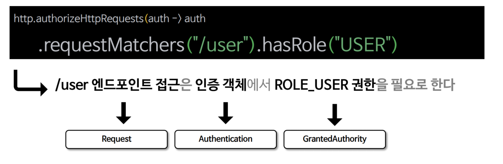

# **내부 구조 이해** 

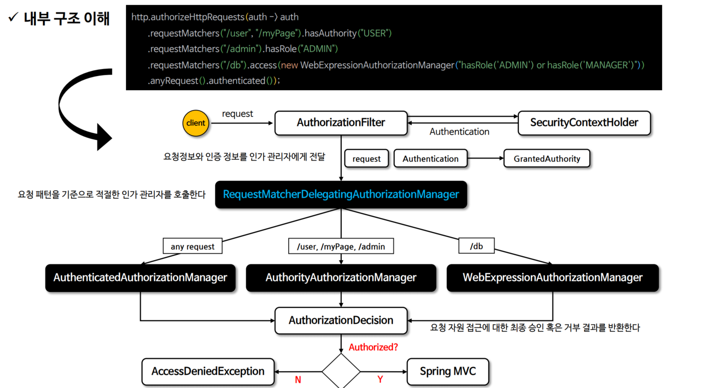

# **AuthenticatedAuthorizationManager 구조**

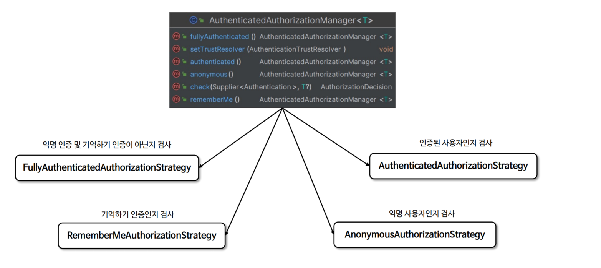

  - `AuthenticatedAuthorizationManager`는 내부적으로 네 개의 `AbstractAuthorizationStrategy` 구현을 통해 인증 여부 확인 전략을 세운다
- `FullyAuthenticatedAuthorizationStrategy` → `anyRequest().fullyAuthenticated()` 
- 아이디, 비밀번호
    - `AuthenticatedAuthorizationStrategy` → `anyRequest().authenticated()` 
- 어떤 방식이든 인증을 받은 경우
    - `RememberMeAuthorizationStrategy` → `anyRequest().rememberMe()`
- 기억하기 인증을 통해 인증 받은 경우
    - `AnonymousAuthorizationStrategy` → `anyRequest().anonymous()` 
- 익명 사용자 인증 (로그인 X 사용자)

# **AuthenticatedAuthorizationManager 매핑**

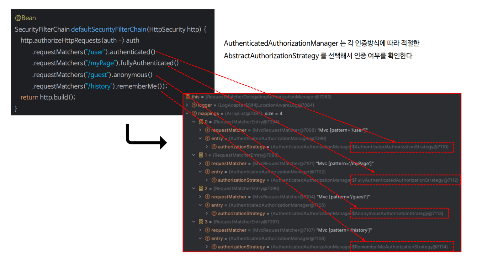

# **AuthenticatedAuthorizationManager 흐름도**

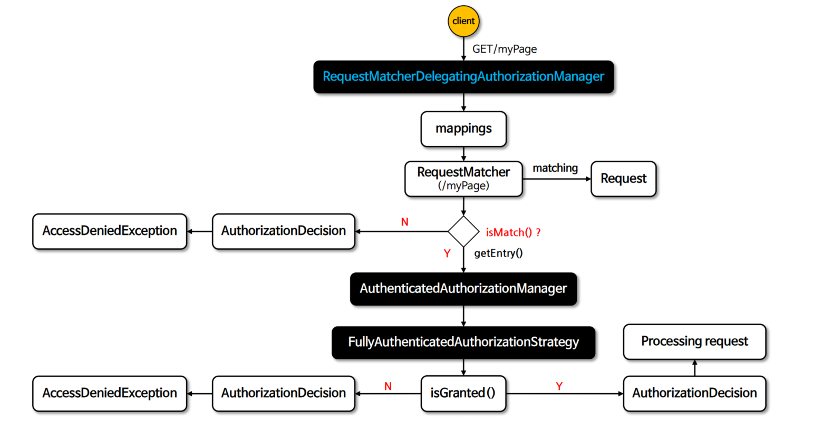

```
현재 그림에서는 mappings에 존재하는 RequestMatcher가 isMatch() -> fasle 결과라면 
바로 AccessDeniedException 예외가 던져지는 것처럼 보일 수 있지만
mappings = ArrayList 이고 List를 순회하면서 모든 RequestMatcher가 isMatch() -> false면  
AccessDeniedException 예외가 던져진다. 

isMatch() -> true -> getEntry() 
AuthenticatedAuthorizationManager가 가지고 있는 전략에 따라서 다르게 동작한다 
```

# 
**AuthorityAuthorizationManager 구조**

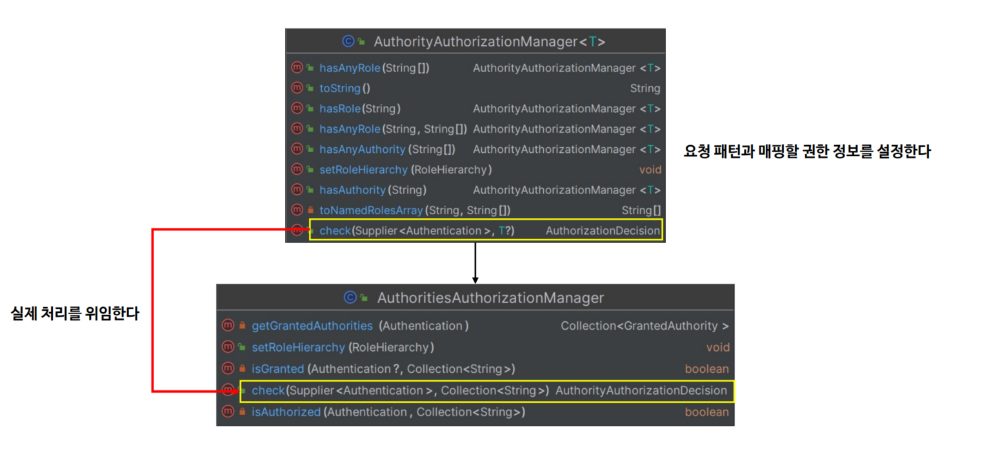

  - `AuthorityAuthorizationManager`는 내부적으로 `AuthoritiesAuthorizationManager`를 사용하여 권한 여부 결정을 위임한다

# **AuthorityAuthorizationManager 매핑**

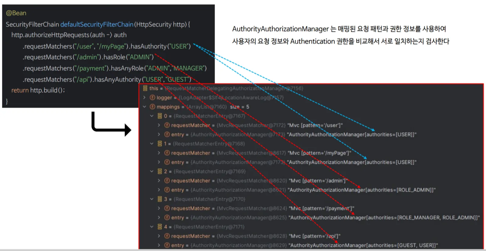

# **AuthorityAuthorizationManager 흐름도**

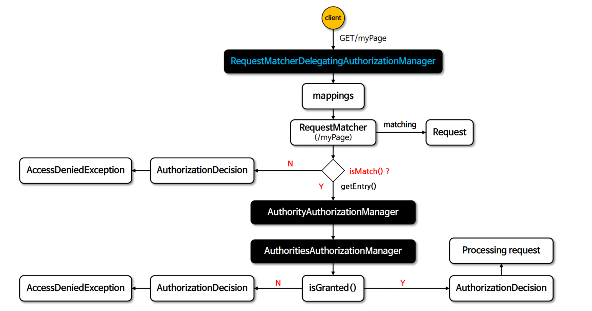

# **디버깅을 통해서 초기화 과정 이해** 

**SecurityConfig**

```java
@EnableWebSecurity
@Configuration
public class SecurityConfig {
    @Bean
    public SecurityFilterChain securityFilterChain(HttpSecurity http) throws Exception{

        http.authorizeHttpRequests(authorize -> authorize
                .requestMatchers("/user").hasRole("USER")
                .requestMatchers("/db").access(new WebExpressionAuthorizationManager("hasRole('DB')"))
                .requestMatchers("/admin").hasAuthority("ROLE_ADMIN")
                .anyRequest().authenticated())
                .formLogin(Customizer.withDefaults())
                .csrf(AbstractHttpConfigurer::disable);
        return http.build();
    }
    @Bean
    public UserDetailsService userDetailsService(){
        UserDetails user = User.withUsername("user").password("{noop}1111").roles("USER").build();
        UserDetails db = User.withUsername("db").password("{noop}1111").authorities("ROLE_DB").build();
        UserDetails admin = User.withUsername("admin").password("{noop}1111").roles("ADMIN","SECURE").build();
        return  new InMemoryUserDetailsManager(user, db, admin);
    }
}
```

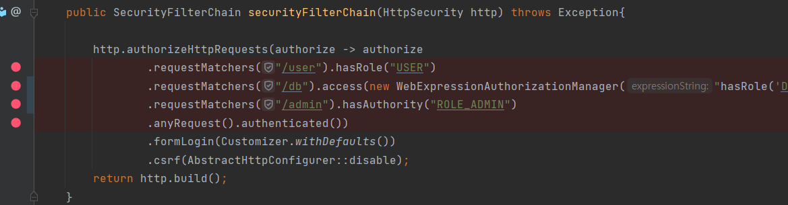

 **RequestMatcherDelegatingAuthorizationManager**

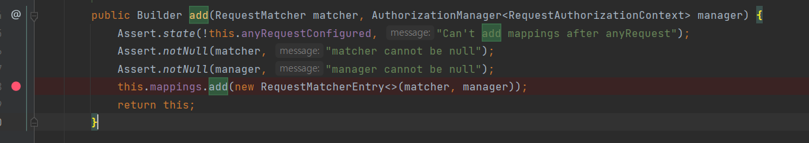

**.requestMatchers("/user").hasRole("USER")**

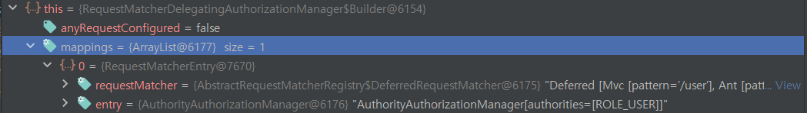

  - mappings size = 1
  - requestMatcher = “/user”
  - entry = AuthroityAuthorizationManager [ROLE_USER]

**.requestMatchers("/db").access(new WebExpressionAuthorizationManager("hasRole('DB')"))**

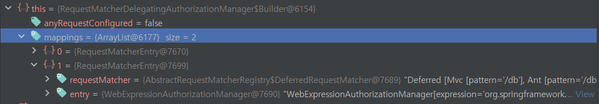

  - mappings size = 2
  - requestMatcher = “/db”
  - entry = WebExpressionAuthorizationManager 

**.requestMatchers("/admin").hasAuthority("ROLE_ADMIN")**

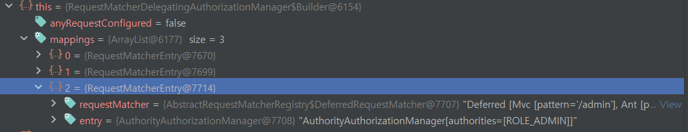

  - mappings size = 3
  - requestMatcher = “/admin”
  - entry = AuthroityAuthorizationManager [ROLE_ADMIN]

**.anyRequest().authenticated()**

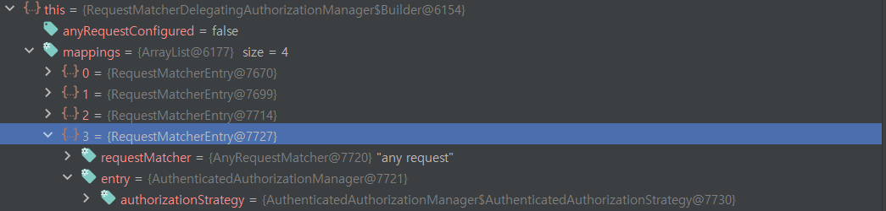

  - mappings size = 4
  - requestMatcher = “any request”
  - entry = AuthenticatedAuthorizationManager
- authorizationStrategy = AuthenticatedAuthorizationStrategy(인증을 받으면 AuthorizationDecision = true)

# **개요**

  - 스프링 시큐리티 인가 설정 시 선언적 방식이 아닌 프로그래밍 방식으로 구현할 수 있으며 **access(AuthorizationManager) API** 를 사용한다
  - **access()**에는 `AuthorizationManager<RequestAuthorizationContext>`타입의 객체를 전달할 수 있으며 사용자의 요청에 대한 권한 검사를 **access()**에 지정한 `AuthorizationManager`가 처리하게 된다
  - **access()**에 지정한 `AuthorizationManager`객체는 `RequestMatcherDelegatingAuthorizationManager` 의 매핑 속성에 저장된다 

```java
http.authorizeHttpRequests(auth -> 
auth.requestMatcher().access(AuthorizationManager)
```

# **적용**

  - 특정한 엔드포인트에 대한 권한 검사를 수행하기 위해 `AuthorizationManager`를 구현하여 설정한다

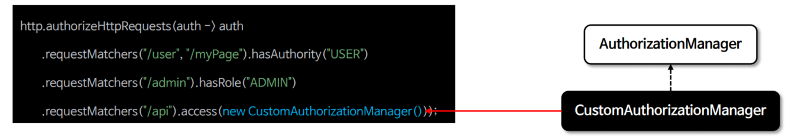

  - `/user`, `/myPage`, `/admin` 요청 패턴의 권한 검사는 `AuthorityAuthorizationManager`가 처리한다
  - `/api`요청 패턴의 권한 검사는 `CustomAuthorizationManager`가 처리한다

# **CustomAuthorizationManager.java**

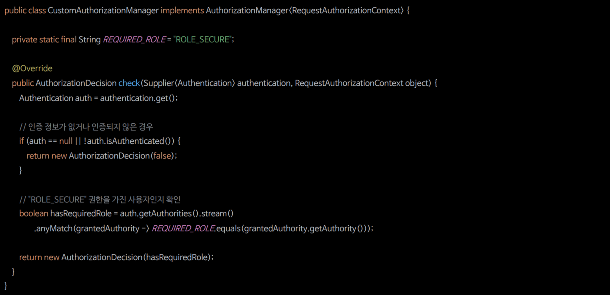

# **실습**

**CustomAuthorizationManager**

```java
public class CustomAuthorizationManager implements AuthorizationManager<RequestAuthorizationContext> {
    private final String REQUIRED_ROLE = "ROLE_SECURE";
    @Override
    public AuthorizationDecision check(Supplier<Authentication> authentication, RequestAuthorizationContext object) {
        Authentication auth = authentication.get();
        // null || 인증 X || 익명 사용자
        if(auth == null || !auth.isAuthenticated() || auth instanceof AnonymousAuthenticationToken){
            return new AuthorizationDecision(false);
        }
        // 권한 심사
        boolean hasRequiredRole = auth.getAuthorities().stream()
                .anyMatch(grantedAuthority -> REQUIRED_ROLE.equals(grantedAuthority.getAuthority()));

        return new AuthorizationDecision(hasRequiredRole);
    }
}
```

  - **stream API anyMatch(): 하나라도 일치하면 return true** 
- 내부 predicate 인터페이스 사용

**SecurityConfig**

```java
@EnableWebSecurity
@Configuration
public class SecurityConfig {
    @Bean
    public SecurityFilterChain securityFilterChain(HttpSecurity http) throws Exception{
        http.authorizeHttpRequests(authorize -> authorize
                .requestMatchers("/user").hasRole("USER")
                .requestMatchers("/db").access(new WebExpressionAuthorizationManager("hasRole('DB')"))
                .requestMatchers("/admin").hasAuthority("ROLE_ADMIN")
                .requestMatchers("/secure").access(new CustomAuthorizationManager())
                .anyRequest().authenticated())
                .formLogin(Customizer.withDefaults())
                .csrf(AbstractHttpConfigurer::disable);
        return http.build();
    }
    @Bean
    public UserDetailsService userDetailsService(){
        UserDetails user = User.withUsername("user").password("{noop}1111").roles("USER").build();
        UserDetails db = User.withUsername("db").password("{noop}1111").authorities("ROLE_DB").build();
        UserDetails admin = User.withUsername("admin").password("{noop}1111").roles("ADMIN","SECURE").build();
        return  new InMemoryUserDetailsManager(user, db, admin);
    }
}
```

  - `.requestMatchers("/secure").access(new CustomAuthorizationManager())`
  - admin 사용자만 `ROLE_SECURE` 
- → admin 사용자만 `/secure` 엔드포인트에 접근이 가능하다

# **개요** 

  - `RequestMatcherDelegatingAuthorizationManager`의 mappings 속성에 직접 `RequestMatcherEntry` 객체를 생성하고 추가한다 

**RequestMatcherEntry**

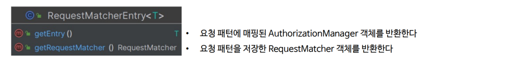

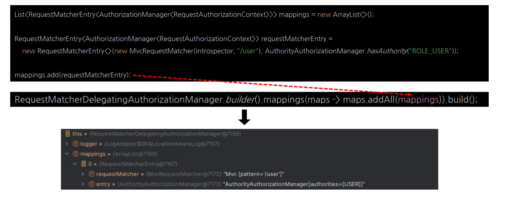

  - **RequestMatcherEntry 생성자** 
```java
public RequestMatcherEntry(RequestMatcher requestMatcher, T entry) {
		this.requestMatcher = requestMatcher;
		this.entry = entry;
	}
```

    - 매개변수: RequestMatcher, AuthorizationManager<T> 
    - 매개변수: MvcRequestMatcher(introspector, “/user”), AuthorityAuthorizationManager
- AuthorityAuthorizationManager.hasAuthority(”ROLE_USER”)
- hasAuthority: static 메소드를 통해 간편하게 생성 가능

**RequestMatcherDelegatingAuthorizationManager**

  - RequestMatcherDelegatingAuthorizationManager.builder().mappings(consumer) 통해 생성  

# **적용**

  - `RequestMatcherDelegatingAuthorizationManager`를 감싸는 `CustomRequestMatcherDelegatingAuthorizationManager`를 구현한다 

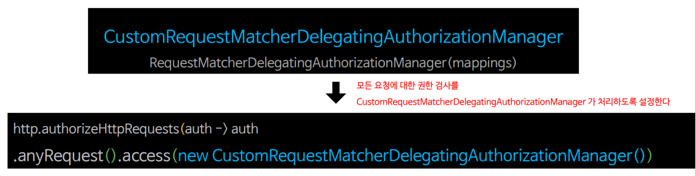

# **적용 후 구조**


# **SecurityConfig.java**

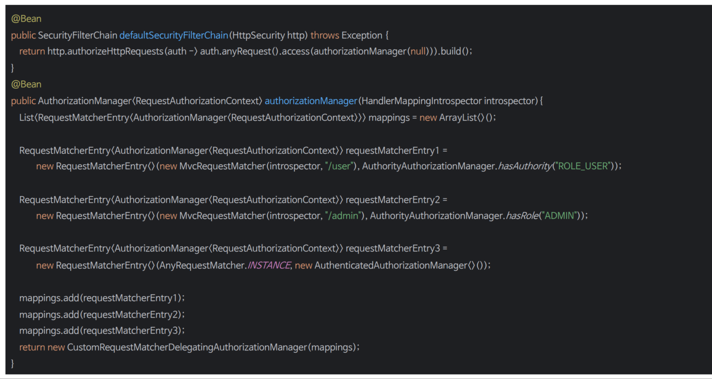

# **CustomRequestMatcherDelegatingAuthorizationManager**

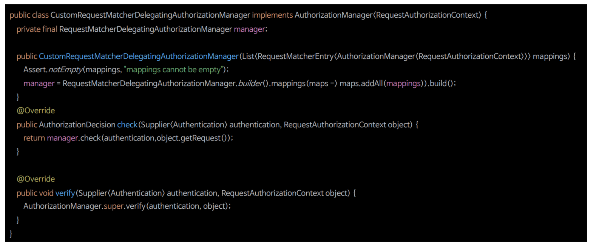

  - 요청에 대한 권한 검사를 `RequestMatcherDelegatingAuthorizationManager` 객체가 수행하도록 한다
  - `RequestMatcherDelegatingAuthorizationManager` → `CustomRequestMatcherDelegatingAuthorizationManager` →
`RequestMatcherDelegatingAuthorizationManager` 
- 구조는 조금 더 개선이 필요하다

# 테스트

**SecurityConfig**

```java
@EnableWebSecurity
@Configuration
public class SecurityConfig {
    @Bean
    public SecurityFilterChain securityFilterChain(HttpSecurity http) throws Exception{
        http.authorizeHttpRequests(authorize -> authorize
                .anyRequest().access(authorizationManager(null)))
                .formLogin(Customizer.withDefaults())
                .csrf(AbstractHttpConfigurer::disable);
        return http.build();
    }
    @Bean
    public AuthorizationManager<RequestAuthorizationContext> authorizationManager(HandlerMappingIntrospector introspector){
        List<RequestMatcherEntry<AuthorizationManager<RequestAuthorizationContext>>> mappings = new ArrayList<>();

        RequestMatcherEntry<AuthorizationManager<RequestAuthorizationContext>> requestMatcherEntry1
                = new RequestMatcherEntry<>(
                        new MvcRequestMatcher(introspector, "/user"),
                        AuthorityAuthorizationManager.hasAuthority("ROLE_USER"));

        RequestMatcherEntry<AuthorizationManager<RequestAuthorizationContext>> requestMatcherEntry2
                = new RequestMatcherEntry<>(
                        new MvcRequestMatcher(introspector, "/db"),
                        AuthorityAuthorizationManager.hasAuthority("ROLE_DB"));

        RequestMatcherEntry<AuthorizationManager<RequestAuthorizationContext>> requestMatcherEntry3
                = new RequestMatcherEntry<>(
                        new MvcRequestMatcher(introspector, "/admin"),
                        AuthorityAuthorizationManager.hasAuthority("ROLE_ADMIN"));

        RequestMatcherEntry<AuthorizationManager<RequestAuthorizationContext>> requestMatcherEntry4
                        = new RequestMatcherEntry<>(
                                AnyRequestMatcher.INSTANCE,
                                // default strategy = AuthenticatedAuthorizationStrategy
                                new AuthenticatedAuthorizationManager<>());

        mappings.add(requestMatcherEntry1);
        mappings.add(requestMatcherEntry2);
        mappings.add(requestMatcherEntry3);
        mappings.add(requestMatcherEntry4);

        return new CustomRequestMatcherDelegatingAuthorizationManager(mappings);
    }

    @Bean
    public UserDetailsService userDetailsService(){
        UserDetails user = User.withUsername("user").password("{noop}1111").roles("USER").build();
        UserDetails db = User.withUsername("db").password("{noop}1111").authorities("ROLE_DB").build();
        UserDetails admin = User.withUsername("admin").password("{noop}1111").roles("ADMIN","SECURE").build();
        return  new InMemoryUserDetailsManager(user, db, admin);
    }
}
```

**SecurityConfig: @Configuration - 빈 자동 주입** 

```java
// SecurityFilterChain 빈을 만드는 코드 일부 
.anyRequest().access(authorizationManager(null)))

@Bean
public AuthorizationManager<RequestAuthorizationContext> authorizationManager(
HandlerMappingIntrospector introspector)
{
	// 생략 ...
}
```

  - 코드에서는 `null`을 넘기지만 `HandlerMappingIntrospector` 타입의 빈을 자동주입 하는걸 디버깅으로 확인했다. 왜 이렇게 동작할까?

### Spring의 빈 주입 방식

Spring은 `@Bean` 메서드에서 파라미터가 있는 경우, 해당 파라미터의 타입에 맞는 빈을 애플리케이션 컨텍스트에서 찾아 자동으로 주입한다

# **CustomRequestMatcherDelegatingAuthorizationManager**

```java
public class CustomRequestMatcherDelegatingAuthorizationManager implements AuthorizationManager<RequestAuthorizationContext> {
    private final RequestMatcherDelegatingAuthorizationManager delegate;
    public CustomRequestMatcherDelegatingAuthorizationManager(
            List<RequestMatcherEntry<AuthorizationManager<RequestAuthorizationContext>>> mappings) {
        this.delegate = RequestMatcherDelegatingAuthorizationManager.builder().mappings(maps -> maps.addAll(mappings)).build();
    }
    @Override
    public void verify(Supplier<Authentication> authentication, RequestAuthorizationContext object) {
        AuthorizationManager.super.verify(authentication, object);
    }
    @Override
    public AuthorizationDecision check(Supplier<Authentication> authentication, RequestAuthorizationContext object) {
        return delegate.check(authentication, object.getRequest());
    }
}
```

# **“/” 경로 요청 디버깅 (흐름 파악하기)**

**AuthorizationFilter**

```java
try {
		AuthorizationDecision decision = this.authorizationManager.check(this::getAuthentication, request);
		this.eventPublisher.publishAuthorizationEvent(this::getAuthentication, request, decision);
		if (decision != null && !decision.isGranted()) {
			throw new AccessDeniedException("Access Denied");
		}
		chain.doFilter(request, response);
	}
	finally {
		request.removeAttribute(alreadyFilteredAttributeName);
	}
```

  - 해당 코드는 doFilter 메소드의 일부이다. 
  - 내부에 가지고 있는 **authorizationManager.check()**를 통해 **AuthorizationDecision** 객체를 받는다.

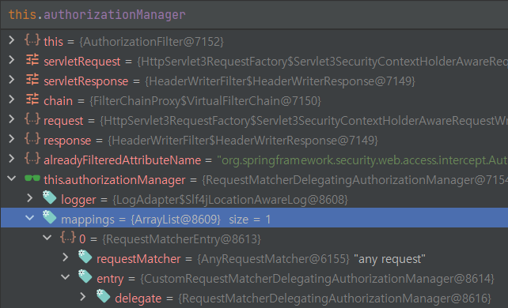

  - `this.authorizationManager = RequestMatcherDelegatingAuthorizationManager@7154`
- mappings.size = 1
- requestMatcher = anyRequest
      - entry = CustomRequestMatcherDelegatingAuthorizationManager

**RequestMatcherDelegatingAuthorizationManager**

```java
for (RequestMatcherEntry<AuthorizationManager<RequestAuthorizationContext>> mapping : this.mappings) {
		RequestMatcher matcher = mapping.getRequestMatcher();
		MatchResult matchResult = matcher.matcher(request);
		if (matchResult.isMatch()) {
			AuthorizationManager<RequestAuthorizationContext> manager = mapping.getEntry();
			if (this.logger.isTraceEnabled()) {
				this.logger.trace(
						LogMessage.format("Checking authorization on %s using %s", requestLine(request), manager));
			}
			return manager.check(authentication,
					new RequestAuthorizationContext(request, matchResult.getVariables()));
		}
	}
```

  - 해당 코드는 check() 메소드의 일부분 
  - mappings for문을 돌면서 matchResult(요청 경로와 RequestMatcherEntry가 가지는 RequestMatcher가 일치하면  RequestMatcherEntry가 가지는 AuthorizationManager를 호출해서 
요청을 위임한다.
  - 현재 AuthorizationManager는 CustomRequestMatcherDelegatingAuthorizationManager

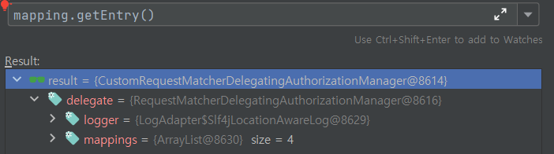

**CustomRequestMatcherDelegatingAuthorizationManager**

```java
private final RequestMatcherDelegatingAuthorizationManager delegate;

@Override
public AuthorizationDecision check(Supplier<Authentication> authentication, RequestAuthorizationContext object) {
    return delegate.check(authentication, object.getRequest());
}
```

**RequestMatcherDelegatingAuthorizationManager - CustomRequestMatcherDelegatingAuthorizationManager (delegate)**

  - mappings에는 4개의 RequestMatcherEntry가 존재한다. 
  - `/` 경로는 AnyRequestMatcher에 해당하는 경로여서 최종적으로 AuthenticatedAuthorizationManager가 처리하는데 이때 전략을 기본 전략인 AuthenticatedAuthorizationStrategy를 사용하기 때문에 최종적으로 AuthorizationDecision 내부는 false가 된다.
  - `AccessDeniedException`이 throw
  - 익명 사용자이기 때문에 `AuthenticatedException`으로 다시 throw


# **직접 구조 바꿔보기 (인프런 링크)**

[https://www.inflearn.com/course/lecture?courseSlug=%EC%8A%A4%ED%94%84%EB%A7%81-%EC%8B%9C%ED%81%90%EB%A6%AC%ED%8B%B0-%EC%99%84%EC%A0%84%EC%A0%95%EB%B3%B5&unitId=208608&tab=community&category=questionDetail&q=1457201](https://www.inflearn.com/course/lecture?courseSlug=%EC%8A%A4%ED%94%84%EB%A7%81-%EC%8B%9C%ED%81%90%EB%A6%AC%ED%8B%B0-%EC%99%84%EC%A0%84%EC%A0%95%EB%B3%B5&unitId=208608&tab=community&category=questionDetail&q=1457201)

```java
@EnableWebSecurity
@Configuration
public class SecurityConfig {
    @Bean
    public SecurityFilterChain securityFilterChain(HttpSecurity http, HandlerMappingIntrospector introspector) throws Exception{
        http
                .addFilterAt(authorizationFilter(introspector), AuthorizationFilter.class)
                .formLogin(Customizer.withDefaults())
                .csrf(AbstractHttpConfigurer::disable);
        return http.build();
    }
    @Bean
    public AuthorizationFilter authorizationFilter(HandlerMappingIntrospector introspector){
        List<RequestMatcherEntry<AuthorizationManager<RequestAuthorizationContext>>> mappings = new ArrayList<>();

        RequestMatcherEntry<AuthorizationManager<RequestAuthorizationContext>> requestMatcherEntry1
                = new RequestMatcherEntry<>(
                        new MvcRequestMatcher(introspector, "/user"),
                        AuthorityAuthorizationManager.hasAuthority("ROLE_USER"));

        RequestMatcherEntry<AuthorizationManager<RequestAuthorizationContext>> requestMatcherEntry2
                = new RequestMatcherEntry<>(
                        new MvcRequestMatcher(introspector, "/db"),
                        AuthorityAuthorizationManager.hasAuthority("ROLE_DB"));

        RequestMatcherEntry<AuthorizationManager<RequestAuthorizationContext>> requestMatcherEntry3
                = new RequestMatcherEntry<>(
                        new MvcRequestMatcher(introspector, "/admin"),
                        AuthorityAuthorizationManager.hasAuthority("ROLE_ADMIN"));

        RequestMatcherEntry<AuthorizationManager<RequestAuthorizationContext>> requestMatcherEntry4
                        = new RequestMatcherEntry<>(
                                AnyRequestMatcher.INSTANCE,
                                // default strategy = AuthenticatedAuthorizationStrategy
                                new AuthenticatedAuthorizationManager<>());

        mappings.add(requestMatcherEntry1);
        mappings.add(requestMatcherEntry2);
        mappings.add(requestMatcherEntry3);
        mappings.add(requestMatcherEntry4);

        RequestMatcherDelegatingAuthorizationManager manager = RequestMatcherDelegatingAuthorizationManager.builder()
                .mappings(maps -> maps.addAll(mappings)).build();
        return new AuthorizationFilter(manager);
    }

    @Bean
    public UserDetailsService userDetailsService(){
        UserDetails user = User.withUsername("user").password("{noop}1111").roles("USER").build();
        UserDetails db = User.withUsername("db").password("{noop}1111").authorities("ROLE_DB").build();
        UserDetails admin = User.withUsername("admin").password("{noop}1111").roles("ADMIN","SECURE").build();
        return  new InMemoryUserDetailsManager(user, db, admin);
    }
}
```

- 인가 과정 상세한 디버깅 정리 
- 스프링 `@Bean` 파라미터 자동 주입 

# **개요**

  - 스프링 시큐리티는 메서드 기반의 인증된 사용자 및 특정권한을 가진 사용자의 자원접근 허용여부를 결정하는 인가 관리자 클래스들을 제공한다
  - `PreAuthorizeAuthorizationManager`, `PostAuthorizeAuthorizationManager`, `Jsr250AuthorizationManager`, `SecuredAuthorizationManager`가 있다
  - 메서드 기반 권한 부여는 내부적으로 AOP 방식에 의해 초기화 설정이 이루어지며 메서드의 호출을 `MethodInterceptor`가 가로 채어 처리하고 있다

# **메소드 인가 처리**

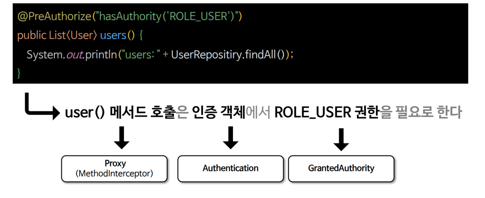

# **메서드 권한 부여 초기화 과정**

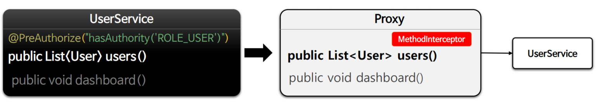

  1. 스프링은 초기화 시 생성되는 전체 빈을 검사하면서 빈이 가진 메소드 중에서 보안이 설정된 메소드가 있는지 탐색한다
  1. 보안이 설정된 메소드가 있다면 스프링은 그 빈의 프록시 객체를 자동으로 생성한다 (기본적으로 **CGLIB** 방식으로 생성한다)
- 스프링 AOP는 JDK 동적 프록시 기술과 바이트 코드를 조작하는 CGLIB 라이브러리 2가지를 사용한다 인터페이스 기반이면 JDK 동적 프록시 클래스만 존재한다면 CGLIB 통해 상속해서 프록시 객체를 생성
  1. 보안이 설정된 메소드에는 인가처리 기능을 하는 `Advice`를 등록한다
  1. 스프링은 빈 참조시 실제 빈이 아닌 프록시 빈 객체를 참조하도록 처리한다
  1. 초기화 과정이 종료된다
  1. 사용자는 프록시 객체를 통해 메소드를 호출하게 되고 프록시 객체는 `Advice`가 등록된 메서드가 있다면 호출하여 작동 시킨다
  1. `Advice`는 메소드 진입 전 인가 처리를 하게 되고 인가 처리가 승인되면 실제 객체의 메소드를 호출하게 되고 인가 처리가 거부되면 예외가 발생하고 메소드 진입이 실패한다

# **메소드 인터셉터 구조**

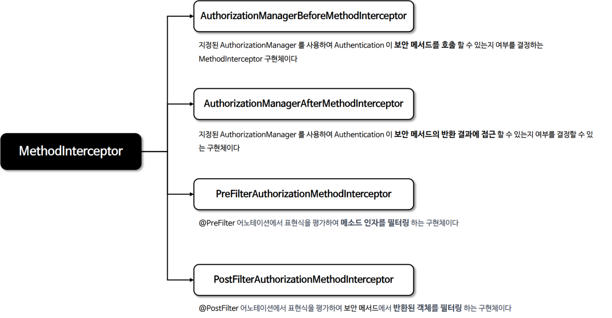

# **초기화 과정 구성도**

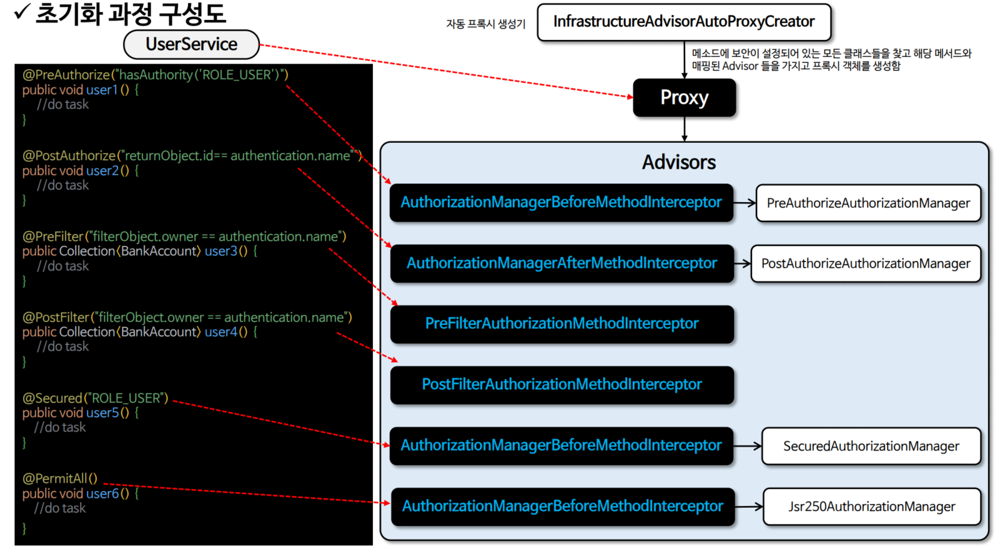

  - `@PreAuthorize`, `@Secured`, `@PermitAll` 모두 `AuthorizationManagerBeforeMethodInterceptor`에서 처리한다 하지만 내부에서 처리하는 `AuthorizationManager`는 다르다 

# **@PreAuthorize 처리 구조 이해**

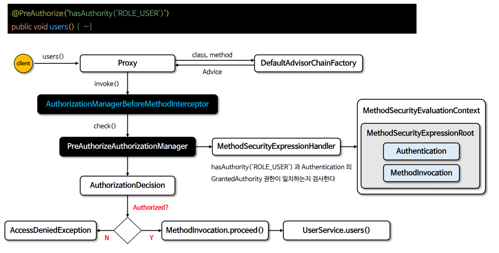

  1. 클라이언트가 UserService: Proxy users() 메소드를 호출 
  1. UserService Proxy는 `DefaultAdvisorChainFactory`에 class, method 정보를 넘기고 해당하는 `Advice`를 받는다.
  1. Proxy invoke() → Advice : `AuthorizationManagerBeforeMethodInterceptor` 
  1. `AuthorizationManagerBeforeMethodInterceptor` check() → `PreAuthorizeAuthorizationManager` 
  1. `PreAuthorizeAuthorizationManager` 권한 검사를 하고 `AuthorizationDecision` 반환 
  1. `AuthorizationDecision(true)` → MethodInvocation.proceed() → UserService.users()
`AuthorizationDecision(false)` → AccessDeniedException 

# **@PostAuthorize 처리 구조 이해**

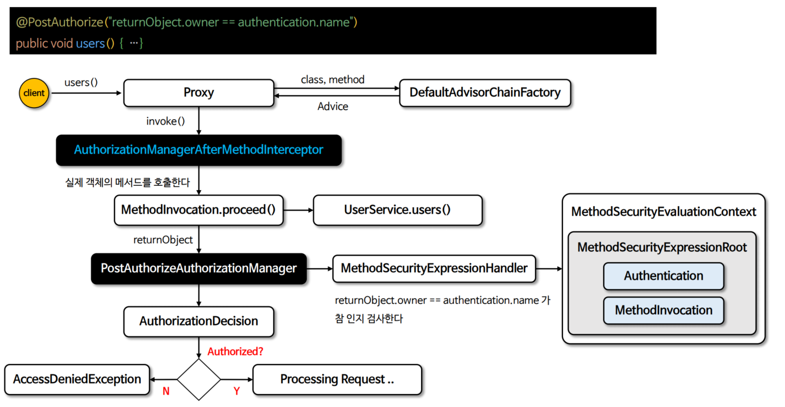

# **실습** 

 **SecurityConfig**

```java
@EnableWebSecurity
@EnableMethodSecurity(securedEnabled = true, jsr250Enabled = true)
@Configuration
public class SecurityConfig {
    @Bean
    public SecurityFilterChain securityFilterChain(HttpSecurity http, HandlerMappingIntrospector introspector) throws Exception{
        http
                .authorizeHttpRequests(authorize -> authorize
                        .anyRequest().authenticated())
                .formLogin(Customizer.withDefaults())
                .csrf(AbstractHttpConfigurer::disable);
        return http.build();
    }
    @Bean
    public UserDetailsService userDetailsService(){
        UserDetails user = User.withUsername("user").password("{noop}1111").roles("USER").build();
        UserDetails db = User.withUsername("db").password("{noop}1111").authorities("ROLE_DB").build();
        UserDetails admin = User.withUsername("admin").password("{noop}1111").roles("ADMIN","SECURE").build();
        return  new InMemoryUserDetailsManager(user, db, admin);
    }
}
```

**IndexController**

```java
@RestController
@RequiredArgsConstructor
public class IndexController {
    private final DataService dataService;
    @GetMapping("/")
    public String index(){
        return "index";
    }
    @GetMapping("/user")
    public String user(){
        return dataService.getUser();
    }
    @GetMapping("/owner")
    public Account owner(String name){
        return dataService.getOwner(name);
    }
    @GetMapping("/display")
    public String display(){
        return dataService.display();
    }
}
```

**DataService**

```java
@Service
public class DataService {
    @PreAuthorize("hasAuthority('ROLE_USER')")
    public String getUser() {
        return "user";
    }
    @PostAuthorize("returnObject.owner == authentication.name")
    public Account getOwner(String name) {
        return new Account(name, false);
    }
    public String display() {
        return "display";
    }
}
```

# **개요**

  - 사용자 정의 `AuthorizationManager`를 생성함으로서 메소드 보안을 구현할 수 있다 

# 설정 클래스 정의

```java
@EnableMethodSecurity(prePostEnabled = false) 
public class MethodSecurityConfig {
		@Bean
		@Role(BeanDefinition.ROLE_INFRASTRUCTURE)
		public Advisor preAuthorize() {
				return AuthorizationManagerBeforeMethodInterceptor.preAuthorize(new MyPreAuthorizationManager());
		}
		@Bean
		@Role(BeanDefinition.ROLE_INFRASTRUCTURE)
		public Advisor postAuthorize() {
				return AuthorizationManagerAfterMethodInterceptor.postAuthorize(new MyPostAuthorizationManager());
		}
}
```

  - `@EnableMethodSecurity(prePostEnabled = false)`
- 시큐리티가 제공하는 클래스들을 비활성화 한다. 그렇지 않으면 중복해서 검사하게 된다.

# **사용자 정의 AuthorizationManager 구현**

```java
public class MyPreAuthorizationManager implements AuthorizationManager<MethodInvocation> {
    @Override
    public AuthorizationDecision check(Supplier<Authentication> authentication, MethodInvocation object) {
        return new AuthorizationDecision(authentication.get().isAuthenticated());
    }
}

public class MyPostAuthorizationManager implements AuthorizationManager<MethodInvocationResult> {
    @Override
    public AuthorizationDecision check(Supplier<Authentication> authentication, MethodInvocationResult result) {
        Authentication auth = authentication.get();
        if(auth instanceof AnonymousAuthenticationToken) return new AuthorizationDecision(false);
        Account account = (Account) result.getResult();
        boolean isGranted = account.getOwner().equals(authentication.get().getName());
        return new AuthorizationDecision(isGranted);
    }
}
```

  - 사용자 정의 `AuthorizationManager`는 여러 개 추가할 수 있으며 그럴 경우 체인 형태로 연결되어 각각 권한 검사를 하게 된다

# **인터셉터 순서 지정**

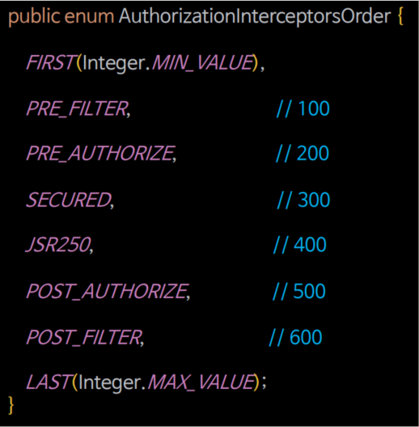

  - 메서드 보안 어노테이션에 대응하는 AOP 메소드 인터셉터들은 AOP 어드바이저 체인에서 특정 위치를 차지한다
  - 구체적으로 `@PreFilter` 메소드 인터셉터의 순서는 100, `@PreAuthorize`의 순서는 200 등으로 설정되어 있다
  - 이것이 중요한 이유는 `@EnableTransactionManagement`와 같은 다른 AOP 기반 어노테이션들이
Integer.MAX_VALUE 로 순서가 설정되어 있는데 기본적으로 이들은 어드바이저 체인의 끝에 위치하고 있다
  - 만약 스프링 시큐리티보다 먼저 다른 어드바이스가 실행 되어야 할 경우, 예를 들어 `@Transactional`과 `@PostAuthorize`가 함께 어노테이션 된 메소드가 있을 때 `@PostAuthorize`가 실행될 때 트랜잭션이 여전히 열려있어서 `AccessDeniedException`이 발생하면 롤백이 일어나게 하고 싶을 수 있다
  - 그래서 메소드 인가 어드바이스가 실행되기 전에 트랜잭션을 열기 위해서는 `@EnableTransactionManagement`의 순서를 설정해야 한다
  - **@EnableTransactionManagement(order = 0)**
  - 위의 order = 0 설정은 트랜잭션 관리가 `@PreFilter` 이전에 실행되도록 하며 `@Transactional` 어노테이션이 적용된 메소드가 스프링 시큐리티의 @PostAuthorize 와 같은 보안 어노테이션보다 먼저 실행되어 트랜잭션이 열린 상태에서 보안검사가 이루어지도록 할 수 있다. 이러한 설정은 트랜잭션 관리와 보안 검사의 순서에 따른 의도하지 않은 사이드 이펙트를 방지할 수 있다
  - `AuthorizationInterceptorsOrder`를 사용하여 인터셉터 간 순서를 지정할 수 있다

# **개요** 

  - 메서드 보안은 `AOP`를 기반으로 구축되었기 때문에 어노테이션이 아닌 패턴 형태로 권한 규칙을 선언할 수 있으며 이는 요청 수준의 인가와 유사한 방식이다
  - 자체 어드바이저(Advisor)를 발행하거나 포인트컷(PointCut)을 사용하여 AOP 표현식을 애플리케이션의 인가 규칙에 맞게 매칭할 수 있으며 이를 통해 어노테이션을 사용하지 않고도 메소드 수준에서 보안 정책을 구현할 수 있다

# **빈 정의하기 ­ 단일 포인터컷**

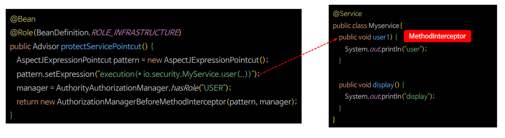

  - `MethodInterceptor`에 `PointCut, AuthorizationManager`를 넘긴다.

# **빈 정의하기 ­ 다중 포인터컷**

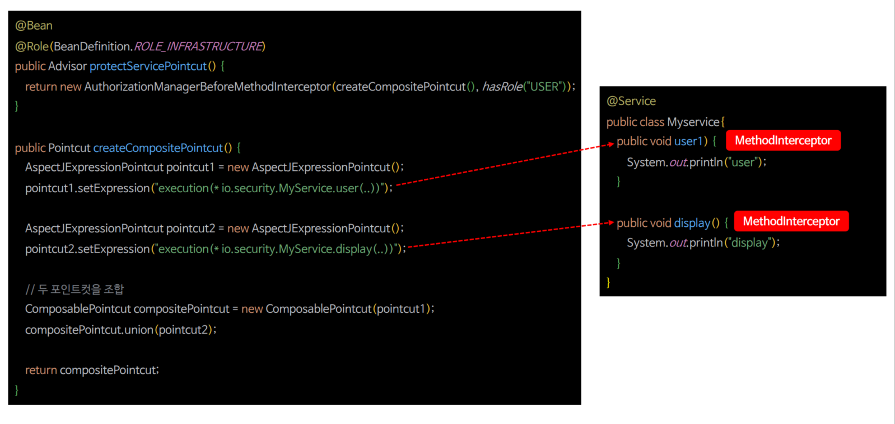

  - 표현식을 `execution(* io.security.`*`Service.`*`(..))` 설정하면 모든 메서드에 AOP 인터셉터가 등록된다

```java
@EnableWebSecurity
@EnableMethodSecurity(prePostEnabled = false)
@Configuration
public class SecurityConfig {
    @Bean
    @Role(BeanDefinition.ROLE_INFRASTRUCTURE)
    public Advisor pointCutAdvisor(){
        AspectJExpressionPointcut pointcut = new AspectJExpressionPointcut();
        pointcut.setExpression("execution(* spring.security.DataService.getUser(..))");
        AuthorityAuthorizationManager<MethodInvocation> manager = AuthorityAuthorizationManager.hasRole("USER");
        return new AuthorizationManagerBeforeMethodInterceptor(pointcut, manager);
    }
    @Bean
    @Role(BeanDefinition.ROLE_INFRASTRUCTURE)
    public Advisor pointCutAdvisor2(){
        AspectJExpressionPointcut pointcut1 = new AspectJExpressionPointcut();
        pointcut1.setExpression("execution(* spring.security.DataService.getUser(..))");

        AspectJExpressionPointcut pointcut2 = new AspectJExpressionPointcut();
        pointcut2.setExpression("execution(* spring.security.DataService.getOwner(..))");

        ComposablePointcut composablePointcut = new ComposablePointcut((Pointcut) pointcut1);
        composablePointcut.union((Pointcut) pointcut2);

        AuthorityAuthorizationManager<MethodInvocation> manager = AuthorityAuthorizationManager.hasRole("USER");
        return new AuthorizationManagerBeforeMethodInterceptor(composablePointcut, manager);
    }

    @Bean
    public SecurityFilterChain securityFilterChain(HttpSecurity http) throws Exception{
        http
                .authorizeHttpRequests(authorize -> authorize
                        .anyRequest().authenticated())
                .formLogin(Customizer.withDefaults())
                .csrf(AbstractHttpConfigurer::disable);
        return http.build();
    }
    @Bean
    public UserDetailsService userDetailsService(){
        UserDetails user = User.withUsername("user").password("{noop}1111").roles("USER").build();
        UserDetails db = User.withUsername("db").password("{noop}1111").authorities("ROLE_DB").build();
        UserDetails admin = User.withUsername("admin").password("{noop}1111").roles("ADMIN","SECURE").build();
        return  new InMemoryUserDetailsManager(user, db, admin);
    }
}
```

# ***개요***

  - *MethodInterceptor, Pointcut, Advisor, AuthorizationManager등을 커스텀하게 생성하여 AOP 메서드 보안을 구현 할 수 있다*

# ***AOP 요소 이해***

***Advisor(Advice + Pointcut)***

  - *AOP Advice 와 Advice 적용 가능성을 결정하는 포인트컷을 가진 기본 인터페이스*

***MethodInterceptor(Advice)***

  - *대상 객체를 호출하기 전과 후에 추가 작업을 수행하기 위한 인터페이스로서 수행 이후 실제 대상 객체의 조인포인트 호출(메소드 호출)을 위해* *`Joinpoint.proceed()`**를 호출한다*

***Pointcut***

  - *AOP 에서 Advice가 적용될 메소드나 클래스를 정의하는 것으로서 어드바이스가 실행되어야 하는 '적용 지점'이나 '조건'을 지정한다*
  - *ClassFilter와 MethodMatcher를 사용해서 어떤 클래스 및 어떤 메서드에 Advice를 적용할 것인지 결정한다*

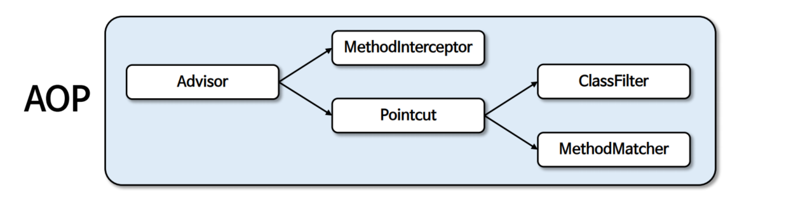

# ***AOP 초기화***

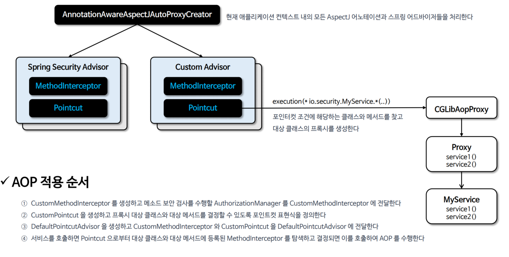

  - *AnnotationAwareAspectJAutoProxyCreator → Bean Post Proceesor*

# ***구현 예제***

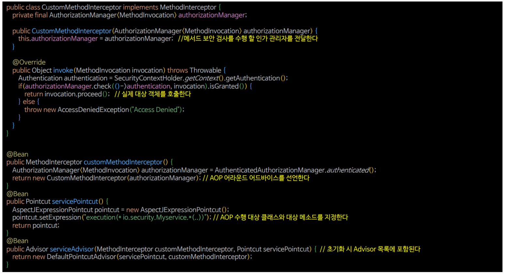

***CustomMethodInterceptor***

```java
@RequiredArgsConstructor
public class CustomMethodInterceptor implements MethodInterceptor {
    private final AuthorizationManager<MethodInvocation> authorizationManager;
    @Override
    public Object invoke(MethodInvocation invocation) throws Throwable {
        Authentication authentication = SecurityContextHolder.getContext().getAuthentication();
        if(authorizationManager.check(()-> authentication, invocation).isGranted()){
            return invocation.proceed(); // target or 다른 advice 호출
        }
        throw new AccessDeniedException("Access Denied");
    }
}
```

***SecurityConfig***

```java
@EnableWebSecurity
@EnableMethodSecurity(prePostEnabled = false)
@Configuration
public class SecurityConfig {
    @Bean
    public Advice customMethodInterceptor(){
        AuthorizationManager<MethodInvocation> authorizationManager = new AuthenticatedAuthorizationManager<>();
        return new CustomMethodInterceptor(authorizationManager);
    }
    @Bean
    public Pointcut pointcut(){
        AspectJExpressionPointcut pointcut = new AspectJExpressionPointcut();
        pointcut.setExpression("execution(* spring.security.DataService.*(..))");
        return pointcut;
    }
    @Bean
    public Advisor advisor(){
        DefaultPointcutAdvisor advisor = new DefaultPointcutAdvisor();
        advisor.setPointcut(pointcut());
        advisor.setAdvice(customMethodInterceptor());
        return advisor;
    }
    @Bean
    public SecurityFilterChain securityFilterChain(HttpSecurity http) throws Exception{
        http
                .authorizeHttpRequests(authorize -> authorize
                        .anyRequest().permitAll())
                .formLogin(Customizer.withDefaults())
                .csrf(AbstractHttpConfigurer::disable);
        return http.build();
    }
    @Bean
    public UserDetailsService userDetailsService(){
        UserDetails user = User.withUsername("user").password("{noop}1111").roles("USER").build();
        UserDetails db = User.withUsername("db").password("{noop}1111").authorities("ROLE_DB").build();
        UserDetails admin = User.withUsername("admin").password("{noop}1111").roles("ADMIN","SECURE").build();
        return  new InMemoryUserDetailsManager(user, db, admin);
    }
}
```

