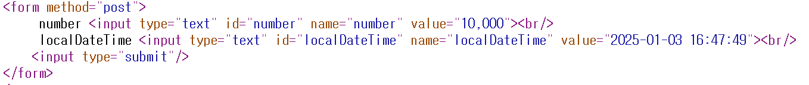
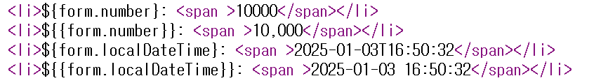

# ***스프링 타입 컨버터 소개***

*문자를 숫자로 변환하거나, 반대로 숫자를 문자로 변환해야 하는 것 처럼 애플리케이션을 개발하다 보면 타입을 변환해야 하는 경우가 상당히 많다.*

*HTTP 쿼리 스트링으로 전달하는 값은 @RequestParam을 사용하면 원하는 타입으로 편리하게 받을 수 있다. → 스프링이 중간에서 타입을 변환해주었기 때문이다.*

***스프링의 타입 변환 적용 예***

- *@RequestParam , @ModelAttribute , @PathVariable*
- *@Value 등으로 YML 정보 읽기*
- *뷰를 렌더링 할 때*

***컨버터 인터페이스***

```java
package org.springframework.core.convert.converter;
public interface Converter<S, T> {
		T convert(S source);
}
```

*개발자가 새로운 타입으로 만들어서 변환하고 싶으면 해당 컨버터 인터페이스를 구현해서 등록하면 된다.*

*해당 기능은 Java8 부터 제공하는 FunctionalInterface인 Function과 유사하다.*

# ***타입 컨버터 - Converter***

*타입 컨버터를 사용하려면* *`org.springframework.core.convert.converter.Converter`* *인터페이스를
구현하면 된다.*

***스프링의 다양한 타입 컨버터*** 

- *Converter: 기본 타입 컨버터*
- *ConverterFactory: 전체 클래스 계층 구조가 필요할 때*
- *GenericConverter: 정교한 구현, 대상 필드의 애노테이션 정보 사용 가능*
- *ConditionalGenericConverter: 특정 조건이 참인 경우에만 실행*

***ConversionService?***

*컨버터를 하나하나 직접 사용하면(컨버터를 객체를 생성해서 직접 사용) 개발자가 직접 컨버팅 하는 것과 큰 차이가 없다. 
타입 컨버터를 등록하고 관리하면서 편리하게 변환 기능을 제공하는 컨버전 서비스(ConversionService)가 필요하다.*

# ***컨버전 서비스 - ConversionService***

***ConversionService - Interface***

```java
package org.springframework.core.convert;

public interface ConversionService {
		boolean canConvert(@Nullable Class<?> sourceType, Class<?> targetType);
		
		boolean canConvert(@Nullable TypeDescriptor sourceType, TypeDescriptor targetType);
		
		<T> T convert(@Nullable Object source, Class<T> targetType);
		
		Object convert(@Nullable Object source, @Nullable TypeDescriptor sourceType, TypeDescriptor targetType);
}
```

- *컨버팅이 가능한지 확인하는 기능(canConvert), 컨버팅(convert) 기능을 제공*

***ConversionServiceTest - 컨버전 서비스 테스트 코드***

```java
@Test
void conversionService(){
    // 등록
    DefaultConversionService conversionService = new DefaultConversionService();
    conversionService.addConverter(new StringToIntegerConverter());
    conversionService.addConverter(new IntegerToStringConverter());
    conversionService.addConverter(new StringToIpPortConverter());
    conversionService.addConverter(new IpPortToStringConverter());

    // 사용
    assertThat(conversionService.convert("10", Integer.class)).isEqualTo(10);
    assertThat(conversionService.convert(10, String.class)).isEqualTo("10");

    assertThat(conversionService.convert("127.0.0.1:8080", IpPort.class))
            .isEqualTo(new IpPort("127.0.0.1", 8080));

    assertThat(conversionService.convert(new IpPort("127.0.0.1", 8080), String.class))
            .isEqualTo("127.0.0.1:8080");

}
```

- *DefaultConversionService implements ConversionService*
- *addConverter(Converter<?, ?> converter): 컨버터 등록 기능을 제공한다.*

***등록과 사용 분리***

*컨버터를 사용하는 입장에서는 타입 컨버터를 전혀 몰라도 된다.*

*타입 컨버터들은 모두 컨버전 서비스 내부에 숨어서 제공 (캡슐화)*

*타입 변환을 원하는 클라이언트는 컨버전 서비스 인터페이스에만 의존한다.* 

***인터페이스 분리 원칙 - ISP(Interface Segregation Principle)***

*인터페이스 분리 원칙은 클라이언트가 자신이 이용하지 않는 메서드(컨버터 등록)에 의존하지 않아야 한다.*

*DefaultConversionService는 다음 두 인터페이스를 구현했다.*

- *ConversionService: 컨버터 사용에 초점* 
- *ConverterRegistry: 컨버터 등록에 초점*

***단일 책임 원칙 - SRP*** *또한 잘 적용되었다. 하나의 인터페이스는 하나의 역할과 책임을 가진다.* 

*SRP가 잘 적용된 구조는 OCP(Open-Closed-Principal) 또한 지켜지기 쉽다.*

# ***스프링에 Converter 적용하기***

***WebConfig - implements WebMvcConfigurer***

```java
@Configuration
public class WebConfig implements WebMvcConfigurer {
    @Override
    public void addFormatters(FormatterRegistry registry) {
         registry.addConverter(new StringToIntegerConverter());
         registry.addConverter(new IntegerToStringConverter());
         registry.addConverter(new StringToIpPortConverter());
         registry.addConverter(new IpPortToStringConverter());
    }
}
```

- *스프링 내부에서 사용하는 ConversionService에 컨버터를 추가한다.*

*스프링은 내부에서 수 많은 기본 컨버터를 제공한다.*

*FormatterRegistry를 통해서 컨버터를 추가하면 같은 타입의 source(S), 같은 타입의 return(T) 이어도 기본 컨버터 보다 높은 우선순위를 가진다.*

***처리 과정 - @RequestParam***

*@RequestParam을 처리하는 ArgumentResolver인 RequestParamMethodArgumentResolver에서 ConversionService를 사용해서 타입을 변환한다*

*반면 @RequestBody를 처리하는 HttpMessageConverter 같은 경우 Jackson의 ObjectMapper를 사용하고 내부에서 ConversionService를 사용하지는 않는다.*

# ***뷰 템플릿에 컨버터 적용하기***

*타임리프는 렌더링 시에 컨버터를 적용해서 렌더링 하는 방법을 편리하게 지원한다.*

***ConverterController***

```java
@Controller
public class ConverterController {

		 @GetMapping("/converter-view")
		 public String converterView(Model model) {
				 model.addAttribute("number", 10000);
				 model.addAttribute("ipPort", new IpPort("127.0.0.1", 8080)); 
				 return "converter-view";
		 }
}
```

***coverter-view 일부***

```html
<span th:text="${number}" ></span>
<span th:text="${{number}}" ></span>
<span th:text="${ipPort}" ></span>
<span th:text="${{ipPort}}" ></span>
```

***렌더링 결과***

```html
10000
10000
hello.typeconverter.type.IpPort@59cb0946
127.0.0.1:8080
```

*타임리프는 ${{...}}를 사용하면 자동으로 컨버전 서비스를 사용해서 변환된 결과를 출력*

*변수 표현식 : ${...}
컨버전 서비스 적용 : ${{...}}*

**<span th:text="${ipPort}" ></span>:** *toString() 호출 → 재정의 하지 않았기 때문에 Object toString()*

**<span th:text="${{ipPort}}" ></span>:** *ConversionService 호출* 

### ***폼에 적용하기***

```java
@Data
@AllArgsConstructor
@NoArgsConstructor
static class Form{
    private IpPort ipPort;
}

@GetMapping("/converter/edit")
public String converterForm(Model model){
    IpPort ipPort = new IpPort("127.0.0.1", 8080);
    Form form = new Form(ipPort);
    model.addAttribute("form", form);
    return "converter-form";
}
```

***converter-form 일부*** 

```html
<form th:object="${form}" th:method="post">
    th:field <input type="text" th:field="*{ipPort}"><br/>
    th:value <input type="text" th:value="*{ipPort}">(보여주기 용도)<br/>
 <input type="submit"/>
</form>
```

*타임리프의 th:field는 컨버전 서비스 적용된다.*

*th:value: toString() 호출* 

*th:field: ConversionService 호출*

# ***포맷터 - Formatter***

***What is Formatter?***

*Converter는 입력과 출력 타입에 제한이 없는, 범용 타입 변환 기능을 제공*

*일반적인 웹 애플리케이션 상황에서는 문자를 다른 타입으로 변환하거나, 다른 타입을 문자로 변환하는 상황이 대부분이다.*

*객체를 특정한 포맷에 맞추어 문자로 출력하거나 그 반대의 역할을 하는 것에 특화된 기능이 바로 Formatter이다.* 

***Converter vs Formatter***

- *Converter는 범용(객체 ↔ 객체)*
- *Formatter는 문자에 특화(객체 ↔ 문자) + 현지화(Locale)*

***Formatter - interface extends Printer, Parser***

```java
public interface Printer<T> {
		String print(T object, Locale locale);
}

public interface Parser<T> {
		T parse(String text, Locale locale) throws ParseException;
}

public interface Formatter<T> extends Printer<T>, Parser<T> {
	
}
```

***MyNumberFormatter***

```java

public class MyNumberFormatter implements Formatter<Number> {
    @Override
    public Number parse(String text, Locale locale) throws ParseException {
        // "1,000" -> 1000
        NumberFormat format =  NumberFormat.getInstance(locale);
        return format.parse(text); // Long
    }

    @Override
    public String print(Number object, Locale locale) {
		    // 1000 -> "1,000"
        NumberFormat instance = NumberFormat.getInstance(locale);
        return instance.format(object);
    }
}
```

*“1,000” 처럼 숫자 중간의 쉼표를 적용하려면 자바에서 제공하는 NumberFormat 객체를 사용하면 된다. (Local 정보를 활용해서 나라별로 다른 숫자 포맷을 만들어준다)*

*참고로 parse 결과는 Long이다. 
Number는 abstract class 이고 구현체는 AtomicInteger, Integer, Long 등이 있다.*

***스프링은 용도에 따라 다양한 방식의 기본 포맷터를 제공***

# ***포맷터를 지원하는 컨버전 서비스***

*컨버전 서비스는 컨버터만 등록할 수 있고, 포맷터는 등록할 수 없다.*

*포맷터를 지원하는 컨버전 서비스를 사용하면 컨버전 서비스에 포맷처를 추가할 수 있다.* 

*내부에서 어댑터 패턴을 사용하여 Formatter를 Converter처럼 동작하도록 지원한다.*

*FormattingConversionService는 포맷터를 지원하는 컨버전 서비스*

*DefaultFormattingConversionService는 FormattingConversionService에 기본적인 통화, 숫자 관
련 몇가지 기본 포맷터를 추가해서 제공*

***DefaultFormattingConversionService Test***

```java
public class FormattingConversionServiceTest {
    @Test
    void formattingConversionService(){
        DefaultFormattingConversionService conversionService = new DefaultFormattingConversionService();

        // 컨버터 등록
        conversionService.addConverter(new StringToIpPortConverter());
        conversionService.addConverter(new IpPortToStringConverter());

        // 포멧터 등록
        conversionService.addFormatter(new MyNumberFormatter());

        // 컨버터 사용
        assertThat(conversionService.convert(new IpPort("127.0.0.0.1", 8080), String.class))
                .isEqualTo("127.0.0.0.1:8080");

        // 포멧터 사용
        assertThat(conversionService.convert("1,000", Integer.class)).isEqualTo(1000);
        assertThat(conversionService.convert(1000, String.class)).isEqualTo("1,000");

    }

}
```

- *포맷터 등록/사용,  컨버터 등록/사용 모두 가능* 
- *Spring Boot는 DefaultFormattingConversionService를 상속 받은* ***WebConversionService****를
내부에서 사용*

# ***포맷터 적용하기***

***WebConfig implements WebMvcConfigurer***

```java
@Configuration
public class WebConfig implements WebMvcConfigurer {
    @Override
    public void addFormatters(FormatterRegistry registry) {
    
         // registry.addConverter(new StringToIntegerConverter());
         // registry.addConverter(new IntegerToStringConverter());
         
         registry.addConverter(new StringToIpPortConverter());
         registry.addConverter(new IpPortToStringConverter());
         
         registry.addFormatter(new MyNumberFormatter());
    }
}

```

*MyNumberFormatter 기능은 숫자 ↔ 문자 기능이고 StringToIntegerConverter, IntegerToStringConverter 또한 숫자 ↔ 문자 기능이다.* 

*즉, 둘의 기능이 겹친다.* 

***우선순위가 Converter > Formatter*** *이기 때문에 Formatter 기능을 사용하고 싶으면 주석 처리를 해야한다.* 

# ***스프링이 제공하는 기본 포맷터***

*스프링은 자바에서 기본으로 제공하는 타입들에 대해 수 많은 포맷터를 기본으로 제공*

***@NumberFormat*** 

- *숫자 관련 형식 지정 포맷터 사용*
- *NumberFormatAnnotationFormatterFactory*

***@DateTimeFormat*** 

- *날짜 관련 형식 지정 포맷터 사용*
- *Jsr310DateTimeFormatAnnotationFormatterFactory*

***Controller***

```java
@Data
static class Form{
    @NumberFormat(pattern = "###,###")
    private Integer number;

    @DateTimeFormat(pattern = "yyyy-MM-dd HH:mm:ss")
    private LocalDateTime localDateTime;
}

@GetMapping("/formatter/edit")
public String formatterForm(Model model){
    Form form = new Form();
    form.setNumber(10000);
    form.setLocalDateTime(LocalDateTime.now());
    model.addAttribute("form", form);
    return "formatter-form";
}

@PostMapping("/formatter/edit")
public String formatterEdit(@ModelAttribute Form form){
    return "formatter-view";
}

```

***formatter-form***

```html
<form th:object="${form}" th:method="post">
     number <input type="text" th:field="*{number}"><br/>
     localDateTime <input type="text" th:field="*{localDateTime}"><br/>
    <input type="submit"/>
</form>
```

- *th:field는 value convert를 자동으로 해준다.*



***formatter-view***

```html
<ul>
     <li>${form.number}: <span th:text="${form.number}" ></span></li>
     <li>${{form.number}}: <span th:text="${{form.number}}" ></span></li>
     <li>${form.localDateTime}: <span th:text="${form.localDateTime}" ></span></li>
     <li>${{form.localDateTime}}: <span th:text="${{form.localDateTime}}" ></span></li>
</ul>
```



- *${}: → convert x*
- *${{}}: → convert o*

***LocalDateTime toString()***

```java
@Override
public String toString() {
    return date.toString() + 'T' + time.toString();
}
```

- *${form.localDateTime}: LocalDateTime toString()이 호출돼서 중간에 T가 들어갔다.*
- *${{form.localDateTime}}:@DateTimeFormat(pattern = "yyyy-MM-dd HH:mm:ss")형식에 맞게 출력*

# *정리*

*컨버터를 사용하든, 포맷터를 사용하든 등록 방법은 다르지만, 사용할 때는 컨버전 서비스를 통해서 일관성 있게 사용할 수 있다.*

*메시지 컨버터(HttpMessageConverter)에는 컨버전 서비스가 적용되지 않는다.*

*JSON을 객체로 변환하는 메시지 컨버터는 내부에서 Jackson 같은 라이브러리를 사용
한다. 객체를 JSON으로 변환한다면 그 결과는 이 라이브러리에 달린 것*

*컨버전 서비스는 @RequestParam , @ModelAttribute , @PathVariable , 뷰 템플릿 등에서 사용할 수 있다.*

