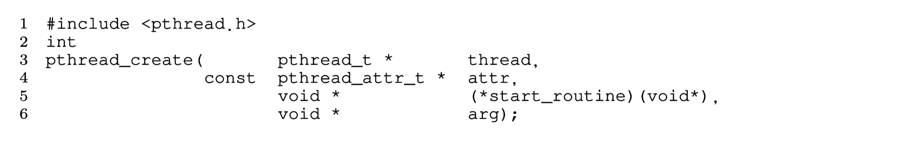
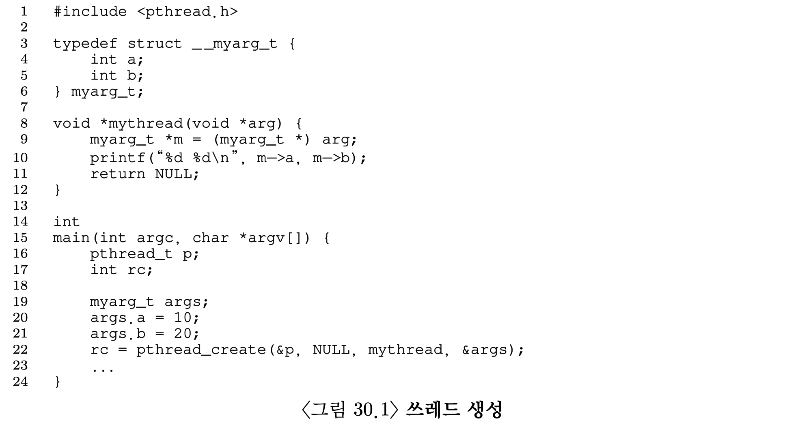
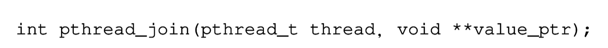
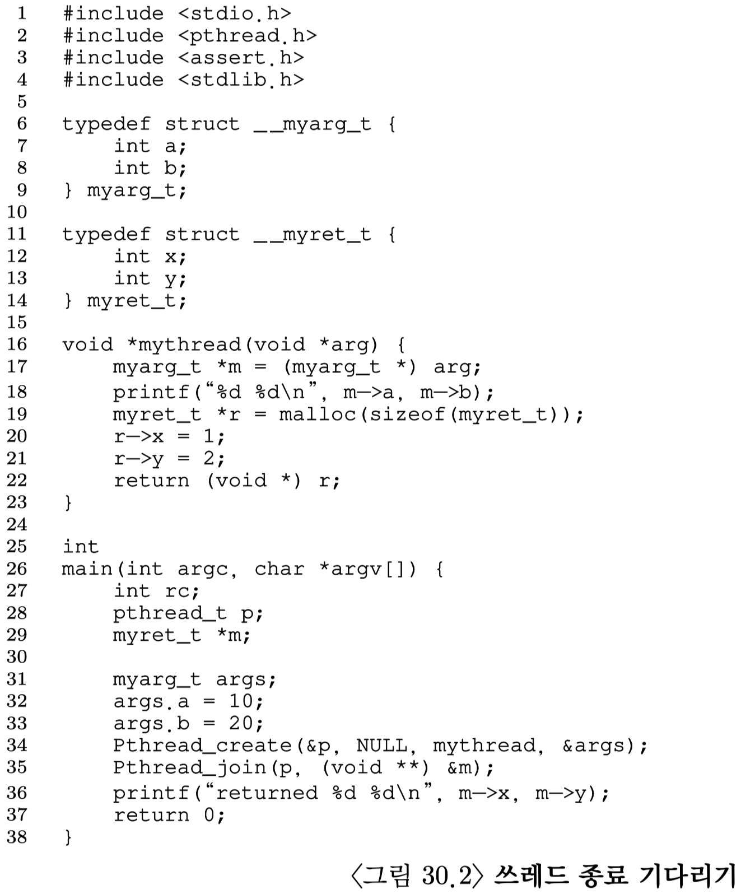
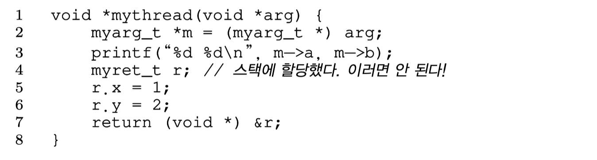

# 30.1 쓰레드 생성



**pthread_create() 4개의 인자** 

| 인자 | 설명 |
| --- | --- |
| **thread** | 새로 생성된 스레드의 ID를 저장할 포인터. (`pthread_t` 타입)  → 스레드가 성공적으로 생성되면 이 변수에 ID가 채워진다. |
| **attr** | 스레드의 속성을 지정하는 포인터. (`pthread_attr_t *`)  → `NULL`을 넘기면 기본 속성(Default Attributes)으로 생성 |
| **start_routine** | 새 스레드가 시작할 함수의 포인터.  → 함수 포맷은 `void* 함수(void* arg)` 형태 |
| **arg** | `start_routine` 함수에 전달할 인자.  → 만약 여러 값이 필요하면 구조체로 포장해서 넘기곤 한다. |

**attr** 

- 쓰레드의 속성을 지정하는 데 사용
- 스택의 크기, 쓰레드의 스케줄링 우선순위 같은 정보를 지정하기 위해 사용될 수 있다.
- 개별 속성은 **pthread_attr_init() 함수**를 호출하여 초기화한다.
- default: NULL 전달 / 대부분의 경우 디폴트 값 지정하면 충분 



그림 30.1을 보면 새롭게 생성되는 쓰레드는 mythread() 함수를 실행한다.

이때 두 개의 인자를 전달받는다. (int a, int b) = myarg_t

---

# 30.2 쓰레드 종료

다른 쓰레드가 작업을 완료할 때까지 기다려야 한다면 어떻게 해야 할까?

**→ pthread_join()**



- **pthread_t 타입 인자**: 어떤 스레드를 기다리려고 하는지 명시
- **void **value_ptr:** 반환 값에 대한 포인터
- 루틴이 임의의 데이터 타입을 반환할 수 있기 때문에 void에 대한 포인터를 타입으로 정의한다.



그림 30.2를 보면 이전 예제와 마찬가지로 쓰레드를 생성하여 myarg_t 데이터 타입을 통하여 2개의 인자를 전달했다. 반환값으로 myret_t 타입이 사용된다. 

메인 쓰레드는 pthread_join() 루틴 안에서 기다리는 중이다.

쓰레드가 실행을 마치면 종료한 쓰레드의 반환한 값, 즉 myret_t 안에 들어 있는 무슨 값이든 접근할 수 있게 된다.



해당 루틴은 스택에 변수 r이 할당되어 있다. 이 값은 쓰레드가 리턴할 때 자동적으로 해제된다

현재 해제된 변수를 가리키는 포인터를 반환하는 것은 좋지 않은 결과를 가져온다.

반환 받았다고 생각하는 값을 출력하려고 시도하면 세그멘테이션 폴트(segmentation fault)가 발생할 것이다.  

```
사실 join은, 스레드를 생성한 스레드가 해당 스레드가 종료될 때까지 블록(block) 되는 동작이기 때문에,
일반적으로 하나의 스레드를 생성하고 곧바로 join하는 경우는 거의 없다.
이런 경우 굳이 쓰레드를 생성하지 않고 그냥 프로시저 호출(함수 호출)을 통해서도 동일한 작업이 가능하다.

보통은 여러 개의 스레드를 생성하여 병렬로 작업을 수행한 후,
모든 작업이 완료되기를 기다릴 때 join을 사용한다.
(예: 여러 계산을 동시에 처리하고, 모두 끝나야 다음 단계로 넘어가는 경우)

또는 join을 아예 사용하지 않는 경우도 있다.
예를 들어, 어떤 스레드는 요청을 받아서 새로운 자식 스레드에게 작업을 위임하는데,
이런 경우에는 자식 스레드의 완료를 기다리지 않고, 메인 스레드는 계속해서 다음 요청을 처리(받아서 위임)한다.
```

---

# 30.3 락 

경쟁 조건 문제를 해결하는 방법 중 하나인 락(lock)을 통한 임계 영역에 대한 상호 배제 기법을 알아보자

```c
int pthread_mutex_lock(pthread_mutex_t *mutex); 

int pthread_mutex_unlock(pthread_mutex_t *mutex);
```

이 루틴을 이용해 임계 영역을 원하는 방식(결정적 동작)으로 동작하도록 보호할 때 사용할 수 있다.

```c
pthread_mutex_t lock;
int pthread_mutex_lock(pthread_mutex_t *mutex); 
x = x + 1; // critical section
int pthread_mutex_unlock(pthread_mutex_t *mutex);
```

pthread_mutex_lock()이 호출되었을 때 어떤 쓰레드도 락을 가지고 있지 않다면 호출한 쓰레드가 락을 얻어 임계 영역에 진입한다. 만약 다른 쓰레드가 락을 가지고 있다면, 락 획득을 시도하는 쓰레드는 락을 얻을 때까지 리턴하지 않는다. 락을 획득한 쓰레드만이 언락을 호출해야 한다. 

**이 코드는 두 가지 측면에서 올바르게 동작하지 않는다.**

첫 번째, 초기화를 하지 않았다. 올바른 값을 가지고 시작했다는 것을 보장하기 위해 모든 락은 올바르게 초기화되어야 한다. 그래야 락과 언락을 호출하였을 때 의도한 대로 동작할 수 있다.

두 번째 문제는 락과 언락을 호출할 때 에러 코드를 확인하지 않는다는 것 이다.

이 경우 여러 쓰레드가 동시에 임계 영역에 들어갈 수 있다. 최소한 래퍼 함수를 사용하여 해당 루틴이 성공적으로 처리되었는지 확인해야 한다. 락이나 언락이 실패한 경우 그냥 종료하면 안되고 적절한 대응을 해야 한다.

```c
int pthread_mutex_trylock(pthread_mutex_t *mutex); 

int pthread_mutex_timedlock(pthread_mutex_t *mutex, 
						struct timespec *abs_timeout);
```

이 두 함수는 락을 획득하는 데 사용된다. 

trylock은 락이 이미 사용 중이라면 실패 코드를 반환한다. 

timedlock은 타임아웃이 끝나거나 락을 획득한다면 리턴한다. 타임아웃을 0으로 설정하면 trylock과 동일하게 동작한다.

락 획득 루틴에서 무한정 대기하는 상황을 피하기 위해 사용되기도 한다.

---

# 30.4 컨디션 변수

**컨디션 변수(Condition Variable)**는 여러 쓰레드가 **특정 조건이 만족될 때까지 기다리게 하고**, 그 조건이 만족되었을 때 **다른 쓰레드가 이를 깨워주는** 데 사용하는 **동기화 메커니즘(시그널 교환 메커니즘 기반 동기화 메커니즘)**이다.

```c
int pthread_cond_wait(pthread_cond_t *cond , pthread_mutex_t *mutex); 
int pthread_cond_signal(pthread_cond_t *cond);
```

pthread_cond_wait()는 호출 쓰레드를 수면(sleep)상태로 만들고 다른 쓰레드로부터의 시그널을 대기한다.

현재 수면 중인 쓰레드가 관심 있는 무언가가 변경되면 시그널을 보낸다.

**예제** 

```c
pthread_mutex_t lock = PTHREAD_MUTEX_INITIALIZER; 
pthread_cond_t cond = PTHREAD_COND_INITIALIZER;

Pthread_mutex_lock(&lock); 
while (ready == 0) 
		Pthread_cond_wait(&cond , &lock); 
Pthread_mutex_unlock(&lock);
```

연관된 락과 컨디션 변수를 초기화한 후에 쓰레드는 ready 변수가 0인지 검사한다.

ready 변수가 0이라면, 다른 쓰레드가 깨워줄 때까지 잠들기 위해 대기 루틴을 호출한다.

**잠자는 쓰레드를 깨우는 코드**

```c
Pthread_mutex_lock(&lock); 
Pthread_cond_signal(&cond); 
ready = 1; 
Pthread_mutex_unlock(&lock);
```

- 시그널을 보내고 전역 변수 ready를 수정할 때 반드시 락을 가지고 있어야 한다.
→ 이를 통해 경쟁 조건이 발생하지 않는다는 것을 보장한다.
- 시그널 내기 함수에서는 락을 두 번째 인자로 받지만, 시그널 보내기 함수에서는 조건만을 인자로 받는다.
→ 이런 차이는 시그널 대기 함수는 호출 쓰레드를 재우는 것 외에 락도 반납(release)해야 하기 때문이다.

락을 반납하지 않으면 어떻게 다른 쓰레드가 락을 얻어 이 쓰레드를 깨우기 위한 시그널을 보낼 수 있겠는가?

pthread_cond_wait()를 실행한 쓰레드들은 항상 락을 획득한 상태로 실행된다는 것을 보장한다.

---

