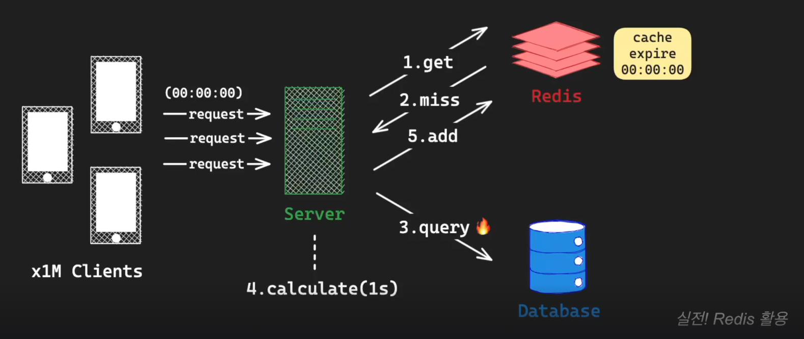
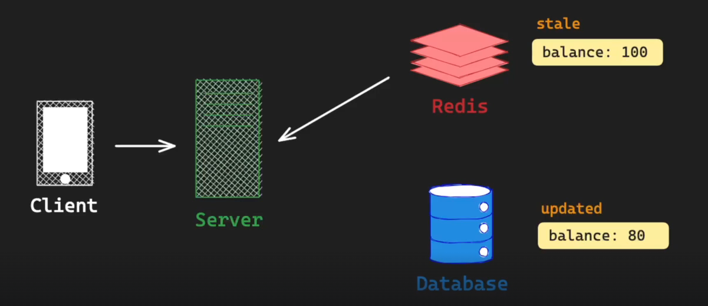

- *대부분의 명령어는 O(1) 시간복잡도를 갖지만, 일부 명령어의 경우 O(N)*
  - *Redis는 Single Thread로 명령어를 순차적으로 수행하기 때문에,
오래 걸리는 O(N) 명령어 수행시, 전체적인 어플리케이션 성능 저하*
  - ***KEYS*** 
- *지정된 패턴과 일치하는 모든 키 key 조회*
    - *Production 환경에서 절대 사용 금지 -> SCAN 명령어로 대체*
  - ***SMEMBERS***
- *Set의 모든 member 반환(N = Set Cardinality)*
  - ***HGETALL*** 
- *Hash의 모든 field 반환(N = Size of Hash)*
  - ***SORT*** 
- *List, Set, ZSet의 item 정렬하여 반환*

# ***Thundering Herd?***

*병렬 요청이 공유 자원에 대해서 접근할 때, 급격한 과부하가 발생하는 문제*

  - *캐싱 적용도 중요하지만 캐시 관리 또한 매우 중요하다*
  - *별도의 배치 작업을 통해서 캐시를 최신화 해야한다.*

# ***Cache Invalidation ?***

  - *캐시의 유효성이 손실 되었거나 변경되었을 때, 캐시를 변경하거나 삭제하는 기술*
- *원본 데이터와의 sync 문제*


