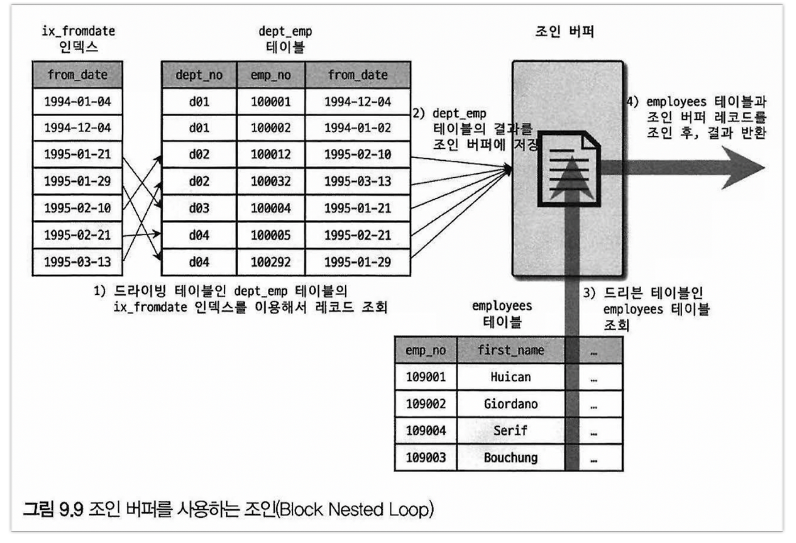
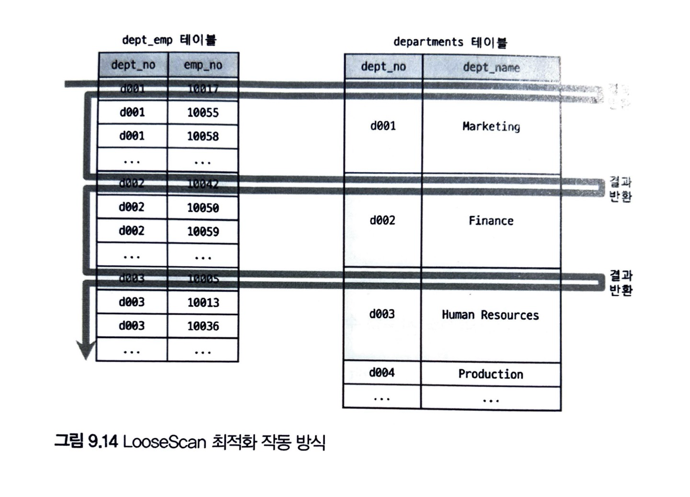

MySQL 서버의 옵티마이저는 **통계 정보 + 옵티마이저 옵션**을 결합해서 최적의 계획을 수립하게 된다.

옵티마이저 옵션은 **조인 관련된 옵션**과 **옵티마이저 스위치**로 구분할 수 있다.

---

# 9.3.1 옵티마이저 스위치 옵션

옵티마이저 스위치 옵션은 `optimizer_switch`  시스템 변수를 통해서 제어한다.

보통 `optimizer_switch` 시스템 변수에는 여러 개의 옵션을 세트로 묶어서 설정하는 방식으로 사용한다.

여러가지 스위치 옵션은 p318 ~ p319를 확인하자.

**옵션 상태 3가지** 

각각의 스위치 옵션은 “default”, “on”, “off” 3가지 중에서 하나를 설정할 수 있는데 “default” 옵션은 기본값을 의미하며 “on” 또는 “off”이다.

**스위치 옵션 적용 방법 3가지**

```sql
// MySQL 서버 전체적으로 옵티마이저 스위치 설정
SET GLOBAL optimizer_switch='~~~~';

// 현재 커넥션(세션)의 옵티마이저 스위치만 설정
SET SESSION optimizer_switch='~~~~';

// 옵티마이저 힌트를 통한 현재 쿼리에만 옵티마이저 스위치 설정
SELECT /*+ SET_VAR(optimizer_switch='~~~~') */
...
FROM ...
```

---

## 9.3.1.1 MRR과 배치 키 엑세스(mrr & batched_key_access)

**MySQL 서버에서 지금까지 지원하던 조인 방식**

```
드라이빙 테이블(조인에서 제일 먼저 읽는 테이블)의 레코드를 한 건 읽어서 
드리븐 테이블(조인되는 테이블)의 일치하는 레코드를 찾아서 수행
이를 네스티드 루프 조인(Nested Loop Join)이라고 부른다.

MySQL 서버에서 조인 처리는 MySQL 엔진이 처리, 레코드를 검색하고 읽는 부분은
스토리지 엔진이 담당한다. 

이때 드라이빙 테이블의 레코드 건별로 드라이븐 테이블의 레코드를 찾으면 레코드를 찾고 
읽는 스토리지 엔진에서는 아무런 최적화를 수행할 수가 없다.
```

**조인 버퍼 버퍼링** 

이런 단점을 보완하기 위해 MySQL 서버는 조인 대상 테이블 중 하나로부터 레코드를 읽어 조인 버퍼에 버퍼링한다. 즉, **드라이빙 테이블의 레코드를 읽어서 드리븐 테이블과의 조인을 즉시 실행하지 않고 조인 대상을 버퍼링**하는 것이다. **조인 버퍼에 레코드가 가득 차면 버퍼링 된 레코드를 스토리지 엔진에 한 번에 요청**한다.

→ 반복적인 랜덤 엑세스를 줄이고, I/O 효율을 높일 수 있다.

→ 물론 데이터 페이지가 메모리(InnoDB 버퍼 풀)에 있다고 하더라도 버퍼 풀의 접근을 최소화할 수 있다.

**MMR & BKA**

이러한 읽기 방식을 **MRR(Multi-Range Read)**이라고 하며, MRR을 응용해서 실행되는 조인 방식을 **BKA(Batched Key Access)** 조인이라고 한다.

BKA 조인은 기본적으로 비활성화돼 있다. BKA 조인을 사용할 때 추가적인 정렬 작업이 필요하고, 이로 인해 오히려 성능이 나빠질 수 있는 상황이 있기 때문이다.

MMR 및 BKA는 조인 칼럼에 인덱스가 존재하지 않으면 사용을 안한다. → **네스티드 루프 조인 최적화 기법**
BKA 성능이 MRR 보다 나빠지는 경우는 조인 칼럼에 대한 인덱스 키 없이 바로 조회하는 비용보다 인덱스 키를 모아서 정렬하고 조회하는 비용이 더 큰 경우에 발생한다.

---

## 9.3.1.2 블록 네스티드 루프 조인(block_nested_loop)

MySQL 서버에서 사용되는 대부분의 조인은 **네스티드 루프 조인(Nested Loop Join)**인데, 조인의 연결 조건이 되는 칼럼에 모두 인덱스가 있는 경우 사용되는 조인 방식이다.

```sql
EXPLAIN 
SELECT *
FROM employees e
INNER JOIN salaries s ON s.emp_no=e.emp_no
AND s.from_date <= NOW() 
AND s.to_date >= NOW()
WHERE e.first_name='Amor';

+----+-------------+-------+------------+------+----------------------+--------------+---------+--------------------+------+----------+-------------+
| id | select_type | table | partitions | type | possible_keys        | key          | key_len | ref                | rows | filtered | Extra       |
+----+-------------+-------+------------+------+----------------------+--------------+---------+--------------------+------+----------+-------------+
|  1 | SIMPLE      | e     | NULL       | ref  | PRIMARY,ix_firstname | ix_firstname | 58      | const              |    1 |   100.00 | NULL        |
|  1 | SIMPLE      | s     | NULL       | ref  | PRIMARY              | PRIMARY      | 4       | employees.e.emp_no |    9 |    11.11 | Using where |
+----+-------------+-------+------------+------+----------------------+--------------+---------+--------------------+------+----------+-------------+
```

예시 쿼리 같은 형태의 조인을 마치 중첩된 반복 명령을 사용하는 것처럼 작동한다고 해서 네스티드 루프 조인이라고 한다. 

```java
for(row1 IN employees){
	 for(row2 IN salaries){
		 if(condition_matched) return (row1, row2);
	 }
}
```

네스티드 루프 조인과 **블록 네스티드 루프 조인(Block Nested Loop Join)**의 가장 큰 차이는 **조인 버퍼**가 사용되는지 여부와 조인에서 드라이빙 테이블과 드리븐 테이블이 어떤 순서로 조인되느냐다.

조인 알고리즘에서 “Block” 단어가 사용되면 조인용으로 별도의 버퍼가 사용됐다는 것을 의미하고, 조인 쿼리의 실행 계획에서 Extra 칼럼에 “Using Join Buffer” 문구가 표시되면 그 실행 계획은 조인 버퍼를 사용한다는 것을 의미한다.

조인은 드라이빙 테이블에서 일치하는 레코드의 건수만큼 드리븐 테이블을 검색하면서 처리된다.

즉 드라이빙 테이블은 한 번에 쭉 읽지만, 드리븐 테이블은 여러 번 읽는다는 것을 의미한다.

예를 들어, 드라이빙 테이블에서 일치하는 레코드가 1,000건이라면 드리븐 테이블의 조인 조건이 인덱스를 이용할 수 없었다면 드리븐 테이블에 1,000번의 풀 테이블 스캔을 해야 한다.

**그래서 옵티마이저는 최대한 드리븐 테이블의 검색이 인덱스를 사용할 수 있게 실행 계획을 수립한다.**

만약 어떤 방식으로도 드리븐 테이블의 풀 테이블 스캔이나 인덱스 풀 스캔을 피할 수 없다면 옵티마이저는 드라이빙 테이블에서 읽은 레코드를 메모리에 캐시한 후 드리븐 테이블과 이 메모리 캐시를 조인하는 형태로 처리한다.

이때 사용되는 메모리의 캐시를 **조인 버퍼(Join Buffer)**라고 한다. 

조인 버퍼는 `join_buffer_size`  시스템 변수로 크기를 제한할 수 있으며, 조인이 끝나면 바로 해제된다.

### 일반 네스티드 루프 조인 VS 네스티드 루프 조인 최적화(MRR, BKA) VS 블록 네스티드 루프 조인

```
# 일반 네스티드 루프 조인

일반 네스티드 루프 조인은 조인 버퍼 없이, 드라이빙 테이블의 레코드를 한 건씩 읽고 바로 
드리븐 테이블을 조회해 결과를 내보낸다.

# 네스티드 루프 조인 최적화 기법(MMR, BKA)

드라이빙 테이블의 모든 레코드를 메모리 캐시 즉, 조인 버퍼에 저장하고 조인을 진행
일반 네스티드 루프 조인은 매번 레코드 마다 읽기 작업이 발생하지만 (버퍼 풀 또는 디스크)
최적화 기법인 MMR, BKA는 한 번에 드리븐 테이블 조회가 가능하다. 
조인 칼럼의 연결 조건이 모두 인덱스가 있어야 사용된다.

# 블록 네스티드 루프

드리븐 테이블을 검색할 때 어떤 방식으로도 드리븐 테이블의 테이블 풀 스캔 또는 인덱스 풀 스캔을
피할 수 없다면 네스티드 루프 조인 최적화 기법처럼 조인 버퍼에 드라이빙 테이블 레코드를 모두 캐시하고
조인을 수행한다.

MMR, BKA 와 차이점은 드리븐 테이블의 조회 방식의 차이다.

인덱스 조인(MRR, BKA 등)
→ 드라이빙 테이블의 키를 모아 한 번에 인덱스 레인지 스캔
→ 드리븐 테이블 접근이 1회(혹은 소수회)로 끝남
→ 대량 랜덤 I/O가 순차 I/O로 바뀌어 성능이 매우 좋아짐

블록 네스티드 루프 조인(인덱스 없음)
→ 드라이빙 테이블 레코드 수만큼 드리븐 테이블 풀스캔 반복
→ 예: 드라이빙 테이블 1,000건 → 드리븐 테이블 1,000번 전체 스캔
→ I/O 비용이 기하급수적으로 증가
```

```sql
SELECT *
FROM dept_emp de, employees e
WHERE de.from_date > '1995-01-01' AND e.emp_no < 109004;
```

해당 쿼리는 각 테이블에 대한 조건은 존재하지만, 두 테이블 간의 연결 고리 역할을 하는 조인 조건은 없다.

그래서 카테시안 조인을 수행한다. 조인 버퍼를 이용해 블록 네스티드 루프 조인을 Extra 칼럼을 통해서 알 수 있다. “Using join buffer (block nested loop)”

아래 그림을 보면 조인 버퍼가 어떻게 사용되는지 보여준다.



**주의점** 

조인 버퍼를 사용하는 조인에서는 결과 정렬 순서가 보장되지 않을 수 있으므로,반드시 정렬이 필요하다면 ORDER BY 절을 명시적으로 사용해야 한다.

**MySQL 8.0.18 해시 조인 도입**

```sql
EXPLAIN
SELECT *
FROM dept_emp de, employees e
WHERE de.from_date > '1995-01-01' AND e.emp_no < 109004;

+----+-------------+-------+------------+-------+---------------+---------+---------+------+--------+----------+--------------------------------------------+
| id | select_type | table | partitions | type  | possible_keys | key     | key_len | ref  | rows   | filtered | Extra                                      |
+----+-------------+-------+------------+-------+---------------+---------+---------+------+--------+----------+--------------------------------------------+
|  1 | SIMPLE      | e     | NULL       | range | PRIMARY       | PRIMARY | 4       | NULL | 149960 |   100.00 | Using where                                |
|  1 | SIMPLE      | de    | NULL       | ALL   | ix_fromdate   | NULL    | NULL    | NULL | 331143 |    50.00 | Using where; Using join buffer (hash join) |
+----+-------------+-------+------------+-------+---------------+---------+---------+------+--------+----------+--------------------------------------------+
```

MySQL 8.0.20 버전부터는 **블록 네스티드 루프 조인은 더이상 사용되지 않고 해시 조인 알고리즘이 대체**되어 사용된다.

---

## 9.3.1.3 인덱스 컨디션 푸시다운(index_condition_pushdown)

**테스트 설정**

```sql
ALTER TABLE employees ADD INDEX ix_lastname_firstname (last_name, first_name);

SET optimizer_switch='index_condition_pushdown=off';

SHOW VARIABLES LIKE 'optimizer_switch';
+------------------+-----------------------------------------------------------------------------------------------------------------------------------------------------------------------------------------------------------------------------------------------------------------------------------------------------------------------------------------------------------------------------------------------------------------------------------------------------------------------------------------------------------------------------------------------------------------------------------------------------+
| Variable_name    | Value                                                                                                                                                                                                                                                                                                                                                                                                                                                                                                                                                                                               |
+------------------+-----------------------------------------------------------------------------------------------------------------------------------------------------------------------------------------------------------------------------------------------------------------------------------------------------------------------------------------------------------------------------------------------------------------------------------------------------------------------------------------------------------------------------------------------------------------------------------------------------+
| optimizer_switch | index_merge=on,index_merge_union=on,index_merge_sort_union=on,index_merge_intersection=on,engine_condition_pushdown=off,index_condition_pushdown=on,mrr=on,mrr_cost_based=on,block_nested_loop=on,batched_key_access=off,materialization=on,semijoin=on,loosescan=on,firstmatch=on,duplicateweedout=on,subquery_materialization_cost_based=on,use_index_extensions=on,condition_fanout_filter=on,derived_merge=on,use_invisible_indexes=off,skip_scan=on,hash_join=on,subquery_to_derived=off,prefer_ordering_index=on,hypergraph_optimizer=off,derived_condition_pushdown=on,hash_set_operations=on |
+------------------+-----------------------------------------------------------------------------------------------------------------------------------------------------------------------------------------------------------------------------------------------------------------------------------------------------------------------------------------------------------------------------------------------------------------------------------------------------------------------------------------------------------------------------------------------------------------------------------------------------+
```

```sql
EXPLAIN
SELECT * FROM employees
WHERE last_name='Acton' AND first_name LIKE '%sal';

+----+-------------+-----------+------------+------+-----------------------+-----------------------+---------+-------+------+----------+-------------+
| id | select_type | table     | partitions | type | possible_keys         | key                   | key_len | ref   | rows | filtered | Extra       |
+----+-------------+-----------+------------+------+-----------------------+-----------------------+---------+-------+------+----------+-------------+
|  1 | SIMPLE      | employees | NULL       | ref  | ix_lastname_firstname | ix_lastname_firstname | 66      | const |  189 |    11.11 | Using where |
+----+-------------+-----------+------------+------+-----------------------+-----------------------+---------+-------+------+----------+-------------+
```

해당 쿼리는 (last_name, first_name) 인덱스를 last_name은 **인덱스 레인지 스캔**으로 사용할 수 있다.

하지만 first_name LIKE ‘%sal’ 조건은 테이블 데이터를 모두 읽은 후 사용자가 원하는 결과인지 **하나씩 비교해보는 조건(체크 조건 또는 필터링 조건)**으로만 사용된다.

실행 계획의 Extra 칼럼을 보면 “Using Where”가 표시된 것을 확인할 수 있다.

**“Using Where”는 인덱스를 사용할 수 없는 WHERE 조건에 일치하는지 검사하는 과정을 의미한다.** 

first_name LIKE ‘%sal’ 이 검사 과정에 사용된 조건이다.

즉, WHERE 조건 검사를 위해 테이블 읽기를 한다.


그림 9.10은 last_name=’Acton’ 조건으로 인덱스 레인지 스캔 이후 테이블의 레코드를 읽은 후, first_name LIKE ‘%sal’ 조건에 부합하는지 여부를 비교하는 과정이다.

만약 last_name=’Acton’ 조건에 일치하는 레코드가 10만 건이나 되는데, 단 1건만 모든 조건에 부합한다면 

이 경우에는 99,999건의 레코드 읽기가 불필요한 작업이 되어버린다.

그런데 왜 ix_lastname_firstname 세컨더리 인덱스에 존재하는 first_name에서 검사하지 않고 테이블의 first_name 칼럼을 이용했을까?

**first_name LIKE ‘%sal’ 조건을 누가 처리하느냐에 따라 인덱스에 포함된 first_name 칼럼을 이용할지 또는 테이블의 first_name 칼럼을 이용할지가 결정된다.**

그림 9.1에서 인덱스를 비교하는 작업은 InnoDB 스토리지 엔진이 수행하지만 테이블의 레코드에서 first_name 조건을 비교하는 작업은 MySQL 엔진이 수행하는 작업이다.

그런데 **MySQL 5.5 버전까지는 인덱스를 범위 제한 조건으로 사용하지 못하는 first_name 조건은 MySQL 엔진이 스토리지 엔진으로 아예 전달해주지 않았다.** 

그래서 스토리지 엔진에서는 불필요한 2건의 테이블 읽기를 수행할 수밖에 없었던 것이다.

MySQL 5.6 버전부터는 이렇게 인덱스를 범위 제한 조건으로 사용하지 못한다고 하더라도 인덱스에 포함된 칼럼의 조건이 있다면 모두 같이 모아서 스토리지 엔진으로 전달할 수 있게 핸들러 API가 개선됐다. 


그래서 MySQL 5.6 버전부터는 그림 9.11과 같이 인덱스를 이용해 최대한 필터링까지 완료해서 꼭 필요한 레코드 1건에 대해서만 테이블 읽기를 수행할 수 있게 됐다.

```sql
SET optimizer_switch='index_condition_pushdown=on';

EXPLAIN
SELECT * FROM employees
WHERE last_name='Acton' AND first_name LIKE '%sal';

+----+-------------+-----------+------------+------+-----------------------+-----------------------+---------+-------+------+----------+-----------------------+
| id | select_type | table     | partitions | type | possible_keys         | key                   | key_len | ref   | rows | filtered | Extra                 |
+----+-------------+-----------+------------+------+-----------------------+-----------------------+---------+-------+------+----------+-----------------------+
|  1 | SIMPLE      | employees | NULL       | ref  | ix_lastname_firstname | ix_lastname_firstname | 66      | const |  189 |    11.11 | Using index condition |
+----+-------------+-----------+------------+------+-----------------------+-----------------------+---------+-------+------+----------+-----------------------+

```

이제 “Using Where”가 없어지고 “Using index condition”이 출력되는 것을 확인할 수 있다.

| **MySQL 버전** | **인덱스 범위 제한 불가 조건(예: LIKE '%sal') 처리 방식** | **스토리지 엔진에 WHERE 조건 전달** | **Extra 칼럼 표시** | **비고** |
| --- | --- | --- | --- | --- |
| 5.5 이하 | 인덱스 범위 제한 조건만 스토리지 엔진에 전달 | X (전달 안 됨) | Using where | 스토리지 엔진이 불필요한 테이블 읽기 수행 |
| 5.6 이상 | 인덱스 범위 제한 조건 + 인덱스 칼럼 조건 모두 전달 | O (전달됨) | Using index condition | 스토리지 엔진이 조건까지 검사 |

---

## 9.3.1.4 인덱스 확장(use_index_extensions)

`use_index_extensions` 옵티마이저 옵션은 InnoDB 스토리지 엔진을 사용하는 테이블에서 
세컨더리 인덱스에 자동으로 추가된 프라이머리 키를 활용할 수 있게 할지를 결정하는 옵션이다.

InnoDB 스토리지 엔진은 프라이머리 키를 클러스터링 키로 생성한다. 그래서 모든 세컨더리 인덱스는 리프 노드에 프라이머리 키 값을 가진다.

```sql
CREATE TABLE dept_emp (
    emp_no INT NOT NULL,
    dept_no CHAR(4) NOT NULL,
    from_date DATE NOT NULL,
    to_date DATE NOT NULL,
    PRIMARY KEY (dept_no, emp_no),
    KEY ix_fromdate (from_date)
) ENGINE=InnoDB;
```

프라이머리 키: (dept_no, emp_no), 세컨더리 인덱스: (from_date)

세컨더리 인덱스는 데이터 레코드를 찾아가기 위해 프라이머리 키인 dept_no, emp_no 칼럼을 순서대로(프라이머리 키에 명시된 순서) 포함한다.

최종적으로 ix_fromdate 인덱스는 (from_date, dept_no, emp_no) 조합으로 인덱스를 생성한 것과 흡사하게 작동할 수 있게 된다.

예전 MySQL 버전에서는 자동으로 추가되는 프라이머리 키를 제대로 활용하지 못했다.

하지만 업그레이드되면서 **옵티마이저는 세컨더리 인덱스에 프라이머리 키 칼럼이 숨어있다는 것을 인지하고 실행 계획을 수립**하도록 개선했다.

```sql
EXPLAIN SELECT COUNT(*)
FROM dept_emp
WHERE from_date='1987-07-25' AND dept_no='d001';

+----+-------------+----------+------------+------+---------------------------------------+-------------+---------+-------------+------+----------+-------------+
| id | select_type | table    | partitions | type | possible_keys                         | key         | key_len | ref         | rows | filtered | Extra       |
+----+-------------+----------+------------+------+---------------------------------------+-------------+---------+-------------+------+----------+-------------+
|  1 | SIMPLE      | dept_emp | NULL       | ref  | PRIMARY,ix_fromdate,ix_empno_fromdate | ix_fromdate | 19      | const,const |    6 |   100.00 | Using index |
+----+-------------+----------+------------+------+---------------------------------------+-------------+---------+-------------+------+----------+-------------+
```

실행 계획의 key_len 칼럼은 이 쿼리가 인덱스를 구성하는 칼럼 중에서 어느 부분까지 사용했는지를 바이트 수로 보여주는데, 19바이트로 표시된 것을 보면 from_date(3바이트) + dept_no(16바이트)까지 사용했다는 것을 알 수 있다.

```sql
EXPLAIN SELECT COUNT(*)
FROM dept_emp
WHERE from_date='1987-07-25t';
+----+-------------+----------+------------+------+-------------------------------+-------------+---------+-------+------+----------+-------------+
| id | select_type | table    | partitions | type | possible_keys                 | key         | key_len | ref   | rows | filtered | Extra       |
+----+-------------+----------+------------+------+-------------------------------+-------------+---------+-------+------+----------+-------------+
|  1 | SIMPLE      | dept_emp | NULL       | ref  | ix_fromdate,ix_empno_fromdate | ix_fromdate | 3       | const |   64 |   100.00 | Using index |
+----+-------------+----------+------------+------+-------------------------------+-------------+---------+-------+------+----------+-------------+
```

dept_no 칼럼을 사용하지 않았더니, from_date 칼럼을 위한 3바이트만 표시된 것을 확인할 수 있다.

InnoDB 프라이머리 키가 세컨더리 인덱스에 포함돼 있으므로 다음과 같은 정렬 작업도 인덱스를 활용해서 처리되는 장점도 있다. 

```sql
EXPLAIN SELECT *
FROM dept_emp
WHERE from_date='1987-07-25'
ORDER BY dept_no;
+----+-------------+----------+------------+------+---------------+-------------+---------+-------+------+----------+-------+
| id | select_type | table    | partitions | type | possible_keys | key         | key_len | ref   | rows | filtered | Extra |
+----+-------------+----------+------------+------+---------------+-------------+---------+-------+------+----------+-------+
|  1 | SIMPLE      | dept_emp | NULL       | ref  | ix_fromdate   | ix_fromdate | 3       | const |   64 |   100.00 | NULL  |
+----+-------------+----------+------------+------+---------------+-------------+---------+-------+------+----------+-------+
```

실행 계획을 보면 “Using Filesort”가 표시되지 않았다는 것은 별도의 정렬 작업 없이 인덱스 순서대로 레코드를 읽기만 함으로써 “ORDER BY dept_no”를 만족했다는 것을 의미한다.

---

## 9.3.1.5 인덱스 머지(index_merge)

인덱스를 이용해 쿼리를 실행하는 경우 대부분 옵티마이저는 테이블별로 하나의 인덱스만 사용하도록 실행 계획을 수립한다. 하지만 **인덱스 머지 실행 계획을 사용하면 하나의 테이블에 대해 2개 이상의 인덱스를 이용**해 쿼리를 처리한다. 

쿼리에서 한 테이블에 대한 WHERE 조건이 여러 개 있더라도 하나의 인덱스에 포함된 칼럼에 대한 조건만으로 인덱스를 검색하고 나머지 조건은 읽어온 레코드에 대해서 체크하는 형태로만 사용되는 것이 일반적이다.

하나의 인덱스만 사용해서 작업 범위를 충분히 줄일 수 있는 경우라면 테이블별로 하나의 인덱스만 활용하는 것이 효율적이다. 하지만 **각각의 조건이 서로 다른 인덱스를 사용할 수 있고, 그 조건을 만족하는 레코드 건수가 많은 것으로 예상될 때 MySQL 서버는 인덱스 머지 실행 계획을 선택**한다.

인덱스 머지 실행 계획은 병합 방식에 따라 3가지로 구분된다.

- **index_merge_intersection**
- **index_merge_soft_union**
- **index_merge_union**

---

## 9.3.1.6 인덱스 머지 - 교집합(index_merge_intersection)

```sql
EXPLAIN SELECT *
FROM employees
WHERE first_name='Georgi' AND emp_no BETWEEN 10000 AND 20000;
+----+-------------+-----------+------------+-------------+----------------------+----------------------+---------+------+------+----------+----------------------------------------------------+
| id | select_type | table     | partitions | type        | possible_keys        | key                  | key_len | ref  | rows | filtered | Extra                                              |
+----+-------------+-----------+------------+-------------+----------------------+----------------------+---------+------+------+----------+----------------------------------------------------+
|  1 | SIMPLE      | employees | NULL       | index_merge | PRIMARY,ix_firstname | ix_firstname,PRIMARY | 62,4    | NULL |    1 |   100.00 | Using intersect(ix_firstname,PRIMARY); Using where |
+----+-------------+-----------+------------+-------------+----------------------+----------------------+---------+------+------+----------+----------------------------------------------------+
```

employees 테이블의 first_name 칼럼과 emp_no 칼럼은 모두 각각의 인덱스(ix_firstname, PRIMARY)를 가지고 있다. 그에 따라 옵티마이저는 ix_firstname, PRIMARY 키를 모두 사용해서 쿼리를 처리하기로 결정한다.

실행 계획의 Extra 칼럼에 “Using intersect”라고 표시된 것은 이 쿼리가 여러 개의 인덱스를 각각 검색해서 그 결과의 교집합만 반환했다는 것을 의미한다.

만약 두 칼럼의 조건 중 하나라도 충분히 효율적으로 쿼리를 처리할 수 있었다면 2개의 인덱스를 모두 사용하는 실행 계획을 사용하지 않았을 것이다.

즉, 옵티마이저는 각각의 조건에 일치하는 레코드 건수를 예측해 본 결과, 두 조건 모두 상대적으로 많은 레코드를 가져와야 한다는 것을 알게 된 것이다.

**각 조건 레코드 카운트 확인** 

```sql
SELECT COUNT(*)
FROM employees
WHERE first_name='Georgi'; 
+----------+
| COUNT(*) |
+----------+
|      253 |
+----------+

SELECT COUNT(*)
FROM employees
WHERE emp_no BETWEEN 10000 AND 20000;
+----------+
| COUNT(*) |
+----------+
|    10000 |
+----------+
```

 

**인덱스 머지 실행 계획이 없었다면?**

```
1번 
first_name='Georgi' 조건만 인덱스를 사용했다면 레코드 253건을 검색한 다음 
데이터 페이지에서 레코드를 찾고 emp_no 칼럼의 조건에 일치하는 레코드들만 반환하는 형태로 처리돼야 한다.

2번
emp_no BETWEEN 10000 AND 20000 조건만 인덱스를 사용했다면 프라이머리 키를 이용해 10,000건을 
읽어와서 first_name='Georgi' 조건에 일치하는 레코드만 반환하는 형태로 처리돼야 한다.
```

**하지만 1번 2번 모두 괜찮은 방식 같은데 왜 두 인덱스의 교집합만 가져오는 실행 계획을 세웠을까?**

```sql
SELECT COUNT(*)
FROM employees
WHERE first_name='Georgi' AND emp_no BETWEEN 10000 AND 20000;

+----------+
| COUNT(*) |
+----------+
|       14 |
+----------+
```

만약 1번 방식을 사용했다면 253번의 데이터 페이지 읽기를 하지만 실제 그중에서 겨우 14번만 의미 있는 작업이고 2번 방식의 경우 10,000건을 읽어서 9,986건은 버리고 겨우 14건만 반환하는 작업이 됐을 것이다.

두 작업 모두 비효율이 매우 큰 상황이어서 옵티마이저는 각 인덱스를 검색해 두 결과의 교집합만 찾아서 반환한 것이다.

**인덱스 확장 측면**

그런데 ix_firstname 세컨더리 인덱스는 리프 노드에 프라이머리 키인 emp_no 칼럼을 자동으로 포함하고 있기 때문에 그냥 ix_firstname 인덱스만 사용하는 것이 더 성능이 좋은 것으로 생각할 수 있다.

그렇다면  `index_merge_intersection` 최적화를 서버 레벨, 세션 레벨, 쿼리 레벨로 비활성화하면 된다.

```sql
EXPLAIN
SELECT /*+ SET_VAR(optimizer_switch='index_merge_intersection=off') */ *
FROM employees
WHERE first_name='Georgi' AND emp_no BETWEEN 10000 AND 20000;
+----+-------------+-----------+------------+-------+----------------------+--------------+---------+------+------+----------+-----------------------+
| id | select_type | table     | partitions | type  | possible_keys        | key          | key_len | ref  | rows | filtered | Extra                 |
+----+-------------+-----------+------------+-------+----------------------+--------------+---------+------+------+----------+-----------------------+
|  1 | SIMPLE      | employees | NULL       | range | PRIMARY,ix_firstname | ix_firstname | 62      | NULL |   14 |   100.00 | Using index condition |
+----+-------------+-----------+------------+-------+----------------------+--------------+---------+------+------+----------+-----------------------+
```

---

## 9.3.1.7 인덱스 머지 - 합집합(index_merge_union)

인덱스 머지의 **“Using union”은 WHERE 절에 사용된 2개 이상의 조건이 각각의 인덱스를 사용하되 OR 연산자로 연결된 경우에 사용**되는 최적화다.

```sql
EXPLAIN SELECT *
FROM employees
WHERE first_name='Matt' OR hire_date='1987-03-31';

+----+-------------+-----------+------------+-------------+--------------------------+--------------------------+---------+------+------+----------+----------------------------------------------------+
| id | select_type | table     | partitions | type        | possible_keys            | key                      | key_len | ref  | rows | filtered | Extra                                              |
+----+-------------+-----------+------------+-------------+--------------------------+--------------------------+---------+------+------+----------+----------------------------------------------------+
|  1 | SIMPLE      | employees | NULL       | index_merge | ix_hiredate,ix_firstname | ix_firstname,ix_hiredate | 58,3    | NULL |  344 |   100.00 | Using union(ix_firstname,ix_hiredate); Using where |
+----+-------------+-----------+------------+-------------+--------------------------+--------------------------+---------+------+------+----------+----------------------------------------------------+
```

employees 테이블에는 first_name 칼럼에 해당하는 인덱스와 hire_date 칼럼에 해당하는 인덱스가 각각 존재한다. 또한 각 조건 OR 연산자로 연결되었기 때문에 “Using union” 즉, 인덱스 머지 최적화를 사용한다.

Extra 칼럼을 보면 “Using union(ix_firstname,ix_hiredate)” 메시지가 보인다.

그런데 두 조건을 모두 만족하는 사원이 있었다면 사원의 정보가 두 번 출력이 되었어야 하는데 그렇지 않다. 

즉, MySQL 서버가 두 결과 집합의 중복 레코드를 제거했다는 것인데, 두 결과 집합에서 중복을 제거하기 위한 정렬 작업이 필요했을 것이다. 하지만 실행 계획에는 정렬했다는 표시는 없다.

MySQL 서버는 이 같은 중복 제거를 위해 내부적으로 어떤 작업을 수행


그림 9.12는 인덱스 머지 최적화의 Union 알고리즘의 작동 방식이다.

사원 번호(emp_no)가 “13163”인 사원은 first_name 검색 결과와 hire_date 검색 결과에서 모두 포함돼 있어서 반드시 하나를 제거해야 한다. 

MySQL 서버는 first_name 조건을 검색한 결과와 hire_date 조건을 검색한 결과가 프라이머리 키로 정렬돼 있다는 것을 알고 있다.

```sql
SELECT *
FROM employees
WHERE first_name='Matt';

+--------+------------+------------+-----------------+--------+------------+
| emp_no | birth_date | first_name | last_name       | gender | hire_date  |
+--------+------------+------------+-----------------+--------+------------+
|  10690 | 1962-09-06 | Matt       | Jumpertz        | F      | 1989-08-22 |
|  12302 | 1962-02-14 | Matt       | Plessier        | M      | 1987-01-28 |
|  13163 | 1963-12-11 | Matt       | Heping          | F      | 1987-03-31 |
|  13507 | 1959-09-05 | Matt       | Wallrath        | M      | 1985-06-28 |
|  15456 | 1957-09-27 | Matt       | Granlund        | M      | 1987-08-17 |
|  15577 | 1961-02-15 | Matt       | Menhardt        | M      | 1985-10-26 |
|  15696 | 1959-05-06 | Matt       | Zhang           | F      | 1987-08-21 |
|  16572 | 1956-11-26 | Matt       | Aamodt          | M      | 1987-06-16 |
|  17791 | 1952-09-22 | Matt       | Stifter         | F      | 1988-01-30 |
|  18258 | 1964-02-28 | Matt       | Hiroyama        | M      | 1986-04-03 |
|  19127 | 1963-11-30 | Matt       | Munawer         | M      | 1987-07-12 |
|  20351 | 1962-07-03 | Matt       | Vanwelkenhuysen | M      | 1994-04-12 |
|  20730 | 1959-02-08 | Matt       | Yemenis         | F      | 1990-06-11 |
|  21667 | 1963-10-28 | Matt       | Maquelin        | F      | 1995-08-23 |

// 생략 ....

SELECT *
FROM employees
WHERE hire_date='1987-03-31';

// 생략 ... 
```

그래서 MySQL **서버는 두 집합에서 하나씩 가져와서 서로 프라이머리 키를 기준으로 비교하면서 값이 중복된 레코드들을 별도의 정렬 없이 걸러낼 수 있다.**

---

## 9.3.1.8 인덱스 머지 - 정렬 후 합집합(index_merge_sort_union)

인덱스 머지 작업을 하는 도중에 결과의 정렬이 필요한 경우 MySQL 서버는 인덱스 머지 최적화의 “Sort union” 알고리즘을 사용한다.

```sql
EXPLAIN
SELECT * FROM employees
WHERE (first_name='Matt') OR (hire_date BETWEEN '1987-03-01' AND '1987-03-31');
+----+-------------+-----------+------------+-------------+--------------------------+--------------------------+---------+------+------+----------+---------------------------------------------------------+
| id | select_type | table     | partitions | type        | possible_keys            | key                      | key_len | ref  | rows | filtered | Extra                                                   |
+----+-------------+-----------+------------+-------------+--------------------------+--------------------------+---------+------+------+----------+---------------------------------------------------------+
|  1 | SIMPLE      | employees | NULL       | index_merge | ix_hiredate,ix_firstname | ix_firstname,ix_hiredate | 58,3    | NULL | 3197 |   100.00 | Using sort_union(ix_firstname,ix_hiredate); Using where |
+----+-------------+-----------+------------+-------------+--------------------------+--------------------------+---------+------+------+----------+---------------------------------------------------------+
```

2개의 쿼리로 분리해서 생각해 보자.

```sql
SELECT * FROM employees WHERE first_name='Matt';
SELECT * FROM employees WHERE hire_date BETWEEN '1987-03-01' AND '1987-03-31'
```

첫 번째 쿼리는 프라이머리 키(emp_no)를 기준으로 결과가 정렬되어 출력된다.

두 번째 쿼리는 hire_date를 기준으로 결과가 정렬되어 출력된다.

즉, 위 예제의 결과에서는 중복을 제거하기 위해 우선순위 큐를 사용하는 것이 불가능하다.

그래서 MySQL 서버는 두 집합의 결과에서 중복을 제거하기 위해 각 집합을 emp_no 칼럼으로 정렬한 다음 중복 제거를 수행한다.

인덱스 머지 최적화에서 중복 제거를 위해 강제로 정렬을 수행해야 하는 경우에는 실행 계획의 Extra 칼럼에 “Using sort_union” 문구가 표시된다.

---

## 9.3.1.9 세미 조인(semijoin)

다른 테이블과 실제 조인을 수행하지 않고, 단지 다른 테이블과 조건에 일치하는 레코드가 있는지 없는지만 

체크하는 형태의 쿼리를 **세미 조인(Semi-Join)**이라고 한다.

**MySQL 8.0 버전에서 세미 조인 쿼리의 예전 처리 방식 확인하기**

```sql
SET SESSION optimizer_switch='semijoin=off';

EXPLAIN
SELECT *
FROM employees e
WHERE e.emp_no IN
(SELECT de.emp_no FROM dept_emp de WHERE de.from_date='1995-01-01');

+----+-------------+-------+------------+------+-------------------------------+-------------+---------+-------+--------+----------+-------------+
| id | select_type | table | partitions | type | possible_keys                 | key         | key_len | ref   | rows   | filtered | Extra       |
+----+-------------+-------+------------+------+-------------------------------+-------------+---------+-------+--------+----------+-------------+
|  1 | PRIMARY     | e     | NULL       | ALL  | NULL                          | NULL        | NULL    | NULL  | 300363 |   100.00 | Using where |
|  2 | SUBQUERY    | de    | NULL       | ref  | ix_fromdate,ix_empno_fromdate | ix_fromdate | 3       | const |     57 |   100.00 | Using index |
+----+-------------+-------+------------+------+-------------------------------+-------------+---------+-------+--------+----------+-------------+
```

세미 조인 최적화 기능이 없었을 때 세미 조인 쿼리의 실행 계획은 employees 테이블을 풀 스캔(type=ALL)하면서 한 건 한 건 서브쿼리의 조건에 일치하는지 비교했다.

실행 계획만 봐도 대략 57건만 읽으면 될 쿼리를 30만 건 넘게 읽어서 처리된다는 것을 알 수 있다.

일반적으로 사용자가 기대하는 실행 방식은 서브 쿼리 먼저 실행, employees 테이블에서 일치하는 레코드만 검색

**MySQL 8.0 버전에서 세미 조인 쿼리의 최적화된 방식 확인하기**

```sql
SET SESSION optimizer_switch='semijoin=on';

EXPLAIN
SELECT *
FROM employees e
WHERE e.emp_no IN
(SELECT de.emp_no FROM dept_emp de WHERE de.from_date='1995-01-01');

+----+-------------+-------+------------+--------+-------------------------------+-------------+---------+---------------------+------+----------+------------------------------+
| id | select_type | table | partitions | type   | possible_keys                 | key         | key_len | ref                 | rows | filtered | Extra                        |
+----+-------------+-------+------------+--------+-------------------------------+-------------+---------+---------------------+------+----------+------------------------------+
|  1 | SIMPLE      | de    | NULL       | ref    | ix_fromdate,ix_empno_fromdate | ix_fromdate | 3       | const               |   57 |   100.00 | Using index; Start temporary |
|  1 | SIMPLE      | e     | NULL       | eq_ref | PRIMARY                       | PRIMARY     | 4       | employees.de.emp_no |    1 |   100.00 | End temporary                |
+----+-------------+-------+------------+--------+-------------------------------+-------------+---------+---------------------+------+----------+------------------------------+
```

먼저 서브 쿼리를 실행하여 57건을 읽고 employees 테이블의 PK emp_no를 통해서 1건만 읽는다.

세미 조인(Semi-join) 형태의 쿼리와 안티 세미 조인(Anti Semi-join) 형태의 쿼리는 최적화 방법에 차이가 존재한다.

| 최적화 기법 | 설명 |
| --- | --- |
| **세미 조인 최적화** | IN/EXISTS 서브쿼리를 내부적으로 조인으로 변환하여 효율적으로 처리. <br>Hash Semi Join, Index Semi Join 등 |
| **IN-to-EXISTS 최적화** | IN (subquery) → EXISTS로 변환하여 조건이 만족되면 즉시 반환 가능하도록 최적화 |
| **Materialization** | 서브쿼리 결과를 임시 테이블로 미리 계산하여 캐싱함으로써 반복 평가 방지 |

“= (subquery)”, “IN (subquery)” 형태의 세미 조인 쿼리에 대해 다음과 같은 최적화 방법을 사용 

- 세미 조인 최적화
- In-to-EXISTS 최적화
- MATERIZATION 최적화

“<> (subquery)”, “NOT IN (subquery)” 형태의 안티 세미 조인 쿼리에 대해 다음과 같은 최적화 방법을 사용

- In-to-EXISTS 최적화 
- MATERIZATION 최적화

MySQL 서버 메뉴얼은 아래 최적화 전략들을 모아서 **전부 세미 조인 최적화라고 부른다.**

- Table Pull-out
- Duplicate Weed-out
- First Match
- Loose Scan
- Materialization 

---

## 9.3.1.10 테이블 풀-아웃(Table Pull-out)

Table pullout 최적화는 **세미 조인의 서브쿼리에 사용된 테이블을 아우터 쿼리로 끄집어낸 후에 쿼리를 조인 쿼리로 재작성하는 형태**의 최적화다.

이는 서브쿼리 최적화가 도입되기 이전에 수동으로 쿼리를 튜닝하던 대표적인 방법이었다.

```sql
EXPLAIN
SELECT *
FROM employees e
WHERE e.emp_no IN (SELECT de.emp_no FROM dept_emp de WHERE de.dept_no='d009');

+----+-------------+-------+------------+--------+---------------------------+---------+---------+---------------------+-------+----------+-------------+
| id | select_type | table | partitions | type   | possible_keys             | key     | key_len | ref                 | rows  | filtered | Extra       |
+----+-------------+-------+------------+--------+---------------------------+---------+---------+---------------------+-------+----------+-------------+
|  1 | SIMPLE      | de    | NULL       | ref    | PRIMARY,ix_empno_fromdate | PRIMARY | 16      | const               | 46012 |   100.00 | Using index |
|  1 | SIMPLE      | e     | NULL       | eq_ref | PRIMARY                   | PRIMARY | 4       | employees.de.emp_no |     1 |   100.00 | NULL        |
+----+-------------+-------+------------+--------+---------------------------+---------+---------+---------------------+-------+----------+-------------+
```

실행 계획을 보면 id 칼럼이 전부 1이다.

**이 값이 동일한 값을 가진다는 것은 두 테이블이 서브쿼리 형태가 아니라 조인으로 처리됐음을 의미한다.**

IN (subquery) 형태의 세미 조인이 가장 빈번하게 사용되는 형태의 쿼리이다.

**Table pullout 최적화 간단한 확인 방법**

별도로 실행 계획의 Extra 칼럼에 “Using table pullout” 같은 문구가 출력되지 않는다.

그래서 Table pullout 최적화가 사용됐는지는 실행 계획에서 해당 테이블들의 id 칼럼값이 같은지 다른지를 비교 + Extra 칼럼에 아무것도 출력되지 않는 경우가 가장 간단한 확인 방법이다.

**Table pullout 최적화 정확한 확인 방법**

EXPLAIN 명령을 실행한 직후 SHOW WARNIGNS 명령으로 옵티마이저가 재작성한 쿼리를 살펴보기

```sql


SHOW WARNINGS;
+-------+------+------------------------------------------------------------------------------------------------------------------------------------------------------------------------------------------------------------------------------------------------------------------------------------------------------------------------------------------------------------------------------------------------------------------------------------------------------------+
| Level | Code | Message                                                                                                                                                                                                                                                                                                                                                                                                                                                    |
+-------+------+------------------------------------------------------------------------------------------------------------------------------------------------------------------------------------------------------------------------------------------------------------------------------------------------------------------------------------------------------------------------------------------------------------------------------------------------------------+
| Note  | 1003 | /* select#1 */ select `employees`.`e`.`emp_no` AS `emp_no`,`employees`.`e`.`birth_date` AS `birth_date`,`employees`.`e`.`first_name` AS `first_name`,`employees`.`e`.`last_name` AS `last_name`,`employees`.`e`.`gender` AS `gender`,`employees`.`e`.`hire_date` AS `hire_date` from `employees`.`dept_emp` `de` join `employees`.`employees` `e` where ((`employees`.`e`.`emp_no` = `employees`.`de`.`emp_no`) and (`employees`.`de`.`dept_no` = 'd009')) |
+-------+------+------------------------------------------------------------------------------------------------------------------------------------------------------------------------------------------------------------------------------------------------------------------------------------------------------------------------------------------------------------------------------------------------------------------------------------------------------------+
```

**EXPLAIN FORMAT=JSON 활용 확인**

```sql
EXPLAIN FORMAT=JSON
SELECT *
FROM employees e
WHERE e.emp_no IN (SELECT de.emp_no FROM dept_emp de WHERE de.dept_no='d009');

{
  "query_block": {
    "select_id": 1,
    "cost_info": {
      "query_cost": "35806.43"
    },
    "nested_loop": [
      {
        "table": {
          "table_name": "de",
          "access_type": "ref",
          "possible_keys": [
            "PRIMARY",
            "ix_empno_fromdate"
          ],
          "key": "PRIMARY",
          "used_key_parts": [
            "dept_no"
          ],
          "key_length": "16",
          "ref": [
            "const"
          ],
          "rows_examined_per_scan": 46012,
          "rows_produced_per_join": 46012,
          "filtered": "100.00",
          "using_index": true,
          "cost_info": {
            "read_cost": "222.44",
            "eval_cost": "4601.20",
            "prefix_cost": "4823.64",
            "data_read_per_join": "1M"
          },
          "used_columns": [
            "emp_no",
            "dept_no"
          ]
        }
      },
      {
        "table": {
          "table_name": "e",
          "access_type": "eq_ref",
          "possible_keys": [
            "PRIMARY"
          ],
          "key": "PRIMARY",
          "used_key_parts": [
            "emp_no"
          ],
          "key_length": "4",
          "ref": [
            "employees.de.emp_no"
          ],
          "rows_examined_per_scan": 1,
          "rows_produced_per_join": 46012,
          "filtered": "100.00",
          "cost_info": {
            "read_cost": "26381.60",
            "eval_cost": "4601.20",
            "prefix_cost": "35806.44",
            "data_read_per_join": "5M"
          },
          "used_columns": [
            "emp_no",
            "birth_date",
            "first_name",
            "last_name",
            "gender",
            "hire_date"
          ]
        }
      }
    ]
  }
}
```

쿼리가 IN (subquery)에서 2개의 테이블이 조인으로 동작한다.

**Table pullout 최적화 제한 사항과 특징**

- 세미 조인 서브쿼리에서만 사용 가능하다.
- IN/EXISTS 같은 쿼리
- **서브쿼리 부분이 UNIQUE 인덱스나 프라이머리 키 룩업으로 결과가 1건인 경우에만 사용 가능하다.**
- 만약 모든 서브쿼리의 모든 테이블이 아우터 쿼리로 끄집어 낼 수 있다면 서브쿼리 자체는 없어진다.
- MySQL에서는 **“최대한 서브쿼리를 풀어서 사용해라”라는 튜닝 가이드가 많은데, Table pullout 최적화는 이 가이드를 그대로 실행하는 것**이다. → 서브쿼리를 직접 조인으로 풀어서 사용할 필요가 없다.

---

## 9.3.1.11 퍼스트 매치(first match)

First Match 최적화 전략은 IN (subquery) 형태의 세미 조인을 EXISTS (subquery) 형태로 튜닝한 것과 비슷한 방법으로 실행된다.

```sql
EXPLAIN SELECT *
FROM employees e
WHERE e.first_name='Matt' AND e.emp_no IN
( SELECT t.emp_no FROM titles t
  WHERE t.from_date BETWEEN '1995-01-01' AND '1995-01-30');
  
+----+-------------+-------+------------+------+----------------------+--------------+---------+--------------------+------+----------+-----------------------------------------+
| id | select_type | table | partitions | type | possible_keys        | key          | key_len | ref                | rows | filtered | Extra                                   |
+----+-------------+-------+------------+------+----------------------+--------------+---------+--------------------+------+----------+-----------------------------------------+
|  1 | SIMPLE      | e     | NULL       | ref  | PRIMARY,ix_firstname | ix_firstname | 58      | const              |  233 |   100.00 | NULL                                    |
|  1 | SIMPLE      | t     | NULL       | ref  | PRIMARY              | PRIMARY      | 4       | employees.e.emp_no |    1 |    11.11 | Using where; Using index; FirstMatch(e) |
+----+-------------+-------+------------+------+----------------------+--------------+---------+--------------------+------+----------+-----------------------------------------+  
```

실행 계획을 보면 id 칼럼의 값이 모두 1로 표시됐다. Extra 칼럼에는 “FirstMatch(e)”라는 문구가 출력됐다.

즉, titles 테이블이 서브 쿼리 패턴이 아닌, 조인으로 처리됐다는 것을 알 수 있다.


“FirstMatch(e)” 문구는 employees 테이블의 레코드에 대해 titles 테이블에 일치하는 레코드 1건만 찾으면 더이상의 titles 테이블 검색을 하지 않는다는 것을 의미한다.

즉, EXISTS(subquery)와 동일하게 처리된 것이다. 하지만 FirstMatch는 서브쿼리가 아니라 조인으로 풀어서 실행하면서 일치하는 첫 번째 레코드만 검색하는 최적화를 실행한 것이다.

**e 테이블을 드라이빙 테이블로 잡고 t 테이블과의 네스티드 루프 조인 & first match**

**그렇다면 IN-to-EXISTS 변환에 비해 FirstMatch 최적화 전략은 어떤 장점이 있을까?**

```
여러 테이블이 조인되는 형태의 쿼리에서는 없던 동등 조건을 옵티마이저가 자동으로 추가하는 형태의
최적화가 실행되기도 한다. 
기존 IN-to-EXISTS 최적화에서는 이러한 동등 조건 전파가 서브쿼리 내에서만 가능했지만
FirstMatch에서는 조인 형태로 처리되기 때문에 서브쿼리뿐만 아니라 
아우터 쿼리의 테이블까지 전파될 수 있다.
즉, FirstMatch 같은 경우 더 많은 조건이 주어지는 것이므로 더 나은 실행 계획을 수립할 수 있다.


In-to-EXISTS 최적화는 아무런 조건 없이 변환이 가능한 경우 무조건 그 최적화를 수행했다.
반면에 FirstMatch 최적화는 서브쿼리의 모든 테이블에 대해 FirstMatch 최적화를 수행할지 
일부 테이블에서만 수행할지 선택할 수 있다는 것이 장점이다.


요약하면 아우터 쿼리에도 동등 조건 전파, 테이블 최적화 일부 또는 전체 적용 선택 가능이다.
```

**FirstMatch 최적화 특징** 

- 서브쿼리에서 하나의 레코드만 검색되면 더이상의 검색을 멈추는 단축 실행 경로이기 때문에 서브쿼리는 그 서브쿼리가 참조하는 모든 아우터 테이블이 먼저 조회된 이후에 실행된다.
- 최적화가 사용되면 Extra 칼럼에는 “FirstMatch(table-N)” 문구가 표시된다.
- 최적화는 상관 서브쿼리(Correlated subquery)에서도 사용될 수 있다.
- GROUP BY나 집합 함수가 사용된 서브쿼리의 최적화에는 사용될 수 없다.

---

## 9.3.1.12 루스 스캔(loose scan)

세미 조인 서브쿼리 최적화의 LooseScan은 인덱스를 사용하는 GROUP BY 최적화 방법에서 살펴본 

“Using index for group-by”의 루스 인덱스 스캔과 비슷한 읽기 방식을 사용한다.

```sql
select count(*) from departments;
+----------+
| count(*) |
+----------+
|        9 |
+----------+

select count(*) from dept_emp;
+----------+
| count(*) |
+----------+
|   331603 |
+----------+

SHOW INDEXES FROM dept_emp;
+----------+------------+-------------------+--------------+-------------+-----------+-------------+----------+--------+------+------------+---------+---------------+---------+------------+
| Table    | Non_unique | Key_name          | Seq_in_index | Column_name | Collation | Cardinality | Sub_part | Packed | Null | Index_type | Comment | Index_comment | Visible | Expression |
+----------+------------+-------------------+--------------+-------------+-----------+-------------+----------+--------+------+------------+---------+---------------+---------+------------+
| dept_emp |          0 | PRIMARY           |            1 | dept_no     | A         |           8 |     NULL |   NULL |      | BTREE      |         |               | YES     | NULL       |
| dept_emp |          0 | PRIMARY           |            2 | emp_no      | A         |      331143 |     NULL |   NULL |      | BTREE      |         |               | YES     | NULL       |
| dept_emp |          1 | ix_fromdate       |            1 | from_date   | A         |        6908 |     NULL |   NULL |      | BTREE      |         |               | YES     | NULL       |
| dept_emp |          1 | ix_empno_fromdate |            1 | emp_no      | A         |      298489 |     NULL |   NULL |      | BTREE      |         |               | YES     | NULL       |
| dept_emp |          1 | ix_empno_fromdate |            2 | from_date   | A         |      331143 |     NULL |   NULL |      | BTREE      |         |               | YES     | NULL       |
+----------+------------+-------------------+--------------+-------------+-----------+-------------+----------+--------+------+------------+---------+---------------+---------+------------+
```

departments 테이블의 레코드 건수는 9건, dept_emp 테이블 레코드 건수는 33만건 가까이 저장돼 있다.

그런데 dept_emp 테이블에는 (dept_no + emp_no) 칼럼의 조합으로 프라이머리 키 인덱스가 만들어져 있다

하지만 이 프라이머리 키는 dept_no 만으로 그루핑해서 보면 9건밖에 없다는 것을 알 수 있다.

즉, dept_emp 테이블의 프라이머리 키를 루스 인덱스 스캔으로 유니크한 dept_no만 읽으면 아주 효율적으로 서브쿼리 부분을 실행할 수 있다.



**옵티마이저 스위치 off 이후 실행 결과**

```sql
SET optimizer_switch='materialization=off';
SET optimizer_switch='firstmatch=off';
SET optimizer_switch='duplicateweedout=off';

EXPLAIN 
SELECT * 
FROM departments d 
WHERE d.dept_no IN (SELECT de.dept_no FROM dept_emp de);
+----+-------------+-------+------------+--------+---------------+---------+---------+----------------------+--------+----------+------------------------+
| id | select_type | table | partitions | type   | possible_keys | key     | key_len | ref                  | rows   | filtered | Extra                  |
+----+-------------+-------+------------+--------+---------------+---------+---------+----------------------+--------+----------+------------------------+
|  1 | SIMPLE      | de    | NULL       | index  | PRIMARY       | PRIMARY | 20      | NULL                 | 331143 |     0.00 | Using index; LooseScan |
|  1 | SIMPLE      | d     | NULL       | eq_ref | PRIMARY       | PRIMARY | 16      | employees.de.dept_no |      1 |   100.00 | NULL                   |
+----+-------------+-------+------------+--------+---------------+---------+---------+----------------------+--------+----------+------------------------+
```

Extra 칼럼에 LooseScan 문구가 표시된다. 또한 id 값이 동일하니 내부적으로 조인으로 처리됐다.

**옵티마이저 default 설정 실행 결과**

```sql
EXPLAIN
SELECT *
FROM departments d
WHERE d.dept_no IN (SELECT de.dept_no FROM dept_emp de);

+----+-------------+-------+------------+------+---------------+---------+---------+---------------------+-------+----------+----------------------------+
| id | select_type | table | partitions | type | possible_keys | key     | key_len | ref                 | rows  | filtered | Extra                      |
+----+-------------+-------+------------+------+---------------+---------+---------+---------------------+-------+----------+----------------------------+
|  1 | SIMPLE      | d     | NULL       | ALL  | PRIMARY       | NULL    | NULL    | NULL                |     9 |   100.00 | NULL                       |
|  1 | SIMPLE      | de    | NULL       | ref  | PRIMARY       | PRIMARY | 16      | employees.d.dept_no | 41392 |   100.00 | Using index; FirstMatch(d) |
+----+-------------+-------+------------+------+---------------+---------+---------+---------------------+-------+----------+----------------------------+
```

FirstMatch가 실행된다.

### Query 

```sql
EXPLAIN FORMAT=JSON
SELECT *
FROM departments d
WHERE d.dept_no IN (SELECT de.dept_no FROM dept_emp de);
```

---

### LooseScan

```sql
SET optimizer_switch='materialization=off';
SET optimizer_switch='firstmatch=off';
SET optimizer_switch='duplicateweedout=off';
```

```sql
{
  "query_block": {
    "select_id": 1,
    "cost_info": {
      "query_cost": "83191.43"
    },
    "nested_loop": [
      {
        "table": {
          "table_name": "de",
          "access_type": "index",
          "possible_keys": [
            "PRIMARY"
          ],
          "key": "PRIMARY",
          "used_key_parts": [
            "dept_no",
            "emp_no"
          ],
          "key_length": "20",
          "rows_examined_per_scan": 331143,
          "rows_produced_per_join": 8,
          "filtered": "0.00",
          "using_index": true,
          "loosescan": true,
          "cost_info": {
            "read_cost": "404.08",
            "eval_cost": "0.80",
            "prefix_cost": "404.88",
            "data_read_per_join": "256"
          },
          "used_columns": [
            "dept_no"
          ]
        }
      },
      {
        "table": {
          "table_name": "d",
          "access_type": "eq_ref",
          "possible_keys": [
            "PRIMARY"
          ],
          "key": "PRIMARY",
          "used_key_parts": [
            "dept_no"
          ],
          "key_length": "16",
          "ref": [
            "employees.de.dept_no"
          ],
          "rows_examined_per_scan": 1,
          "rows_produced_per_join": 1,
          "filtered": "100.00",
          "cost_info": {
            "read_cost": "82785.75",
            "eval_cost": "0.10",
            "prefix_cost": "83191.43",
            "data_read_per_join": "184"
          },
          "used_columns": [
            "dept_no",
            "dept_name",
            "emp_count"
          ]
        }
      }
    ]
  }
}
```

---

### default: FirstMatch

```sql
{
  "query_block": {
    "select_id": 1,
    "cost_info": {
      "query_cost": "37711.29"
    },
    "nested_loop": [
      {
        "table": {
          "table_name": "d",
          "access_type": "ALL",
          "possible_keys": [
            "PRIMARY"
          ],
          "rows_examined_per_scan": 9,
          "rows_produced_per_join": 9,
          "filtered": "100.00",
          "cost_info": {
            "read_cost": "0.25",
            "eval_cost": "0.90",
            "prefix_cost": "1.15",
            "data_read_per_join": "1K"
          },
          "used_columns": [
            "dept_no",
            "dept_name",
            "emp_count"
          ]
        }
      },
      {
        "table": {
          "table_name": "de",
          "access_type": "ref",
          "possible_keys": [
            "PRIMARY"
          ],
          "key": "PRIMARY",
          "used_key_parts": [
            "dept_no"
          ],
          "key_length": "16",
          "ref": [
            "employees.d.dept_no"
          ],
          "rows_examined_per_scan": 41392,
          "rows_produced_per_join": 9,
          "filtered": "100.00",
          "using_index": true,
          "first_match": "d",
          "cost_info": {
            "read_cost": "456.55",
            "eval_cost": "0.90",
            "prefix_cost": "37711.29",
            "data_read_per_join": "288"
          },
          "used_columns": [
            "dept_no"
          ]
        }
      }
    ]
  }
}
```

---

### 분석 

| 항목 | `loosescan` (서브쿼리 먼저) | `firstmatch` (departments 먼저) |
| --- | --- | --- |
| 드라이빙 테이블 | `dept_emp` (331,143 rows) | `departments` (9 rows) |
| 드리븐 테이블 | `departments` | `dept_emp` |
| `query_cost` | `83191.43` | `37711.29` |
| 옵티마이저 전략 | `loose index scan` | `firstmatch` (de-duplication) |

### 드라이빙 테이블이 dept_emp인 경우 (루스 인덱스 스캔 / Loose Index Scan)

  - dept_no가 비유니크하지만 인덱스가 있기 때문에 루스 인덱스 스캔으로 중복 건너뛰기가 가능하다.
  - 하지만 루스 스캔이더라도 MySQL은 dept_no가 바뀌는 순간까지 인덱스를 차례대로 순회하며 체크한다.
  - 따라서 결국 331,143건의 인덱스를 모두 읽으며 중복을 스킵하는 구조이다.
  - 이로 인해 I/O는 줄어들 수 있어도, CPU 연산량은 여전히 크다.

---

### 드라이빙 테이블이 departments인 경우 (FirstMatch)

  - 드라이빙 테이블이 9건이기 때문에, 먼저 departments 9건을 단순 스캔한다.
  - 각 dept_no에 대해 dept_emp 테이블에서 매칭되는 첫 번째 레코드만 찾으면 끝이다.
  - 중복 제거(distinct 등)를 따로 하지 않아도 되고, join 이후 더 이상 쓸모없는 row는 보지 않는다.
  - firstmatch는 각 드라이빙 레코드별 최초 일치만 찾고 그 뒤는 스킵하므로 매우 효율적이다.

**LooseScan 최적화의 특성** 

- LooseScan 최적화는 루스 인덱스 스캔으로 서브쿼리 테이블을 읽고,  그다음으로 아우터 테이블을 드리븐으로 사용해서 조인을 수행한다. 그래서 서브쿼리 부분이 루스 인덱스 스캔을 사용할 수 있는 조건이 갖춰져야 사용할 수 있는 최적화다.

**사용 가능한 예시 쿼리** 

```sql
SELECT ... FROM ... WHERE expr IN (SELECT keypart1 FROM tab WHERE ...)
SELECT ... FROM ... WHERE expr IN (SELECT keypart2 FROM tab WHERE keypart1='상수' ...)
```

---

## 9.3.1.13 구체화(Materialization)

Materialization 최적화란 세미 조인에서 사용된 **서브쿼리를 통째로 구체화 즉, 내부 임시 테이블을 생성하여 쿼리를 최적화** 한다는 의미이다.

```sql
EXPLAIN 
SELECT *
FROM employees e 
WHERE e.emp_no IN (
    SELECT de.emp_no FROM dept_emp de
    WHERE de.from_date='1995-01-01'
);

+----+--------------+-------------+------------+--------+-------------------------------+-------------+---------+--------------------+------+----------+-------------+
| id | select_type  | table       | partitions | type   | possible_keys                 | key         | key_len | ref                | rows | filtered | Extra       |
+----+--------------+-------------+------------+--------+-------------------------------+-------------+---------+--------------------+------+----------+-------------+
|  1 | SIMPLE       | <subquery2> | NULL       | ALL    | NULL                          | NULL        | NULL    | NULL               | NULL |   100.00 | NULL        |
|  1 | SIMPLE       | e           | NULL       | eq_ref | PRIMARY                       | PRIMARY     | 4       | <subquery2>.emp_no |    1 |   100.00 | NULL        |
|  2 | MATERIALIZED | de          | NULL       | ref    | ix_fromdate,ix_empno_fromdate | ix_fromdate | 3       | const              |   57 |   100.00 | Using index |
+----+--------------+-------------+------------+--------+-------------------------------+-------------+---------+--------------------+------+----------+-------------+
```

해당 쿼리는 1995년 1월1일에 조직이 변경된 사원들의 목록을 조회하는 IN(subquery) 세미 조인을 사용한다.

**if FirstMatch 최적화?** 

만약 FirstMatch 최적화를 사용하면 employees 테이블에 대한 조건이 서브쿼리 이외에는 아무것도 없기 때문에 테이블을 풀 스캔해야 할 것이다.

왜냐하면 FirstMatch 같은 경우 먼저 서브 쿼리 테이블과 조인을 하고 exists 형태로 탐색을 진행하면서 조건이 맞으면 종료한다. 이때 현재 쿼리는 employees 테이블에 대한 조건이 없기 때문에 employees 테이블 전체를 풀 스캔하고 조인하는 방식으로 진행하기 때문이다.

**서브쿼리 구체화 최적화**

MySQL 옵티마이저는 이런 형태의 쿼리를 위해 서브쿼리 구체화 최적화를 도입했다.

실행 계획의 마지막 라인의 select_type 칼럼을 보면 “MATERIAILIZED” 메시지가 출력됐다. 

해당 쿼리에서 사용하는 테이블은 2개인데 실행 계획은 3개 라인이 출력된 것을 봐도 임시 테이블이 생성됐다는 것을 짐작할 수 있다.

**실행 순서 분석**

먼저 dept_emp 테이블을 읽는 서브 쿼리가 실행되고 그 결과로 임시 테이블 <subquery2>이 만들어진다.

최종적으로 서브쿼리가 구체화된 임시 테이블 <subquery2>과 employees 테이블을 조인해서 결과를 반환한다.

```sql
EXPLAIN
SELECT *
FROM employees e
WHERE e.emp_no IN (
    SELECT de.emp_no FROM dept_emp de
    WHERE de.from_date='1995-01-01'
    GROUP BY de.dept_no
);
```

구체화 최적화는 다른 서브쿼리 최적화와 다르게, 서브 쿼리 내에 Group By 절이 있어도 이 최적화 전략을 사용할 수 있다.

**Materialization 제한 사항과 특성**

- IN(Subquery)에서 서브쿼리는 상관 서브쿼리가 아니어야 한다.
- 서브쿼리는 Group By 또는 집합 함수들이 사용돼도 구체화를 사용할 수 있다.
- 구체화가 사용된 경우에는 내부 임시 테이블이 사용된다.

**MySQL 8.0 버전**

구체화 최적화는 `semijoin` 옵션과 `materialization` 옵션이 모두 ON으로 활성화된 경우에만 사용된다.

8.0 버전에서는 기본적으로 두 옵션은 활성화돼 있다.

---

## 9.3.1.14 중복 제거(Duplicated Weed-out)

Duplicated Weedout은  **세미 조인 서브쿼리를 일반적인 INNER JOIN 쿼리로 바꿔서 실행하고 마지막에 중복된 레코드를 제거**하는 방법으로 처리되는 최적화 알고리즘이다.

```sql
EXPLAIN
SELECT * FROM employees e
WHERE e.emp_no IN (
    SELECT s.emp_no FROM salaries s
    WHERE s.salary > 150000
);

+----+--------------+-------------+------------+--------+-------------------+-----------+---------+--------------------+------+----------+--------------------------+
| id | select_type  | table       | partitions | type   | possible_keys     | key       | key_len | ref                | rows | filtered | Extra                    |
+----+--------------+-------------+------------+--------+-------------------+-----------+---------+--------------------+------+----------+--------------------------+
|  1 | SIMPLE       | <subquery2> | NULL       | ALL    | NULL              | NULL      | NULL    | NULL               | NULL |   100.00 | NULL                     |
|  1 | SIMPLE       | e           | NULL       | eq_ref | PRIMARY           | PRIMARY   | 4       | <subquery2>.emp_no |    1 |   100.00 | NULL                     |
|  2 | MATERIALIZED | s           | NULL       | range  | PRIMARY,ix_salary | ix_salary | 4       | NULL               |   36 |   100.00 | Using where; Using index |
+----+--------------+-------------+------------+--------+-------------------+-----------+---------+--------------------+------+----------+--------------------------+


SHOW INDEXES FROM salaries;
+----------+------------+-----------+--------------+-------------+-----------+-------------+----------+--------+------+------------+---------+---------------+---------+------------+
| Table    | Non_unique | Key_name  | Seq_in_index | Column_name | Collation | Cardinality | Sub_part | Packed | Null | Index_type | Comment | Index_comment | Visible | Expression |
+----------+------------+-----------+--------------+-------------+-----------+-------------+----------+--------+------+------------+---------+---------------+---------+------------+
| salaries |          0 | PRIMARY   |            1 | emp_no      | A         |      297214 |     NULL |   NULL |      | BTREE      |         |               | YES     | NULL       |
| salaries |          0 | PRIMARY   |            2 | from_date   | A         |     2838426 |     NULL |   NULL |      | BTREE      |         |               | YES     | NULL       |
| salaries |          1 | ix_salary |            1 | salary      | A         |       74151 |     NULL |   NULL |      | BTREE      |         |               | YES     | NULL       |
+----------+------------+-----------+--------------+-------------+-----------+-------------+----------+--------+------+------------+---------+---------------+---------+------------+
```

해당 쿼리는 급여가 150000 이상인 사원들의 정보를 조회하는 쿼리다.

salaries 테이블의 PK(emp_no + from_date)이므로 salary가 150000 이상인 레코드를 salaries 테이블에서 조회하면 그 결과에는 중복된 emp_no가 발생할 수 있다.

```sql
SELECT *
FROM salaries
WHERE salary > 150000;
+--------+--------+------------+------------+
| emp_no | salary | from_date  | to_date    |
+--------+--------+------------+------------+
|  66793 | 150052 | 2002-06-16 | 9999-01-01 |
             .....
|  43624 | 157821 | 2001-03-22 | 2002-03-22 |
|  43624 | 158220 | 2002-03-22 | 9999-01-01 |
+--------+--------+------------+------------+
36 rows in set (0.00 sec)
```

그래서 이 쿼리를 다음과 같이 재작성해서 GROUP BY 절을 넣어 주면 위의 세미 조인 서브쿼리와 동일한 결과를 얻을 수 있다. Duplicate weedout 최적화를 진행하면 아래와 같은 쿼리로 바뀐다.

```sql
 SELECT e.* 
 FROM employees e, salaries s 
 WHERE e.emp_no=s.emp_no AND s.salary > 150000 
 GROUP BY e.emp_no;
```

테스트를 진행하니까 책과 다른 결과가 나와서 그림으로 해당 최적화에 대한 이해만 해보려고 한다.

물론, 옵티마이저 스위치 설정까지 똑같이 진행하였다.


1. salaries 테이블의 ix_salary 인덱스를 스캔해서 salary가 150000보다 큰 사원을 검색해 employees 테이블 조인을 실행
1. 조인된 결과를 임시 테이블에 저장
1. 임시 테이블에 저장된 결과를 emp_no 기준으로 중복 제거
1. 중복을 제거하고 남은 레코드를 최종적으로 반환

Duplicate Weedout 최적화는 다음과 같은 장점과 제약사항이 있다.

- 서브쿼리가 상관 서브쿼리라고 하더라도 사용할 수 있는 최적화다.
- 서브쿼리가 GROUP BY나 집합 함수가 사용된 경우에는 사용될 수 없다.
- Duplicate Weedout은 서브쿼리의 테이블을 조인으로 처리하기 때문에 최적화할 수 있는 방법이 많다.

---

## 9.3.1.15 컨디션 팬아웃(condition_fantout_filter)

조인을 실행할 때 테이블의 순서는 쿼리의 성능에 매우 큰 영향을 미친다.

예를 들어 A, B 테이블이 존재하는데 조인 조건에 일치하는 레코드 건수가 A가 1만건 B가 10건이라고 할 때

A 테이블을 드라이빙 테이블로 결정하면 B 테이블을 1만번 읽어야 한다.

그래서 옵티마이저는 **여러 테이블이 조인되는 경우 가능하다면 일치하는 레코드 건수가 적은 순서대로 조인을 실행**한다.

**컨디션 팬아웃 이해를 위한 예제 쿼리**

```sql
SELECT *
FROM employees e INNER JOIN salaries s
ON s.emp_no=e.emp_no
WHERE e.first_name='Matt' AND
(e.hire_date BETWEEN '1985-11-21' AND '1986-11-21');
```

**condition_fanout_filter 옵티마이저 옵션 off  실행 계획**

```sql
SET optimizer_switch = 'condition_fanout_filter=off';

+--+-----------+-----+----------+----+--------------------------------+------------+-------+------------------+----+--------+-----------+
|id|select_type|table|partitions|type|possible_keys                   |key         |key_len|ref               |rows|filtered|Extra      |
+--+-----------+-----+----------+----+--------------------------------+------------+-------+------------------+----+--------+-----------+
|1 |SIMPLE     |e    |null      |ref |PRIMARY,ix_hiredate,ix_firstname|ix_firstname|58     |const             |233 |100     |Using where|
|1 |SIMPLE     |s    |null      |ref |PRIMARY                         |PRIMARY     |4      |employees.e.emp_no|9   |100     |null       |
+--+-----------+-----+----------+----+--------------------------------+------------+-------+------------------+----+--------+-----------+
```

1. employees 테이블에서 ix_firstname 인덱스를 이용해 first_name=’Matt’ 조건에 일치하는 233건의 레코드를 검색한다.
1. 검색된 233건의 레코드 중에서 hire_date 조건에 맞는 레코드만 걸러낸다. 이 실행계획에서는 **filtered 칼럼의 값이 100인 것은 옵티마이저가 233건 모두 hire_date 칼럼의 조건을 만족할 것으로 예측**했다는 것을 의미한다.
1. employees 테이블을 읽은 결과 233건에 대해 salaries 테이블의 프라이머리 키를 이용해 salaries 레코드를 읽는다. 이때 옵티마이저는 employees 테이블의 레코드 한 건당 salaries 테이블의 레코드 9건이 일치할 것으로 예상했다.

여기서 핵심은 employees 테이블의 rows 칼럼의 값이 233이고, filtered 칼럼의 값이 100%라는 것이다.

**condition_fanout_filter 옵티마이저 옵션 on**

```sql
SET optimizer_switch = 'condition_fanout_filter=on';

+--+-----------+-----+----------+----+--------------------------------+------------+-------+------------------+----+--------+-----------+
|id|select_type|table|partitions|type|possible_keys                   |key         |key_len|ref               |rows|filtered|Extra      |
+--+-----------+-----+----------+----+--------------------------------+------------+-------+------------------+----+--------+-----------+
|1 |SIMPLE     |e    |null      |ref |PRIMARY,ix_hiredate,ix_firstname|ix_firstname|58     |const             |233 |26.08   |Using where|
|1 |SIMPLE     |s    |null      |ref |PRIMARY                         |PRIMARY     |4      |employees.e.emp_no|9   |100     |null       |
+--+-----------+-----+----------+----+--------------------------------+------------+-------+------------------+----+--------+-----------+
```

condition_fanout_filter 최적화를 활성한 후 조회한 실행 계획에서도 row 칼럼의 값은 233으로 동일하다.

하지만 filtered 칼럼의 값이 100%가 아니라 23.2%로 변경됐다.

컨디션 팬아웃 최적화가 활성화되면서 옵티마이저는 인덱스를 사용할 수 있는 first_name 칼럼 조건 이외의 나머지 조건(hire_date)에 대해서도 얼마나 조건을 충족할지를 고려했다는 뜻이다.

즉, 비활성화 한 경우에는 233건으로 예측한 반면, 활성화 한 경우에는 54(233 * 0.232)만 조건을 충족할 것이라고 예측했다. 옵티마이저가 조건을 만족하는 레코드 건수를 예측할 수 있다면 더 빠른 실행 계획을 만들어 낼 수 있다는 것이다. 더 빠른 실행 계획이란 조인 시 조인에 일치하는 레코드 건수가 더 작은 테이블을 드라이빙 테이블로 잡는것을 말한다.

**condition_fanout_filter 최적화는 어떻게 filtered 칼럼의 값을 예측할까?** 

MySQL 8.0 버전에서는 컨디션 팬아웃 최적화가 활성화되면 다음과 같은 조건을 만족하는 칼럼의 조건들에 대해 조건을 만족하는 레코드의 비율을 계산할 수 있다.

- WHERE 조건절에 사용된 칼럼에 대해 인덱스가 있는 경우
- WHERE 조건절에 사용된 칼럼에 대해 히스토그램이 존재하는 경우

예제로 살펴본 쿼리의 경우 first_name=’Matt’ 조건을 위한 ix_firstname 인덱스만 사용한다.

하지만 실행 계획을 수립하는 경우에는 first_name 칼럼의 인덱스를 이용해 조건에 일치하는 레코드 건수가 대략 233건 정도라는 것을 알아내고, hire_date 칼럼의 인덱스가 없었다면 hire_date 칼럼값의 분포도를 살펴보고 filtered 칼럼의 값을 예측한다.

**즉, 정리하면 컨디션 팬아웃 최적화는 인덱스가 있으면 인덱스를 통해 건수를 예상하고
인덱스가 없으면 히스토그램을 통해 filtered 값을 예측하며, 검색되는 레코드 건수를 근사치로 알아내고 어떤 테이블을 드라이빙 테이블로 할지 결정한다.**

1. 레인지 옵티마이저를 이용한 예측
  1. 히스토그램을 통한 예측 
  1. 인덱스 통계를 이용한 예측
  1. 추측에 기반한 예측

레인지 옵티마이저 같은 경우 실제 인덱스의 데이터를 살펴보고 레코드 건수를 예측하는 방식인데, 

당연히 인덱스를 이용해 쿼리가 실행될 수 있을 때만 사용된다.

실제 쿼리가 실행되기도 전에 미리 인덱스를 이용해 소량의 데이터를 읽어본다.

레인지 옵티마이저의 예측은 다른 예측보다 우선순위가 높기 때문에 실행 계획에 표시되는 레코드 건수가 실제 테이블이나 인덱스의 통계, 히스토그램 정보와 다른 값이 표시될 수 있다.

컨디션 팬아웃 필터 최적화 기능을 활성화하면 옵티마이저는 더 정교한 계산을 거쳐서 실행 계획을 수립한다.

그에 때라 더 많은 시간과 컴퓨팅 자원을 사용하게 된다. 쿼리가 간단하거나 쿼리 실행 계획이 잘못된 선택을 한 적이 없다면, 오히려 컨디션 팬아웃 필터는 성능 향상에 크게 도움이 되지 않을 수 있다.

---

## 9.3.1.16 파생 테이블 머지(derived_merge)

예전 버전의 MySQL 서버에서는 다음과 같이 FROM 절에 사용된 서브쿼리는 먼저 실행해서 그 결과를 임시 테이블로 만든 다음 외부 쿼리 부분을 처리했다.


실행 계획을 보면 employees 테이블을 읽는 라인의 select_type 칼럼이 DERIVED라고 표시돼 있다.

이는 employees 테이블에서 first_name 칼럼의 값이 ‘Matt’인 레코드들만 읽어서 임시 테이블을 생성하고, 이 임시 테이블을 다시 읽어서 hire_date 칼럼의 값이 ‘1986-04-03’인 레코드만 걸러내어 반환한 것이다.

이렇게 FROM 절에 사용된 서브쿼리를  파생 테이블 (Derived Table)이라고 부른다.

이 실행 계획의 경우 MySQL 서버는 내부적으로 임시 테이블을 생성하고 first_name=’Matt’인 레코드를 employees 테이블에서 읽어서 임시 테이블로 INSERT 한다. 그리고 다시 임시 테이블을 읽으므로 레코드를 복사하고 읽는 오버헤드가 추가된다. 내부적으로 생성되는 임시 테이블은 처음에 메모리에 생성되지만, 건수가 많아지면 결국 디스크로 다시 기록돼야 한다. 메모리에 상주할 만큼 임시 테이블의 크기가 작다면 성능에 큰 영향을 미치지 않겠지만 레코드가 많아지면 오버헤드로 인해 쿼리의 성능은 많이 느려질 것이다.

### 참고 

참고로 예전 버전의 MySQL은 메모리의 임시 테이블을 MEMORY 스토리지 엔진을 이용하고 디스크에 생성되는 임시 테이블은 MyISAM 스토리지 엔진을 사용했다. 하지만 MEMORY 스토리지 엔진은 가변 길이 칼럼을 지원하지 않고 MyISAM 스토리지 엔진은 트랜잭션을 지원하지 않는 문제점이 존재하여 8.0 버전 부터는 메모리에 생성되는 임시 테이블을 위해 TempTable이라는 스토리지 엔진이 도입됐고 디스크 임시 테이블에 대해서는 InnoDB 스토리지 엔진을 사용하도록 개선했다. 메모리에 만들어지는 테이블은 가변 길이 칼럼을 지원하고, 디스크 임시 테이블도 트랜잭션을 지원할뿐만 아니라 MyISAM 스토리지 엔진보다 더 나은 성능으로 처리할 수 있게 됐다.

5.7 버전 부터 파생 테이블로 만들어지는 서브쿼리를 외부 쿼리와 병합해서 서브쿼리 부분을 제거하는 최적화가 도입됐다. `derived_merge` 최적화 옵션은 이러한 임시 테이블 최적화를 활성화할지 여부를 결정한다.

```sql
EXPLAIN
SELECT * FROM (
    SELECT * FROM employees WHERE first_name='Matt'
    ) derived_table
WHERE derived_table.hire_date='1986-04-03';

+--+-----------+---------+----------+-----------+------------------------+------------------------+-------+----+----+--------+------------------------------------------------------+
|id|select_type|table    |partitions|type       |possible_keys           |key                     |key_len|ref |rows|filtered|Extra                                                 |
+--+-----------+---------+----------+-----------+------------------------+------------------------+-------+----+----+--------+------------------------------------------------------+
|1 |SIMPLE     |employees|null      |index_merge|ix_hiredate,ix_firstname|ix_hiredate,ix_firstname|3,58   |null|1   |100     |Using intersect(ix_hiredate,ix_firstname); Using where|
+--+-----------+---------+----------+-----------+------------------------+------------------------+-------+----+----+--------+------------------------------------------------------+
```

해당 실행 계획은 쿼리에서의 임시 테이블이 외부 쿼리로 병합된 경우의 실행 계획을 보여준다.

이제 서브쿼리 없이 employees 테이블을 조회하는 형태의 단순 실행 계획으로 바뀌었다.

SHOW WARNIGNS 명령으로 옵티마이저가 새로 작성한 쿼리를 살펴보면 어떻게 외부 쿼리로 병합했는지 확인할 수 있다.

DataGrip은 SHOW WARNINGS 사용 불가 → 터미널에서 확인

```sql
EXPLAIN
SELECT * FROM (
    SELECT * FROM employees WHERE first_name='Matt'
 ) derived_table
WHERE derived_table.hire_date='1986-04-03';
+----+-------------+-----------+------------+-------------+--------------------------+--------------------------+---------+------+------+----------+--------------------------------------------------------+
| id | select_type | table     | partitions | type        | possible_keys            | key                      | key_len | ref  | rows | filtered | Extra                                                  |
+----+-------------+-----------+------------+-------------+--------------------------+--------------------------+---------+------+------+----------+--------------------------------------------------------+
|  1 | SIMPLE      | employees | NULL       | index_merge | ix_hiredate,ix_firstname | ix_hiredate,ix_firstname | 3,58    | NULL |    1 |   100.00 | Using intersect(ix_hiredate,ix_firstname); Using where |
+----+-------------+-----------+------------+-------------+--------------------------+--------------------------+---------+------+------+----------+--------------------------------------------------------+

SHOW WARNINGS;
+-------+------+-----------------------------------------------------------------------------------------------------------------------------------------------------------------------------------------------------------------------------------------------------------------------------------------------------------------------------------------------------------------------------------------------------------------------------------------------------------------------------------+
| Level | Code | Message                                                                                                                                                                                                                                                                                                                                                                                                                                                                           |
+-------+------+-----------------------------------------------------------------------------------------------------------------------------------------------------------------------------------------------------------------------------------------------------------------------------------------------------------------------------------------------------------------------------------------------------------------------------------------------------------------------------------+
| Note  | 1003 | /* select#1 */ select `employees`.`employees`.`emp_no` AS `emp_no`,`employees`.`employees`.`birth_date` AS `birth_date`,`employees`.`employees`.`first_name` AS `first_name`,`employees`.`employees`.`last_name` AS `last_name`,`employees`.`employees`.`gender` AS `gender`,`employees`.`employees`.`hire_date` AS `hire_date` from `employees`.`employees` where ((`employees`.`employees`.`hire_date` = DATE'1986-04-03') and (`employees`.`employees`.`first_name` = 'Matt')) |
+-------+------+-----------------------------------------------------------------------------------------------------------------------------------------------------------------------------------------------------------------------------------------------------------------------------------------------------------------------------------------------------------------------------------------------------------------------------------------------------------------------------------+
```

**모든 쿼리에 대해 옵티마이저가 서브쿼리를 병합할 수 있는 것은 아니다.**

다음과 같은 조건에서는 자동으로 옵티마이저가 외부 쿼리로 병합할 수 없다.

그러므로 다음의 경우 가능하다면 서브쿼리는 외부 쿼리로 수동으로 병합해서 작성하는 것이 쿼리의 성능 향상에 도움이 된다.

- SUM(), MIN() 같은 집계 함수와 윈도우 함수가 사용
- DISTINCT 사용
- LIMIT 사용
- GROUP BY, HAVING 사용
- UNION, UNION ALL 포함 
- SELECT 절에 사용된 서브쿼리
- 값이 변경되는 사용자 변수가 사용된 서브쿼리

---

## 9.3.1.17 인비저블 인덱스(use_invisible_indexes)

MySQL 8.0 버전부터는 인덱스의 가용 상태를 제어할 수 있는 기능이 추가됐다.

MySQL 8.0 이전 버전까지는 인덱스가 존재하면 항상 옵티마이저가 실행 계획을 수립할 때 해당 인덱스를 검토하고 사용했다. 하지만 8.0 이후 버전부터는 인덱스를 삭제하지 않고, 해당 인덱스를 사용하지 못하게 제어하는 기능을 제공한다.

```sql
ALTER TABLE employees ALTER INDEX ix_hiredate INVISIBLE;

ALTER TABLE employees ALTER INDEX ix_hiredate VISIBLE;
```

더 자세한 기능은 책 354를 참고하자

---

## 9.3.1.18 스킵 스캔(skip_scan)

인덱스의 핵심은 값이 정렬돼 있다는 것이다. 이로 인해 인덱스를 구성하는 칼럼의 순서가 매우 중요하다.

예를 들어 (A, B, C) 인덱스가 존재할 때 쿼리의 WHERE 절에 A와 B의 칼럼에 대한 조건이 있다면 이 쿼리는 A 칼럼과 B 칼럼까지만 인덱스를 활용할 수 있고, WHERE 절에 A 칼럼에 대한 조건만 가진다면 A 칼럼까지만 인덱스를 활용할 수 있다.

그런데 WHERE 절에 B, C 칼럼에 대한 조건을 가지고 있다면 이 쿼리는 인덱스를 활용할 수 없다.

**인덱스 스킵 스캔은 제한적이긴 하지만 인덱스의 이런 제약 사항을 뛰어넘을 수 있는 최적화 기법**이다.

```sql
ALTER TABLE employees
ADD INDEX ix_gender_birthdate (gender, birth_date);

# ix_gender_birthdate 인덱스 사용 불가 쿼리
SELECT * FROM employees WHERE birth_date >= '1965-02-01';

# ix_gender_birthdate 인덱스 사용 가능 쿼리
SELECT * FROM employees WHERE gender = 'M' AND birth_date >= '1965-02-01';
```

MySQL 8.0 이전 버전에서는 인덱스 사용 불가 쿼리의 경우 인덱스를 사용하려면 birth_date 칼럼부터 시작하는 인덱스를 새로 생성해야만 했다.

하지만 **MySQL 8.0 버전부터는 인덱스 스킵 스캔 최적화가 도입됐으며, 이 기능은 인덱스의 선행 칼럼이 조건절에 사용되지 않더라도 후행 칼럼의 조건만으로도 인덱스를 이용한 쿼리 성능 개선이 가능**하다.

내가 상상하는 인덱스 스킵 스캔 내부 동작 방식

```sql
# ix_gender_birthdate 인덱스 사용 불가 쿼리
SELECT * FROM employees WHERE birth_date >= '1965-02-01';

# 인덱스 스킵 스캔
SELECT * FROM employees WHERE gender = IN ('M', 'F') AND 
birth_date >= '1965-02-01';
```

인덱스 스킵 스캔에 대한 자세한 내용은 8.3.4.4 인덱스 스킵 스캔을 참조하자.

책 페이지 355를 보면 여러가지 옵티마이저 인덱스 스킵 스캔 최적화 기능 제어 방법을 알려준다.

---

## 9.3.1.19 해시 조인(hash_join)

MySQL 8.0.18 버전부터는 해시 조인이 추가로 지원되기 시작했다.

많은 사용자가 해시 조인 성능을 기대하는 이유가 기존의 네스티드 루프 조인(Nested Loop Join)보다 해시 조인이 빠르다고 생각하기 때문이다. 하지만 이는 항상 옳은 내용은 아니다.


네스티드 루프 조인과 해시 조인은 똑같은 시점에 시작했지만 해시 조인이 먼저 끝난 것을 확인할 수 있다.

A 지점은 쿼리가 실행되면서 서버가 첫 번째 레코드를 찾아낸 지점이고, B 지점은 서버가 마지막 레코드를 찾아낸 시점을 의미한다.

해시 조인은 첫 번째 레코드를 찾는 데는 시간이 많이 걸리지만 최종 레코드를 찾는 데까지는 시간이 많이 걸리지 않음을 알 수 있다.

네스티드 루프 조인은 마지막 레코드를 찾는 데까지는 시간이 많이 걸리지만 첫 번째 레코드를 찾는 것은 상대적으로 훨씬 빠르다는 것을 알 수 있다.

즉, 해시 조인 쿼리는 **최고 스루풋(Best Throughput) 전략**에 적합하며, 네스티드 루프 조인은 **최고 응답 속도(Best Response-time)전략**에 적합하다는 것을 알 수 있다.

일반적인 웹 서비스는 온라인 트랜잭션(OLTP)서비스 이기 때문에 스루풋도 중요하지만 응답 속도가 더 중요하다.

그리고 분석과 같은 서비스는 사용자의 응답 시간보다는 전체적으로 처리 소요 시간이 중요하기 때문에 응답 속도보다는 전체 스루풋이 중요하다.

MySQL 서버는 범용 RDBMS 즉, 온라인 트랜잭션 처리를 위한 데이터베이스 서버를 지칭한다.

아마도 대용량 데이터 분석을 위해서 MySQL 서버를 사용하지 않을 것이다.

이 관점으로 본다면 MySQL 서버가 응답 속도와 스루풋 중 어디에 집중해서 최적화할 것인지 명확해진다.

이런 이유로 MySQL 서버는 주로 조인 조건의 칼럼이 인덱스가 없다거나 조인 대상 테이블 중 일부의 레코드 건수가 매우 적은 경우 등에 대해서만 해시 조인 알고리즘을 사용하도록 설계돼 있다.

즉, **네스티드 루프 조인이 사용되기에 적합하지 않은 경우를 위한 차선책 같은 기능**으로 생각하는 것이 좋다.

ex) MySQL 8.0.20: 블록 네스티드 루프 조인 → 해시 조인

나는 네스티드 루프 조인이 온라인 트랜잭션 처리에 왜 더 좋은지 아직 모르겠다 ㅠㅠ

**인덱스 확인** 

```sql
SHOW INDEXES FROM employees;
+---------+----------+---------------------+------------+-----------+---------+-----------+--------+------+----+----------+-------+-------------+-------+----------+
|Table    |Non_unique|Key_name             |Seq_in_index|Column_name|Collation|Cardinality|Sub_part|Packed|Null|Index_type|Comment|Index_comment|Visible|Expression|
+---------+----------+---------------------+------------+-----------+---------+-----------+--------+------+----+----------+-------+-------------+-------+----------+
|employees|0         |PRIMARY              |1           |emp_no     |A        |300252     |null    |null  |    |BTREE     |       |             |YES    |null      |
|employees|1         |ix_hiredate          |1           |hire_date  |A        |4744       |null    |null  |    |BTREE     |       |             |YES    |null      |
|employees|1         |ix_gender_birthdate  |1           |gender     |A        |5          |null    |null  |    |BTREE     |       |             |YES    |null      |
|employees|1         |ix_gender_birthdate  |2           |birth_date |A        |8308       |null    |null  |    |BTREE     |       |             |YES    |null      |
|employees|1         |ix_firstname         |1           |first_name |A        |999        |null    |null  |    |BTREE     |       |             |YES    |null      |
|employees|1         |ix_lastname_firstname|1           |last_name  |A        |1558       |null    |null  |    |BTREE     |       |             |YES    |null      |
|employees|1         |ix_lastname_firstname|2           |first_name |A        |272383     |null    |null  |    |BTREE     |       |             |YES    |null      |
+---------+----------+---------------------+------------+-----------+---------+-----------+--------+------+----+----------+-------+-------------+-------+----------+

SHOW INDEXES FROM dept_emp;
+--------+----------+-----------------+------------+-----------+---------+-----------+--------+------+----+----------+-------+-------------+-------+----------+
|Table   |Non_unique|Key_name         |Seq_in_index|Column_name|Collation|Cardinality|Sub_part|Packed|Null|Index_type|Comment|Index_comment|Visible|Expression|
+--------+----------+-----------------+------------+-----------+---------+-----------+--------+------+----+----------+-------+-------------+-------+----------+
|dept_emp|0         |PRIMARY          |1           |dept_no    |A        |8          |null    |null  |    |BTREE     |       |             |YES    |null      |
|dept_emp|0         |PRIMARY          |2           |emp_no     |A        |331143     |null    |null  |    |BTREE     |       |             |YES    |null      |
|dept_emp|1         |ix_fromdate      |1           |from_date  |A        |6908       |null    |null  |    |BTREE     |       |             |YES    |null      |
|dept_emp|1         |ix_empno_fromdate|1           |emp_no     |A        |298489     |null    |null  |    |BTREE     |       |             |YES    |null      |
|dept_emp|1         |ix_empno_fromdate|2           |from_date  |A        |331143     |null    |null  |    |BTREE     |       |             |YES    |null      |
+--------+----------+-----------------+------------+-----------+---------+-----------+--------+------+----+----------+-------+-------------+-------+----------+
```

**예제 쿼리**

```sql
EXPLAIN
SELECT *
FROM employees e IGNORE INDEX (PRIMARY, ix_hiredate)
INNER JOIN dept_emp de IGNORE INDEX (ix_empno_fromdate, ix_fromdate)
ON de.emp_no=e.emp_no AND de.from_date=e.hire_date;

+--+-----------+-----+----------+----+-------------+----+-------+----+------+--------+------------------------------------------+
|id|select_type|table|partitions|type|possible_keys|key |key_len|ref |rows  |filtered|Extra                                     |
+--+-----------+-----+----------+----+-------------+----+-------+----+------+--------+------------------------------------------+
|1 |SIMPLE     |de   |null      |ALL |null         |null|null   |null|331143|100     |null                                      |
|1 |SIMPLE     |e    |null      |ALL |null         |null|null   |null|300252|0       |Using where; Using join buffer (hash join)|
+--+-----------+-----+----------+----+-------------+----+-------+----+------+--------+------------------------------------------+
```

IGNORE INDEX 힌트는 네스티드 루프 조인이 사용되지 못하게 하기 위해 사용됐으며, 결과적으로 옵티마이저는 적절한 인덱스가 없어서 해시 조인을 사용했다.

보면 Extra 칼럼에 “hash join” 키워드를 확인할 수 있다.

해시 조인은 **빌드 단계(Build-phase), 프로브 단계(Probe-phase)**로 나누어 처리된다.

**빌드 단계**에서는 조인 대상 테이블 중에서 레코드 건수가 적어서 해시 테이블로 만들기에 용이한 테이블을 골라서 메모리에 해시 테이블을 생성(빌드)하는 작업을 수행한다.
**프로프 단계**에서는 나머지 테이블 나머지 테이블의 레코드를 읽어서 해시 테이블의 일치 레코드를 찾는 과정을 의미한다. 이때 나머지 테이블을 프로프 테이블이라고도 한다.

위의 실행 계획에서는 어느 테이블이 빌드 테이블이고 어느 테이블이 프로브 테이블인지 식별하기 어렵다.

이러한 경우에는 `EXPLAIN FORMAT=TREE` 명령어 또는 `EXPLAIN ANALYZE` 명령어를 사용하면 더 쉽게 구분할 수 있다.

**DataGrip 실행 결과**

```sql
EXPLAIN FORMAT=TREE
SELECT *
FROM employees e IGNORE INDEX (PRIMARY, ix_hiredate)
INNER JOIN dept_emp de IGNORE INDEX (ix_empno_fromdate, ix_fromdate)
ON de.emp_no=e.emp_no AND de.from_date=e.hire_date;

[42000][1064] You have an error in your SQL syntax; check the manual that corresponds to your MySQL server version for the right syntax to use near '' at line 1

EXPLAIN ANALYZE
SELECT *
FROM employees e IGNORE INDEX (PRIMARY, ix_hiredate)
INNER JOIN dept_emp de IGNORE INDEX (ix_empno_fromdate, ix_fromdate)
ON de.emp_no=e.emp_no AND de.from_date=e.hire_date;

-> Inner hash join (e.hire_date = de.from_date), (e.emp_no = de.emp_no)  (cost=9.94e+9 rows=331143) (actual time=138..387 rows=150301 loops=1)
    -> Table scan on e  (cost=0.0504 rows=300252) (actual time=0.817..97.5 rows=300024 loops=1)
    -> Hash
        -> Table scan on de  (cost=33851 rows=331143) (actual time=5.62..84.8 rows=331603 loops=1)
```

→ DataGrip 에서는 FORMAT=TREE 지원 X

**터미널에서 실행 결과**

```sql
EXPLAIN FORMAT=TREE
SELECT *
FROM employees e IGNORE INDEX (PRIMARY, ix_hiredate)
INNER JOIN dept_emp de IGNORE INDEX (ix_empno_fromdate, ix_fromdate)
ON de.emp_no=e.emp_no AND de.from_date=e.hire_date;
+--------------------------------------------------------------------------------------------------------------------------------------------------------------------------------------------------------------------------+
| EXPLAIN                                                                                                                                                                                                                  |
+--------------------------------------------------------------------------------------------------------------------------------------------------------------------------------------------------------------------------+
| -> Inner hash join (e.hire_date = de.from_date), (e.emp_no = de.emp_no)  (cost=9.94e+9 rows=331143)
    -> Table scan on e  (cost=0.0237 rows=300252)
    -> Hash
        -> Table scan on de  (cost=33299 rows=331143)
 |
+--------------------------------------------------------------------------------------------------------------------------------------------------------------------------------------------------------------------------+
```

실행 결과를 보면 옵티마이저는 dept_emp 테이블을 빌드 테이블로 선정되었고 employees 테이블을 프로브 테이블로 선택했다. 근데 왜 dept_emp 테이블 레코드 컨수가 더 많은데 빌드 테이블이지..?


옵티마이저는 해시 조인을 위해서 dept_emp 테이블의 레코드를 읽어서 메모리에 해시 테이블을 생성하고

employees 테이블을 스캔하면서 메모리에 생성된 해시 테이블에서 레코드를 찾아서 결과를 사용자에게 반환한다.

해시 테이블을 메모리에 저장할 때 MySQL 서버는 `join_buffer_size`  시스템 변수로 크기를 제어할 수 있는 조인 버퍼를 사용한다. 만약 해시 테이블의 레코드 건수가 많아서 조인 버퍼의 공간이 부족할 수도 있다.

이러한 경우 서버는 빌드 테이블과 프로프 테이블을 적당한 크기(조인 버퍼보다 작도록)의 청크로 분리한 다음 해시 조인을 처리한다.

### 해시 조인에서 빌드 테이블이 조인 버퍼 크기를 초과할 때의 처리 과정

해시 조인은 일반적으로 빌드 테이블 전체를 메모리(조인 버퍼)에 올려 해시 테이블을 만든 뒤, 프로브 테이블을 순차적으로 읽으며 해시 테이블과 매칭한다.

하지만, 빌드 테이블이 조인 버퍼보다 클 경우, 해시 테이블을 한 번에 메모리에 올릴 수 없어 **디스크 기반의 분할(파티셔닝) 해시 조인**이 수행된다.

**1. 파티셔닝 단계 (Partition Phase)**

- 조인에 참여하는 양쪽 테이블(특히 빌드 테이블)의 조인 컬럼에 해시 함수를 적용한다.
- 해시 값에 따라 데이터를 여러 청크(파티션)로 분할한다.
- 각 파티션은 메모리에 올릴 수 있을 만큼 작게 나누어, **디스크(Temp 테이블스페이스 등)에 임시 파일로 저장한다.**

**2. 조인 단계 (Join Phase)**

- 각 파티션 쌍(빌드 파티션, 프로브 파티션)을 하나씩 메모리로 읽어와 조인을 수행한다.
- 이때, 빌드 파티션을 메모리에 올려 해시 테이블을 만들고, 해당 프로브 파티션을 순차적으로 읽으며 해시 테이블과 매칭한다.
- 모든 파티션 쌍에 대해 이 과정을 반복한다.

**3. 반복(Recursive Partitioning)**

- 만약 파티션 크기가 여전히 조인 버퍼를 초과한다면, **재귀적으로 더 작은 파티션으로 나누는 과정**을 반복한다.
- 이 과정을 "Recursive Hash Join" 또는 "Grace Hash Join"이라고 부른다.

요약하면 파티셔닝 → 조인 → 필요하면 반복(재귀적)

이 방식은 메모리의 한계를 넘어서 대용량 데이터를 조인하도록 하지만 디스크 I/O가 증가해 인메모리 해시 조인보다 성능이 크게 저하된다.

그래서 대용량 데이터라면 조인에 사용되는 적절한 인덱스를 추가하고 최대한 인덱스 기반의 네스티드 루프 조인(+MRR, BKA)으로 동작하도록 유도해야 한다.

**해시 조인에 대해서 더 자세한 내용은 책 페이지 359 ~ 362를 참고하자**

---

## 9.3.1.20 인덱스 정렬 선호(prefer_ordering_index)

MySQL 옵티마이저는 ORDER BY 또는 GROUP BY를 인덱스를 활용해 처리 가능한 경우 쿼리의 실행 계획에서 해당 인덱스의 가중치를 높게 설정해서 실행한다.

```sql
EXPLAIN
SELECT *
FROM employees 
WHERE hire_date BETWEEN '1985-01-01' AND '1985-02-01'
ORDER BY emp_no;

+--+-----------+-----+----------+-----+-------------+-----------+-------+----+----+--------+-------------------------------------+
|id|select_type|table|partitions|type |possible_keys|key        |key_len|ref |rows|filtered|Extra                                |
+--+-----------+-----+----------+-----+-------------+-----------+-------+----+----+--------+-------------------------------------+
|1 |SIMPLE     |e    |null      |range|ix_hiredate  |ix_hiredate|3      |null|25  |100     |Using index condition; Using filesort|
+--+-----------+-----+----------+-----+-------------+-----------+-------+----+----+--------+-------------------------------------+
```

이 쿼리는 대표적으로 다음 2가지 실행 계획을 선택할 수 있다.

1. ix_hiredate 인덱스를 이용해 where 조건에 일치하는 레코드를 찾은 다음, emp_no로 정렬해서 결과를 반환
1. employees 테이블의 프라이머리 키가 emp_no이므로 프라이머리 키를 정순으로 읽으면서 hire_date 칼럼의 조건에 일치하는지 비교 후 결과를 반환

상황에 따라 1번이 효율적일 수도 있고 2번이 효율적일 수도 있다.

일반적으로는 hire_date 칼럼의 조건에 부합되는 레코드 건수가 많지 않다면 1번이 효율적일 것이다.

이런 경우가 빈번하지는 않지만 옵티마이저는 2번 실행 계획을 선택할 수 있다.

실행 계획에서 PK를 풀 스캔하면서 hire_date 칼럼 조건에 맞는지 필터링하도록 쿼리를 처리하는 방식이다.

이런 실수는 `prefer_ordering_index`  옵션 때문에 정렬에 대한 인덱스 가중치가 높아져서 발생하는 일이다.

옵티마이저가 이런 실수를 자주 한다면 책 364를 보고 설정하면 된다!

```sql
+----------------+---------------------------------------------------------------------------------------------------------------------------------------------------------------------------------------------------------------------------------------------------------------------------------------------------------------------------------------------------------------------------------------------------------------------------------------------------------------------------------------------------------------------------------------------------------------------------------------------------+
|Variable_name   |Value                                                                                                                                                                                                                                                                                                                                                                                                                                                                                                                                                                                              |
+----------------+---------------------------------------------------------------------------------------------------------------------------------------------------------------------------------------------------------------------------------------------------------------------------------------------------------------------------------------------------------------------------------------------------------------------------------------------------------------------------------------------------------------------------------------------------------------------------------------------------+
|optimizer_switch|index_merge=on,index_merge_union=on,index_merge_sort_union=on,index_merge_intersection=on,engine_condition_pushdown=on,index_condition_pushdown=on,mrr=on,mrr_cost_based=on,block_nested_loop=on,batched_key_access=off,materialization=on,semijoin=on,loosescan=on,firstmatch=on,duplicateweedout=on,subquery_materialization_cost_based=on,use_index_extensions=on,condition_fanout_filter=on,derived_merge=on,use_invisible_indexes=off,skip_scan=on,hash_join=on,subquery_to_derived=off,prefer_ordering_index=on,hypergraph_optimizer=off,derived_condition_pushdown=on,hash_set_operations=on|
+----------------+---------------------------------------------------------------------------------------------------------------------------------------------------------------------------------------------------------------------------------------------------------------------------------------------------------------------------------------------------------------------------------------------------------------------------------------------------------------------------------------------------------------------------------------------------------------------------------------------------+
```

prefer_ordering_index 옵션이 on 활성화 상태일 때 책에서는 2번 방식으로 풀 스캔을 하지만 나는 1번 방식으로 조회한다. 책이 나온 이후로 버전업이 되면서 최적화한 게 아닐까 싶다.

---

# 9.3.2 조인 최적화 알고리즘

MySQL에는 조인 쿼리의 실행 계획 최적화를 위한 알고리즘이 2개 있다.

MySQL의 조인 최적화는 나름 많이 개선됐다고 이야기한다. 하지만 테이블의 개수가 많아지면 최적화된 실행 계획을 찾는 것이 상당히 어려워지고, 실행 계획 수립에 소요되는 시간만 몇 시간이나 며칠로 늘어날 수도 있다.

왜 그런 현상이 생기고, 어떻게 그런 현상을 피할 수 있는지 알아보자.

**예제 쿼리**

```sql
SELECT *
FROM t1, t2, t3, t4
WHERE ...
```

---

## 9.3.2.1 Exhaustive 검색 알고리즘


Exhaustive 알고리즘은 MySQL 5.0 버전 이하에서 사용되던 조인 최적화 기법으로, FROM 절에 명시된 모든 테이블 조합에 대해 실행 계획의 비용을 계산해서 최적의 조합 1개를 찾는 방법이다.

그림 9.20은 4개의 테이블(t1~t4)이 Exhaustive 검색 알고리즘으로 처리될 때 최적의 조인 순서를 찾는 방법을 표현하는 것이다. 테이블이 20개라면 이 방법으로 처리했을 때 가능한 조합은 무려 20!이다.

즉, 해당 알고리즘은 테이블이 10개만 넘어도 실행 계획을 수립하는데 몇 분이 걸리며 테이블이 10개에서 1개만 더 늘어나도 11배의 시간이 걸린다.

---

## 9.3.2.2 Greedy 검색 알고리즘


Greedy 검색 알고리즘은 Exhaustive 검색 알고리즘의 시간 소모적인 문제점을 해결하기 위해 도입된 조인 최적화 기법이다. 그림 9.21은 4개의 테이블(t1~t4)이 Greedy 검색 알고리즘으로 처리될 때(optimizer_search_depth 시스템 변수의 값 2로 가정)최적의 조인 순서를 검색하는 방법을 보여준다.

즉, Greedy 알고리즘은 전체 조합을 모두 계산하지 않고, **각 단계에서 가장 비용이 낮은(최적의) 부분 실행 계획**만을 선택해 점진적으로 전체 실행 계획을 완성한다.

**구체적 절차**

1. 가능한 조인 조합 중에서, optimizer_search_depth 시스템 변수에 지정된 개수만큼의 테이블로 부분 실행 계획을 만든다.
1. 각 부분 실행 계획의 비용을 계산하여, 그 중 **가장 비용이 낮은 계획**을 선택한다.
1. 선택된 부분 실행 계획에 남은 테이블 중 하나를 추가해 새로운 부분 실행 계획을 만든다.
1. 이 과정을 모든 테이블이 포함될 때까지 반복한다.
1. 최종적으로 완성된 실행 계획을 실제 실행에 사용한다.

이때, optimizer_search_depth 값이 작을수록 Greedy 특성이 강해지고, 값이 클수록 Exhaustive에 가까워진다. 

**더 자세한 내용은 367 ~ 369 내용을 참고하자.**

---

