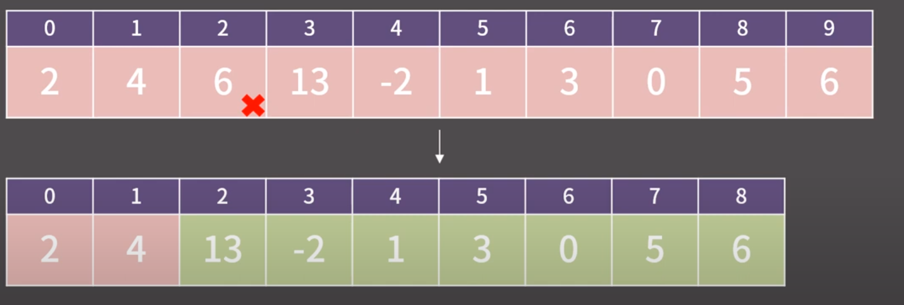

## 배열의 성질

1. O(1)에 k번째 원소를 확인/변경이 가능
1. 추가적으로 소모되는 메모리의 양(overhead)가 거의 없음
1. Cache hit rate가 높다.
1. 메모리 상에 연속한 구간을 잡아야 해서 할당에 제약이 걸린다.

## **Over Head?**

**정의** 

어떤 작업을 수행하기 위해 추가적으로 소요되는 부가적인 비용이나 자원을 의미한다.

**예시**

A라는 처리를 단순하게 실행한다면 10초 걸리는데, 안전성을 고려하고 부가적인 B라는 처리를 추가한 결과 처리시간이 15초 걸렸다면, 오버헤드는 5초가 된다.

B를 개선해 B'라는 처리를 한 결과, 처리시간이 12초가 되었다면, 이 경우 오버헤드가 3초 단축되었다고 말한다.

**그렇다면 배열에서는 왜 오버헤드가 거의 없을까?**

배열에서 추가적으로 소모되는 메모리의 양이 거의 없는 이유는 배열이 메모리에 연속적으로 할당되기 때문입니다. 배열은 연속된 메모리 블록에 데이터를 저장하므로 추가적인 포인터 등을 저장할 필요가 없습니다. 배열의 각 요소는 메모리에서 연속적으로 배치되므로 인덱스를 사용하여 요소에 직접 액세스할 수 있습니다.

그러나 다른 데이터 구조에는 오버헤드가 발생할 수 있습니다. 예를 들어, 링크드 리스트의 각 노드는 데이터 뿐만 아니라 다음 노드를 가리키는 포인터도 저장해야 합니다. 따라서 링크드 리스트는 각 요소 사이에 추가적인 포인터를 저장해야 하므로 메모리 오버헤드가 발생할 수 있습니다.

따라서 배열은 메모리 오버헤드가 거의 없고 직접적인 메모리 액세스가 가능한 반면, 다른 데이터 구조에는 데이터 구조 자체를 위한 추가적인 메모리가 필요할 수 있습니다.

## Cache hit rate?

참고 링크

[https://ikit.tistory.com/11](https://ikit.tistory.com/11)

[https://ndlessrain.com/entry/캐시메모리-적중률Hit-Rate](https://ndlessrain.com/entry/%EC%BA%90%EC%8B%9C%EB%A9%94%EB%AA%A8%EB%A6%AC-%EC%A0%81%EC%A4%91%EB%A5%A0Hit-Rate)

Cache?

캐시 메모리는 CPU의 처리 처리 속도와 주기억장치의 접근 속도를 줄이기 위해 사용하는 고속 Buffer Memory이다.

Cache 메모리 이용 효과

프로그램의 실행 과정을 분석해 보면, 주어진 시간 동안에 참조하는 메모리 영역은 국한된다는 사실을 알 수 있다. 따라서 자주 참조되는 프로그램의 일부를 속도가 빠른 기억 장치에 저장해 놓고 실행시키면 프로그램의 총 실행 시간을 단축시킬 수 있다. 이때 이용하는 기억장치를 캐시 메모리라고 한다.

Cache 메모리 특징

1. 캐시는 주기억장치와 CPU사이에 위치하며, 자주 사용하는 프로그램과 데이터를 기억한다.
    1. 캐시 메모리는 메모리 계층 구조에서 가장 빠른 소자이며, 처리 속도가 거의 CPU의 속도와 비슷할 정도이다.
    1. 캐시를 사용하면 주기억장치를 접근하는 횟수가 줄어듦으로써 컴퓨터의 처리속도가 향상된다.
    1. 캐시 주소표는 검색시간을 단축시키기 위해 주로 연관기억장치(CAM, Associative Memory)를 사용한다.

Cache Hit

메모리에서 데이터를 찾아 성공적으로 제공되는 것을 의미한다.

Cache Miss 

메모리를 검색했지만 데이터를 찾을 수 없는 경우를 나타낸다.

이 경우 콘테츠가 전송되어 캐시에 기록된다.

Cache Hit Ratio

말 그대로 캐시가 적중되는 정도를 뜻한다.

적중률 = 적중횟수 / 총 접근 횟수 (0.95 ~ 0.99 일 때 우수하다고 한다)

배열에서 Cache hit rate가 높은 이유?

메모리 접근 패턴 때문이다. 캐시는 데이터의 지역성(locality)의 원리를 기반으로 동작한다.

이것은 한 번에 특정 데이터 주변의 데이터에 엑세스하는 경향이 있다는 것을 의미한다.

배열은 메모리에 연속적으로 배치되므로 인접한 배열 요소는 물리적으로도 인접한 메모리 위치에 저장됩니다. 예를 들어 배열의 첫 번째 요소에 접근하면 다음 요소도 바로 뒤에 메모리에 저장되어 있다. 이런 배열의 특성으로 인해 Cache hit rate가 높아진다.

즉 배열에서는 인접한 요소에 대한 연속적인 엑세스 패턴이 캐시의 작동 방식과 잘 일치하여 

Cache hit rate가 높아진다.

## 시간 복잡도

원소 확인 / 변경

시간 복잡도 : O(1)

원소를 끝에 추가 

시간 복잡도 : O(1)

마지막 원소 제거

시간 복잡도 : O(1)

임의의 위치에 원소를 추가

시간 복잡도 : O(N)

지금 보면 5번에 15를 추가했는데 이렇게 되면, 그 뒤의 원소들을 전부 한 칸씩 밀어야해서 O(N)이 필요하다. 추가하려는 인덱스가 끝에 갈수록 빨라지고 인덱스가 앞이면 더 드려지는데 평균적으로 O(N/2)가 걸린다. → O(N)

임의의 위치에 있는 원소를 제거

시간 복잡도 : O(N) 

임의의 위치에 원소와 마찬가지로 삭제된 인덱스 위치로 전부 1칸식 땡겨지니 O(N)이 걸린다.

