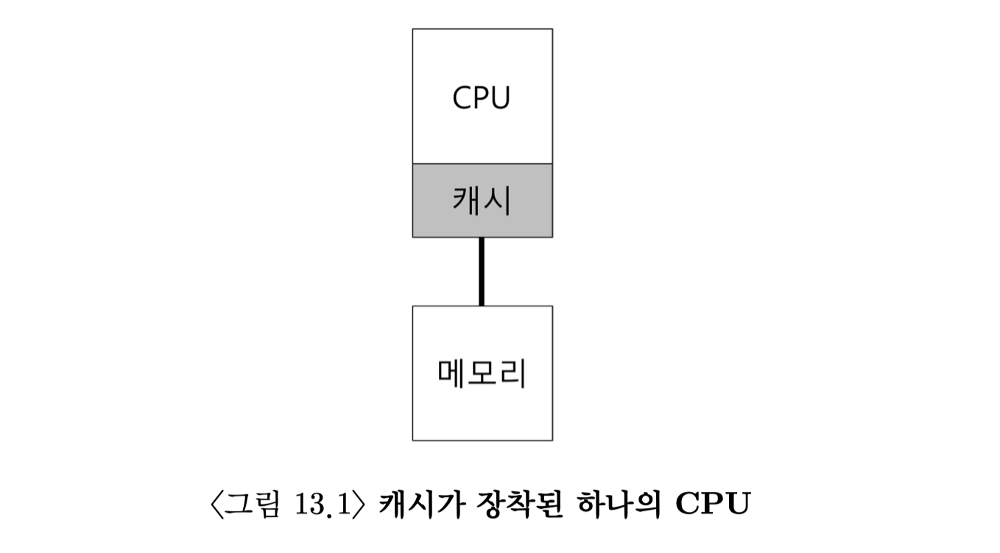
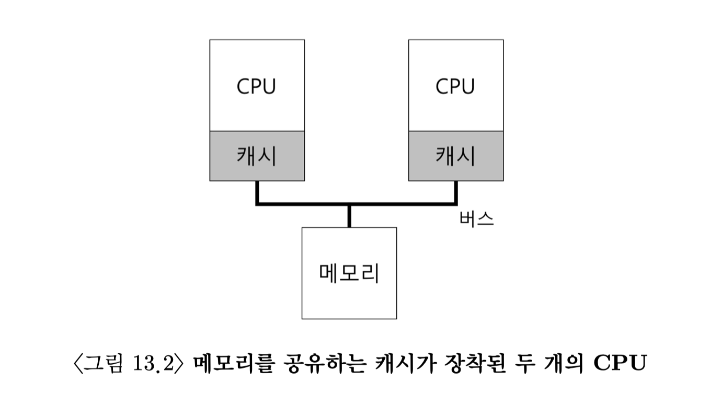
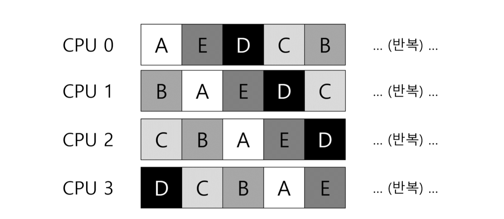
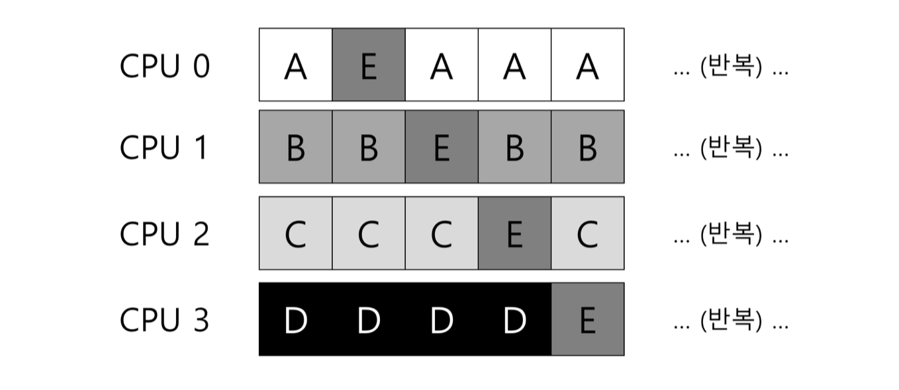
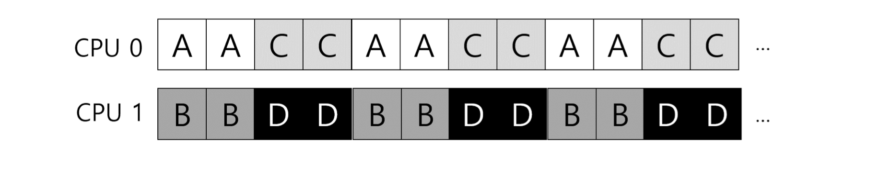
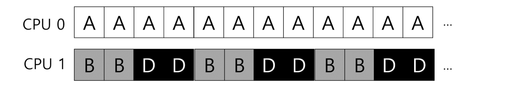
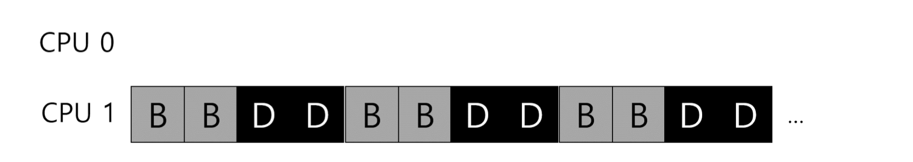
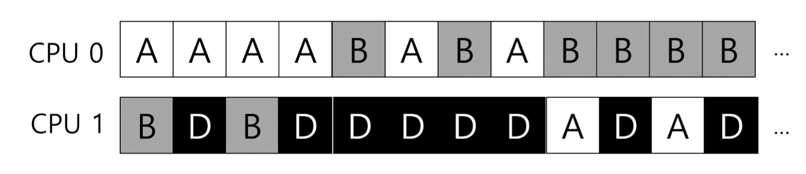

## 13.1 배경: 멀티프로세서 구조 

단일 CPU 하드웨어와 멀티 CPU 하드웨어의 차이에 대한 이해 

단일 CPU와 멀티 CPU는 프로세서간에 데이터 공유, 하드웨어 캐시의 사용 방식<그림3.1, 3.2>에서 차이가 발생한다. 





### ✅ **캐시는 지역성(locality)에 기반한다.**

지역성에는 **시간 지역성(temporal locality)**과 **공간 지역성(spatial locality)**의 두 종류가 있다.

시간 지역성의 원리는 데이터가 한 번 접근되면 가까운 미래에 다시 접근되기 쉽다는 것이다. 

→ 반복문에서 여러번 반복해서 접근되는 변수 또는 명령어 자체 

공간 지역성의 기본 아이디어는 프로그램이 주소 x의 데이터를 접근하면 x 주변의 데이터가 접근되기 쉽다는 것이다.

**row major vs column-major (3 x 3 배열 접근 순서 비교)**

**row major: (0, 0) → (0, 1) → (0, 2) → (1, 0) …**

**column-major: (0, 0) → (1, 0) → (2, 0) → (0, 1) …**

**java - spatial locality 활용** 

```java
int[][] arr = new int[1000][1000];

int sum = 0;
// 공간 지역성을 잘 활용 (row-major 방식에 맞는 순회)
for (int i = 0; i < 1000; i++) {
    for (int j = 0; j < 1000; j++) {
        sum += arr[i][j];
    }
}

--------------------------------------------------------
int[][] arr = new int[1000][1000];

int sum = 0;

// 공간 지역성 비효율적 (cache miss 증가 가능)
for (int j = 0; j < 1000; j++) {
    for (int i = 0; i < 1000; i++) {
        sum += arr[i][j];
    }
}
```

그림 13.2에서 보는 바와 같이 하나의 시스템에 여러 프로세서가 존재하고 하나의 공유 메인 메모리가 있을 때 어떤 일이 일어날까? 

멀티프로세서 시스템에서 캐시를 사용하는 것은 훨씬 복잡하다. 

### ✅ **캐시 일관성 문제(cache coherence)**

CPU1에서 실행 중인 프로그램이 주소 A를(D 값)을 읽는다고 가정 

데이터가 CPU1 캐시에 존재하지 않기 때문에 메인 메모리로부터 데이터를 가져오고 값 D를 얻는다. 

그런 후 프로그램은 주소 A의 값을 변경(D → F)한다.

메모리에 데이터를 쓰는 것은 시간이 오래 걸리므로 메인 메모리에 기록하는 것은 보통 나중에 한다.

이때 프로그램이 CPU2를 통해서 주소 A의 값을 다시 읽으면 캐시에 없기 때문에 메모리에서 가져오고 메모리에는 옛날 값인 D를 가져온다. 

### ✅ 기본적인 하드웨어 해결책: 버스 스누핑 (Bus Snooping)

- **버스를 감시(Snoop)**: 각 캐시는 시스템 버스를 모니터링하면서, 자신이 갖고 있는 캐시 라인과 관련된 쓰기(write) 또는 읽기(read)가 발생하면 반응
- **Invalidation 방식**: 다른 CPU가 내가 가진 값과 관련된 데이터를 수정(write)하면, 그 값을 **무효화(invalidate)** 해서 더 이상 사용하지 않음
- **Update 방식**: 변경된 값을 캐시들이 **서로 갱신(update)** 하도록 함.

**example**

- CPU1이 x = 10 으로 변경하면, CPU2는 자신의 캐시에서 x값을 무효화하거나 새 값으로 갱신함

### ✅ Write-back 캐시와의 관계

```
Write-back 캐시는 CPU가 메모리로 바로 쓰지 않고, 일단 캐시에만 쓰고 나중에 메모리에 반영.
이런 경우 일관성 유지가 더 복잡해진다.
언제 메모리에 반영할지 모름 → 다른 CPU들이 오래된 값을 읽을 수 있음
그래서 스누핑 기법과 일관성 프로토콜 (MESI 등)을 함께 사용해 문제를 해결한다.
```

**버스 스누핑을 통해서 캐시 read/write를 감지하고 MESI 프로토콜에 맞게 캐시 일관성을 유지한다.** 

## 13.2 동기화를 잊지 마시오 

캐시과 일관성을 유지해 준다고 해서 동기화를 하지 않아도 되는 건 아니다. 

병행 환경에서는 동일한 데이터를 동시에 여러 CPU가 접근할 때 문제가 생길 수 있다.

**동기화 기법(예: 락)** 을 사용해야 병행 접근에서 **정합성을 보장**할 수 있다.

그러나 락 기반 동기화는 **성능 저하**의 원인이 될 수 있으므로, 필요에 따라 **락프리 구조**도 고려된다. 

## 13.3 마지막 문제점: 캐시 친화성

멀티프로세서 캐시 스케줄러에서의 마지막 문제점은 **캐시 친화성(cache affinity)**이다. 

프로세스가 한 CPU에서 실행되면, 해당 CPU의 캐시와 TLB에 관련 데이터가 저장된다. 

다음 실행 시 같은 CPU에서 실행되면, 이 데이터를 재활용할 수 있어 성능 향상된다. 

하지만 다른 CPU에서 실행되면 실행할 때마다 필요한 정보를 다시 탑재해야만 하기 때문에 프로세스의 성능은 더 나빠진다. 

그러니 멀티프로세서 스케줄러는 스케줄링 결정을 내릴 때 캐시 친화성 → 가능한 프로세스를 동일한 CPU에서 실행하려고 노력하는 방향으로 결정해야 한다. 

## 13.4 단일 큐 스케줄링 

### **단일 큐 스케줄링 (single queue multiprocessor scheduling, SQMS)**

- 멀티 코어 환경에서 하나의 공용 실행 큐를 사용하는 방식 
- 기존의 단일 CPU 스케줄러 로직을 그대로 확장해서 사용 가능하다. 
- 각 CPU는 공통 큐에서 실행할 작업을 가져온다. 

### 단점1: 확장성(scalability) 문제 

- 스케줄러가 다수의 CPU에서 제대로 동작하기 위해 동기화(lock)을 삽입한다. 
- 당연히 락은 성능을 크게 저하시킨다. 특히 CPU 개수가 증가할수록 더욱 그렇다. 
- 단일 락에 대한 경쟁이 증가할수록 시스템은 락에 점점 더 많은 시간을 소모한다. 

단일 큐 스케줄링 확장성 문제: 시스템의 리로스(CPU)를 늘렸는데 오히려 성능이 떨어진다.  

### 단점2: 캐시 친화성 

**가정: 4개의 프로세서, 5개의 작업** 




각 CPU는 공유 큐에서 다음 작업을 선택하기 때문에 각 작업은 CPU를 옮겨 다니게 된다. 

→ 캐시 친화성 관점에서 잘못된 선택 

이 문제를 해결하기 위해 대부분의 SQMS 스케줄러는 가능한 프로세스가 동일한 CPU에서 재실행될 수 있도록 시도한다. 특정 작업은 캐시 친화성을 고려하고 다른 작업은 오버헤드를 균등하게 하기 위해 분산시키는 정책을 사용 



이러한 기법은 구현이 복잡하다. 

## 13.5 멀티 큐 스케줄링 

### 멀티 큐 멀티프로세서 스케줄링(multi-queue multiprocessor scheduling, MQMS)

단일 큐 스케줄러로 인한 문제(락 경쟁, 캐시 친화성) 때문에 일부 시스템은 멀티 큐, 예를 들어, CPU마다 큐를 하나씩 둔다. 

각 큐는 라운드 로빈 같은 특정 스케줄링 규칙을 사용 또는 특정 스케줄링 기법을 사용 가능 

배치될 큐의 결정은 적당한 방법을 따른다. (무작위, 작은 수의 작업이 있는 큐로 배치) 

배치된 이후에는 각각이 CPU에 맞춰 독립적으로 스케줄 되기 때문에 단일 큐 방식에서 보았던 정보 공유 및 동기화 문제를 피할 수 있다. 



**라운드 로빈 스케줄 example** 

MQMS가 SQMS에 비해 가지는 명확한 이점은 확장성

CPU 개수가 증가할수록, 큐의 개수도 증가하므로 락과 캐시 경합은 더이상 문제가 되지 않는다. 

### **워크로드의 불균형(load imbalance)**

멀티 큐 기반의 근본적인 문제는 **워크로드의 불균형(load imbalance)**이다. 


각 큐에 라운드 로빈 정책을 실행한 경우? 



A가 B와 D보다 2배의 CPU를 차지한다. 만약 A,C 모두 종료된다면? 



 

**→ 워크로드 불균형** 

### 이주(migration)

워크로드의 불균형을 해결하는 방법: 작업을 CPU1 → CPU2로 이주 

**example1**


운영체제는 B 또는 D 중 하나를 CPU 0으로 이동시킨다. → 워크로드는 균형을 찾는다. 

**example2**




example1에서는 한번의 이주로 문제가 해결되었지만 example2는 그렇지 않다. 

→ 해결하려면? 지속적으로 이주시키는 것 

이주 패턴은 다양하게 존재한다. 

### 작업 훔치기(work stealing)

작업 훔치기에서는 작업의 개수가 낮은 큐가 가끔 다른 큐에 훨씬 많은 수의 작업이 있는지를 검사한다. 

대상 큐가 소스 큐보다 더 가득 차 있다면 워크로드의 균형을 맞추기 위해 소스는 대상에서 하나 이상의 작업을 가져온다. 

물론 이런 방식도 문제가 있다. 큐를 너무 자주 검사하게 되면 높은 오버헤드로 확장성에 문제가 생기게 된다. 

반면 다른 큐를 자주 검사하지 않으면 심각한 워크로드 뷸군형을 초래할 가능성이 있다. 

시스템 정책 설계에 있어 흔히 있는 일로서 적절한 값을 찾아내는 것은 마법의 영역이다. 

이런 설정에 대한 고민은 CPU 스케줄링 MLFQ에서의 에이징에서도 나온다.

- 얼마나 자주 한번 최하단의 큐에 있는 작업을 우선순위가 가장 높은 큐로 옮겨야 하는지 

## 13.7 요약

```
다양한 방식의 멀티프로세서 스케줄링을 살펴보았다. 
단일 큐 방식(SQMS)은 구현이 용이하고 워크로드의 균형을 맞추기 용이하지만 
많은 개수의 프로세서에 대한 확장성과 캐시 친화성이 좋지 못하다. 

멀티 큐 방식(MQMS)은 확장성이 좋고 캐시 친화성을 잘 처리하지만 
워크로드 불균형에 문제가 있고 구현이 복잡하다.
 
어떤 방식을 택하든지 쉬운 답은 없다. 
CPU 스케줄러는 사소한 코드 수정으로 시스템의 동작이 엄청나게 바뀌기 때문에 
모든 경우에 다 잘 동작하는 범용 스케줄러를 구현하는 것은 매우 어렵다.
```

