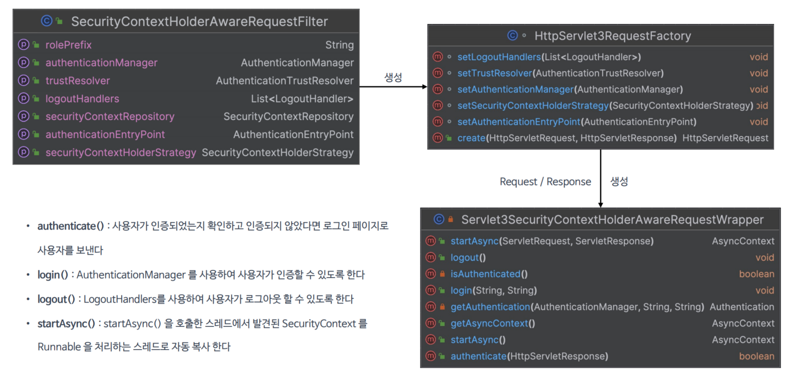
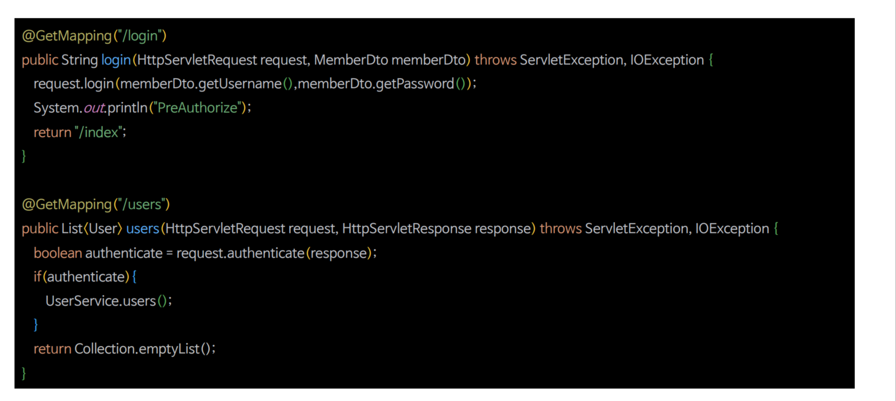

# *개요*

- *스프링 시큐리티는 다양한 프레임워크 및 API 와의 통합을 제공하고 있으며 Servlet3과 Spring MVC와 통합을 통해 여러 편리한 기능들을 사용할 수 있다*
- *인증 관련 기능들을 필터가 아닌 서블릿 영역에서 처리할 수 있다*

# ***Servlet 3+ 통합***

- ***SecurityContextHolderAwareRequestFilter***
- *HTTP 요청이 처리될 때 HttpServletRequest에 보안 관련 메소드를 추가적으로 제공하는* ***래퍼(SecurityContextHolderAwareRequestWrapper)****클래스를 적용한다*
  - *이를 통해 개발자는 서블릿 API 의 보안 메소드를 사용하여 인증, 로그인, 로그아웃 등의 작업을 수행할 수 있다*
- ***HttpServlet3RequestFactory***
- *Servlet 3 API 와의 통합을 제공하기 위해* ***Servlet3SecurityContextHolderAwareRequestWrapper****객체를 생성한다*
- ***Servlet3SecurityContextHolderAwareRequestWrapper***
- *HttpServletRequest의 래퍼 클래스로서 Servlet 3.0의 기능을 지원하면서 동시에 SecurityContextHolder와의 통합을 제공한다*
  - *이 래퍼를 사용함으로써 SecurityContext에 쉽게 접근할 수 있고 Servlet 3.0의 비동기 처리와 같은 기능을 사용하는 동안 보안 컨텍스트를 올바르게 관리할 수 있다*

# ***구조 및 API***

*클라이언트 요청 → 서블릿 필터(DelegatingFilterChainProxy) → 서블릿(DispatcherServlet) → 스프링 MVC* 

*DelegatingFilterChainProxy는 단순히 FilterChainProxy에게 요청을 위임* 

*FilterChainProxy에서의 필터중 SeucirtyContextHolderFilter는 HttpServletRequest/Response를 포함한 시큐리티의 중요 객체들을 HttpServlet3RequestFactory에 넘겨준다.  HttpServlet3RequestFactory에서는 해당 정보를 바탕으로 Servlet3SecurityContextHolderAwareRequestWrapper를 생성해서 다음 필터에게 넘겨주어 최종적으로 래핑된 ServletRequest/ServletResponse가 서블릿까지 가게된다.* 



# *코드 구현* 



- *해당 request 객체는 Servlet3SecurityContextHolderAwareRequestWrapper이다.* 
- *시큐리티 관련 API를 사용이 가능하고 간단한 메소드 호출을 통해 실행된다.* 

# *테스트*

***SecurityConfig***

```java
@EnableWebSecurity
@Configuration
public class SecurityConfig {
    @Bean
    public WebSecurityCustomizer webSecurityCustomizer() {
        return webSecurity -> webSecurity.ignoring().requestMatchers(PathRequest.toStaticResources().atCommonLocations());
    }
    @Bean
    public SecurityFilterChain securityFilterChain(HttpSecurity http) throws Exception {
        http
                .authorizeHttpRequests(authorize -> authorize
                        .requestMatchers("/user").hasAuthority("ROLE_USER")
                        .requestMatchers("/db").hasAuthority("ROLE_DB")
                        .requestMatchers("/admin").hasAuthority("ROLE_ADMIN")
                        .anyRequest().permitAll())
                //.formLogin(Customizer.withDefaults())
                .csrf(AbstractHttpConfigurer::disable);

        return http.build();
    }
    @Bean
    public UserDetailsService userDetailsService(){
        UserDetails user = User.withUsername("user").password("{noop}1111").roles("USER").build();
        UserDetails db = User.withUsername("db").password("{noop}1111").authorities("ROLE_DB").build();
        UserDetails admin = User.withUsername("admin").password("{noop}1111").roles("ADMIN","SECURE").build();
        return  new InMemoryUserDetailsManager(user, db, admin);
    }
}
```

***MemberDto***

```java
@Data
@AllArgsConstructor
public class MemberDto {
    private String username;
    private String password;
}
```

***IndexController***

```java
@RestController
public class IndexController {
    @GetMapping("/")
    public String index(HttpServletRequest request){
        return "index";
    }
    @GetMapping("/user")
    public String user(){
        return "user";
    }
    @GetMapping("/db")
    public String db(){
        return "db";
    }
    @GetMapping("/admin")
    public String admin(){
        return "admin";
    }

    @GetMapping("/login")
    public String login(HttpServletRequest request, MemberDto memberDto) throws ServletException, IOException {
        request.login(memberDto.getUsername(), memberDto.getPassword());
        System.out.println("login is successful");
        return "login";
    }
    @GetMapping("/users")
    public List<MemberDto> users(HttpServletRequest request, HttpServletResponse response) throws ServletException, IOException {
        boolean authenticate = request.authenticate(response);
        if (authenticate) {
            return List.of(new MemberDto("user","1111"));
        }
        return Collections.emptyList();
    }
}
```

*단순하게 시큐리티 필터에서 하던 인증 인가 프로세스가 ServletRequest Wrapper 클래스의API로 진행된다.*

