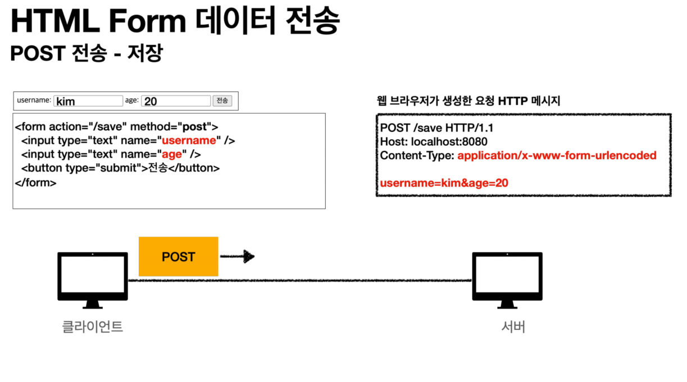
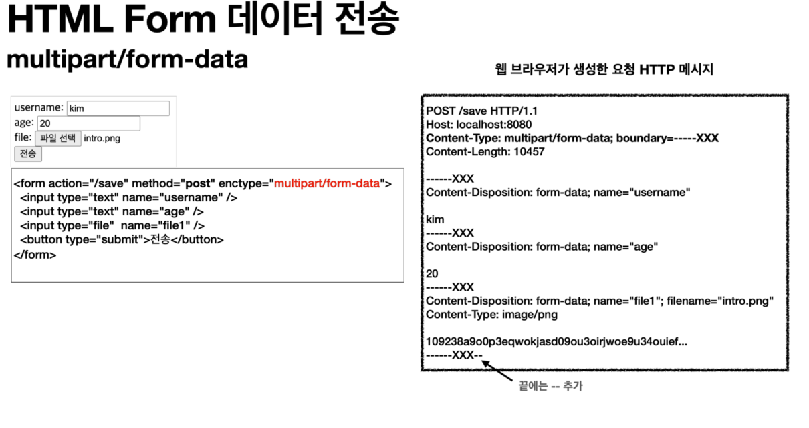

# ***파일 업로드 소개***

***HTML 폼 전송 방식***

- *application/x-www-form-urlencoded*
- *multipart/form-data*

## ***application/x-www-form-urlencoded 방식***



*application/x-www-form-urlencoded 방식은 HTML 폼 데이터를 서버로 전송하는 가장 기본적인 방법*

*Form 태그에 별도의 enctype 옵션(인코딩 타입)이 없으면 웹 브라우저는 요청 HTTP 메시지의 헤더에 다음 내용을 추가 →* ***Content-Type: application/x-www-form-urlencoded***

*HTTP Body에 문자로 username=kim&age=20 와 같이 &로 구분해서 전송*

## ***파일 업로드는 어떻게?***

*파일을 업로드 하려면 파일은 문자가 아니라 바이너리 데이터를 전송해야 한다.*

*문자를 전송하는 이 방식으로 파일을 전송하기는 어렵다,*

*또한 보통 폼을 전송할 때 파일만 전송하는 것이 아니다.*

***전송 데이터 example***

```java
- 이름
- 나이
- 첨부파일
```

*이름과 나이도 전송해야 하고, 첨부파일도 함께 전송해야 한다*

*이름과 나이는 문자로 전송하고, 첨부파일은 바이너리로 전송해야 한다*

*즉, 문자와 바이너리 데이터 모두를 동시에 전송해야 하는 상황이다.*

→ *이 문제를 해결하기 위해서 HTTP는* ***multipart/form-data****라는 전송 방식을 제공*

## ***multipart/form-data 방식***



*multipart/form-data 방식을 사용하려면  Form 태그에 별도의* ***enctype="multipart/form-data"*** *를 지정해야 한다.*

*multipart/form-data 방식은 다른 종류의 여러 파일과 폼의 내용 함께 전송할 수 있다*

***폼의 입력 결과***

*폼의 입력 결과(HTTP 메시지)를 보면 각각의 전송 항목이 구분(****——X****)이 되어있다.*

***Content-Disposition****이라는 항목별 헤더가 추가되어 있고 여기에 부가 정보가 있다.*

 *username , age , file1 이 각각 분리되어있고, 폼의 일반 데이터는 각 항목별로 문자가 전송되고, 파일의 경우 파일 이름과 Content-Type이 추가되고 바이너리 데이터가 전송된다.*

*multipart/form-data는 이렇게 각각의 항목을 구분해서, 한번에 전송하는 것*

# ***서블릿과 파일 업로드1***

```java
@Slf4j
@Controller
@RequestMapping("/servlet/v1")
public class ServletUploadControllerV1 {

    @GetMapping("/upload")
    public String newFile(){
        return "upload-form";
    }
    
    @PostMapping("/upload")
    public String saveFileV1(HttpServletRequest request) throws ServletException, IOException {
        log.info("request ={}", request);

        String itemName = request.getParameter("itemName");
        log.info("itemName ={}", itemName);

        Collection<Part> parts = request.getParts();
        log.info("parts={}", parts);

        return "upload-form";
    }
}
```

*HttpServletRequest request.getParts(): → return Collections<Part> parts*

*multipart/form-data 전송 방식에서 각각 나누어진 부분을 받아서 확인할 수 있다.*

***스프링 부트 3.2 이상 로그 출력 - application.properties/yaml***

```java
logging.level.org.apache.coyote.http11=trace
```

***결과 로그***

```java
Content-Type: multipart/form-data; boundary=----xxxx

------xxxx
Content-Disposition: form-data; name="itemName"
Spring

------xxxx
Content-Disposition: form-data; name="file"; filename="test.data"
Content-Type: image/jpeg

sdklajkljdf...

------xxxx--
```

## ***멀티파트 사용 옵션***

***업로드 사이즈 제한***

```java
spring.servlet.multipart.max-file-size=1MB
spring.servlet.multipart.max-request-size=10MB
```

- *사이즈를 넘으면 예외(SizeLimitExceededException)가 발생*
- *max-file-size : 파일 하나의 최대 사이즈, 기본 1MB*
- *max-request-size : 멀티파트 요청 전체 합 사이즈, 기본 10 MB*

***spring.servlet.multipart.enabled 끄기***

```java
spring.servlet.multipart.enabled=false
```

- *default: true*
- *해당 옵션을 끄면 서블릿 컨테이너는 멀티파트 관련된 처리를 하지 않는다.*

***참고***

*spring.servlet.multipart.enabled 옵션을 켜면 Dispatcher Servlet에서 멀티파트 리졸버(MultipartResolver)를 실행*

*멀티팔트 리졸버는 HttpServletRequest 객체를 MultipartHttpServletRequest(extends HttpServletRequest)로 변환해서 반환*

*스프링이 제공하는 멀티파트 리졸버는 MultipartHttpServletRequest 인터페이스를 구현한
StandardMultipartHttpServletRequest를 반환*

*해당 객체로 멀티 파트 관련 처리를 편리하게 할 수 있지만 MultipartFile을 사용하면 더 편하기 때문에 MultipartHttpServletRequest는 잘 사용하지 않는다.*

# ***서블릿과 파일 업로드2***

*서블릿이 제공하는 Part 통해서 실제 파일을 서버에 업로드 하자* 

***파일 저장 경로 지정 - application.properties***

```java
file.dir=/Users/baeue/study/file/
```

- *해당 경로에 실제 폴더를 미리 만들어두자*

***파일 업로드 예제***

```java
@Slf4j
@Controller
@RequestMapping("/servlet/v2")
public class ServletUploadControllerV2 {

    @Value("${file.dir}")
    private String fileDir;

    @GetMapping("/upload")
    public String newFile(){
        return "upload-form";
    }
    
    @PostMapping("/upload")
    public String saveFileV1(HttpServletRequest request) throws ServletException, IOException {
        log.info("request ={}", request);

        String itemName = request.getParameter("itemName");
        log.info("itemName ={}", itemName);

        Collection<Part> parts = request.getParts();
        log.info("parts={}", parts);

        for (Part part : parts) {
            log.info("====PART====");
            log.info("name={}", part.getName());
            part.getHeaderNames()
                    .iterator()
                    .forEachRemaining(
                            headerName -> log.info("header {}: {}", headerName, part.getHeader(headerName)));

      
            // content-disposition fileName
            log.info("submittedFileName={}", part.getSubmittedFileName());
            // 데이터(body) 사이즈
            log.info("size={}", part.getSize());

            // 데이터 읽기
            InputStream inputStream = part.getInputStream();
            String body = StreamUtils.copyToString(inputStream, StandardCharsets.UTF_8);
            // log.info("body={}", body);

            // 파일 저장하기
            if(StringUtils.hasText(part.getSubmittedFileName())){
                String fullPath = fileDir + part.getSubmittedFileName();
                log.info("파일 저장 fullPath={}", fullPath);
                part.write(fullPath);
            }
        }

        return "upload-form";
    }
}

```

***application.properties 에서 설정한 file.dir의 값을 주입***

```java
@Value("${file.dir}")
private String fileDir;
```

*HttpServletRequest getParts() 정확히는 StandardMultipartHttpServletRequest*

*→ Collection<Part> 반환*

*멀티파트 형식은 전송 데이터를 하나하나 각각 부분(Part)으로 나누어 전송한다. 
parts에는 이렇게 나누어진 데이터가 각각 담긴다.*

***Part 주요 메서드***

- *part.getName(): <input> 태그 name*
- *part.getSize(): 사이즈* 
- *part.getSubmittedFileName() : 클라이언트가 전달한 파일명*
- *part.getHeaderNames(), part.getHeader(): header* 
- *part.getInputStream(): Part의 전송 데이터(인코딩된 바이너리 데이터)를 읽을 수 있다.*
- *디코딩: StreamUtils.copyToString(inputStream, StandardCharsets.UTF_8) return String*
- *part.write(String path): Part를 통해 전송된 데이터를 저장할 수 있다.*
- *저장 경로를 넘긴다.*

***결과 로그***

```
 request =org.springframework.web.multipart.support.StandardMultipartHttpServletRequest@2f19d21c
 itemName =배제우
 parts=[org.apache.catalina.core.ApplicationPart@35d0d5cc, org.apache.catalina.core.ApplicationPart@2feb9c]

 ====PART====
 name=itemName
 header content-disposition: form-data; name="itemName"
 submittedFileName=null
 size=9
 body=배제우
 
 ====PART====
 name=file
 header content-disposition: form-data; name="file"; filename="xxx.JPG"
 header content-type: image/jpeg
 submittedFileName=xxx.JPG
 size=41781
 body=���� JFIF  x x  ���Exif  MM *   ;      J�i      P��    
```

*서블릿이 제공하는 Part는 편하기는 하지만, HttpServletRequest를 사용해야 하고(서블릿에 의존성이 생긴다), 추가로 파일 부분만 구분하려면 여러가지 코드를 넣어야 한다.*

# ***스프링과 파일 업로드***

```java
@Slf4j
@Controller
@RequestMapping("/spring")
public class SpringUploadController {

    @Value("${file.dir}") 
    private String fileDir;
    
    @PostMapping("/upload")
    public String saveFile(@RequestParam String itemName,
                           @RequestParam MultipartFile file) throws IOException{

        if(!file.isEmpty()){
            String fullPath = fileDir + file.getOriginalFilename();
            log.info("파일 저장 fullPath={}", fullPath);
            file.transferTo(new File(fullPath));
        }
        return "upload-form";
    }
}    
```

- *스프링은 MultipartFile 이라는 인터페이스로 멀티파트 파일을 매우 편리하게 지원*
- *HTML Form input 태그 name에 맞추어 @RequestParam 또는 @ModelAttribute를 적용하면 된다.*
- *getOriginalFilename() : 업로드 파일 명*
  - *transferTo(new File(fullPath)): 파일 저장*

