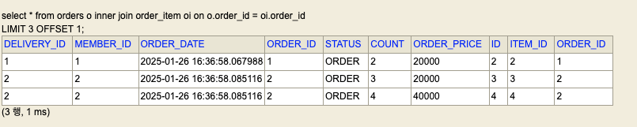

### *개요* 

*이번에는 주문내역에서 추가한 주문한 상품 정보를 추가로 조회하자.* 

*Order 기준으로 컬렉션인 OrderItem과 Item이 필요하다.*

*Order → OrderItem (1:N) → Item(N:1)*

***이번에는 일대다 관계(OneToMany)를 조회하고, 최적화하는 방법을 알아보자***

# ***주문 조회*** *V1:* ***엔티티 직접 노출***

*엔티티를 직접 노출하면 양방향 연관관계면 무한 루프에 걸리지 않게 한곳에 @JsonIgnore를 추가한다.*

*또헌 Hibernate5Module 설정을 통해 지연 로딩된 프록시 객체를 반환하지 않도록 한다.* 

*반환하고 싶은 객체는 직접 객체를 초기화한다.*

*하지만 이렇게 엔티티를 직접 노출하는 방식은 많은 단점이 존재한다.*

*그래서 코드는 생략한다.* 

# 
***주문 조회*** *V2:* ***엔티티를*** *DTO****로 변환***

```java
@GetMapping("/api/v2/orders")
public List<OrderDto> ordersV2() {
    List<Order> orders = orderRepository.findAllByString(new OrderSearch());
    return orders.stream()
            .map(OrderDto::new)
            .collect(Collectors.toList());
}

@Data
static class OrderDto {
    private Long orderId;
    private String name;
    private LocalDateTime orderDate;
    private OrderStatus orderStatus;
    private Address address;
    private List<OrderItemDto> orderItems;

    public OrderDto(Order order) {
        orderId = order.getId();
        name = order.getMember().getName();
        orderDate = order.getOrderDate();
        orderStatus = order.getStatus();
        address = order.getDelivery().getAddress();
        orderItems = order.getOrderItems()
                .stream()
                .map(OrderItemDto::new)
                .collect(Collectors.toList());
    }
}

@Data
static class OrderItemDto{
    private String itemName;
    private int orderPrice;
    private int count;
    public OrderItemDto(OrderItem orderItem){
        itemName = orderItem.getItem().getName();
        orderPrice = orderItem.getOrderPrice();
        count = orderItem.getCount();
    }
}
```

*코드를 보면 OrderItem(엔티티) 또한 OrderItemDto(dto)로 변환하고 있다.*

***v2의 문제점*** 

- ***SQL 실행 수*** 
- *order 1번*
  - *member, delivery N번 (order 조회 수 만큼)*
  - *orderItem N번 (order 조회 수 만큼)*
  - *item N번 (orderItem 조회 수 만큼)*

# ***주문 조회*** *V3:* ***엔티티를*** *DTO****로 변환*** *-* ***페치 조인 최적화***

```java
// OrderRepository
public List<Order> findAllWithItem() {
    return em.createQuery("select distinct o from Order o " +
            "join fetch o.member m " +
            "join fetch o.delivery d " +
            "join fetch o.orderItems oi " +
            "join fetch oi.item i", Order.class).getResultList();
}

// Controller

@GetMapping("/api/v3/orders")
public List<OrderDto> ordersV3() {
    List<Order> orders = orderRepository.findAllWithItem();
    return orders.stream()
            .map(OrderDto::new)
            .collect(Collectors.toList());
}

// OrderDto 부분 v2와 동일 생략 
```

- *컬렉션 fech 조인으로 SQL이 1번만 실행된다.*
- distinct를 적용하면 2가지 효과가 적용된다. 
- *database SQL query에 distinct 추가*  
  - *Hibernate가 중복 프로젝션 제거*
- *DB에 distinct는 적용되지 않지만 List<Order>에는 중복이 없게된다.* 

***Hibernate 6*** 

*Hibernate 6버전은 페치 조인 사용 시 자동으로 중복 제거를 하도록 변경*

*즉, JPQL에 distinct 명시 없이 중복이 제거된다.* 
	

***단점*** 

- *페이징이 불가능하다.*
- *하이버네이트는 경고 로그를 남기면서 모든 데이터를 DB에서 읽어오고, 메모리에서 페이징을 해버린다.*
- *이는 매우 위험하다.*
- *컬렉션 패치 조인은 1개만 사용할 수 있다. 컬렉션 둘 이상에 패치 조인을 사용하면 안된다.* 
- *데이터가 부정합하게 조회될 수 있다.*

***1:N에서 페이징이 불가능한 이유*** 


*아래는 order, order_item 조인 결과이다. - Order, OrderItem 1:N 관계* 

*order를 기준으로 1:N 컬렉션 패치 조인을 하고 페이징 적용 → setFirstResult(1):offset , maxResult(3):limit* 



*그럼 ORDER_ITEM_ID를 기준으로 3개가 2, 3, 4 이렇게 나온다. 
이건 Order를 기준으로 하는 페이징이 아니다. (DB 결과 반환: OrderItem 기준으로 페이징 적용)* 

*그래서 하이버네이트는 조인된 모든 결과를 페이징 적용 없이 가져와서 메모리에서 페이징을 적용한다.*

*→ 이는 매우 위험하다. 하이버네이트는 로그로 경고를 남긴다.* 

# ***주문 조회*** *V3+ :****엔티티를*** *DTO****로 변환*** *-* ***페이징과 한계 돌파***

*그렇다면 1:N 관계에서 페이징을 어떻게 해야 할까?*

*대부분의 페이징 + 컬렉션 엔티티 조회 문제를 이 방법으로 해결이 가능하다.*

- *toOne 관계는 페치 조인을 적용한다.  N:1, 1:1* 
- *컬렉션은 지연 로딩으로 조회한다.*
- *지연 로딩 성능 최적화를 위해* ***hibernate.default_batch_fetch_size****,* ***@BatchSize****를 적용하다.*
- ***hibernate.default_batch_fetch_size: 글로벌 설정*** 
  - *@BatchSize: 개별 최적화*
  - *해당 옵션을 사용하면 컬렉션이나, 프록시 객체를 한꺼번에 설정한 size 만큼 IN 쿼리로 조회한다.*
- *IN 쿼리 → array contains*

```java
public List<Order> findAllWithMemberDelivery(int offset, int limit) {
    return em.createQuery("select o " +
                    "from Order o " +
                    "join fetch o.member m " +
                    "join fetch o.delivery d", Order.class)
            .setFirstResult(offset)
            .setMaxResults(limit)
            .getResultList();
}
```

- ***toOne 관계 fetch 조인 + 페이징 적용*** 

```java
@GetMapping("/api/v3_page/orders")
public List<OrderDto> ordersV3_page() {
    List<Order> orders = orderRepository.findAllWithMemberDelivery(0, 2);
    System.out.println("orders.size() = " + orders.size());
    return orders.stream()
            .map(OrderDto::new)
            .collect(Collectors.toList());
}
```

- *findAllWithMemberDelivery 사용* 
- *N + 1 문제 발생한다.* 
- *Order 1:N OrderItem* 
  - *OrderItem N:1 Item* 
  - *OrderItem 개수만큼 쿼리가 날아간다*

***application.yaml***

```yaml
spring:
  datasource:
    url: jdbc:h2:tcp://localhost/~/jpashop
    username: sa
    password:
    [REDACTED] org.h2.Driver
  jpa:
    hibernate:
      ddl-auto: create
    properties:
        hibernate:
          # show_sql: true
          format_sql: true
          default_batch_fetch_size: 100

logging:
  level:
    org.hibernate.SQL: debug
  # org.hibernate.orm.jdbc.bind: trace

```

- ***spring.jpa.properties.hibernate.default_batch_fetch_size: 100 추가*** 
- *글로벌 설정*

***실행된 쿼리*** 

```java
 select
      o1_0.order_id,
      d1_0.delivery_id,
      d1_0.city,
      d1_0.street,
      d1_0.zipcode,
      d1_0.status,
      m1_0.member_id,
      m1_0.city,
      m1_0.street,
      m1_0.zipcode,
      m1_0.name,
      o1_0.order_date,
      o1_0.status 
  from
      orders o1_0 
  join
      member m1_0 
          on m1_0.member_id=o1_0.member_id 
  join
      delivery d1_0 
          on d1_0.delivery_id=o1_0.delivery_id 
  offset
      ? rows 
  fetch
      first ? rows only

select
    oi1_0.order_id,
    oi1_0.id,
    oi1_0.count,
    oi1_0.item_id,
    oi1_0.order_price 
from
    order_item oi1_0 
where
    oi1_0.order_id in (?, ?, ?, ?, ?, ?, ?, ?, ?, ?, ?, ?, ?, ?, ?, ?, ?, ?, ? ..

select
    i1_0.item_id,
    i1_0.type,
    i1_0.name,
    i1_0.price,
    i1_0.stock_quantity,
    i1_0.artist,
    i1_0.etc,
    i1_0.author,
    i1_0.isbn,
    i1_0.actor,
    i1_0.director 
from
    item i1_0 
where
    i1_0.item_id in (?, ?, ?, ?, ?, ?, ?, ?, ?, ?, ?, ?, ?, ?, ?, ?, ?, ?, ?, ..
```

- *먼저 Order, Member, Delivery에 대한 쿼리가 날아간다.* 
- *Order N:1 Member*
  - *Order 1:1 Delivery*
  - *toOne 관계여서 페이징 쿼리를 날려도 문제없다.*
- *이후 지연로딩된 OrderItem, Item 쿼리가 날아간다.* 
- *즉, 총 3개의 쿼리가 날아간다.* 

*개별로 설정하려면 @BatchSize를 적용하면 된다.* 

- *컬렉션은 컬렉션 필드* 
- *엔티티는 엔티티 클래스에 적용* 

### ***정리*** 👍

***장점***

- *N + 1 문제 해결* 
- *조인보다 DB 데이터 전송량이 최적화 된다. (Order, OrderItem을 조인하면 Order가 OrderItem만큼 중복해서 조회된다.)* 
- *페치 조인 방식과 비교해서 쿼리 호출 수가 약간 증가하지만, 데이터 전송량은 줄어든다.*
- *컬렉션 페치 조인은 페이징이 불가능 하지만 이 방법은 페이징이 가능하다.*

***결론***

- *toOne 관계는 페치 조인해도 페이징에 영향을 주지 않는다. 따라서 페치 조인으로 쿼리 수를 줄여서 해결하고 
나머지는 hibernate_default_batch_fetch_size로 최적화 하자.* 

***default_batch_fetch_size 적당한 크기?*** 

*100 ~ 1000 사이를 선택하는 것을 권장한다.*

*IN 파라미터를 데이터베이스에 따라 1000으로 제한하기도 한다.*

*1000으로 설정하는 것이 성능상 가장 좋지만 애플리케이션과 DB 모두 순간 부하가 커지기 때문에* 

*어디까지 견딜 수 있는지로 결정하면 된다.*

### ***참고*** *-* ***스프링 부트*** *3.1 -* ***하이버네이트*** *6.2* ***변경사항*** *- array_contains*

*스프링 부트 3.1 부터는 하이버네이트 6.2를 사용한다.*  	

*하이버네이트 6.2부터는 where in 문법 대신에 array_contains를 사용한다.* 

***where in 문법*** 

```java
where item.item_id in(?,?,?,?)
```

***array_contains 문법*** 

```java
where array_contains(?,item.item_id)
```

*where in, array_contains를 사용하도록 변경해도 결과는 완전히 동일하다.* 

*이렇게 변경한 이유는 성능 최적화 때문이다.* 

`select  … where item.item_id in (?)`

*이러한 SQL을 실행할 때 데이터베이스는 SQL 구문을 이해하기 위해 SQL을 파싱하고 분석하는 등 여러가지 복잡한 일을 처리해야 한다. (SQL 파서 모듈, 실행 계획)*

*그래서 성능을 최적화하기 위해 이미 실행된 SQL 구문은 파싱된 결과를 내부에 캐싱하고 있다* 

*이렇게 해두면 이후에 같은 모양의 SQL이 실행되어도 이미 파싱된 결과를 그대로 사용해서 성능을 최적화 할 수 있다.*

*SQL 구문 차제를 캐싱하기 때문에 여기서 ?에 바인딩 되는 데이터는 변경되어도 캐싱된 SQL 결과(구문 파싱 결과)를 그대로 사용할 수 있다.*

*where in 쿼리는 동적으로 데이터가 변하는 것을 넘어서 SQL구문 자체가 변해버리는 문제가 발생한다.*

```java
where item.item_id in(?)
where item.item_id in(?,?)
where item.item_id in(?,?,?,?)
```

- *in에 들어가는 데이터 숫자에 따라서 3개의 다른 SQL 구문이 생성된다.*
- *즉, 캐싱도 3개를 따로한다. → 성능 관점에서 좋지않다.*

*array_contains를 사용하면 이런 문제를 깔끔하게 해결할 수 있다*

```java
*i1_0.item_id in (?, ?, ?, ?)*
```

- *글로벌 배치 사이즈를 4로 줄였다.*
- *데이터가 동적으로 늘어나도 항상 같은 SQL 구문을 사용해서 성능을 최적화 할 수 있다.*
- *또한 특정 데이터베이스에서는 배열의 데이터 숫자가 같아야 최적화가 되기 때문에 null 값을 추가한다.*

# 
***주문 조회*** *V4: JPA****에서*** *DTO* ***직접 조회***

***조회 목록*** 

Order 1:N OrderItem 

Order 1:1 Delivery

Order N:1 Member

OrderItem N:1 Item  

***Dto***

```java
@Data
@AllArgsConstructor
public class OrderItemQueryDto {
    @JsonIgnore
    private Long orderId;
    private String itemName;
    private int orderPrice;
    private int count;
}

@Data
public class OrderQueryDto {
     private Long orderId;
     private String name;
     private LocalDateTime orderDate;
     private OrderStatus orderStatus;
     private Address address;
     private List<OrderItemQueryDto> orderItems;

     public OrderQueryDto(Long orderId, String name, LocalDateTime orderDate, OrderStatus orderStatus, Address address) {
         this.orderId = orderId;
         this.name = name;
         this.orderDate = orderDate;
         this.orderStatus = orderStatus;
         this.address = address;
     }
}
```

- *OrderQueryDto → Member, Delivery, Order 정보* 
- *OrderItemQueryDto → OrderItem, Item 정보* 

***Repository***

```java
@Repository
@RequiredArgsConstructor
public class OrderQueryRepository {

    private final EntityManager em;

    public List<OrderQueryDto> findOrderQueryDto(){
        List<OrderQueryDto> result = findOrders();

        result.forEach(o -> {
            List<OrderItemQueryDto> orderItems = findOrderItems(o.getOrderId());
            o.setOrderItems(orderItems);
        });

        return result;
    }
    private List<OrderItemQueryDto> findOrderItems(Long orderId) {
        return em.createQuery("select new jpabook.jpashop.repository.order.query.OrderItemQueryDto(oi.order.id, i.name, oi.orderPrice, oi.count) " +
                " from OrderItem oi " +
                " join oi.item i" +
                " where oi.order.id = :orderId", OrderItemQueryDto.class)
                .setParameter("orderId", orderId)
                .getResultList();
    }

    private List<OrderQueryDto> findOrders() {
        return em.createQuery("select new" +
                        " jpabook.jpashop.repository.order.query.OrderQueryDto(o.id, m.name, o.orderDate, o.status, d.address)" +
                        " from Order o" +
                        " join o.member m" +
                        " join o.delivery d", OrderQueryDto.class)
                .getResultList();
    }
}
```

- *findOrders를 통해서 toOne(N:1, 1:1) 관계들을 먼저 조회한다.* 
- *findOrderItems()를 통해서 Order를 기준으로 1:N 관계를 조회한다.*
- *총 findOrders에서 쿼리 1번 findOrderItems()에서 쿼리 N번(order 개수) 실행된다.* 
- *N+1 문제 발생*

***Controller***

```java
@GetMapping("/api/v4/orders")
public List<OrderQueryDto> ordersV4() {
    return orderQueryRepository.findOrderQueryDto();
}
```

# ***주문 조회*** *V5: JPA****에서*** *DTO* ***직접 조회*** *-* ***컬렉션 조회 최적화***

***DTO - v4와 동일*** 

- OrderItemQueryDto, OrderQueryDto

***findOrders()***

```java
private List<OrderQueryDto> findOrders() {
      return em.createQuery("select new" +
          " jpabook.jpashop.repository.order.query.OrderQueryDto(o.id, m.name, o.orderDate, o.status, d.address)" +
          " from Order o" +
          " join o.member m" +
          " join o.delivery d", OrderQueryDto.class)
          .getResultList();
 }
 
  
```

- *v4와 동일 findOrders()*

***findOrderQueryDtoOptimization()***

```java
public List<OrderQueryDto> findOrderQueryDtoOptimization(){
    List<OrderQueryDto> result = findOrders();

    List<Long> orderIds = result
            .stream()
            .map(OrderQueryDto::getOrderId)
            .collect(Collectors.toList());

    List<OrderItemQueryDto> orderItems = findOrderItems(orderIds);

    Map<Long, List<OrderItemQueryDto>> orderItemMap = orderItems.stream()
            .collect(Collectors.groupingBy(OrderItemQueryDto::getOrderId));

    result.forEach(o -> {
         o.setOrderItems(orderItemMap.get(o.getOrderId()));
    });

    return result;
}

private List<OrderItemQueryDto> findOrderItems(List<Long> orderIds) {
    return em.createQuery("select new jpabook.jpashop.repository.order.query.OrderItemQueryDto(oi.order.id, i.name, oi.orderPrice, oi.count) " +
                    " from OrderItem oi " +
                    " join oi.item i" +
                    " where oi.order.id in :orderIds", OrderItemQueryDto.class)
            .setParameter("orderIds", orderIds)
            .getResultList();
}
```

- *v4의 최적화 버전* 
- *v4에서는 Order를 조회하고 Order 개수(N) 만큼 추가로 쿼리가 날아가는 N+1 문제가 있었다.*
- *v5는 batch_size in 문법처럼 where in을 통해 쿼리 2개로 해결하는 방법이다.* 

```java
List<Long> orderIds = result
            .stream()
            .map(OrderQueryDto::getOrderId)
            .collect(Collectors.toList());
```

- *orderIds → 조회된 Order Id만 collect* 

```java
List<OrderItemQueryDto> orderItems = findOrderItems(orderIds);

private List<OrderItemQueryDto> findOrderItems(List<Long> orderIds) {
    return em.createQuery("select new jpabook.jpashop.repository.order.query.OrderItemQueryDto(oi.order.id, i.name, oi.orderPrice, oi.count) " +
                    " from OrderItem oi " +
                    " join oi.item i" +
                    " where oi.order.id in :orderIds", OrderItemQueryDto.class)
            .setParameter("orderIds", orderIds)
            .getResultList();
}
```

- *orderIds where 조건에 넣어서 조회한다.* 
- *oi1_0.order_id in (?, ?)*

```java
List<OrderItemQueryDto> orderItems = findOrderItems(orderIds);

Map<Long, List<OrderItemQueryDto>> orderItemMap = orderItems.stream()
        .collect(Collectors.groupingBy(OrderItemQueryDto::getOrderId));
```

- *where in 조건으로 최적화하여 가져온 orderItems를 List에서 Map으로 바꾼다.*
- *key: orderId value: List<OrderItemQueryDto>*

```java
result.forEach(o -> {
       o.setOrderItems(orderItemMap.get(o.getOrderId()));
  });
```

- *orderId = result를 기준으로 OrderQueryDto에 List<OrderItemQueryDto>를 set 한다.*
- *이전에 Map으로 바꿔놔서 매칭에 걸리는 시간이 O(1)이다.*

# ***주문 조회*** *V6: JPA****에서*** *DTO****로 직접 조회****,* ***플랫 데이터 최적화***

 ***OrderFlatDto*** 

```java
@Data
public class OrderFlatDto {
    private Long orderId;
    private String name;
    private LocalDateTime orderDate;
    private OrderStatus orderStatus;
    private Address address;

    private String itemName;
    private int orderPrice;
    private int count;

    public OrderFlatDto(Long orderId, String name, LocalDateTime orderDate, OrderStatus orderStatus, Address address, String itemName, int orderPrice, int count) {
        this.orderId = orderId;
        this.name = name;
        this.orderDate = orderDate;
        this.orderStatus = orderStatus;
        this.address = address;
        this.itemName = itemName;
        this.orderPrice = orderPrice;
        this.count = count;
    }
}

```

***OrderQueryRepository - findOrderFlatDto()***

```java
public List<OrderFlatDto> findOrderFlatDto() {
    return em.createQuery("select new jpabook.jpashop.repository.order.query.OrderFlatDto" +
            "(o.id, m.name, o.orderDate, o.status, d.address, i.name, oi.orderPrice, oi.count) " +
            " from Order o " +
            " join o.member m " +
            " join o.delivery d " +
            " join o.orderItems oi " +
            " join oi.item i ", OrderFlatDto.class).getResultList();
}	

```

***OrderQueryDto***

```java
@Data
@EqualsAndHashCode(of = "orderId")
public class OrderQueryDto {
     private Long orderId;
     private String name;
     private LocalDateTime orderDate;
     private OrderStatus orderStatus;
     private Address address;
     private List<OrderItemQueryDto> orderItems;
```

- *@EqualsAndHashCode(of = "orderId") 추가* 

***ordersV6()***

```java
@GetMapping("/api/v6/orders")
public List<OrderQueryDto> ordersV6() {
    List<OrderFlatDto> result = orderQueryRepository.findOrderFlatDto();
    return result.stream().collect(
		Collectors.groupingBy(o -> 
                new OrderQueryDto(
                      o.getOrderId(), 
                      o.getName(), 
                      o.getOrderDate(), 
                      o.getOrderStatus(), 
                      o.getAddress()),
        Collectors.mapping(o -> 
                new OrderItemQueryDto(
                        o.getOrderId(), 
                        o.getItemName(), 
                        o.getOrderPrice(), 
                        o.getCount()), 
                Collectors.toList())))
            .entrySet().stream()
            .map(o -> {
                OrderQueryDto orderQueryDto = o.getKey();
                orderQueryDto.setOrderItems(o.getValue());
                return orderQueryDto;
            })
            .collect(Collectors.toList());
}
```

### ***(1) 데이터 조회***

```java
List<OrderFlatDto> result = orderQueryRepository.findOrderFlatDto();
```

- *findOrderFlatDto() 메서드를 통해* ***플랫한 데이터****를 조회.*
- *예: 동일한 orderId를 가진 행이 주문 상품 개수만큼 중복되어 나타남.*
  - ***데이터 예시***
```java
orderId | name | orderDate  | status   | address | itemName | orderPrice | 
	1     | A    | 2025-01-01 | ORDERED  | addr1   | Item1    | 100        | 
  1     | A    | 2025-01-01 | ORDERED  | addr1   | Item2    | 200        | 
  2     | B    | 2025-01-02 | SHIPPED  | addr2   | Item3    | 150        | 
```

---

### ***(2) 데이터 그룹화***

```java
result.stream().collect(
Collectors.groupingBy(o -> 
                new OrderQueryDto(
                      o.getOrderId(), 
                      o.getName(), 
                      o.getOrderDate(), 
                      o.getOrderStatus(), 
                      o.getAddress()),
        Collectors.mapping(o -> 
                new OrderItemQueryDto(
                        o.getOrderId(), 
                        o.getItemName(), 
                        o.getOrderPrice(), 
                        o.getCount()), 
                Collectors.toList())))
```

1. ***groupingBy***
- *OrderFlatDto 리스트를* ***orderId를 기준으로 그룹화****.*
  - *그룹화 키는 OrderQueryDto 객체를 생성하여 만들었다.*
  - *OrderQueryDto는 @EqualsAndHashCode(of = "orderId")를 사용해 orderId로만 비교되므로, 
동일한 주문 ID의 데이터가 같은 그룹으로 묶인다.*
1. ***mapping****:*
- *그룹화된 데이터에서 각 주문의 상품 정보를 추출.*
  - *OrderItemQueryDto 객체로 변환하여 List<OrderItemQueryDto> 형태로 저장.*
  - *그룹화 벨류가 된다.*

---

### ***(3) Map<OrderQueryDto, List<OrderItemQueryDto>>을 List<OrderQueryDto>로 변환***

```java
.entrySet()
.stream()
.map(o -> {
    OrderQueryDto orderQueryDto = o.getKey();
    orderQueryDto.setOrderItems(o.getValue());
    return orderQueryDto;
})
.collect(Collectors.toList());
```

- *groupingBy의 결과는 Map<OrderQueryDto, List<OrderItemQueryDto>> 형태*
- *key: OrderQueryDto (주문 메타 정보)*
  - *value: List<OrderItemQueryDto> (상품 정보)*
- ***map***
- *각 Map.Entry를 처리하여 OrderQueryDto에 orderItems를 추가(set)*
  - *최종적으로 완전한 OrderQueryDto 리스트 생성.*

### *예시 출력*

```json
[
    {
        "orderId": 1,
        "name": "A",
        "orderDate": "2025-01-01",
        "orderStatus": "ORDERED",
        "address": "addr1",
        "orderItems": [
            {
                "itemName": "Item1",
                "orderPrice": 100,
                "count": 1
            },
            {
                "itemName": "Item2",
                "orderPrice": 200,
                "count": 2
            }
        ]
    },
    {
        "orderId": 2,
        "name": "B",
        "orderDate": "2025-01-02",
        "orderStatus": "SHIPPED",
        "address": "addr2",
        "orderItems": [
            {
                "itemName": "Item3",
                "orderPrice": 150,
                "count": 1
            }
        ]
    }
]
```

### ***정리***

- *장점: 쿼리 1번*
- *단점*
- *쿼리는 한번이지만 조인으로 인해 DB에서 애플리케이션에 전달하는 데이터에 중복 데이터가 추가되고 애플리케이션 추가 작업이 커서 v5보다 더 느릴 수도 있다.* 
  - *페이징이 불가능하다.*

