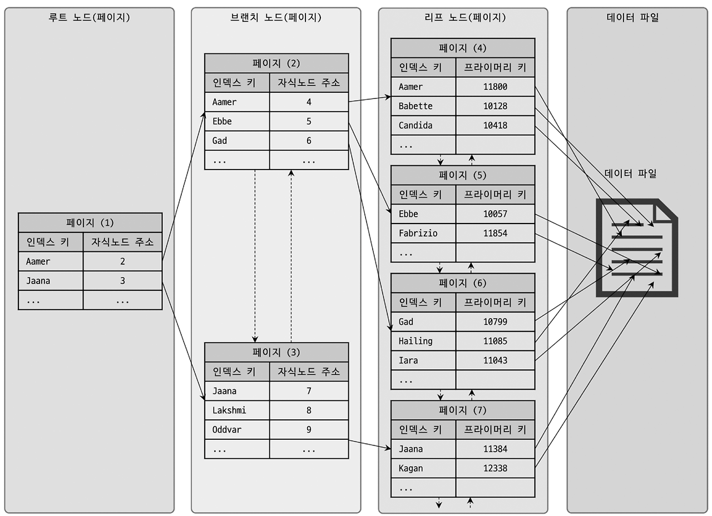
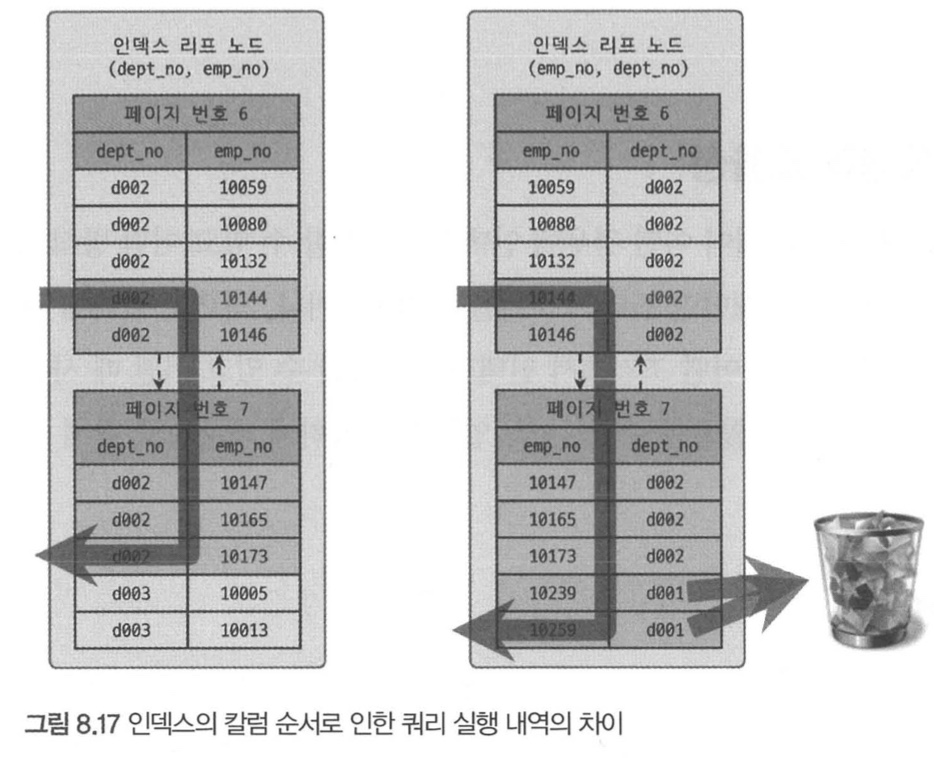
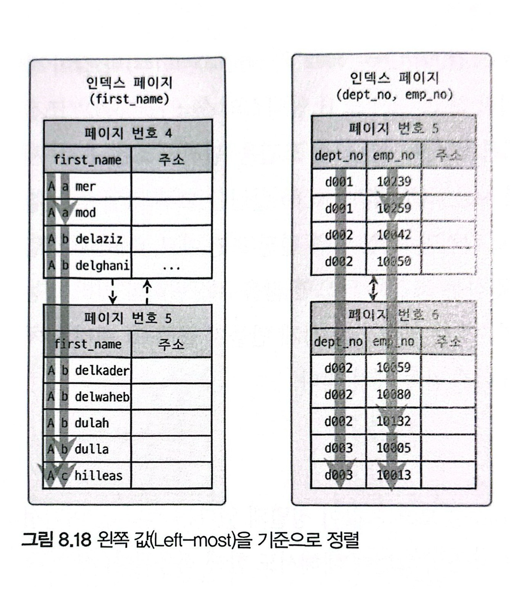

B-Tree는 데이터베이스의 인덱싱 알고리즘 가운데 가장 먼저 도입되고 아직도 가장 범용적인 목적으로 사용된다.

일반적으로 DBMS에서는 B-Tree 변형된 형태의 **B+-Tree** 또는 **B*-Tree**를 사용한다.

B-Tree의 “B”는 “Binary(이진)”의 약자가 아닌 “Balanced”를 의미한다.

### 추천 자료 

[https://www.youtube.com/watch?v=bqkcoSm_rCs&list=PLcXyemr8ZeoREWGhhZi5FZs6cvymjIBVe&index=29](https://www.youtube.com/watch?v=bqkcoSm_rCs&list=PLcXyemr8ZeoREWGhhZi5FZs6cvymjIBVe&index=29)

[https://20240228.tistory.com/416](https://20240228.tistory.com/416)

---

# 8.3.1 구조 및 특성


해당 그림은 B-Tree의 기본적인 구조를 나타낸 그림이다. (4차 B+-Tree)

데이터베이스에서 인덱스와 실제 데이터가 저장된 데이터는 따로 관리되는데, **인덱스의 리프 노드는 항상 실제 데이터 레코드를 찾아가기 위한 주솟값을 가지고 있다.** 

| 항목 | B Tree | B+ Tree |
| --- | --- | --- |
| **데이터 저장 위치** | 모든 노드(내부 + 리프)에 분산 | **리프 노드에만 저장** |
| **인덱스 노드의 역할** | 일부는 인덱스, 일부는 데이터 | 전부 인덱스 (루트/브랜치) |
| **범위 검색 효율성** | 느림 (리프 간 연결 없음) | **빠름 (리프 노드가 연결됨)** |
| **디스크 I/O** | 많아질 수 있음 | **줄어듦 (리프 노드 연속 탐색)** |
| **정렬된 순회** | 복잡함 | **쉬움** (`리프 노드 연결 리스트` 덕분) |

커버링 인덱스 또한 루트, 브랜치 노드는 리프 노드로 가기 위한 자식 노드의 포인터만 존재하고

리프 노드에 인덱스, 프라이머리 키를 key, value로 가진다.



그림을 보면 인덱스의 키 값은 모두 정렬돼 있지만, 데이터 파일의 레코드는 정렬돼 있지 않고 임의의 순서로 저장돼 있다.

인덱스의 리프 노드에는 인덱스 키(KEY), 프라이머리 키(VALUE) 형태로 저장되어 있다.

```
데이터 파일의 레코드는 INSERT된 순서대로 저장되는 것으로 생각하지만 그렇지 않다.
만약 테이블의 레코드를 전혀 삭제하거나 변경하지 않고 INSERT만 수행한다면 맞을 수도 있다.
하지만 레코드가 삭제되어 빈 공간이 생기면 그 다음의 INSERT는 가능한 삭제된 빈 공간을 재활용하도록 
DBMS가 설계되기 때문에 **항상 INSERT된 순서대로 저장되는 것은 아니다.

하지만 InnoDB 테이블 레코드는 클러스터되어 디스크에 저장되므로 기본적으로 프라이머리 키 순서로 정렬되어
저장된다.** 
```


**그림 8.5 B-Tree의 리프 노드와 테이블 데이터 레코드(MyISAM)**

그림 8.5는 MyISAM 테이블의 인덱스와 데이터 파일의 관계를 보여준다.

레코드 주소는 MyISAM 테이블의 생성 옵션에 따라 레코드가 테이블에 INSERT된 순번이거나 데이터 파일 내의 위치(Offset)


그림 8.6은 InnoDB 테이블의 인덱스와 데이터 파일의 관계를 보여준다.

InnoDB 스토리지 엔진을 사용하는 테이블에서는 프라이머리 키가 ROWID 역할을 한다.

두 스토리지 엔진의 인덱스에서 가장 큰 차이점은 세컨더리 인덱스를 통해 데이터 파일의 레코드를 찾아가는 방법에 있다. MyISAM 테이블은 세컨더리 인덱스가 물리적인 주소를 가지는 반면에 **InnoDB 테이블은 프라이머리 키를 주소처럼 사용하기 때문애 논리적인 주소를 가진다고 볼 수 있다.**

그래서 InnoDB 테이블에서 세컨더리 인덱스를 통해 레코드를 읽을 때는 MyISAM에서처럼 데이터 파일을 바로 찾아가지 못한다. 세컨더리 인덱스의 리프 노드에 있는 프라이머리 키 값을 이용해 프라이머리 키 인덱스를 한 번 더 검색한 후, 프라이머이 키 인덱스의 리프 노드에 저장돼 있는 레코드를 읽는다.

즉, InnoDB 스토리지 엔진에서는 모든 세컨더리 인덱스 검색에서 반드시 프라이머리 키를 저장하고 있는 B-Tree를 다시 한번 검색해야 한다.

이 작업으로 인해 성능이 떨어질 것처럼 보이지만 MyISAM 인덱스 구조와 InnoDB 인덱스 구조는 각각 장단점을 가진다. → 8.8 클러스터 인덱스를 참고하자.

---

# 8.3.2 B-Tree 인덱스 키 추가 및 삭제

테이블의 레코드를 저장하거나 변경하는 경우 인덱스 키 추가나 삭제 작업이 발생한다.

인덱스 키 추가나 삭제의 동작을 알아보자.

---

## 8.3.2.1 인덱스 키 추가

새로운 키 값이 B-Tree에 저장될 때 테이블의 스토리지 엔진에 따라 새로운 키 값이 즉시 인덱스에 저장될 수도 있고 그렇지 않을 수 있다. (InnoDB 스토리지 엔진 체인지 버퍼 기능을 말한다.)

자세한 내용은 InnoDB 스토리지 엔진 체인지 버퍼 내용을 참고하자.

B-Tree에 저장될 때는 저장될 키 값을 이용해 B-Tree상의 적절한 위치를 검색해야 한다.

저장될 위치가 결정되면 레코드의 키 값과 대상 레코드의 주소 정보를 B-Tree의 리프 노드에 저장한다. 

- 클러스터 인덱스는 리프 노드에 실제 데이터들을 저장한다.
- 그래서 해당 설명은 세컨더리 인덱스의 기준 내용이다.

리프 노드가 꽉 차서 더는 저장할 수 없을 때는 리프 노드가 분리되고, 이는 상위 브랜치 노드까지 처리의 범위가 넓어진다. 즉, 조정이 들어간다. 이러한 작업 탓에 B-Tree는 상대적으로 쓰기 작업에 비용이 많이 든다.

인덱스 추가로 인해 INSERT나 UPDATE 문장이 어떤 영향을 받을지는 예측하기 힘들다.

테이블 칼럼 수, 칼럼 크기, 인덱스 칼럼의 특성 등을 확인해야 한다.

하지만 테이블에 레코드를 추가하는 비용보다 훨씬 큰 오버헤드를 가지고 **비용의 대부분이 메모리와 CPU에서 처리하는 시간이 아니라 디스크로부터 인덱스 페이지를 읽고 쓰기를 하는 시간이다.**

---

## 8.3.2.2 인덱스 키 삭제

B-Tree의 키 값이 삭제되는 경우는 간단한다.

해당 키 값이 저장된 B-Tree 리프 노드를 찾아서 그냥 삭제 마크만 하면 작업이 완료된다.

삭제 마스킹된 인덱스 키 공간은 그대로 방치하거나 재활용할 수 있다.

하지만 삭제 마스킹 또한 디스크 I/O가 필요한 작업이다.

MySQL 5.5 이상 버전의 InnoDB 스토리지 엔진에서는 이 작업 또한 체인지 버퍼를 통해 지연 처리될 수도 있다.

---

## 8.3.2.3 인덱스 키 변경

인덱스 키 값은 그 값에 따라 저장될 리프 노드의 위치가 결정되므로 B-Tree의 키 값이 변경되는 경우에는 

단순히 인덱스 상의 키 값만 변경하는 것은 불가능하다.

즉, 먼저 키 값을 삭제한 후, 다시 새로운 키를 추가하는 형태로 처리된다.

키 값의 삭제와 추가는 앞에서 설명한 절차대로 처리된다.

InnoDB 스토리지 엔진은 이 작업 모두 체인지 버퍼를 활용해 지연 처리 될 수 있다.

---

## 8.3.2.4 인덱스 키 검색

**INSERT, UPDATE, DELETE 작업을 할 때 인덱스 관리에 대한 추가 비용을 감당하면서 인덱스를 구축하는 이유는 빠른 검색을 위해서다.**

인덱스를 검색하는 작업은 루트 노드부터 최종 리프 노드까지 이동하면서 비교 작업(트리 탐색)을 수행한다.

인덱스 트리 탐색은 SELECT 뿐만 아니라 UPDATE, DELETE 또는 유니크 인덱스 INSERT에도 사용된다.

B-Tree 인덱스를 이용한 검색은 100% 일치하거나 값의 앞부분(Left-most-part)만 일치하는 경우에 사용할 수 있다. 

**인덱스를 구성하는 키 값의 뒷부분만 검색하는 용도 또는 키 값에 변형이 가해진 후 비교가 되는 경우에는 절대 B-Tree의 빠른 검색 기능을 사용할 수 없다.**

InnoDB 스토리지 엔진에서 인덱스는 더욱 중요하다. InnoDB 테이블에서 지원하는 레코드 잠금이나 넥스트 키락(갭락)이 검색을 수행한 인덱스를 잠근 후 테이블의 레코드를 잠그는 방식으로 구현돼 있다.

따라서 UPDATE, DELETE 문장이 실행될 때 테이블에 적절히 사용할 수 있는 인덱스가 없다면 불필요하게 많은 레코드를 잠근다. 심지어 모든 레코드를 잠글 수도 있다.

---

# 8.3.3 B-Tree 인덱스 사용에 영향을 미치는 요소

B-Tree 인덱스는 인덱스를 구성하는 칼럼의 크기와 레코드 건수, 그리고 유니크한 인덱스 키 값의 개수 등에 의해

검색이나 변경 작업의 성능이 영향을 받는다.

---

## 8.3.3.1 인덱스 키 값의 크기

디스크에 데이터를 저장하는 가장 기본 단위를 페이지(Page)라고 한다.

디스크의 모든 읽기 쓰기 작업의 최소 단위가 된다.

또한 InnoDB 스토리지 엔진의 버퍼 풀에서 데이터를 버퍼링하는 기본단위기도 하다.

결국 인덱스는 페이지 단위로 관리되며, B-Tree 각 노드(루트, 브랜치, 리프)기준이 페이지 단위다.

일반적으로 DBMS의 B-Tree는 자식 노드의 개수가 가변적인 구조다.

그러면 MySQL의 B-Tree는 자식 노드를 몇 개까지 가지는지 궁금할 것이다.

그것은 바로 인덱스의 페이지 크기와 키 값의 크기에 따라 결정된다.

InnoDB 스토리지 엔진의 페이지 크기는 `innodb_page_size` 시스템 변수를 이용해 선택할 수 있지만 기본값은 16KB이다. 

인덱스 페이지는 16KB, 인덱스 키가 16바이트라고 가정하자.


그림과 같이 인덱스 페이지가 구성된다.

자식 노드 주소는 여러 가지 복합적인 정보가 담긴 영역이며, 대략 6바이트에서 12바이트까지 다양한 크기의 값을 가질 수 있다. 여기서는 편의상 평균적으로 12바이트로 구성된다고 가정하자.

그럼 해당 그림에서 하나의 인덱스 페이지는 몇 개의 키를 저장할 수 있을까? 

(16 * 1024) / ((16, 키 크기) + (12, 자식 노드 주소)) = 16 * 1024 / 28 = 585개

최종적으로 이 경우 자식 노드의 585개를 가질 수 있는 B-Tree가 되는 것이다.

그렇다면 인덱스 키 값이 커지면 어떤 현상이 발생할까? 

똑같은 경우에서 인덱스 키 크기만 2배인 32바이트로 늘어났다고 가정하면 한 페이지에 인덱스 키를 372개 저장할 수 있다. → B-Tree 레벨이 증가한다.

즉, **인덱스를 구성하는 키 값의 크기가 커지면 디스크로부터 읽어야 하는 횟수가 늘어나고, 그만큼 느려진다.**

또한 인덱스 키 값의 크기 증가는 전체적인 인덱스의 크기가 커진다는 것을 의미한다.

인덱스를 캐시해 두는 InnoDB 버퍼 풀이나 MyISAM 키 캐시 영역의 크기는 제한적이기 때문에 하나의 레코드를 위한 인덱스 크기가 커지면 커질수록 메모리에 캐시해 둘 수 있는 레코드의 수는 줄어든다.

그렇게 되면 자연히 메모리 효율이 떨어지는 결과를 가져온다.

---

## 8.3.3.2 B-Tree 깊이

B-Tree 인덱스의 깊이(Depth)는 디스크 접근 횟수와 연관되어 있기 때문에 중요하지만 직접 제어할 방법은 없다.

인덱스 키 값의 평균 크기가 늘어나면 어떤 현상이 발생하는지 추가로 알아보자. 

깊이가 3이고 키 값이 16바이트인 경우 최대 2억(585 * 585 * 585)개 정도의 키 값을 담을 수 있지만, 

키 값이 32바이트인 경우 최대 5천만(372 * 372 * 372)개로 줄어든다. 

즉, 인덱스 키 값의 크기가 커지면 인덱스 페이지가 담을 수 있는 인덱스 키 값의 개수가 적어지고, 그 때문에 같은 레코드 건수라도 B-Tree 깊이가(Depth)가 깊어져서 디스크 읽기가 더 많이 필요하게 된다는 것을 의미한다.

**인덱스 키 값의 크기는 가능하면 작게 만드는 것이 좋다**

실제로는 아무리 대용량 데이터베이스라도 B-Tree 깊이가 5단계 이상까지 깊어지는 경우는 흔치 않다.

---

## 8.3.3.3 선택도(기수성)

인덱스에서 **선택도(Selectivity)** 또는 **기수성(Cardinality)**은 거의 같은 의미로 사용된다.

모든 인덱스 키 값 가운데 유니크한 인덱스를 의미한다. 

인덱스는 선택도가 높을수록 검색 대상이 줄어들기 때문에 그만큼 빠르게 처리된다.

```
선택도가 좋지 않더라도 정렬 같은 작업을 위해 인덱스를 만드는 것이 훨씬 나은 경우가 많다.
인덱스는 항상 검색에만 사용되는 것은 아니므로 여러 가지 용도를 고려해 적절히 인덱스를 설계할 필요가 있다. 
```

### **tb_test 테이블** 

- 칼럼
- country: 인덱스 존재 O
  - city: 인덱스 존재 X
- 전체 레코드 1만건
- 케이스 A: country 칼럼의 유니크한 값의 개수 10개
- 케이스 B: country 칼럼의 유니크한 값의 개수 1,000개

```sql
SELECT *
FROM tb_test
WHERE country='KOREA' AND city='SEOUL';
```

MySQL에서는 **인덱스의 통계 정보(유니크한 값의 개수)**가 관리되기 때문에 city 칼럼의 기수성은 작업 범위에 아무런 영향을 미치지 못한다.

A 케이스의 경우 평균 1,000건 B 케이스의 경우 평균 10건이 조회될 수 있다는 것을 인덱스의 통계 정보를 통해 예측할 수 있다.

A 케이스, B 케이스 모두 실제 모든 조건을 만족하는 레코드는 단 1건만 있었다면 A 케이스의 인덱스는 적합하지 않은 것이라고 볼 수 있다. A 케이스는 1건의 레코드를 위해 쓸모없는 999건의 레코드를 더 읽은 것이지만, B 케이스 같은 경우 9건만 더 읽은 것이다.

그래서 A 케이스의 경우 country 칼럼에 생성된 인덱스는 비효율적이다.

| 케이스 | country 기수성 | `country='KOREA'` 시 예상 건수 | 인덱스 효율성 |
| --- | --- | --- | --- |
| A | 10 | 약 1,000건 (10,000 / 10) | ❌ (많이 읽고 적게 얻음) |
| B | 1,000 | 약 10건 (10,000 / 1,000) | ✅ (적게 읽고 적게 얻음) |

➡ **옵티마이저는 B 케이스에서 country 인덱스를 더 선호**

### tb_city 테이블

- 칼럼
- country: 인덱스 존재 O
  - city: 인덱스 존재 X
- 전체 레코드 1만건
- 국가와 도시가 중복해서 저장돼 있지 않다.
- 케이스 A: country 칼럼의 유니크한 값의 개수 10개
- 케이스 B: country 칼럼의 유니크한 값의 개수 1,000개

```sql
SELECT *
FROM tb_city
WHERE country='KOREA' AND city='SEOUL';
```

**케이스 A**

```
country 컬럼 unique 10 -> 10개의 국가 존재
이 케이스에서 country='KOREA' 조건으로 인덱스를 검색하면 1000(10000/10)이 일치하리라는 것을 
예상할 수 있다.
그런데 인덱스를 통해 검색된 1000건 가운데 city='SEOUL'인 레코드는 1건이므로 
999건은 불필요하게 읽은 것이다.
```

**케이스 B**

```
country 컬럼 unique 1000 -> 1000개의 국가 존재
이 케이스에서 country='KOREA' 조건으로 인덱스를 검색하면 10(10000/1000)이 일치하리라는 것을
예상할 수 있다.
그런데 인덱스를 통해 검색된 1000건 가운데 city='SEOUL'인 레코드는 1건이므로 
9건만 불필요하게 읽은 것이다.
```

위 두 케이스의 테이블에서 똑같은 쿼리를 실행해 똑같은 결과를 받았지만, 사실 두 쿼리가 처리되기 위해

MySQL 서버가 수행한 작업 내용 차이는 매우 크다는 것을 알 수 있다.

이처럼 **인덱스에서 유니크한 값의 개수는 인덱스나 쿼리의 효율성에 큰 영향을 미친다.**

---

## 8.3.3.4 읽어야 하는 레코드의 건수

인덱스를 통해 테이블을 레코드를 읽은 것은 인덱스를 거치지 않고 바로 테이블의 레코드를 읽는 것보다 높은 비용이 드는 작업이다. 

예를 들어 테이블에 레코드가 100만 건이 저장돼 있는데, 그중에서 50만 건을 읽어야 하는 쿼리가 있다고 가정해 보자. 이 작업은 전체 테이블을 모두 읽어서 필요 없는 50만 건을 버리는 것이 효율적일지, 인덱스를 통해 필요한 50만 건만 읽어 오는 것이 효율적일지 판단해야 한다.

인덱스를 이용한 읽기의 손익 분기점이 얼마인지 판단할 필요가 있는데, 일반적인 **DBMS의 옵티마이저에서는 인덱스를 통해 레코드 1건을 읽는 것이 테이블에서 직접 레코드 1건을 읽는 것보다 4~5배 정도 비용이 더 많이 드는 작업으로 예측**한다.

즉, **인덱스를 통해 읽어야 할 레코드의 건수가 전체 테이블 레코드의 20~25%를 넘어서면 인덱스를 이용하지 않고 테이블을 모두 직접 읽어서** 레코드만 가려내는(필터링) 방식으로 처리하는 것이 효율적이다.

---

# 8.3.4 B-Tree 인덱스를 통한 데이터 읽기

어떤 경우에 (세컨더리)인덱스를 사용하게 유도할지, 또는 사용하지 못하게 할지 판단하려면 어떻게 인덱스를 경유해서 실제 레코드를 읽어 내는지 알아야한다. 

---

## 8.3.4.1 인덱스 레인지 스캔

인덱스 레인지 스캔은 인덱스의 접근 방법 가운데 가장 대표적이고 빠른 방식이다.

인덱스를 통해 레코드를 1건 조회하는 경우와 2건 이상을 조회하는 경우를 각각 다른 이름으로 구분하지만,

이번 학습에서는 묶어서 “인덱스 레인지 스캔”으로 표현하겠다.

```sql
SELECT * FROM employees WHERE first_name BETWEEN 'Ebbe' AND 'Gad';
```


**인덱스 레인지 스캔은 검색해야 할 인덱스의 범위가 결정됐을 때 사용**하는 방식이다.

검색하려는 값의 수나 결과 레코드 건수와 관계없이 레인지 스캔이라고 표현한다.

루트 노드에서부터 비교를 시작해 브랜치 노드를 거치고 최종적으로 리프 노드까지 찾아 들어가야만 비로소 필요한 레코드의 시작 지점을 찾을 수 있다.

일단 시작해야 할 위치를 찾으면 그때부터는 리프 노드의 레코드를 순서대로 읽으면 된다.

이렇게 차례대로 읽는 행위를 스캔이라고 표현한다.

스캔하다가 리프 노드(페이지)의 끝까지 읽으면 리프 노드 간의 링크를 이용해 다음 리프 노드를 찾아서 다시 스캔한다. 최종적으로 스캔을 멈춰야 할 위치에 다다르면 지금까지 읽은 레코드를 사용자에게 반환하고 쿼리를 끝낸다.

그림의 경우 실제 인덱스만 읽는 경우를 보여준다. (커버링 인덱스)

하지만 B-Tree 인덱스의 리프 노드를 스캔하면서 실제 데이터 파일의 레코드를 읽어 와야 하는 경우도 많다.

→ table access rowid

**추가 정리(B+Tree)**

```
정확히는 B-Tree 자료구조가 아닌 B+Tree여서 이런식으로 동작한다.
B+Tree 루트, 브랜치 노드는 인덱스 키와 자식 노드의 주소만 가지고 리프 노드에 
인덱스 키와 프라이머리 키를 가진다. 해당 프라이머리 키는 실제 PK가 아닌 
테이블의 ROWID 이며 탐색용이다. 

-> select id(pk) from table where 세컨더리 인덱스 범위
-> 커버링 인덱스가 아님 

즉, 실제 데이터 파일에 대한 접근은 다시 클러스터 인덱스의 루트 노드로부터 세컨더리 인덱스의 
rowid를 기준으로 탐색이 시작된다.
B+Tree에서 레인지 스캔이 가능한 경우는 리프 노드가 이중 링크드 리스트로 연결되어 있으며
각 노드 즉, 페이지가 연결되어 있어서 가능하다.
```

| 구분 | 내용 |
| --- | --- |
| 인덱스 구조 | B+Tree (리프 노드에만 데이터 접근 정보 존재) |
| 리프 노드 | (인덱스 키, ROWID) 저장, 이중 연결 리스트로 연결 |
| 레인지 스캔 | 시작 위치 찾은 후, 리프 노드 순차 스캔 |
| 데이터 접근 | 커버링 인덱스 아니면 ROWID 통해 클러스터 인덱스 탐색 필요 |
| 장점 | 정렬 + 연결 덕분에 효율적인 범위 검색 가능 |


B-Tree 인덱스에서 루트와 브랜치 노드를 이용해 스캔 시작 위치를 검사하고, 그 지점부터 필요한 방향(오름차순 / 내림차순)으로 인덱스를 읽어 나간다.

중요한 것은 **어떤 방식으로 스캔하든 관계없이, 해당 인덱스를 구성하는 컬럼의 정순 또는 역순으로 정렬된 상태로 레코드를 가져온다는 것**이다. 

이는 별도의 정렬 과정이 수반되는 것이 아니라 인덱스 자체의 정렬 특성 때문에 자동으로 그렇게 된다.

인덱스의 리프 노드에서 검색 조건이 일치하는 건들은 데이터 파일에서 레코드를 읽어오는 과정이 필요하다.

이때 리프 노드에 저장된 레코드 주소로 데이터 파일의 레코드를 읽어오는데, 레코드 한 건 한 건 단위로 랜덤 I/O가 발생한다. 즉, 인덱스 조건에 일치한 레코드가 3건이면 랜덤 I/O가 최대 3번이 필요하다.

그래서 인덱스를 통해 데이터 레코드를 읽는 작업은 비용이 많이 드는 작업으로 분류된다.

인덱스를 통해 읽어야 할 데이터 레코드가 전체 테이블 레코드의 비율 20~25%를 넘기면 인덱스를 통한 읽기보다 

테이블의 데이터를 직접 읽는 것이 더 효율적인 처리 방식이 된다.

```
세컨더리 인덱스:루트 -> 브랜치 -> 리프 -> (랜덤I/O) -> 
클러스터 인덱스:루트 -> 브랜치 -> 리프 

해당 비용이

클러스터 인덱스:루트 -> 브랜치 -> 리프 비용보다 평균적으로 4~5배

그래서 옵티마이저는 인덱스를 통해 읽어야 할 데이터 레코드가 전체 테이블 레코드의 비율 20~25%를 
넘기면 인덱스를 타지 않는 선택을 한다.
```

**인덱스 레인지 스캔 3단계 정리** 

1. 인덱스에서 조건을 만족하는 값이 저장된 위치를 찾는다. 이 과정을 인덱스 탐색(Index seek)
1. 1번에서 탐색한 위치부터 필요한 만큼 인덱스를 차례대로 쭉 읽는다. 이 과정을 인덱스 스캔(Index scan)
1. 2번에서 읽어 들인 인덱스 키와 레코드 주소를 이용해 레코드가 저장된 페이지를 가져오고, 최종 레코드를 읽어온다.

**쿼리가 필요로 하는 데이터에 따라 3번 과정은 필요하지 않을 수 있다. 이를 커버링 인덱스라고 한다.**

커버링 인덱스로 처리되는 쿼리는 디스크의 레코드를 추가적으로 읽지 않아도 되기 때문에 랜덤 읽기가 상당히 줄어들고 성능은 그만큼 빨라진다.

MySQL 서버에서는 1번과 2번 단계의 작업이 얼마나 수행됐는지를 확인할 수 있게 다음과 같은 상태 값을 제공.

```sql
SHOW STATUS LIKE 'Handler_%';
```


`Handler_read_key` → 1번 단계가 실행된 횟수

`Handler_read_next`, `Handler_read_prev` → 2번 단계로 읽은 레코드 건수

- read_next → 인덱스 정순(오름차순)
- read_prev → 인덱스 역순(내림차순)

`Handler_read_first`, `Handler_read_last` → 인덱스 첫 번째 레코드와 마지막 레코드를 읽은 횟수

- MIN(), MAX() 사용하면 증가한다.

이 상태 값들은 읽은 레코드 건수를 의미하고, 인덱스만 읽었는지 인덱스를 통해 테이블의 레코드를 

읽었는지(3번 단계) 구분하지 않는다.

---

## 8.3.4.2 인덱스 풀 스캔

인덱스 레인지 스캔과 마찬가지로 인덱스를 사용하지만 **인덱스 레인지 스캔과는 달리 인덱스의 처음부터 끝까지 모두 읽는 방식을 인덱스 풀 스캔**이라고 한다.

대표적으로 쿼리의 조건절에 사용된 칼럼이 인덱스의 첫 번째 칼럼이 아닌 경우 인덱스 풀 스캔 방식이 사용된다.

예를 들어 인덱스는 (A,B,C) 칼럼의 순서로 만들어져 있지만 쿼리의 조건절은 B 칼럼이나 C 칼럼으로 검색하는 경우다. 

일반적으로 인덱스의 크기는 테이블의 크기보다 작으므로 직접 테이블을 처음부터 끝까지 읽는 것보다 인덱스만 읽는 것이 효율적이다. 쿼리가 인덱스에 명시된 컬럼만으로 조건을 처리할 수 있는 경우 주로 이 방식이 사용된다.

인덱스뿐만 아니라 데이터 레코드까지 모두 읽어야 한다면 절대 이 방식으로 처리되지 않는다.

즉, 커버링 인덱스인 경우에만 인덱스 풀 스캔을 진행한다.


해당 그림은 인덱스 풀 스캔의 예로 살펴볼 수 있다.

먼저 인덱스 리프 노드의 제일 앞 또는 제일 뒤로 이동한 후, 인덱스의 리프 노드를 연결하는 링크드 리스트를 따라서 처음부터 끝까지 스캔하는 방식이다.

이 방식은 인덱스 레인지 스캔보다 빠르지는 않지만 테이블 풀 스캔보다는 효율적이다.

인덱스에 포함된 컬럼만으로 처리할 수 있는 경우 테이블의 레코드를 읽을 필요가 없기 때문이다.

인덱스의 전체 크기는 테이블 자체의 크기보다는 훨씬 작으므로 인덱스 풀 스캔은 테이블 전체를 읽는 것보다는 적은 디스크 I/O로 쿼리를 처리할 수 있다.

**요약**

```
세컨더리 인덱스 리프 노드 레코드 구성 = 인덱스 키 +  물리 레코드 주소(클러스터 인덱스 키) 
클러스터 인덱스 리프 노드 레코드 구성 = 모든 레코드(칼럼)

즉, 1개의 페이지(노드)에 들어갈 수 있는 데이터량이 다르다.
-> 인덱스 풀 스캔 VS 테이블 풀 스캔을 비교하면 
압도적으로 테이블 풀 스캔 디스크 I/O 횟수가 많기 떄문에
인덱스 풀 스캔이 가능하면 훨씬 유리하다.

**InnoDB 스토리지 엔진은 한번의 I/O 단위는 페이지(블록)**
```

**주의**

```
인덱스 풀 스캔 방식 또한 인덱스를 이용하는 것이지만 효율적인 방식이 아니다.
즉, 일반적으로 인덱스를 생성하는 목적이 아니다.
테이블 전체를 읽거나 인덱스 풀 스캔 방식으로 인덱스를 사용하는 경우는
"인덱스를 사용하지 못한다" 또는 "인덱스를 사용하지 못한다"와 같다.
```

---

## 8.3.4.3 루스 인덱스 스캔

“인덱스 레인지 스캔”과 “인덱스 풀 스캔”은 “루스 인덱스 스캔”과 상반된 의미에서 “타이트(Tight) 인덱스 스캔”으로 분류된다. 

**루스 인덱스 스캔이란 듬성듬성하게 인덱스를 읽는 것을 의미한다.**


**루스 인덱스 스캔은 인덱스 레인지 스캔과 비슷하게 동작하지만 중간에 필요하지 않은 인덱스 키 값은 무시(SKIP)**하고 다음으로 넘어가는 형태로 처리한다.

**일반적으로 GROUP BY 또는 집합 함수 가운데 MAX() 또는 MIN() 함수에 대한 최적화를 하는 경우에 사용**된다.

```sql
CREATE INDEX idx_dept_emp ON dept_emp(dept_no, emp_no);

SELECT dept_no, MIN(emp_no)
FROM dept_emp
WHERE dept_no BETWEEN 'd002' AND 'd004'
GROUP BY dept_no;
```

인덱스가 (dept_no, emp_no) 두 개의 칼럼으로 생성돼 있다.

이 인덱스는 dept_no, emp_no 조합으로 정렬돼 있어서 그림과 같이 dept_no 그룹별로 첫 번째 레코드의 emp_no 값만 읽으면 된다.

즉, 인덱스에서 WHERE 조건을 만족하는 모든 범위를 다 스캔할 필요가 없다는 것을 옵티마이저는 알고 있기 때문에 조건에 만족하지 않는 레코드는 무시하고 다음 레코드로 이동한다.

---

## 8.3.4.4 인덱스 스킵 스캔

데이터베이스 서버에서 인덱스의 핵심은 값이 정렬돼 있다는 것이다.

이로 인해 인덱스를 구성하는 칼럼의 순서가 매우 중요하다.

예를 들어, employees 테이블에 다음과 같은 인덱스를 생성해보자.

```sql
ALTER TABLE employees
ADD INDEX ix_gender_birthdate (gender, birth_date);
```

이 인덱스를 사용하려면 WHERE 조건절에 gender 칼럼에 대한 비교 조건이 필수다.

```sql
// 인덱스를 사용하지 못하는 쿼리
SELECT * FROM employees WHERE birth_date >= '1965-02-01';

// 인덱스를 사용할 수 있는 쿼리
SELECT * FROM employees WHERE gender='M' AND birth_date >= '1965-02-01';
```

gender 칼럼과 birth_date 칼럼의 조건을 모두 가진 두 번째 쿼리는 인덱스를 효율적으로 사용할 수 있지만 

gender 칼럼에 조건이 없는 첫 번째 쿼리는 인덱스를 사용할 수가 없었다.

주로 이런 경우에는 birth_date 칼럼부터 시작하는 인덱스를 새로 생성해야만 했다.

### MySQL 8.0 버전 - 인덱스 스킵 스캔 최적화 기능

8.0 버전부터는 옵티마이저가 gender 칼럼을 건너뛰어서 birth_date 칼럼만으로도 인덱스 검색이 가능하게 해주는 **인덱스 스킵 스캔(Index skip scan)** 최적화 기능이 도입됐다.

8.0 이전 버전에서도 인덱스 스킵 스캔과 비슷한 최적화를 수행하는 루스 인덱스 스캔 기능이 있었지만 

GROUP BY 작업을 처리하기 위해 인덱스를 사용하는 경우에만 적용할 수 있었다.

하지만 MySQL 8.0 버전에 도입된 인덱스 스킵 스캔은 WHERE 조건절의 검색을 위해 사용 가능하도록 용도가 훨씬 넓어진 것이다.

### **옵티마이저 인덱스 스킵 스캔 최적화 OFF**

```sql
SET optimizer_switch='skip_scan=off';

EXPLAIN
SELECT gender, birth_date
FROM employees
WHERE birth_date >='1965-02-01';

mysql> EXPLAIN SELECT gender, birth_date FROM employees WHERE birth_date>='1965-02-01';
+----+-------------+-----------+------------+-------+---------------+---------------------+---------+------+--------+----------+--------------------------+
| id | select_type | table     | partitions | type  | possible_keys | key                 | key_len | ref  | rows   | filtered | Extra                    |
+----+-------------+-----------+------------+-------+---------------+---------------------+---------+------+--------+----------+--------------------------+
|  1 | SIMPLE      | employees | NULL       | index | NULL          | ix_gender_birthdate | 4       | NULL | 300719 |    33.33 | Using where; Using index |
+----+-------------+-----------+------------+-------+---------------+---------------------+---------+------+--------+----------+--------------------------+
1 row in set, 1 warning (0.00 sec)
```

```
WHERE 조건에 gender 칼럼에 조건 없이 birth_date 칼럼의 비교 조건만 가지고 있기 때문에
ix_gender_birthdate 인덱스를 효율적으로 이용할 수 없다.

"효율적"으로 이용한다는 것은, 인덱스에서 꼭 필요한 부분만 접근하는 것을 의미한다.
위의 실행계획에서 type 칼럼이 "index"라고 표시된 것은 인덱스를 처음부터 끝까지 모두 읽었다
(풀 인덱스 스캔)는 의미이므로 인덱스를 비효율적으로 사용한 것이다.

만약 예제 쿼리가 employees 테이블 모든 컬럼을 가져와야 했다면 
테이블 풀 스캔을 실행했을 것이다.
-> type: all
```

### **옵티마이저 인덱스 스킵 스캔 최적화 ON**


```sql
SET optimizer_switch='skip_scan=on';

EXPLAIN
SELECT gender, birth_date
FROM employees
WHERE birth_date >='1965-02-01';

+----+-------------+-----------+------------+-------+---------------------+---------------------+---------+------+--------+----------+----------------------------------------+
| id | select_type | table     | partitions | type  | possible_keys       | key                 | key_len | ref  | rows   | filtered | Extra                                  |
+----+-------------+-----------+------------+-------+---------------------+---------------------+---------+------+--------+----------+----------------------------------------+
|  1 | SIMPLE      | employees | NULL       | range | ix_gender_birthdate | ix_gender_birthdate | 4       | NULL | 100229 |   100.00 | Using where; Using index for skip scan |
+----+-------------+-----------+------------+-------+---------------------+---------------------+---------+------+--------+----------+----------------------------------------+
1 row in set, 1 warning (0.00 sec)
```

```
쿼리의 실행 계획에서 type 컬럼의 값이 “range”로 표시됐다.
이는 꼭 인덱스에서 필요한 부분만 읽었다는 것을 의미한다.
그리고 실행 계획의 Extra 칼럼에 "Using index for skip scan"
이라는 문구가 표시됐다.
이는 id_gender_birthdate 인덱스에 대해 인덱스 스킵 스캔을 활용해서
데이터를 조회했다는 의미한다.

MySQL 옵티마이저는 우선 gender 칼럼에서 유니크한 값을 모두 조회해서
주어진 쿼리에 gender 칼럼의 조건을 추가해서 쿼리를 다시 실행하는 형태로 처리한다.

gender 칼럼은 성별을 구분하는 칼럼으로 ‘M’ ‘F’ 값만 가지는 칼럼이다.
그래서 gender 칼럼에 대해 가능한 값 2개(’M’,‘F’)를 구한 다음, 
내부적으로 아래 2개의 쿼리를 실행하는 것과 비슷한 형태의 최적화를 실행하게 된다.
```

```sql
SELECT gender, birth_date 
FROM employees 
WHERE gender='M' AND birth_date >='1965-02-01';

SELECT gender, birth_date 
FROM employees 
WHERE gender='F' AND birth_date >='1965-02-01';
```

### 인덱스 스킵 스캔의 단점(조건)

- **WHERE 조건절에 조건이 없는 인덱스의 선행 칼럼의 유니크한 값의 개수가 적어야 함**
- **쿼리가 인덱스에 존재하는 칼럼 칼럼만으로 처리 가능해야 함(커버링 인덱스)**

첫 번째 조건은 **쿼리 실행 계획의 비용과 관련된 부분**이다.

유니크한 값의 개수가 매우 많다면 MySQL 옵티마이저는 인덱스에서 스캔해야 할 시작 지점을 검색하는 작업이 많이 필요해진다. 그래서 쿼리의 처리 성능이 오히려 더 느려질 수도 있다.

예를 들어 (emp_no, dept_no) 조합으로 만들어진 인덱스에서 인덱스 스킵 스캔을 실행한다고 하면 

사원의 수만큼 레인지 스캔 시작 지점을 검색하는 작업이 필요해져 쿼리의 성능이 매우 떨어진다.

두 번째 제약 조건은 아래 예제 쿼리를 통해 살펴보자.

```sql
EXPLAIN
SELECT *
FROM employees
WHERE birth_date >='1965-02-01';

+----+-------------+-----------+------------+------+---------------+------+---------+------+--------+----------+-------------+
| id | select_type | table     | partitions | type | possible_keys | key  | key_len | ref  | rows   | filtered | Extra       |
+----+-------------+-----------+------------+------+---------------+------+---------+------+--------+----------+-------------+
|  1 | SIMPLE      | employees | NULL       | ALL  | NULL          | NULL | NULL    | NULL | 300141 |    33.33 | Using where |
+----+-------------+-----------+------------+------+---------------+------+---------+------+--------+----------+-------------+
1 row in set, 1 warning (0.00 sec)

```

WHERE 조건은 동일하지만 SELECT 절에서 employees 테이블의 모든 칼럼을 조회하도록 변경했다.

이 쿼리는 ix_gender_birthdate 인덱스에 포함된 gender 칼럼과 birh_date 칼럼 이외의 나머지 칼럼도 필요하기 때문에 인덱스 스킵 스캔을 사용하지 못하고 풀 테이블 스캔으로 실행 계획을 수립한 것을 확인할 수 있다.

이 제약 사항은 옵티마이저가 개선하면 충분히 해결될 수 있는 부분으로 보인다.

**인덱스 스캔 방식 4가지 정리**

| 스캔 방식 | 사용 조건 / 목적 | 장점 | 제약 |
| --- | --- | --- | --- |
| 인덱스 레인지 스캔 | WHERE 절에 범위 조건이 있을 때 | 인덱스 일부만 탐색하여 빠름 | - |
| 인덱스 풀 스캔 | WHERE 없이 SELECT 또는 커버링 인덱스 사용 | 테이블 액세스 없이 인덱스만 탐색 | - |
| 루스 인덱스 스캔 | GROUP BY, DISTINCT, MIN/MAX 등 집합 연산 최적화 | 불필요한 탐색 없이 필요한 값만 추출 | - |
| 인덱스 스킵 스캔 | 복합 인덱스에서 선행 조건 없이 후행 조건만 있을 때 | 복합 인덱스의 활용도 향상 | 선행 컬럼 유니크 수 적고, 커버링 인덱스 필요 |

---

# 8.3.5 다중 칼럼(Multi-column) 인덱스

두 개 이상의 칼럼으로 구성된 인덱스를 다중 칼럼 인덱스(복합 칼럼 인덱스)라고 하며, 2개 이상의 칼럼이 연결됐다고 해서 “Concatenated Index”라고도 한다.


그림을 보면 인덱스의 두 번째 칼럼은 첫 번째 인덱스에 의존해서 정렬돼 있다.

즉, 두 번째 칼럼의 정렬은 첫 번째 칼럼이 똑같은 레코드에서만 의미가 있다는 것이다.

이는 **인덱스 내에서 칼럼의 위치(순서)가 상당히 중요한 이유**이다.

---

# 8.3.6 B-Tree 인덱스의 정렬 및 스캔 방향

인덱스를 생성할 때 설정한 정렬 규칙에 따라서 인덱스의 키 값은 항상 오름차순 또는 내림차순으로 정렬되어 저장된다. 하지만 어떤 인덱스가 오름차순으로 생성됐다고 해서 그 인덱스를 항상 오름차순으로만 읽을 수 있는 건 아니다. **인덱스를 어느 방향으로 읽을지는 쿼리에 따라 옵티마이저가 실시간으로 만들어 내는 실행 계획에 따라 결정**된다.

---

## 8.3.6.1 인덱스의 정렬

MySQL 5.7 버전까지는 칼럼 단위로 정렬 순서를 혼합해서 인덱스를 생성할 수 없었다.

하지만 MySQL 8.0 버전부터는 정렬 순서를 혼합한 인덱스도 생성할 수 있게 됐다.

```sql
CREATE INDEX ix_teamname_userscore ON employees (team_name ASC, user_score DESC);
```

---

## 8.3.6.1.1 인덱스 스캔 방향

first_name 칼럼에 대한 인덱스가 포함된 employees 테이블에 대해 아래 쿼리를 실행하는 과정을 살펴보자.

```sql
SELECT *
FROM employees
ORDER BY first_name DEDC
LIMIT 1;
```

Q: MySQL은 이 쿼리를 실행하기 위해 인덱스를 처음부터 오름차순으로 끝까지 읽어 first_name이 가장 큰 값 하나를 가져오는걸까? 

A: 그렇지 않다.

**인덱스를 최솟값부터 읽으면 오름차순으로 데이터를 가져올 수 있고, 최댓값부터 거꾸로 읽으면 내림차순으로 데이터를 가져올 수 있다는 것을 MySQL 옵티마이저는 이미 알고 있다.**

그래서 위의 쿼리는 역순으로 접근해 첫 번째 레코드만 읽으면 된다.


```sql
SELECT * FROM employees WHERE first_name >= 'Anneke'
ORDER BY first_name ASC LIMIT 4;

SELECT * FROM employees 
ORDER BY first_name DESC LIMIT 5;
```

쿼리의 ORDER BY 처리나 MIN() 또는 MAX() 함수 등의 최적화가 필요한 경우에도 

MySQL 옵티마이저는 인덱스의 읽기 방향을 전환해서 사용하도록 실행 계획을 만들어 낸다.

---

## 8.3.6.1.2 내림차순 인덱스


- 오름차순 인덱스(Ascending Index): 작은 값의 인덱스 키가 B-Tree 왼쪽으로 정렬된 인덱스
- 내림차순 인덱스(Descending Index): 큰 값의 인덱스 키가 B-Tree 왼쪽으로 정렬된 인덱스
- 인덱스 정순 스캔(Forward index scan): 리프 노드의 왼쪽부터 오른쪽으로 스캔
- 인덱스 역순 스캔(Backward index scan): 리프 노드의 오른쪽부터 왼쪽으로 스캔

### **내림차순 인덱스의 필요성에 대해서 알아보자**

```sql
CREATE TABLE t1(
		tid INT NOT NULL AUTO_INCREMENT,
		TABLE_NAME VARCHAR(64),
		COLUMN_NAME VARCHAR(64),
		ORDINAL_POSITION INT,
		PRIMARY KEY(tid)
)

INSERT INTO t1
SELECT NULL, TABLE_NAME, COLUMN_NAME, ORDINAL_POSITION
FROM information_schema.COLUMNS;

INSERT INTO t1
SELECT NULL, TABLE_NAME, COLUMN_NAME, ORDINAL_POSITION
FROM t1;

// 13번 실행 ...

SELECT COUNT(*) FROM t1;
+----------+
| count(*) |
+----------+
| 29736960 |
+----------+
```

대략 3천만 건 레코드 준비 끝

**참고 아래 쿼리 3개는 모두 동일하다.**

```sql

SELECT * FROM 테이블 LIMIT N;

SELECT * FROM 테이블 LIMIT 0, N;

SELECT * FROM 테이블 LIMIT N OFFSET 0;
```

```sql
SELECT * FROM t1 ORDER BY tid ASC LIMIT 29736959, 1;
+----------+---------------------------+---------------+------------------+
| tid      | TABLE_NAME                | COLUMN_NAME   | ORDINAL_POSITION |
+----------+---------------------------+---------------+------------------+
| 30007061 | x$waits_global_by_latency | total_latency |                3 |
+----------+---------------------------+---------------+------------------+
1 row in set (5.43 sec)

SELECT * FROM t1 ORDER BY tid DESC LIMIT 29736959, 1;
+-----+-------------+-------------+------------------+
| tid | TABLE_NAME  | COLUMN_NAME | ORDINAL_POSITION |
+-----+-------------+-------------+------------------+
|   1 | departments | dept_name   |                2 |
+-----+-------------+-------------+------------------+
1 row in set (6.84 sec)
```

두 쿼리는 테이블의 프라이머리 키를 정순 또는 역순으로 스캔하면서 마지막 레코드 1건만 반환한다.

첫 번째 쿼리는 tid 칼럼이 가장 큰 레코드를 1건, 두 번째 쿼리는 tid 칼럼이 가장 작은 렉코드를 1건 조회한다.

하지만 LIMIT, OFFSET 때문에 테이블의 거의 모든 레코드를 스캔해야 한다.

정확히는 OFFSET 만큼 인덱스 레인지 스캔이 일어난다.

두 쿼리는 3천만 건을 스캔하는데 “1.4초” 정도 차이난다.

하지만 **비율로 따지면 역순 정렬 쿼리가 정순 정렬 쿼리보다 26퍼 정도 더 시간이 걸리는 것을 확인**할 수 있다.

왜 이런 결과가 나올까?

- 페이지 잠금이 인덱스 정순 스캔(Forward index scan)에 적합한 구조
- 페이지 내에서 인덱스 레코드가 단방향으로만 연결된 구조


```
InnoDB 스토리지 엔진에서 데이터 페이지는 힙처럼 사용되기 때문에 그림처럼
물리적으로 저장이 순서대로 배치되지는 않는다.
```

일반적으로 인덱스를 ORDER BY … DESC 하는 쿼리가 레코드에 드물게 실행되는 경우라면 

내림차순 인덱스를 굳이 고려할 필요는 없어 보인다.

```sql
SELECT * FROM tab
WHERE userid=?
ORDER BY score DESC
LIMIT 10;
```

이 쿼리의 경우 다음 두 가지 인덱스 모두 적절한 선택이 될 수 있다.

```sql
오름차순 인덱스: INDEX (userid ASC, score ASC)
내림차순 인덱스: INDEX (userid DESC, score DESC)
```

하지만 해당 쿼리가 빈번하게 실행되고 많은 레코드를 조회한다면 내림차순 인덱스가 더 효율적이라고 볼 수 있다.

비록 페이지 단위로는 역순 이동이 되더라도, 페이지 내부 레코드는 역순으로 효율적으로 순회할 수 없기 때문에

**DESC 쿼리는 항상 어느 정도 성능 손해가 발생한다.**

| 항목 | 설명 |
| --- | --- |
| **1. 페이지 내부 레코드 간 연결** | ✅ **단방향 (정방향/ASC만 고려)** → 클러스터 인덱스든 세컨더리 인덱스든 동일하게 **레코드는 단방향으로만 연결**되어 있음 |
| **2. 클러스터 인덱스(PK)의 리프 노드 간 연결** | ✅ **양방향(Double-linked list)** → 리프 노드(페이지) 간에 **앞뒤 이동 모두 가능** → ASC/DESC 모두 효율적 (이론상) |

[https://tech.kakao.com/posts/351](https://tech.kakao.com/posts/351)

---

# 8.3.7 B-Tree 인덱스의 가용성과 효율성

쿼리의 WHERE 절이나 GROUP BY, 또는 ORDER BY 절이 어떤 경우에 인덱스를 사용할 수 있고 어떤 방식으로 사용할 수 있는지 식별할 수 있어야 한다.

그래야만 쿼리의 조건을 최적화하거나, 역으로 쿼리에 맞게 인덱스를 최적으로 생성할 수 있다.

---

## 8.3.7.1 비교 조건의 종류와 효율성

다중 칼럼 인덱스에서 각 칼럼의 순서와 사용된 조건이 동등 비교(”=”)인지 크다 (”>”) 또는 작다 (”<”) 같은 범위 조건인지에 따라 각 인덱스 칼럼의 활용 형태와 효율이 달라진다.

```sql
SELECT * FROM dept_emp
WHERE dept_no='d002' AND emp_no >= 10114;
```

- 케이스 A: INDEX(dept_no, emp_no)
- 케이스 B: INDEX(emp_no, dept_no)



케이스 A 같은 경우 “dept_no='d002' AND emp_no >= 10114”인 레코드를 찾고, 그 이후에는 dept_no가 ‘d002’가 아닐 때까지 인덱스를 쭉 읽기만 하면 된다.

이 경우에는 읽은 레코드가 모두 사용자가 원하는 레코드 결과임을 알 수 있다.

케이스 B 같은 경우 “emp_no >= 10114 AND  dept_no='d002'” 레코드를 찾고 그 이후 모든 레코드에 대해 

dept_no가 ‘d002’인지 비교하는 과정을 거쳐야 한다.

이처럼 인덱스를 통해 읽은 레코드가 나머지 조건에 맞는지 비교하면서 취사선택하는 작업을 ‘필터링’이라고 한다.

케이스 B도 레코드 5건을 가져온다. 하지만 케이스 A와는 다르게 7번의 비교 과정을 거친다.

**왜 이런 차이가 발생했을까?** 

다중 칼럼 인덱스의 정렬 방식은 N번째 키 값은 N-1번째 키 값에 대해서 다시 정렬되기 때문이다.

케이스 A 인덱스에서의 “dept_no='d002' , emp_no >= 10114” 같이 작업의 범위를 결정하는 조건을 작업 범위 결정 조건이라고 한다.

케이스 B 인덱스에서의 dept_np=’d002’ 조건을 필터링 조건 또는 체크 조건이라고 한다.

즉, 케이스 A 같은 경우 작업 범위 결정 조건을 2개 사용했고 케이스 B 같은 경우 작업 범위 결정 조건을 1개, 필터링 조건을 1개 사용했다.

**작업 범위를 결정하는 조건이 많으면 많을수록 쿼리의 성능을 높이지만 필터링 조건은 많다고 해서 쿼리의 처리 성능을 높이지는 못한다. 오히려 쿼리 샐행을 더 느리게 만들 때가 많다.** 

---

## 8.3.7.2 인덱스의 가용성

B-Tree 인덱스의 특징은 왼쪽 값에 기준해서 오른쪽 값이 정렬돼 있다는 것이다.

여기서 **왼쪽이란 하나의 칼럼 내에서뿐만 아니라 다중 칼럼 인덱스의 칼럼에 대해서도 함께 적용**된다.

- 케이스 A: INDEX(first_name)
- 케이스 B: INDEX(dept_no, emp_no)



하나의 칼럼으로 검색해도 값의 왼쪽 부분이 없으면 인덱스 레인지 스캔 방식이 불가능하다.

또한 다중 칼럼 인덱스에서도 왼쪽 칼럼의 값을 모르면 인덱스 레인지 스캔을 사용할 수 없다.

물론 8.0 이후 버전이라면 커버링 인덱스 + 왼쪽 칼럼의 기수성이 낮다면 인덱스 스킵 스캔으로 동작할 수 있다.

 

```sql
SELECT * FROM employees WHERE first_name LIKE '%mer';
```

케이스 A에서 해당 쿼리는 인덱스 레인지 스캔 방식으로 인덱스를 사용할 수는 없다.

그 이유는 first_name 칼럼에 저장된 값의 왼쪽부터 한 글자씩 비교해 가면서 일치하는 레코드를 찾아야 하는데, 조건절에 주어진 상숫값(’%mer’)에는 왼쪽 부분이 고정되지 않았기 때문이다.

따라서 정렬 우선순위가 낮은 뒷부분의 값만으로는 인덱스의 효과를 얻을 수 없다.

```sql
SELECT * FROM dept_emp WHERE emp_no >= 10144; 
```

케이스 B는 인덱스가 dept_no, emp_no 순서대로 생성돼 있다.

인덱스의 선행 칼럼인 dept_no 조건 없이 emp_no 값으로만 검색하면 인덱스를 효율적으로 사용할 수 없다.

여기서는 간단히 WHERE 조건절에 대한 내용만 언급했지만 인덱스의 왼쪽 값 기준 규칙은 GROUP BY 절이나 ORDER BY 절에도 똑같이 적용된다.

---

## 8.3.7.3 가용성과 효율성 판단

기본적으로 B-Tree 인덱스의 특성상 다음 조건에서는 사용할 수 없다.

사용할 수 없다는 것은 작업 범위 결정 조건으로 사용할 수 없다는 것을 의미한다.

경우에 따라서는 체크 조건으로 인덱스를 사용할 수는 있다.

| **구분** | **예시** | **설명** |
| --- | --- | --- |
| **NOT-EQUAL로 비교된 경우** | `WHERE column <> 'N'` | 특정 값과 다른 경우를 검색 |
|  | `WHERE column NOT IN (10, 11, 12)` | 특정 값 목록에 없는 경우를 검색. |
|  | `WHERE column IS NOT NULL` | NULL이 아닌 값을 검색하며, 일반적으로 인덱스를 제대로 활용하지 못함. |
| **LIKE로 뒷부분 또는 중간 일치** | `WHERE column LIKE '%승환'` | 문자열 끝부분이 특정 패턴과 일치하는 경우.  |
|  | `WHERE column LIKE '_승환'` | 두 번째 문자부터 특정 패턴과 일치하는 경우. |
|  | `WHERE column LIKE '%승%'` | 문자열 중간에 특정 패턴이 포함된 경우. |
| **인덱스 컬럼이 변형된 경우** | `WHERE SUBSTRING(column, 1, 1) = 'X'` | 인덱스가 적용되지 않으며, 컬럼 값을 변형하는 함수 사용. |
|  | `WHERE DAYOFMONTH(column) = 1` | 날짜 함수로 컬럼을 변형하여 비교하는 경우. |
| **NOT-DETERMINISTIC <br>함수 사용** | `WHERE column = deterministic_function()` | 결과가 매번 달라질 수 있는 함수 사용 시, 인덱스 사용이 제한 |
| **데이터 타입이 다른 비교** | `WHERE char_column = 10` | 문자열과 숫자와 같이 서로 다른 타입을 비교하면 암묵적 형변환이 발생하고 인덱스 사용이 제한 |
| **문자열 콜레이션이 다른 문자열 비교** | `WHERE utf8_bin_char_column = euckr_bin_char_column` | 서로 다른 문자 집합(콜레이션)을 비교하면 불필요한 변환 |

다른 일반적인 DBMS에서는 NULL 값이 인덱스에 저장되지 않지만 MySQL에서는 NULL 값도 인덱스에 저장된다. 다음과 같은 조건도 작업 범위 결정 조건으로 인덱스를 사용한다.

```sql
	... WHERE column IS NULL ..
```

오름차순(정순) 인덱스 기준 NULL은 제일 앞에 정렬돼 있다.

### 다중 컬럼 인덱스의 적용 가능/불가능 조건 - INDEX( col1, col2, col3, … col n)

| **구분** | **설명** | **예시** |
| --- | --- | --- |
| **적용되지 않는 경우** |  |  |
| `col_1`에 대한 조건 없음 | 다중 컬럼 인덱스에서 가장 앞 컬럼(`col_1`)에 대한 조건이 없으면 인덱스가 적용되지 않음. | `WHERE col_2 = 10 AND col_3=20` |
| `col_1` 조건이 인덱스에서 사용 불가 | `col_1` 조건이 NOT-EQUAL (`<>`, `NOT IN`, 등), 패턴 불일치 (`LIKE '%str'`) 등이 포함될 경우. | `WHERE col_1 <> 10 AND col_2 = 20` |
| **적용되는 경우** |  |  |
| `col_1` ~ `col_(i-1)` 동등 비교 | 인덱스 컬럼 중 앞부분(`col_1` ~ `col_(i-1)`)이 동등 비교 조건 (`=`, `IN`)일 때 적용 가능. | `WHERE col_1 = 10 AND col_2 IN (20, 30)` |
| `col_i` 비교 가능 조건 | `col_i`에 동등 비교 (`=`, `IN`), 크고 작음 (`<`, `>`, `<=`, `>=`), 또는 좌측 일치 `LIKE` 조건 사용 가능. | `WHERE col_1 = 10 AND col_2 = 20 AND col_3 > 30`  <br>`WHERE col_1 = 10 AND col_2 LIKE 'jour%'` |
| **작업 범위/체크 조건** |  |  |
| 작업 범위 조건 | `col_1` ~ `col_i`는 작업 범위를 결정하는 조건으로 사용 | `WHERE col_1 = 10 AND col_2 = 20` (인덱스를 통한 데이터 스캔 범위 결정). |
| 체크 조건 | `col_i+1` ~ `col_n`은 작업 범위 내에서 일치 여부를 확인하는 조건으로 사용됨. | `WHERE col_1 = 10 AND col_2 = 20 AND col_3 = 30 AND col_4 = 40` (작업 범위 스캔 후 추가 체크). |

---

