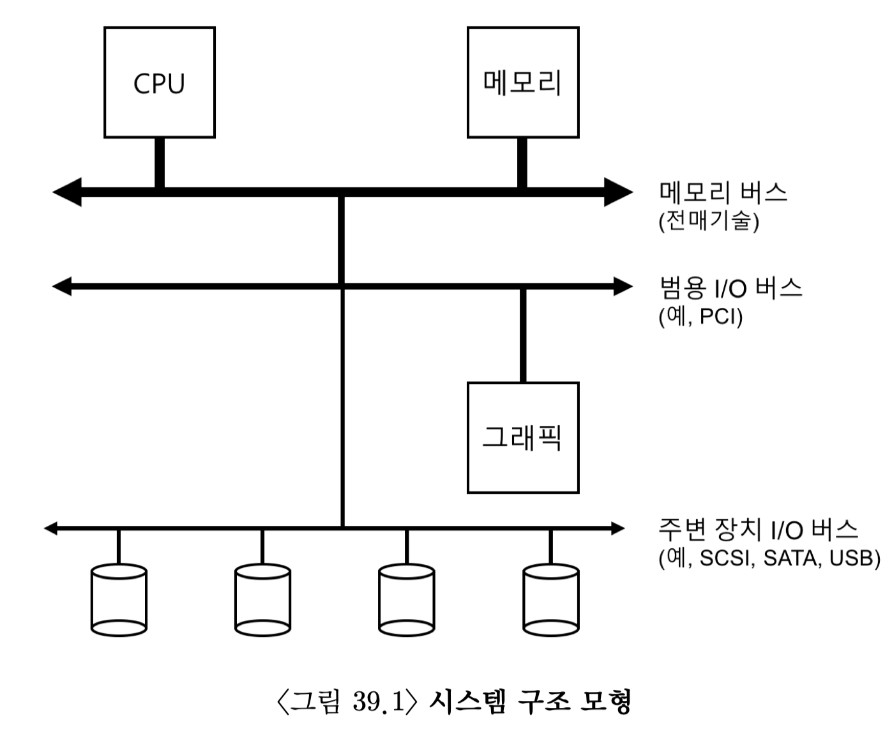
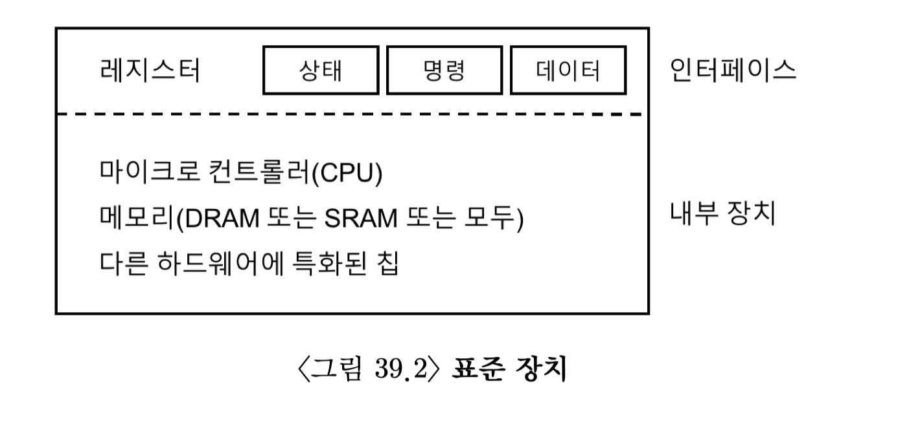
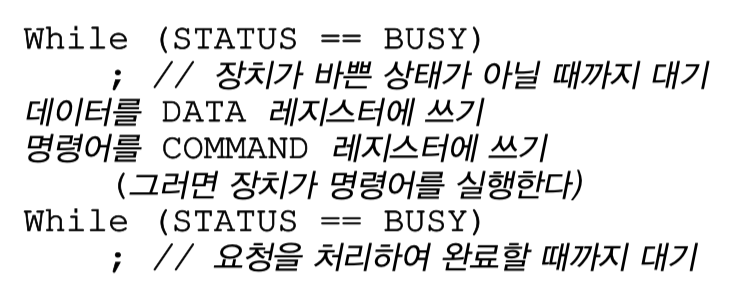
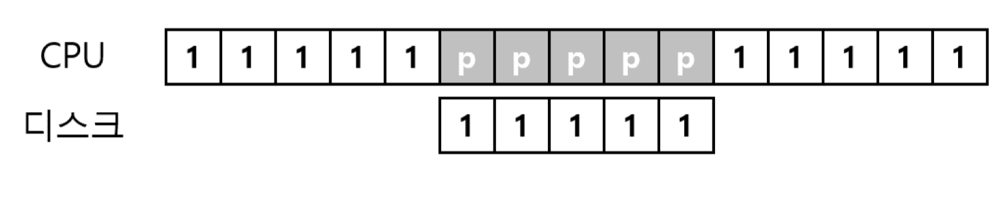
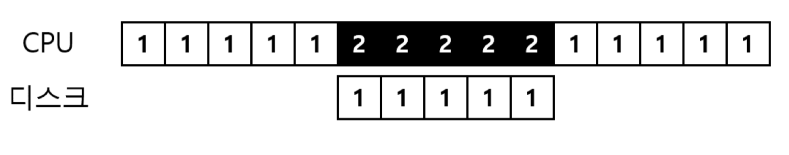
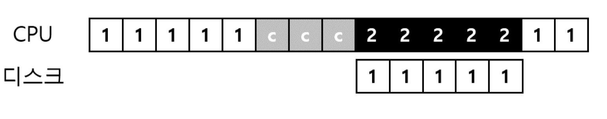
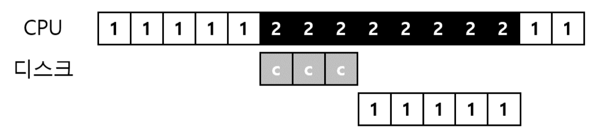
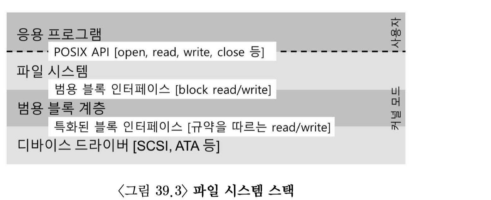

# 39.1 시스템 구조



CPU와 메인 메모리가 **메모리 버스**로 연결되어 있다.

또한 현대의 시스템에서는 **PCI(파생 버스)**를 사용하고, 그래픽이나 다른 고성능 I/O 장치가 여기에 연결될 수 있다. 또한 제일 밑에 디스크와, 마우스 같은 느린 장치들이 연결되는 **주변장치용 버스(I/O 버스)**가 있다.

이러한 하나의 버스는 주소 버스, 제어 버스, 명령어 버스로 구성되어 있다.

이렇게 여러가지 버스 종류로 구성되는 이유는 **버스는 한 번에 하나의 데이터만 전송 가능하기 때문**이다.

만약 하나의 버스로 CPU, 메모리, 주변 장치(I/O 장치)를 연결하면 주변 장치 ↔ 메모리 전송에도 같은 버스가 사용되기 때문에 해당 버스 사용동안 CPU ↔ 메모리는 데이터 전송이 불가능하다.

이런 문제점을 해결하기위해 **여러 버스를 계층적**으로 둔다.

계층적으로 둔다는 의미는 고속 통신용, 중속/저속 장치용으로 버스를 구분한다는 뜻이다.

이를 통해 동시에 다양한 장치 간 통신이 가능하다. → 성능 향상

또한 하드웨어로부터 많은 인터럽트를 제어하기 위해서 **프로그래머블 인터럽트 컨트롤러(PIC)**라는 하드웨어를 사용한다. 

PIC는 여러 장치 컨트롤러에 연결되어 장치 컨트롤러에서 보낸 하드웨어 인터럽트 요청들의 우선순위를 판별한 뒤 CPU에 지금 처리해야 할 하드웨어 인터럽트를 알려준다.

---

# 39.2 표준 장치



**두 개의 중요한 요소 = 하드웨어 인터페이스, 내부 구조**

하드웨어 인터페이스는 시스템의 다른 구성 요소에게 제공한다.

소프트웨어가 인터페이스를 제공하듯이 하드웨어도 인터페이스를 제공하여 시스템 소프트웨어가 동작을 제어할 수 있도록 해야한다.

내부 구조는 시스템에게 제공하는 장치에 대한 추상화를 담당하는 책임을 갖고 있다. 

단순한 장치는 하나 또는 몇 개의 하드웨어 칩을 사용하여 기능을 구현하고, 더 복잡한 장치는 CPU, 범용 메모리, 장치에 특화된 칩들을 사용하여 목적에 맞는 동작을 한다.

최신 RAID 컨트롤러는 수십만 줄에 달하는 펌웨어(firmware) 소프트웨어가 하드웨어 내부의 동작을 정의한다.

## **요약**

- **하드웨어 인터페이스는 시스템이 장치를 사용할 수 있게 해주는 표준화된 접근 경로**(물리적, 논리적 인터페이스)이다.
- **내부 구조는 장치의 실제 동작과 기능 구현, 그리고 이를 추상화해 시스템에 제공하는 역할**을 담당한다.
- 복잡한 장치는 펌웨어 등 소프트웨어적 요소가 하드웨어 내부에서 중요한 비중을 차지하며, 인터페이스와 내부 구조의 역할이 명확히 분리되어 있다.

---

# 39.3 표준 방식 

그림 39.2의 장치 인터페이스는 세 개의 레지스터로 구성되어 있다.

**상태(status)레지스터**는 장치의 현재 상태를 읽을 수 있고, **명령(command)레지스터**는 장치가 특정 동작을 수행하도록 요청할 때, **데이터(data)레지스터**는 장치에 데이터를 보내거나 받거나 할 때 사용한다. 

운영체제는 이 레지스터들을 read/write 하면서 장치의 동작을 제어한다.

운영체제 ↔ 장치 사이의 상호 동작의 과정을 알아보자.



방식은 네 단계로 이루어져 있다.

먼저 **반복적으로(폴링, polling)** 장치의 상태 레지스터를 읽어서 명령의 수신 가능 여부를 확인한다.

두 번째는 데이터 레지스터에 어떤 데이터를 전달한다, 만약 장치가 디스크였다면 디스크 블럭에 해당하는 데이터를 전달할 것이고 여러 번의 쓰기를 수행할 것이다.

데이터 전송에 메인 CPU가 관여하는 경우를 **programmed I/O**라고 부른다.

세 번째로 운영체제가 명령 레지스터에 명령어를 기록한다, 이 레지스터에 명령어가 기록되면 데이터는 이미 준비되었다고 판단하고 명령어를 처리한다.

마지막으로 운영체제는 장치가 처리를 완료했는지를 확인하는 폴링 반복문을 돌면서 기다린다.

이 방식은 간단하고 제대로 동작하지만, 매우 비효율적이다. 이 방식의 첫 번째 문제점은 비효율적인 폴링을 사용하고 있는 점이다. 다른 프로세스에게 CPU를 양도하지 않고, 장치가 동작으로 완료하는 동안 계속 루프를 돌면서 장치상태를 체크하고 있다. 이를 폴링이라고 부른다. 

I/O 장치는 매우 느리다. 그리고 대기하는 중에 특별히 따로 하는 일이 있는 것도 아니다. 

---

# 39.4 인터럽트를 이용한 CPU 오버헤드 개선

운영체제가 장치(디바이스)를 폴링하는 대신 입출력 작업을 요청한 프로세스를 블로킹 시키고 CPU를 다른 프로세스에게 양도한다. 장치가 작업을 끝마치고 나면 하드웨어 인터럽트를 발생시키고 CPU는 운영체제가 미리 정의 해놓은 **인터럽트 서비스 루틴(interrupt service routine(ISR)), 인터럽트 핸들러(interrupt handler)**를 실행한다. 핸들러는 I/O 대기 중인 프로세스를 대기 큐애서 깨우거나, 깨어난 프로세스가 작업을 계속할 수 있도록 한다.



해당 그림은 폴링 방식이다. CPU에서 프로세스1이 일정 시간 동안 실행되다가 디스크를 읽기 위해 I/O 요청을 발생시킨다. 인터럽트가 없으니 시스템은 I/O가 완료될 때까지 반복적으로 장치의 상태를 폴링(p)한다.

디스크 요청의 처리를 완료하면 다시 프로세스1이 동작할 수 있다.



해당 그림은 인터럽트 방식이다. 프로세스1의 디스크 읽기 요청이 디스크에서 처리되는 동안에 운영체제는 프로세스2를 CPU에서 실행시킨다. 디스크 요청이 완료되어 인터럽트가 발생하면 운영체제가 프로세스1을 꺠워 다시 실행시킨다. **인터럽트를 활용하여 CPU 연산과 I/O를 중첩시켜 동작하도록 하였다.** 

하지만 인터럽트가 항상 최적의 해법은 아니란 것에 유의해야 한다. 

예를 들어 대부분의 작업이 한 번의 폴링만으로 끝날 정도로 빠른 장치라고 하면, 이 경우에 인터럽트를 사용하면 시스템이 느려지게 된다. 이는 스핀락 VS 뮤텍스 비교와 똑같은 원리이다.

**컨텍스트 스위칭 비용은 매우 비싼 작업이기 때문에 매우 빠른 장치라면 폴링이 최선이고 느리다면 인터럽트를 사용하여 중첩시키는 것이 최선이다.**

만약 장치의 속도를 모른다거나 빠를 때도 있고 느릴 때도 있는 장치라고 한다면, 짧은 시간 동안만 폴링을 하다가 처리가 완료되지 않으면 인터럽터를 사용하는 하이브리드 방식을 채용하는 것이 최선일 것이다.

이와 같은 두 단계 접근법으로 양쪽의 장점만 취할 수 있다. 

인터럽트를 사용하지 않는 다른 이유를 네트워크 환경에서 찾아볼 수 있다.

인터럽트를 사용하면 대량으로 도착하는 패킷이 있을 때에 각 패킷마다 인터럽트가 발생된다.

이 경우 인터럽트만 처리하다가 운영체제가 사용자 프로세스의 요청을 처리할 수 없도록 만드는 무한반복(livelock)에 빠질 가능성이 있다.

**슬래시닷(Slashdot) 현상**

- **슬래시닷 현상**이란, 유명 웹사이트에 특정 사이트가 소개되어 갑자기 대량의 트래픽이 몰려 해당 사이트가 일시적으로 마비되거나 느려지는 현상을 말한다.
- 이 현상은 갑작스러운 사용자 폭주로 인해 서버가 정상적으로 요청을 처리하지 못하고, 네트워크 패킷이 대량으로 유입되면서 시스템 자원이 고갈되는 상황을 의미한다.

예를 들어 **슬레시닷(slashdot)현상**으로 인해 일시적으로 웹 서버에 사용자가 몰리는 현상이 발생했다고 가정하자. 이 경우, 폴링을 사용하면 시스템의 상황을 보다 효율적으로 제어할 수 있다. 웹 서버가 패킷 도착을 주기적으로 검사하면서, 사용자 요청들도 처리할 수 있기 때문이다.

또 다른 인터럽트 기반의 최적화 기법은 **병합(coalescing)**이다. 이 환경에서는 CPU에 인터럽트를 전달하기 전에 잠시 기다렸다가 인터럽트를 발생시킨다. 기다리는 동안에 다른 요청들도 끝나게 되기 때문에 여러 번 인터럽트를 발생시키는 대신 인터럽트를 한번만 CPU에 전달하게 된다.

물론, 너무 오래 기다리게 되면 요청에 대한 응답 지연 시간이 늘어나기 때문에 시스템의 절충 시간을 찾아야한다.

### **현대 OS의 네트워크 인터럽트 처리: 인터럽트 병합(Coalescing)과 PIC**

- **인터럽트 병합(Coalescing)**
네트워크 카드 등에서는 인터럽트가 발생할 때마다 바로 CPU에 전달하지 않고, 짧은 시간 동안 여러 패킷이 도착할 때까지 기다렸다가 한 번에 인터럽트를 발생시킨다.

이렇게 하면 인터럽트 빈도를 줄이고, CPU가 인터럽트 처리에만 매달리는 것을 방지할 수 있다.

단, 너무 오래 기다리면 응답 지연(latency)이 늘어나므로, 시스템 상황에 맞는 적절한 대기 시간이 필요하다.
- **PIC(Programmable Interrupt Controller, 프로그래머블 인터럽트 컨트롤러)**
PIC는 여러 장치에서 발생하는 인터럽트를 관리하고, 우선순위에 따라 CPU로 전달하는 하드웨어이다. 

PIC는 동시에 여러 인터럽트가 발생하면 우선순위에 따라 적절히 처리하고, 인터럽트 병합(coalescing) 기능을 지원하는 경우 여러 인터럽트를 하나로 묶어 CPU에 전달할 수도 있다.

현대 OS에서는 I/O를 대부분 인터럽트 기반으로 처리하고 인터럽트 병합으로 버퍼링, PIC를 통해 다중 인터럽트를 처리한다.

---

# 39.5 DMA를 이용한 효율적인 데이터 이동

앞서 설명한 방식에서 고려해야 하는 부분이 하나 더 있다.

많은 양의 데이터를 디스크로 전달하기 위해 **programmed I/O(CPU가 직접 I/O 장치에 데이터 송수신)**를 사용하면 CPU는 또 다시 단순 작업처리에 소모된다. 즉, 다른 프로세스를 처리하기 위해 사용될 수 있는 많은 시간을 허비하게 된다.



그림을 보면 프로세스1이 실행 도중에 어떤 데이터를 디스크에 처리하려고 한다. 그래서 I/O를 발생시켜서 명시적으로 데이터를 메모리에서 디스크로 한 워드씩 복사(그림 c로 표기)한다.

복사가 완료되면 디스크에서 I/O 처리를 시작하고, 마침내 CPU를 다른 작업 처리에 사용할 수 있게 된다.

이 문제에 대한 해법을 **직접 메모리 접근 방식(Direct Memory Access, DMA)**이라고 부른다.

DMA 엔진은 시스템 내에 있는 특수한 장치로서 CPU 간섭없이 메모리와 장치 간에 전송을 담당한다.

DMA의 동작 방식은 다음과 같다. 데이터를 장치로 전송한다고 했을 때 운영체제는 DMA 엔진에 메모리 상의 데이터 위치와 전송할 데이터 크기, 대상 장치를 프로그램 한다. 그 시점에 전송하기 위해 할 일은 끝나기 때문에 운영체제는 다른 일을 진행할 수 있다. DMA 동작이 끝나면 DMA 컨트롤러가 인터럽트를 발생시켜 운영체제가 전송이 완료되었음을 알 수 있도록 한다. 



그림을 보면 데이터 복사는 DMA 컨트롤러가 처리하고 있는 것을 알 수 있다.

CPU는 그 시간 동안 자유롭기 때문에 다른 프로세스를 실행할 수 있다. 

```

CPU <----------> 메모리 <------> |
 |														 |
 |                             | 
 -----------------------> DMA 컨트롤러 <--------> 장치 컨트롤러 <---> 디스크 
 |                             |                장치 컨트롤러 <---> 마우스 
 PIC <-------------------------|
 
 
(인터럽트 신호)
DMA컨트롤러/장치컨트롤러 ─────► PIC ─────► CPU
```

---

# 39.6 디바이스와 상호작용하는 방법

**I/O 요청의 서비스에서 장치와 운영체제가 실제로 어떻게 정보를 서로 교환하는지 알아보자.**

첫 번째는 **I/O 명령을 명시적으로 사용**하는 것이다. 이 명령어들은 운영체제가 특정 장치 레지스터에 데이터를 전송할 수 있는 방법을 제공하며, 앞서 언급한 방식을 구현할 수 있게 한다.

데이터를 장치에 보내야 하는 경우에는 호출자가 데이터가 저장된 레지스터를 지정하고 장치를 지칭하는 포트를 지정한다. 이 명령어들은 대부분 **특권(privileged) 명령어**들이다. 운영체제가 장치를 제어하는 역할을 하며, 운영체제만이 장치들과 직접 통신할 수 있다. 만약 어떤 프로그램이 디스크를 읽고 쓸 수 있다면, 어떤 사용자 프로그램이 그 허점을 이용하여 기계의 제어권을 갖게 된다면 많은 문제점이 발생하게 될 것이다.

두 번째 방법은 **memory mapped I/O**를 사용하는 것이다. 이 접근법에서 하드웨어는 장치의 레지스터들이 마치 메모리 상에 존재하는 것처럼 만든다. 특정 레지스터를 접근하기 위해서 운영체제는 해당 주소에 load/store를 하면된다. 하드웨어는 load/store 명령어가 주 메모리를 향하는 대신에 장치로 연결되도록 한다.

두 방법 모두 대단히 큰 장점이 있는 것은 아니다. 

메모리 맵 방식의 경우 새로운 명령어가 필요 없기 때문에 좋기는 하지만, 두 방법 모두 현재도 쓰이고 있다.

---

# 39.7 운영체제에 연결하기: 디바이스 드라이버

마지막 문제는 서로 다른 인터페이스를 갖는 장치들과 운영체제를 연결시키는 방법을 찾는 것이다.

저장 장치를 예로 들어보자. SCSI 디스크, IDE 디스크, USB 같은 이동식 드라이브 등 여러 기기 위에서 동작하는 파일 시스템을 만들고자 한다. 하지만 **파일 시스템이 각 장치들의 구체적인 입출력 명령어 형식에 종속되지 않도록** 만들고 싶다.

**추상화(abstraction)**를 통하여 이 문제를 해결할 수 있다.

운영체제 최하위 계층의 일부 소프트웨어는 장치의 동작 방식을 반드시 알고 있어야 한다.

이 소프트웨어를 우리는 **디바이스 드라이버(device driver)**라고 부르며 장치와의 상세한 상호작용은 그 안에 캡슐화되어 있다.

**헷갈리는 개념: 디바이스 컨트롤러 VS 다바이스 드라이버** 

장치 컨트롤러는 하드웨어, 디바이스 드라이버는 소프트웨어로, 둘은 CPU와 I/O 장치 사이에서 서로를 이어주는 다리 역할을 한다.

Linux 파일 시스템 소프트웨어 계층을 살펴보면서 이 추상화가 어떻게 운영체제의 디자인과 구현을 지원하는지 알아보자. 



그림 39.3은 대략적인 Linux 소프트웨어 구조에 대한 그림이다. 그림을 보면 파일 시스템(그 위의 응용 프로그램 포함)은 어떤 디스크 종류를 사용하는지 전혀 알지 못한다. 파일 시스템은 **범용 블럭 계층(generic block layer)**

에 블럭 read/write 요청할 뿐이다. 범용 블럭 계층은 적절한 디바이스 드라이버로 받은 요청을 전달하며, 디바이스 드라이버는 특정 요청을 장치에 내리기 위해 필요한 일들을 처리한다. 

즉, 장치에 대한 구체적인 동작이 운영체제로부터 캡슐화 되어있다.

**이러한 캡슐화는 단점도 있다는 것에 유의해야 한다.**

예를 들어 특수 기능을 많이 갖고 있는 어떤 장치가 있다고 했을 때, 커널이 범용적인 인터페이스만을 제공할 수 밖에 없다면 그 많은 특수 기능을 사용할 수 없게 된다.

예를 들어 Linux의 SCSI 장치들은 에러 보고 체계가 아주 잘 되어있는데, 다른 블럭 장치(ATA/IDE)들은 단순한 에러 처리만을 지원하기 때문에 상위의 소프트웨어 계층에서 받을 수 있는 정보로 범용 EIO(generic IO error)에러 코드 이상은 받을 수 없다. 즉, SCSI가 제공하는 추가 정보는 파일 시스템에 전달하지 못하고 사라진다.

어떤 장치를 시스템에 연결하든 디바이스 드라이버가 필요하기 때문에 디바이스 드라이버 코드가 커널 코드의 대부분을 차지하게 되었다. 

---

# 39.10 요약 

운영체제가 장치들과 어떻게 상호작용하는지 이해했을 것이다.

두 가지 기술인 **인터럽트(VS 폴링)**와 **DMA(CPU → DMA → 장치 컨트롤러)**는 장치의 효율을 높이기 위해 도입되었으며 **명시적 I/O 명령(직접 접근)**과 **메모리 맵 I/O(CPU는 마치 메모리 접근하듯이, 하드웨어에서 변환)**를 통해 장치(컨트롤러)의 레지스터에 접근할 수 있다는 것을 알아보았다. 마지막으로 디바이스 드라이버 개념을 소개하면서 하위 계층의 세부적인 내용을 운영체제가 캡술화 할 수 있으며, 운영체제의 나머지를 장치 중립적으로 구현할 수 있다는 것을 알았다.

추가적으로 현재 OS는 CPU에게 오는 다중 인터럽트(from DMA, 장치 컨트롤러)를 PIC를 통해서 제어한다.

물론 각각의 장치 컨트롤러가 갖고있는 버퍼와 인터럽트 병합 기술로 버퍼링해서 PIC에게 전달한다.

---

