# 33장 개요

지금까지 락의 개념을 학습하면서 하드웨어와 운영체제의 지원을 통해 제대로 동작하는 락을 만드는 법을 학습했다. 하지만 “락”만으로는 병행 프로그램을 제대로 작성할 수 없다. 

쓰레드가 계속 진행하기 전에 어떤 “조건”이 참인지를 검사하는 경우가 많다.

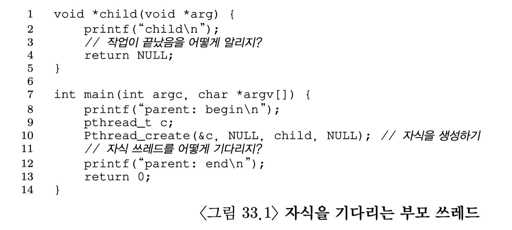

예를 들어 부모 쓰레드가 작업을 시작하기 전에 자식 쓰레드가 작업을 끝냈는지를 검사(join)하기를 원할 수 있다.

그런 대기문은 어떻게 구현해야 할까?

우리는 다음과 같은 (결정적)출력문을 원한다.


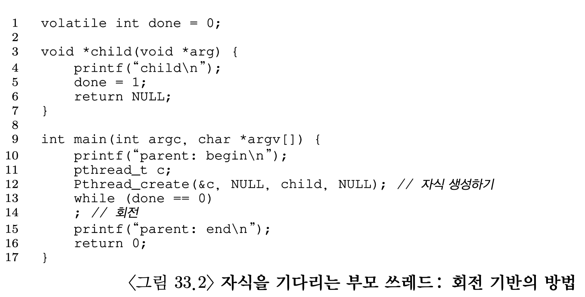

이를 위해 그림 33.2에서 처럼 공유 변수(done)을 사용할 수 있다.

이 방법은 제대로 동작하지만 부모 쓰레드가 회전을 하면서 CPU 시간을 낭비하기 떄문에 비효율적이다.

이 방법 대신에 부모 쓰레드가 특정 조건이 참이 될 때까지 잠자면서 기다리는 방법이 더 좋다.

---

# 33.1 정의와 루틴들

### 컨디션 변수?

특정 조건을 기다리기 위해 **컨디션 변수(conditional variable)**를 활용할 수 있다.

컨디션 변수는 큐 자료 구조로서, 어떤 실행의 조건(상태)가 원하는 것과 다를 때 기다리며 쓰레드가 대기할 수 있는 큐이다.

특정 쓰레드가 상태를 변경시켰을 때, 대기 중이던 쓰레드(하나 이상의 쓰레드)를 깨우고(조건에 따라 시그널을 보내어), 계속 진행할 수 있도록 한다.

컨디션 변수에는 **wait()**과 **signal()**이라는 두 개의 연산이 있다.

wait()은 쓰레드가 스스로를 잠재우기 위해 호출

signal()은 쓰레드가 무언가를 변경했기 때문에 조건이 참이 되기를 기다리며 잠자고 있던 쓰레드를 깨울 때 호출한다.

**POSIX 라이브러리** 

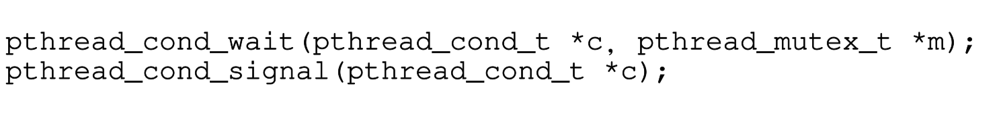

wait()을 호출할 때 mutex는 잠겨있다고 가정한다(락을 획득 상태).

wait()의 역할은 락을 해제하고 호출한 쓰레드를 재우는 것이다.

획득한 락을 해제하지 않고 sleep 상태로 바뀌면 다른 쓰레드들이 락을 획득하지 못하여 데드락이 일어나고, 당연히 sleep 상태로 바뀐 쓰레드도 다른 쓰레드가 signal()을 통해 깨우지 않으니 영원히 sleep 상태가 된다.  

어떤 다른 쓰레드가 시그널을 보내어 쓰레드가 깨어나면, wait()에서 리턴하기 전에 락을 재획득해야 한다.

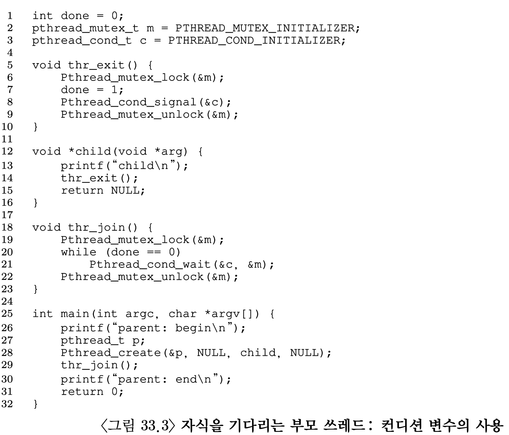

그림 33.3은 아래와 같은 결정적 출력문을 출력하기 위해 작성한 코드이다.


해당 코드는 2가지 케이스가 존재한다.

```
**1번 케이스**

부모 쓰레드가 자식 쓰레드를 생성하고
thr_join()을 호출하고 자식 쓰레드가 기다리는 경우이다.

부모 쓰레드가 락을 획득하고 자식이 끝났는지 검사(done == 1)한 후
자식이 끝나지 않았으므로 wait()를 호출하여 스스로를 재운다 + 락을 해제한다. 

자식 쓰레드가 추후에 실행되어 "child" 메시지를 출력하고 thr_exit()를 호출
계속해서 자식 쓰레드는 락을 획득하고 done = 1로 변경하고
부모 쓰레드에게 시그널을 보내어 깨어나도록 한다.

마지막으로 부모 쓰레드는 호출했던 wait()에서 락을 획득한 채로 리턴하여
부모 쓰레드가 락을 해제하고 parent: end 메시지를 출력한다. 

2**번 케이스**
자식 쓰레드가 생성되면서 즉시 실행되고 done 변수 = 1로 변경(중복 과정 생략)하고 자고 있는
쓰레드를 깨우기위해 시그널을 보낸다.
하지만 자고있는 쓰레드가 없기 때문에 단순 리턴한다.

그 후에 부모 쓰레드가 thr_join()을 호출하고 done == 1 -> true 대기 없이 바로 리턴한다.
```

**부모 쓰레드가 왜 조건을 검사할 때 if가 아니라 while문을 사용할까?** **(뒤에서 설명)**

### thr_exit(), thr_join() 코드 내용의 중요성 이해하기

**done 상태 변수가 없다면? (done 상태 변수 필요성)**

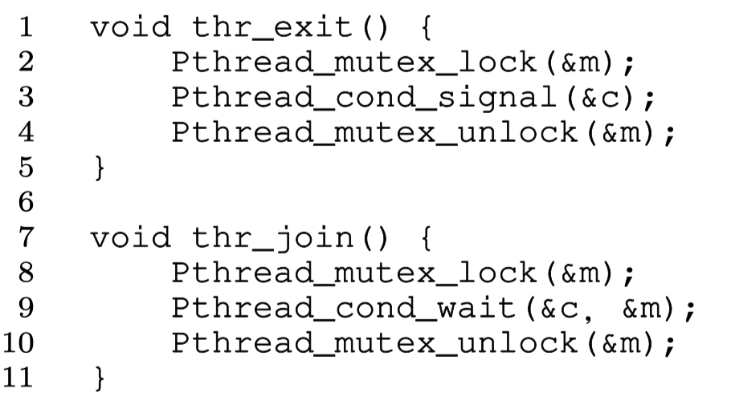

자식 쓰레드가 먼저 thr_exit()를 실행하는 경우 먼지 시그널을 보내고 부모 쓰레드는 thr_join() → wait()에서 멈춰 있는다.

**signal() or wait() 락 없이 한다면? (락 필요성)**

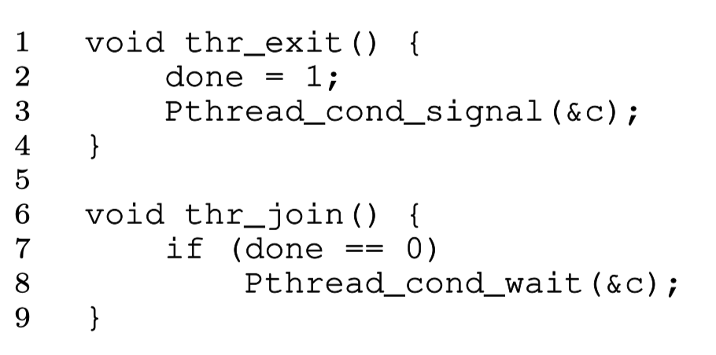

경쟁 조건이 발생한다.

부모 쓰레드가 thr_join()을 실행하고 done == 0 조건까지 확인한 후에 wait()를 호출 직전에

자식 쓰레드로 컨텍스트 스위칭되고 시그널을 보낸다. 

그럼 다시 부모 쓰레드가 실행되면 wait()를 호출하고 잠자게 된다.

마찬가지로 부모 쓰레드는 wait()에서 멈춰 있는다.

### 핵심 정리 

**before wait() or before signal() 락 획득은 경쟁 조건을 피하기 위해 필수고** 

**조건에 따라 쓰레드 실행 순서를 동기화하려면 컨디션 변수가 필요하다.**

---

# 33.2 생산자 / 소비자 (유한 버퍼) 문제

이번에 살펴볼 동기화 문제는 **다익스트라가 제시한 생산자/소비자(producer/consumer) 문제**이다. 

**유한 버퍼(bounded 버퍼)** 문제로도 알려져 있다. 이 문제는 세마포어를 발명하게 된 이유이다.

### 생산자 소비자 문제 이해 

생산자는 데이터를 만들어 버퍼에 넣고, 소비자는 버퍼에 데이터를 꺼내어 사용한다.

**ex) 멀티 쓰레드 웹 서버**

생산자 쓰레드는 HTTP 요청 작업 큐에 넣고, 소비자 쓰레드는 이 큐에서 요청을 꺼내어 처리한다.

**유한 버퍼는 공유 자원이다. 경쟁 조건 발생을 방지하기 위해 동기화가 필요하다.**

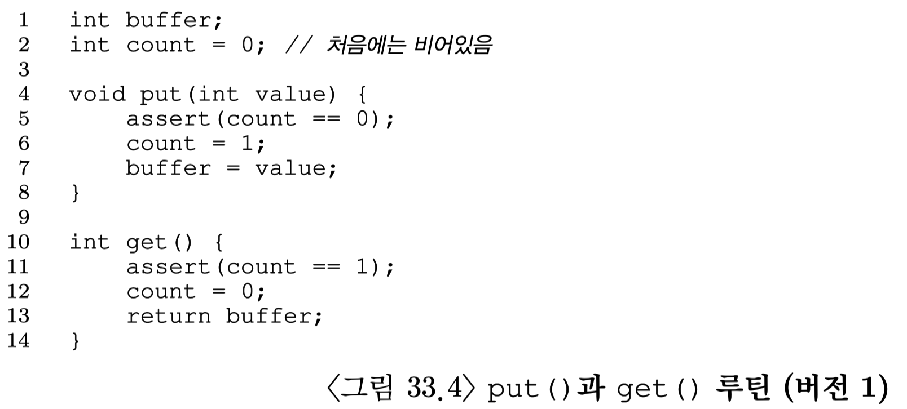

그림 33.4의 버퍼는 숫자1개만 저장할 수 있다.

단순하게 put()은 버퍼가 비어 있다면(count == 0) 데이터를 넣고, get()은 버퍼에 데이터가 존재하면(count == 1)이면 데이터를 꺼낸다.

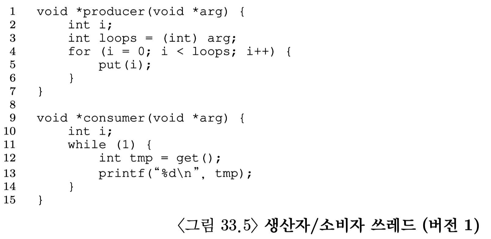

그림 33.5는 생산자 쓰레드와 소비자 쓰레드가 실행할 루틴을 보여준다.

생산자는 loop 횟수 만큼 공유 버퍼에 정수를 넣고, 소비자는 (무한히) 데이터를 공유 버퍼에서 꺼낸다.

당연히 이 코드는 제대로 동작하지 않는다.

**경쟁 조건 예시**

```
buffer = 5, count = 0 시작 
buffer = 5는 이전 소비한 값 즉, invalid value

생산자 쓰레드가 put(3)
count = 1로 변경
이때 컨텍스트 스위칭

소비자 쓰레드는 get()
count = 1 확인하고 
buffer에서 5를 읽고 출력한다.

즉, 3을 소비해야 정상 동작이지만 잘못된 이전의 값 5를 읽는 비결정적 동작을 한다.
-> 임계 영역이 존재하여 경쟁 조건이 발생한다.
```

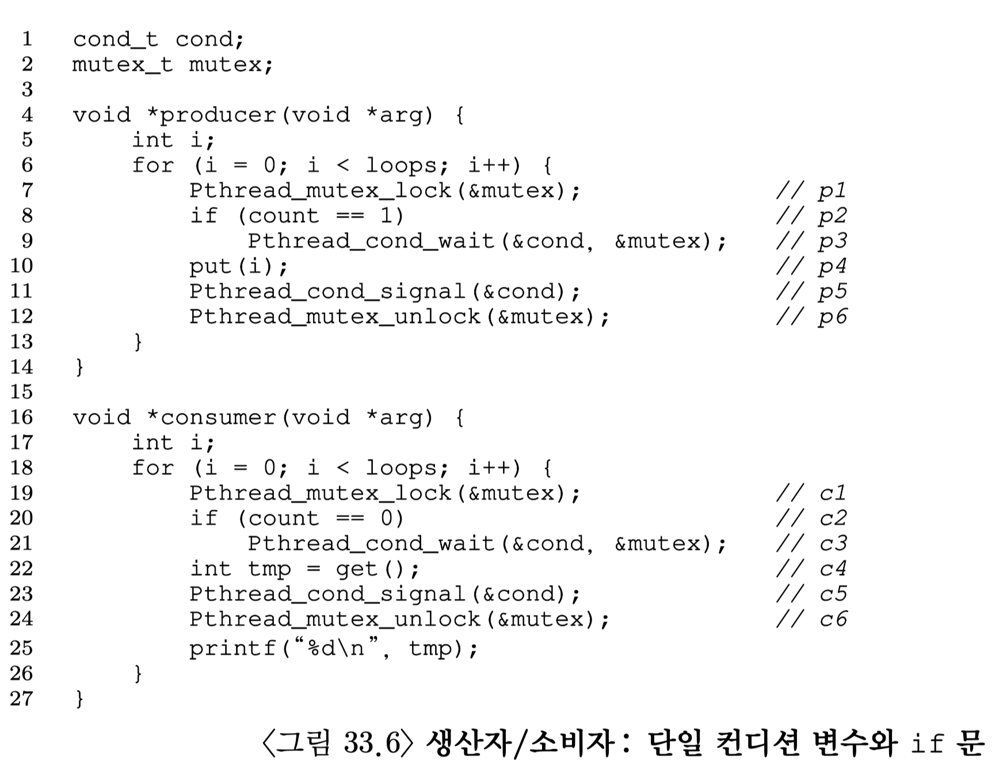

그림 33.6에서는 컨디션 변수(cond)와 mutex 락을 사용한다.

생산자는 버퍼가 빌때까지 기다리고, 소비자는 버퍼가 차기를 기다린다.

생산자 소비자 쓰레드가 각 하나씩인 경우에 그림 33.6의 코드는 동작한다.

하지만 두 개 이상의 쓰레드가 존재한다면 현재 해법에는 문제가 생긴다.

### 그림 33.6 문제점1:  즉시 실행 X

**문제점 설명** 

```
**가정**
생산자 쓰레드 1개 = P1
소비자 쓰레드 2개 = C1, C2 

C1 mutex 락 획득
현재 count = 0 -> wait(cond, mutex) -> waiting queue, mutex 락 해제

P1 mutex 락 획득
현재 count = 0 -> put(item) count = 1 -> siginal(cond) -> 
C1 쓰레드 waiting queue -> ready queue 이동
P1 mutex 락 해제

C2 mutex 락 획득
현재 count = 1 -> get() 소비 count = 0 -> signal(cond) 
C2 mutex 락 해제 

C1 쓰레드 get() wait() 이후 실행은 mutex 락 얻은 상태
하지만 이미 C2 쓰레드가 소비해서 버퍼는 비어있다.
즉, 이미 버퍼는 비어있어서 C1 쓰레드가 버퍼를 읽는 행위를 막았어야 하지만 실행되었다.
```

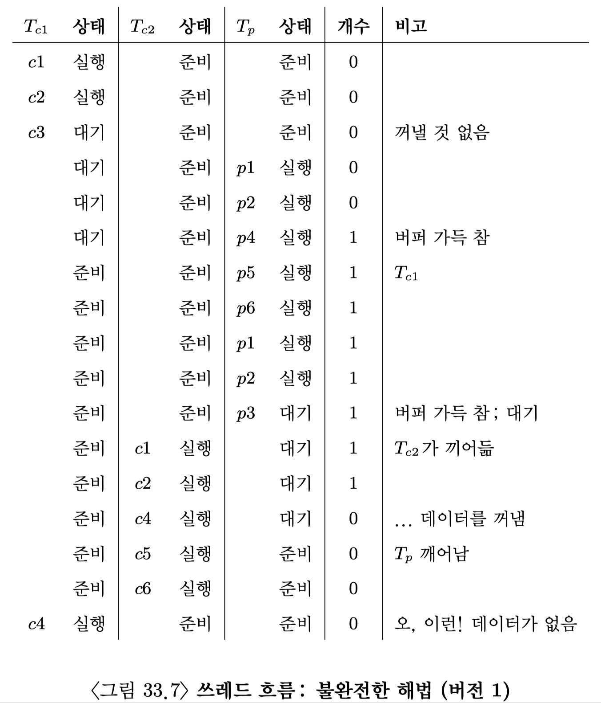

문제의 원인은 소비자1이 깨어나서 실행되기까지 사이에 유한 버퍼의 상태가 변경되었다.

시그널은 단순히 쓰레드를 깨우기만 한다. 상태(버퍼에 값이 추가)가 변경되었음을 알리는 일종의 힌트에 불과하다. **즉, 깨어난 쓰레드가 실제 실행되는 시점에도 그 상태가 유지된다는 보장이 없다.** 

이런 방식의 시그널 즉, 깨어난 이후 쓰레드가 즉시 실행되지 않는 방식을 **Mesa semantic**이라 하고, 대비되는 개념으로 **Hoase semantic**은 시그널 이후 쓰레드의 즉시 실행을 보장하는 방식이다. 

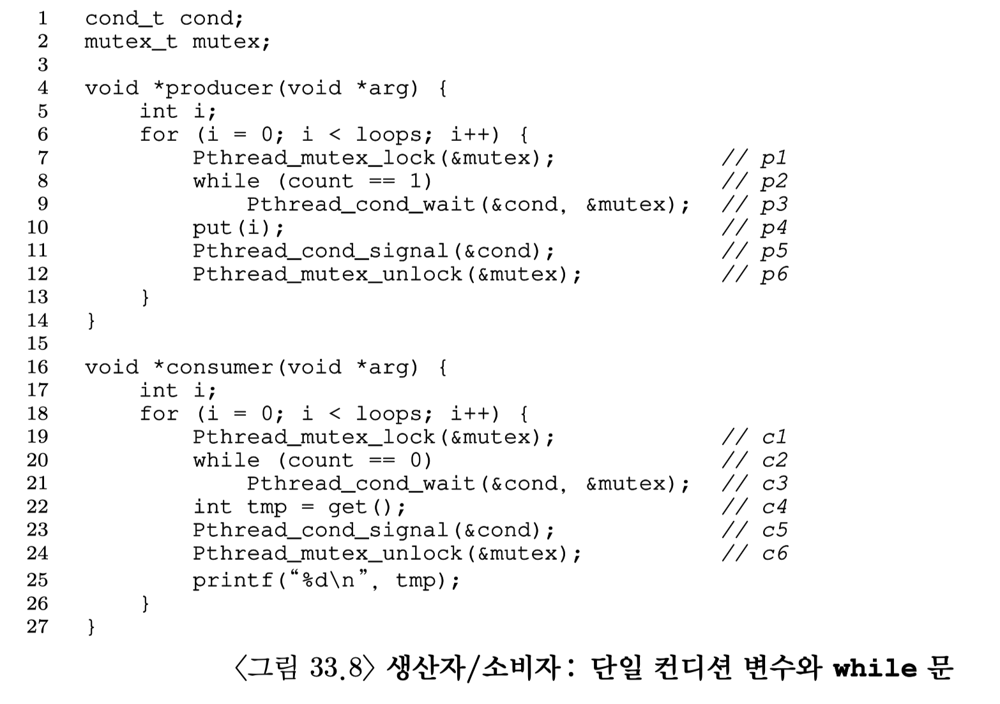

그림 33.8은 조건 검사를 if문 → while문으로 변경했다.

이전 문제인 소비자1이 깨어나서 공유 변수의 상태를 다시 확인 안 하고 유한 버퍼에서 소비하는 문제를

while 문으로 다시 확인하도록 바꿔 해결한 것이다.

당연하지만 생산자도 똑같이 변경하였다.

**Mesa semantic의 컨디션 변수에서 가장 기본적인 법칙은 언제나 while 문을 사용이다**

### 그림 33.6 문제점2: 컨디션 변수 1개

현재는 컨디션 변수가 1개이다. 즉, 생산자 쓰레드가 버퍼가 꽉차서 대기하는 컨디션 변수(큐)와 소비자 쓰레드가 버퍼에 아이템이 없어서 대기하는 컨디션 변수(큐)가 동일하다.

그림 33.8에서는 시그널을 보내는 대상이 소비자 → 생산자, 생산자 → 소비자가 아닌 소비자 → 소비자, 생산자 → 생산자 같은 상황이 발생하는 것이다.

**시그널을 보내는 것은 꼭 필요하지만 대상이 명확해야 한다. 소비자는 생산자만 깨워야하고, 반대로 생산자의 경우도 마찬가지다.** 

아래 그림 33.9에서 컨디션 변수가 1개일 때 발생하는 문제를 보여주고 있다.

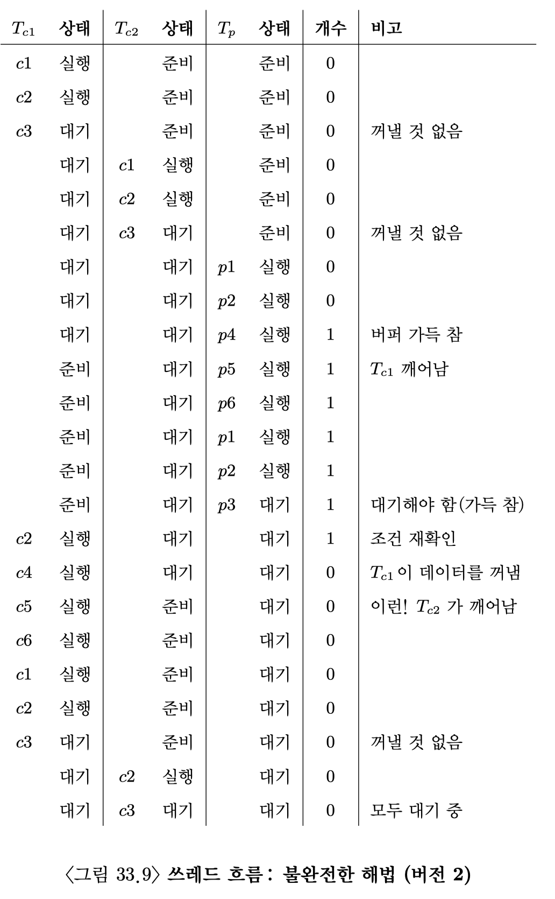

### 단일 버퍼 생산자 / 소비자 해법

그림 33.9의 문제를 해결하는 방법은 간단하다.

두 개의 컨디션 변수를 사용해서 시스템의 상태가 변경되었을 때 깨워야 하는 쓰레드에게만 시그널을 제대로 전달한다.

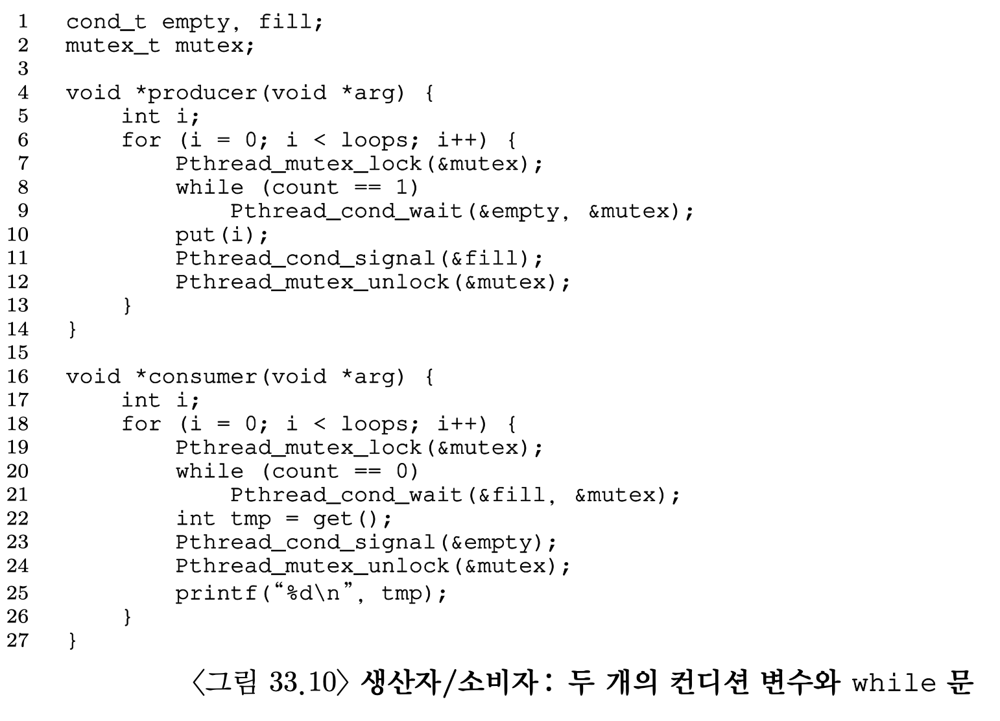

생산자 쓰레드는 empty 컨디션 변수에서 대기하고 fill 컨디션 변수에 대해 시그널을 발생한다.

소비자 쓰레드는 fill 컨디션 변수에서 대기하고 empty 컨디션 변수에 대해 시그널을 발생한다.

### 최종적인 생산자 / 소비자 해법

현재까지 구현한 코드는 버퍼의 크기는 1이다. 이제 버퍼 공간을 추가하여 대기 상태에 들어가기 전에 여러 값들이 생산될 수 있도록 하고, 그리고 마찬가지로 여러 개의 값이 대기 상태 전에 소비될 수 있도록 한다.

이는 생산과 소비가 병행이 될 수 있고, 버퍼가 커져서 쓰레드 간의 문맥 교환이 줄어들기 때문에 더 효율적이다.

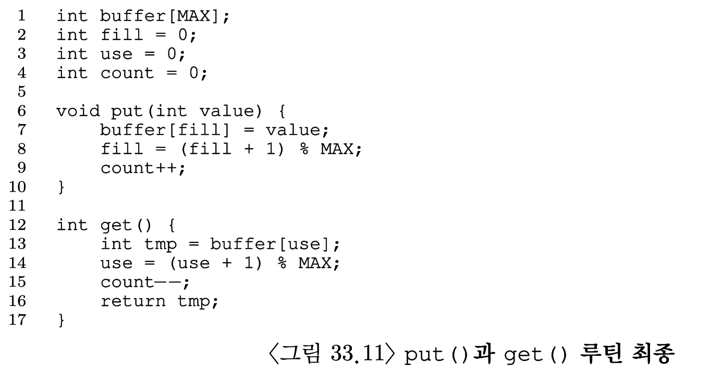

count = 전체 재고

fill = buffer 생산자 index

use = buffer 소비자 index 

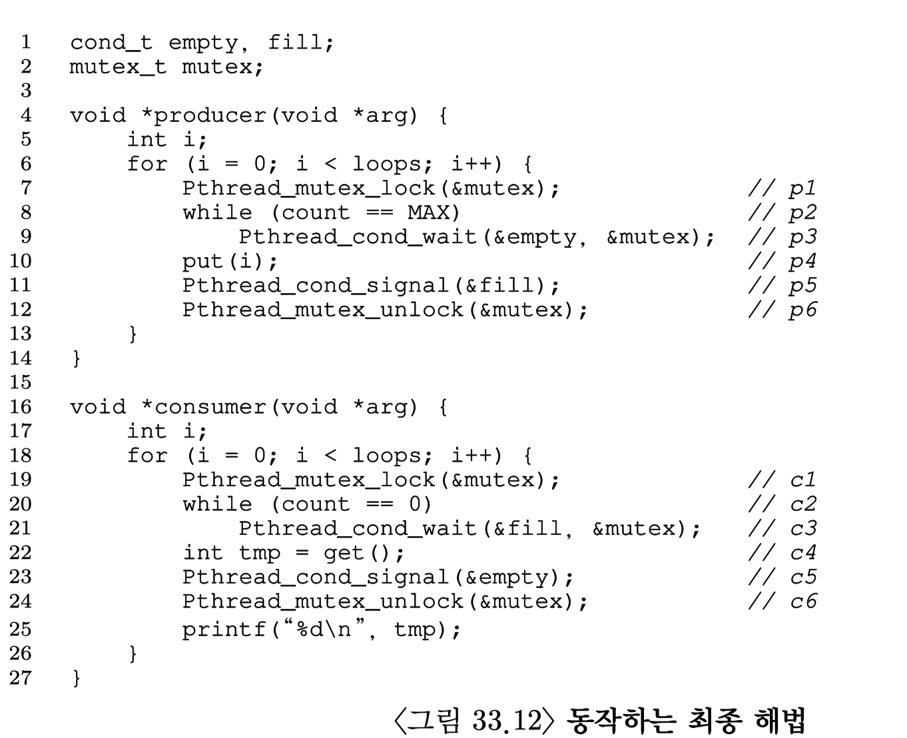

| 단계 | 동작 | fill | use | count | 설명 |
| --- | --- | --- | --- | --- | --- |
| 0 | 초기상태 | 0 | 0 | 0 | 아무것도 없음 |
| 1 | put | 1 | 0 | 1 | buffer[0]에 데이터 저장 |
| 2 | put | 2 | 0 | 2 | buffer[1]에 데이터 저장 |
| 3 | put | 3 | 0 | 3 | buffer[2]에 데이터 저장 |
| 4 | get | 3 | 1 | 2 | buffer[0] 소비됨 |
| 5 | put | 4 | 1 | 3 | buffer[3]에 데이터 저장 |
| 6 | get | 4 | 2 | 2 | buffer[1] 소비됨 |
| 7 | put | 0 | 2 | 3 | buffer[4]에 저장 후 wraparound (`fill = 0`) |
| 8 | put | 1 | 2 | 4 | buffer[0] 재사용 |
| 9 | get | 1 | 3 | 3 | buffer[2] 소비됨 |
| 10 | put | 2 | 3 | 4 | buffer[1] 재사용 |

---

# 33.3 컨디션 변수 사용 시 주의점

그림 33.13은 컨디션 변수 사용 예제이다. 

멀티 쓰레드 기반 메모리 할당 라이브러리 예제

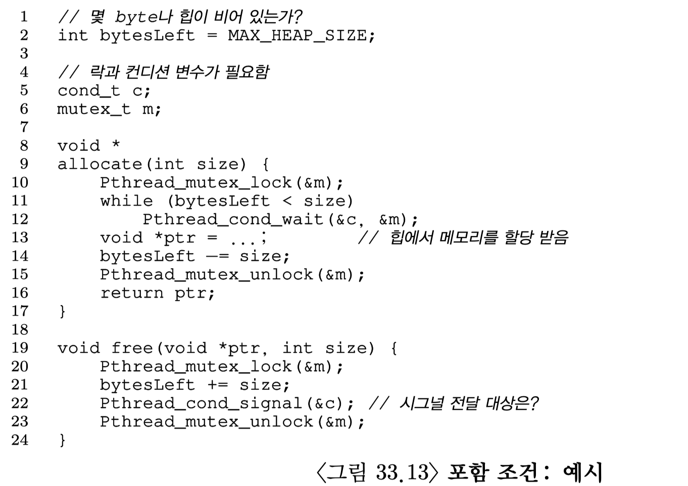

그림 33.13을 보면 메모리 할당 코드(allocate)를 호출하면 공간이 생길 때까지 기다려야할 수 있다.

반대로, 쓰레드가 메모리 반납시 사용 가능한 메모리 공간의 발생을 알리는 시그널을 생성할 수 있다.

그렇다면 어떤 쓰레드가 시그널을 받아야할까?

```
현재 빈 공간 X

T1 allocate(100) -> waiting queue
T2 allocate(10)  -> waiting queue

T3 free(50)      -> size = 50 -> signal to who?
이 호출의 결과로 T2 쓰레드가 깨어나서 공간을 할당받아야 한다. 
T1은 깨어나도 깨어나도 공간이 부족하기 때문에(100 > 50)
하지만 현재 코드는 어떤 쓰레드를 깨워야 할지 모른다.

**Lampson & Redell 누군지 모르겠지만 제시한 방법**  
pthread_cond_signal() 대신 모든 쓰레드를 깨우자
즉, pthread_cond_broadcast()로 사용하면 된다.

단점은 대기 중인 모든 여러 쓰레드가 불필요하게 깨어날 수 있다.
-> 물론 성능에 좋지 않다. 마치 무조건 양보 같이 동작한다. 

깨어난 쓰레드들은 깨어나서 조건을 재검사하고, 즉시 대기 상태로 돌아간다. 

**Lampson & Redell은 이런 경우를 포함 조건(convering condition)이라고 했다.** 
왜냐하면 (보수적으로) 쓰레드가 깨어나야 하는 모든 경우를 다 포함하기 때문이다.
이는 문맥 전환 오버헤드가 크다.


이 방식은 생산자/소비자 문제에서도 사용이 가능하다.
컨디션 변수가 하나일 때 산자/소비자 쓰레드 구분없이 전부 깨우고 
조건에 맞는 쓰레드가 동작하게 하면된다.
하지만 broadcast() 보다 컨디션 변수를 2개 사용하는 방식이 훨씬 효율적이다.

하지만 이런 메모리 할당 문제는 브로드캐스트를 적용하는 것이 가장 자명한 해법이다.
```

| 조건 | 적절한 방법 |
| --- | --- |
| 누가 깨어나야 할지 **알 수 있다** | `signal()` + 여러 `Condition` 변수 → 생산자/소비자 문제 |
| 누가 깨어나야 할지 **모른다(다양한 자원 요청 크기)** | `broadcast()` + covering condition → 메모리 할당 문제 |

---

# 자바 모니터 락

**자바는 모든 객체(인스턴스)에 모니터 락을 하나씩 가진다.**

**이 모니터 락은 1개의 뮤텍스 락과 컨디션 변수를 가진다.**

**메모리 할당 문제 자바 모니터 락으로 해결**

```java
public class MemoryAllocator {
    private final int totalSize;
    private int used = 0;

    public MemoryAllocator(int totalSize) {
        this.totalSize = totalSize;
    }

    public synchronized void allocate(int size) throws InterruptedException {
        while (used + size > totalSize) {
            System.out.println(Thread.currentThread().getName() + " waiting to allocate " + size);
            wait();
        }
        used += size;
        System.out.println(Thread.currentThread().getName() + " allocated " + size + ", used: " + used);
    }

    public synchronized void free(int size) {
        used -= size;
        System.out.println(Thread.currentThread().getName() + " freed " + size + ", used: " + used);
        notifyAll(); // Lampson & Redell 방식: 모두 깨워서 조건 재검사
    }
}

```

생산자/소비자 문제 같은 경우 모니터 락으로 해결이 불가능하다.

물론 norifyAll()로 가능하지만 성능이 떨어진다.

**ReentrantLock + 여러 개의 Condition 사용**

```java
public class BoundedBuffer<T> {
    private final T[] buffer;
    private int putPtr = 0, takePtr = 0, count = 0;

    private final Lock lock = new ReentrantLock();
    private final Condition notFull = lock.newCondition();
    private final Condition notEmpty = lock.newCondition();

    public BoundedBuffer(int capacity) {
        this.buffer = (T[]) new Object[capacity];
    }

    public void put(T item) throws InterruptedException {
        lock.lock();
        try {
            while (count == buffer.length) {
                notFull.await(); // 버퍼가 꽉 찼으면 생산자 대기
            }
            buffer[putPtr] = item;
            putPtr = (putPtr + 1) % buffer.length;
            count++;
            notEmpty.signal(); // 소비자 깨우기
        } finally {
            lock.unlock();
        }
    }

    public T take() throws InterruptedException {
        lock.lock();
        try {
            while (count == 0) {
                notEmpty.await(); // 버퍼가 비었으면 소비자 대기
            }
            T item = buffer[takePtr];
            takePtr = (takePtr + 1) % buffer.length;
            count--;
            notFull.signal(); // 생산자 깨우기
            return item;
        } finally {
            lock.unlock();
        }
    }
}

```

```
while (count == buffer.length) {
    notFull.await(); // 버퍼가 꽉 찼으면 생산자 대기
}

while 문으로 동작하는 이유는 쓰레드가 깨어난 시점에 바로 실행이 되는건 아니기 때문이다.
즉, 상태에 변화가 생겨서 꺠어났지만 꺠어난 쓰레드가 실행하는 시점에도 그 상태가 유지된건 보장하지 못한다.
```

**syncronized(모니터 락) vs ReentrantLock** 

| 기능 | `synchronized` | `ReentrantLock` |
| --- | --- | --- |
| 재진입 가능 (Reentrant) | ✅ | ✅ |
| 락 상태 확인 | ❌ | ✅ (`isLocked()`) |
| 타임아웃 설정 | ❌ | ✅ (`tryLock(timeout)`) |
| 락 중단 가능 (`interrupt`) | ❌ | ✅ |
| 여러 컨디션 변수 사용 가능 | ❌ | ✅ (`newCondition()`) |
| 명시적 락 해제 필요 | ❌ (자동 해제) | ✅ (`unlock()`) |

---

