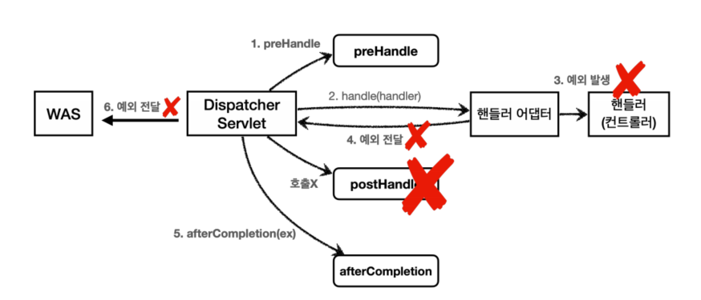
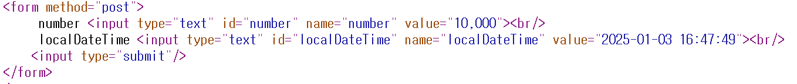
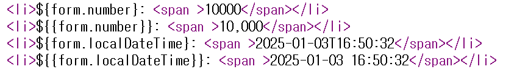
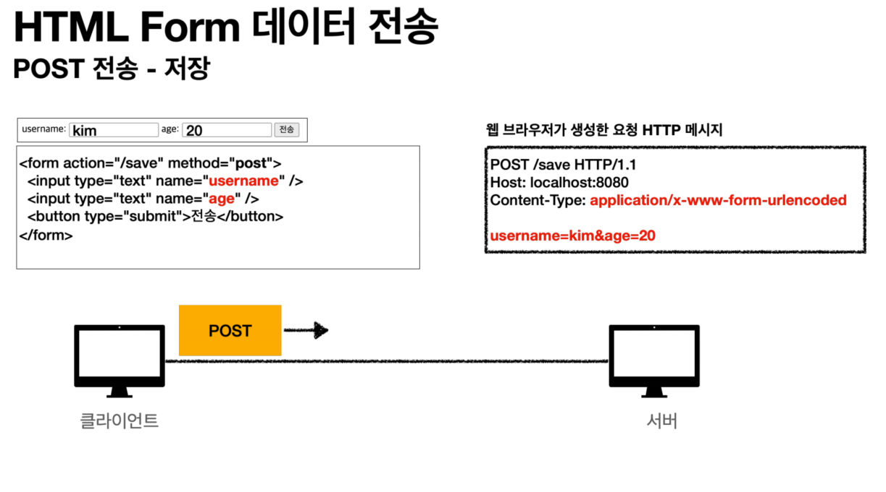

# ***기본 표현식***

| **분류** | **표현식/연산자** | **설명** |
| --- | --- | --- |
| **간단한 표현** | `${...}` | 변수 표현식 |
|  | `*{...}` | 선택 변수 표현식 |
|  | `#{...}` | 메시지 표현식 |
|  | `@{...}` | 링크 URL 표현식 |
|  | `~{...}` | 조각 표현식 |
| **리터럴** | `'one text'` | 텍스트 리터럴 |
|  | `0, 34, 3.0, 12.3` | 숫자 리터럴 |
|  | `true, false` | 불린 리터럴 |
|  | `null` | 널 리터럴 |
|  | `one, sometext, main` | 리터럴 토큰 |
| **문자 연산** | `+` | 문자 합치기 |
|  | `\|The name is ${name}\|`  | 리터럴 대체 |
| **산술 연산** | `+`, `-`, `*`, `/`, `%` | 이항 산술 연산 |
|  | `-` | 단항 부호 (음수) 연산 |
| **불린 연산** | `and`, `or` | 이항 불린 연산 |
|  | `!`, `not` | 단항 불린 부정 |
| **비교와 동등** | `>`, `<`, `>=`, `<=` (`gt`, `lt`, `ge`, `le`) | 비교 연산 |
|  | `==`, `!=` (`eq`, `ne`) | 동등 연산 |
| **조건 연산** | `(if) ? (then)` | If-then 조건 |
|  | `(if) ? (then) : (else)` | If-then-else 조건 |
|  | `(value) ?: (defaultvalue)` | 기본값 연산 |
| **특별한 토큰** | `_` | No-Operation (특별한 토큰) |

# ***텍스트 - text, utext***

*타임리프는 기본적으로 HTML 테그의 속성에 기능을 정의해서 동작한다.*

*HTML의 콘텐츠(content)에 데이터를 출력할 때는 다음과 같이* ***th:text****를 사용하면 된다.*

*HTML 테그의 속성이 아니라 HTML 콘텐츠 영역 안에서 직접 데이터를 출력하고 싶으면 다음과 같이* ***[[...]]*** *를 사용하면 된다.*

```html
<ul>
		 <li>th:text 사용 <span th:text="${data}"></span></li>
		 <li>컨텐츠 안에서 직접 출력하기 = [[${data}]]</li>
</ul>
```

## ***Escape***

*HTML 문서는 < , > 같은 특수 문자를 기반으로 정의된다.* 

*따라서 뷰 템플릿으로 HTML 화면을 생성할 때는 출력하는 데이터에 이러한 특수 문자가 있는 것을 주의해서 사용해야 한다.*

***HTML 엔티티***

*웹 브라우저는 < 를 HTML 테그의 시작으로 인식한다.*

*따라서 < 를 테그의 시작이 아니라 문자로 표현할 수 있는 방법이 필요한데, 이것을 HTML 엔티티라 한다.*

*이렇게 HTML에서 사용하는 특수 문자를 HTML 엔티티로 변경하는 것을* ***이스케이프(escape)****라 한다.*

  - `<` → `&lt;` 
  - `>` → `&gt;` 

***th:text → escape***

***th:utext → unescape***

***[[…]] → escape***

***[(…)] → unescape***

# ***변수 - SpringEL***

*타임리프에서 변수를 사용할 때는 변수 표현식을 사용한다.*

*변수 표현식 :* *`${...}`*

| **대상** | **표현식** | **설명** | **직접 호출 대응** |
| --- | --- | --- | --- |
| **Object** | `user.username` | `user` 객체의 `username` 프로퍼티 접근 (`user.getUsername()`) | `user.getUsername()` |
|  | `user['username']` | `username` 프로퍼티 접근 (`user.getUsername()`) | `user.getUsername()` |
|  | `user.getUsername()` | `user` 객체의 `getUsername()` 메서드 직접 호출 | `user.getUsername()` |
| **List** | `users[0].username` | `List`의 첫 번째 요소에서 `username` 프로퍼티 접근 | `list.get(0)<br>.getUsername()` |
|  | `users[0]['username']` | `List`의 첫 번째 요소에서 `username` 프로퍼티 접근 | `list.get(0)<br>.getUsername()` |
|  | `users[0].getUsername()` | `List`의 첫 번째 요소에서 `getUsername()` 메서드 직접 호출 | `list.get(0)<br>.getUsername()` |
| **Map** | `userMap['userA'].username` | `Map`에서 `userA` 키로 객체를 찾아 `username` 프로퍼티 접근 | `map.get("userA")<br>.getUsername()` |
|  | `userMap['userA']['username']` | `Map`에서 `userA` 키로 객체를 찾아 `username` 프로퍼티 접근 | `map.get("userA")<br>.getUsername()` |
|  | `userMap['userA'].getUsername()` | `Map`에서 `userA` 키로 객체를 찾아 `getUsername()` 메서드 직접 호출 | `map.get("userA")<br>.getUsername()` |

```html
 <span th:text="${user.username}"></span>
 <span th:text="${users[0].username}"></span>
 <span th:text="${userMap['userA'].username}"></span>
```

### *지역 변수 선언*

***th:with****를 사용하면 지역 변수를 선언해서 사용할 수 있다.* 

*지역 변수는 선언한 테그 안에서만 사용할 수 있다.*

```html
<div th:with="first=${users[0]}">
		 <p>처음 사람의 이름은 <span th:text="${first.username}"></span></p>
</div>
```

# *유틸리티 객체와 날짜*

*타임리프는 문자, 숫자, 날짜, URI등을 편리하게 다루는 다양한 유틸리티 객체들을 제공한다*

| **유틸리티 객체** | **설명** |
| --- | --- |
| `#message` | 메시지 및 국제화 처리 지원 |
| `#uris` | URI 이스케이프 지원 |
| `#dates` | `java.util.Date` 서식 지원 |
| `#calendars` | `java.util.Calendar` 서식 지원 |
| `#temporals` | 자바 8 날짜 서식 지원 |
| `#numbers` | 숫자 서식 지원 |
| `#strings` | 문자 관련 편의 기능 제공 |
| `#objects` | 객체 관련 기능 제공 |
| `#bools` | boolean 관련 기능 제공 |
| `#arrays` | 배열 관련 기능 제공 |
| `#lists` | `List` 컬렉션 관련 기능 제공 |
| `#sets` | `Set` 컬렉션 관련 기능 제공 |
| `#maps` | `Map` 컬렉션 관련 기능 제공 |
| `#ids` | 아이디 처리 관련 기능 제공 |

***자바8 LocalDateTime example - #temporals***

```html
<ul>
	 <li>default = <span th:text="${localDateTime}"></span></li>
	 <li>yyyy-MM-dd HH:mm:ss = <span th:text="${#temporals.format(localDateTime, 'yyyy-MM-dd HH:mm:ss')}"></span></li>
</ul>
```

# ***URL 링크***

*타임리프에서 URL을 생성할 때는* ***@{...}*** *문법을 사용하면 된다.*

***쿼리 파라미터***

  - *표현식:* `@{/hello(param1=${param1}, param2=${param2})}` 
  - *결과 URL:* `/hello?param1=data1&param2=data2` 
  - `()` 내부 값이 쿼리 파라미터로 처리됨

***경로 변수***

  - *표현식:* `@{/hello/{param1}/{param2}(param1=${param1}, param2=${param2})}` 
  - *결과 URL:* `/hello/data1/data2`
  - *URL 경로에 포함된 변수를 경로 변수로 처리*

# ***리터럴***

*타임리프에서 문자 리터럴은 항상 ' (작은 따옴표)로 감싸야 한다.*

`<span th:text="'hello'">` 

*그런데 문자를 항상 ' 로 감싸는 것은 너무 귀찮은 일이다.* 

*공백 없이 쭉 이어진다면 하나의 의미있는 토큰으로 인지해서 다음과 같이 작은 따옴표를 생략할 수 있다.*

`<span th:text="hello">` 

***오류*** 

`<span th:text="hello world!"></span>`
→ *문자 리터럴은 원칙상 ' 로 감싸야 한다. 중간에 공백이 있어서 하나의 의미있는 토큰으로도 인식되지 않는다.*

***수정***

`<span th:text="'hello world!'"></span>`

***리터럴 대체(Literal substitutions)***

`<span th:text="|hello ${data}|">`

  - *`|`**는 문자열의 리터럴 부분을 그대로 두고,* *`${}`* *부분만 변수 값으로 대체하는 역할을 한다.*

# ***연산***

***비교 연산***

```html
<li>1 > 10  = <span th:text="1 &gt; 10"></span></li>
<li>1 gt 10 = <span th:text="1 gt 10"></span></li>
<li>1 >= 10 = <span th:text="1 >= 10"></span></li>
<li>1 ge 10 = <span th:text="1 ge 10"></span></li>
<li>1 == 10 = <span th:text="1 == 10"></span></li>
<li>1 != 10 = <span th:text="1 != 10"></span></li
```

  - *HTML 엔티티를 사용해야 하는 부분을 주의하자*
  - *> (gt), < (lt), >= (ge), <= (le), ! (not), == (eq), != (neq, ne)*

***조건식***

```html
<span th:text="(10 % 2 == 0)? '짝수':'홀수'"></span>
```

***Elvis 연산자***

```html
<span th:text="${data}?: '데이터가 없습니다.'"></span>
<span th:text="${nullData}?: '데이터가 없습니다.'"></span>
```

  - *`${data}`* *→ 데이터가 존재해서 해당 값이 출력* 
  - *`${nullData}`* *→ 데이터가 존재하지 않아서* *`데이터가 없습니다`* *출력*

***No-Operation***

```html
<span th:text="${data}?: _">데이터가 없습니다.</span>
<span th:text="${nullData}?: _">데이터가 없습니다.</span>
```

  -  *_ 인 경우 마치 타임리프가 실행되지 않는 것 처럼 동작한다.*

# ***속성 값 설정***

*타임리프는 주로 HTML 태그에* ***th:**** *속성을 지정하는 방식으로 동작한다.* 

***th:**** *로 속성을 적용하면 기존 속성을 대체한다. 기존 속성이 없으면 새로 만든다.*

***속성 설정***

```html
<input type="text" name="mock" th:name="userA"/>
```

→ `<input type="text" name="userA"/>`

***속성 추가***

  - *`th:attrappend`* *: 속성 값의 뒤에 값을 추가한다.*
  - *`th:attrprepend`**: 속성 값의 앞에 값을 추가한다.*
  - *`th:classappend`**: class 속성에 자연스럽게 추가한다.*

***checked 처리***

*HTML에서는* *`<input type="checkbox" name="active" checked="false" />`* *checked 속성의 값과 상관없이* *`checked`*  *속성만 있어도 체크가 된다.* 

*타임리프의* ***th:checked*** *는 값이 false 인 경우 checked 속성 자체를 제거한다*

```html
<input type="checkbox" name="active" th:checked="false"/>
```

→ `<input type="checkbox" name="active" />`

# ***반복***

***반복 기능***

`<tr th:each="user : ${users}">` 

  - *반복시 오른쪽 컬렉션( ${users} )의 값을 하나씩 꺼내서 왼쪽 변수( user )에 담아서 태그를 반복 실행*
  - *th:each 는 List 뿐만 아니라 배열, Iterable, Enumeration을 구현한 모든 객체를 반복에 사용할 수 있다. 또한 Map도 사용이 가능한데 이때 변수에 담기는 값은 Map.Entry이다.*

***반복 상태 유지***

`<tr th:each="user, userStat : ${users}">` 

  - *반복의 두번째 파라미터를 설정해서 반복의 상태를 확인 할 수 있다.*
  - *두번째 파라미터는 생략 가능한데, 생략하면 지정한 변수명( user ) + Stat* 

***반복 상태 유지 기능***

  - *index : 0부터 시작하는 값*
  - *count : 1부터 시작하는 값*
  - *size : 전체 사이즈*
  - *even , odd : 홀수, 짝수 여부( boolean )*
  - *first , last :처음, 마지막 여부( boolean )*
  - *current : 현재 객체*

```html
<table border="1">
		 <tr>
				 <th>count</th>
				 <th>username</th>
				 <th>age</th>
				 <th>etc</th>
		 </tr>
			 <tr th:each="user, userStat : ${users}">
					 <td th:text="${userStat.count}">username</td>
					 <td th:text="${user.username}">username</td>
					 <td th:text="${user.age}">0</td>
			 <td>
					 index = <span th:text="${userStat.index}"></span>
					 count = <span th:text="${userStat.count}"></span>
					 size = <span th:text="${userStat.size}"></span>
					 even? = <span th:text="${userStat.even}"></span>
					 odd? = <span th:text="${userStat.odd}"></span>
					 first? = <span th:text="${userStat.first}"></span>
					 last? = <span th:text="${userStat.last}"></span>
					 current = <span th:text="${userStat.current}"></span>
			 </td>
		 </tr>
</table>
```

# ***조건부 평가, Switch***

***타임리프의 조건식:*** *if , unless (if 의 반대)*

  - *타임리프는 해당 조건이 맞지 않으면 태그 자체를 렌더링하지 않는다*

```html
<span th:text="'미성년자'" th:if="${user.age lt 20}"></span>
<span th:text="'미성년자'" th:unless="${user.age ge 20}"></span>
```

***switch***

```html
<td th:switch="${user.age}">
		<span th:case="10">10살</span>
		<span th:case="20">20살</span>
		<span th:case="*">기타</span>
</td>
```

** 은 만족하는 조건이 없을 때 사용하는 디폴트*

# ***블록***

***th:block****은 HTML 태그가 아닌 타임리프의 유일한 자체 태그다.*

```html
<th:block th:each="user : ${users}">
		 <div>
				 사용자 이름1 <span th:text="${user.username}"></span>
				 사용자 나이1 <span th:text="${user.age}"></span>
		 </div>
		 <div>
				 요약 <span th:text="${user.username} + ' / ' + ${user.age}"></span>
		 </div>
</th:block>
```

*타임리프의 특성상 HTML 태그안에 속성으로 기능을 정의해서 사용하는데, 위 예처럼 이렇게 사용하기 애매한 경우에 사용하면 된다.*

# ***자바스크립트 인라인***

*타임리프는 자바스크립트에서 타임리프를 편리하게 사용할 수 있는 자바스크립트 인라인 기능을 제공한다.*

```html
<!-- 자바스크립트 인라인 사용 전 -->
<script>
	 var username = [[${user.username}]];
	 var age = [[${user.age}]];
	 //자바스크립트 내추럴 템플릿
	 var username2 = /*[[${user.username}]]*/ "test username";
	 //객체
	 var user = [[${user}]];
</script>


<!-- 자바스크립트 인라인 사용 후 -->
<script th:inline="javascript">
	 var username = [[${user.username}]];
	 var age = [[${user.age}]];
	 //자바스크립트 내추럴 템플릿
	 var username2 = /*[[${user.username}]]*/ "test username";
	 //객체
	 var user = [[${user}]];
</script>
```

***Result***

```html
<script>
		var username = userA;
		var age = 10;
		//자바스크립트 내추럴 템플릿
		var username2 = /*userA*/ "test username";
		//객체
		var user = BasicController.User(username=userA, age=10);
</script>


<script>
		var username = "userA";
		var age = 10;
		//자바스크립트 내추럴 템플릿
		var username2 = "userA";
		//객체
		var user = {"username":"userA","age":10};
</script>

```

*자바스크립트 인라인을 사용하지 않은 경우 어떤 문제들이 있는지 알아보자.*

***텍스트 렌더링***

`var username = [[${user.username}]];` 

  - *인라인 사용 전 →* *`var username = userA;`*
  - *인라인 사용 후 →* *`var username = “userA”;`*

*인라인 사용 전 렌더링 결과를 보면 userA 변수 이름이 그대로 남아있다.*

*개발자가 기대한 것은 “userA” 문자 지만 결과적으로 userA가 변수명으로 사용되어서 자바스크립트 오류가 발생한다.*

*인라인 사용 후 렌더링 결과를 보면 문자 타입인 경우* *`"`* *를 포함해준다.*

*또한 자바스크립트에 문제가 될 수 있는 문자가 포함되어 있으면 이스케이프 처리도 해준다.* 

***자바스크립트 내추럴 템플릿***

 `var username2 = /[[${user.username}]]/ "test username";`

  - 인라인 사용 전 → `var username2 = /`*`userA`*`/ "test username";`
  - 인라인 사용 후 → `var username2 = "userA";`

*인라인 사용 전 결과를 보면 정말 순수하게 그대로 해석을 해버렸다.*

*따라서 내추럴 템플릿 기능이 동작하지 않고, 심지어 렌더링 내용이 주석처리 되어 버린다.
인라인 사용 후 결과를 보면 주석 부분이 제거되고, 기대한 "userA"가 정확하게 적용된다.*

***객체***

*타임리프의 자바스크립트 인라인 기능을 사용하면 객체를 JSON으로 자동으로 변환해준다.*

`var user = [[${user}]];` 

  - 인라인 사용 전 → `var user = BasicController.User(username=userA, age=10);`
  - 인라인 사용 후 → `var user = {"username":"userA","age":10};`

*인라인 사용 전은 객체의 toString()이 호출된 값이다.
인라인 사용 후는 객체를 JSON으로 변환해준다.*

# ***자바스크립트 인라인 each***

```html
<script th:inline="javascript">
	 [# th:each="user, stat : ${users}"]
	 var user[[${stat.count}]] = [[${user}]];
	 [/]
</script>
```

***자바스크립트 인라인 each 결과***

```html
<script>
	var user1 = {"username":"userA","age":10};
	var user2 = {"username":"userB","age":20};
	var user3 = {"username":"userC","age":30};
</script>
```

# *템플릿 조각*

*웹 페이지를 개발할 때는 공통 영역이 많이 있다.* 

*예를 들어서 상단 영역이나 하단 영역, 좌측 카테고리 등등 여러 페이지에서 함께 사용하는 영역들이 있다. 이런 부분을 코드를 복사해서 사용한다면 변경시 여러 페이지를 다 수정해야 하므로 상당히 비효율 적이다.* 

*타임리프는 이런 문제를 해결하기 위해 템플릿 조각과 레이아웃 기능을 지원한다.*

```html
<!DOCTYPE html>
<html xmlns:th="http://www.thymeleaf.org">
	<body>
			<footer th:fragment="copy">
					푸터 자리 입니다.
			</footer>
			<footer th:fragment="copyParam (param1, param2)">
					<p>파라미터 자리 입니다.</p>
					<p th:text="${param1}"></p>
					<p th:text="${param2}"></p>
			</footer>
	</body>
</html>
```

  - */resources/templates/template/fragment/footer.html*
  - ***th:fragment****가 있는 태그는 다른곳에 포함되는 코드 조각*

```html
<!DOCTYPE html>
<html xmlns:th="http://www.thymeleaf.org">
	<head>
			 <meta charset="UTF-8">
			 <title>Title</title>
	</head>
	<body>
			<h1>부분 포함</h1>
			
			<h2>부분 포함 insert</h2>
			<div th:insert="~{template/fragment/footer :: copy}"></div>
			
			<h2>부분 포함 replace</h2>
			<div th:replace="~{template/fragment/footer :: copy}"></div>
			
			<h2>부분 포함 단순 표현식</h2>
			<div th:replace="template/fragment/footer :: copy"></div>
			
			<h1>파라미터 사용</h1>
			<div th:replace="~{template/fragment/footer :: copyParam ('데이터1', '데이터2')}"></div>
	</body>
</html>
```

  - */resources/templates/template/fragment/fragmentMain.html*

***부분 포함 insert*** 

```html
<h2>부분 포함 insert</h2>
<div>
<footer>
푸터 자리 입니다.
</footer>
</div>
```

  - `<div th:insert="~{template/fragment/footer :: copy}"></div>`
  - ***th:insert****를 사용하면 현재 태그(div) 내부에 추가*

***부분 포함 replace***

```html
<h2>부분 포함 replace</h2>
<footer>
푸터 자리 입니다.
</footer>
```

  - `<div th:replace="~{template/fragment/footer :: copy}"></div>`
  - ***th:replace****를 사용하면 현재 태그( div )를 대체*

***부분 포함 단순 표현식***

```html
<h2>부분 포함 단순 표현식</h2>
<footer>
푸터 자리 입니다.
</footer>
```

  - `<div th:replace="template/fragment/footer :: copy"></div>` 
  - ***~{...}****를 사용하는 것이 원칙이지만 템플릿 조각을 사용하는 코드가 단순하면 이 부분을 생략할 수 있다*

***파라미터 사용***

```html
<h1>파라미터 사용</h1>
<footer>
<p>파라미터 자리 입니다.</p>
<p>데이터1</p>
<p>데이터2</p>
</footer>
```

  - `<div th:replace="~{template/fragment/footer :: copyParam ('데이터1', '데이터2')}">`    `</div>`
  - *다음과 같이 파라미터를 전달해서 동적으로 조각을 렌더링 할 수도 있다*

# ***템플릿 레이아웃1***

*이전에는 일부 코드 조각을 가지고와서 사용했다면, 이번에는 개념을 더 확장해서 코드 조각을 레이아웃에 넘겨서 사용하는 방법에 대해서 알아보자.*

```html
<html xmlns:th="http://www.thymeleaf.org">
<head th:fragment="common_header(title,links)">

	 <title th:replace="${title}">레이아웃 타이틀</title>
	 
	 <!-- 공통 -->
	 <link rel="stylesheet" type="text/css" media="all" th:href="@{/css/awesomeapp.css}">
	 <link rel="shortcut icon" th:href="@{/images/favicon.ico}">
	 <script type="text/javascript" th:src="@{/sh/scripts/codebase.js}"></script>
	 
	 <!-- 추가 -->
	 <th:block th:replace="${links}" />
</head>
```

  - */resources/templates/template/layout/base.html*

```html
<!DOCTYPE html>
<html xmlns:th="http://www.thymeleaf.org">
		<head th:replace="template/layout/base :: common_header(~{::title},~{::link})">
				 <title>메인 타이틀</title>
				 <link rel="stylesheet" th:href="@{/css/bootstrap.min.css}">
				 <link rel="stylesheet" th:href="@{/themes/smoothness/jquery-ui.css}">
		</head>
		<body>
				메인 컨텐츠
		</body>
</html>
```

  - */resources/templates/template/layout/layoutMain.html*
  - *`common_header(~{::title},~{::link})`**이 부분이 핵심*
- ***::title****은 현재 페이지의 title 태그들을 전달*
    - ***::link****는 현재 페이지의 link 태그들을 전달*

***result***

```html
<!DOCTYPE html>
<html>
		<head>
				<title>메인 타이틀</title>
				
				<!-- 공통 -->
				<link rel="stylesheet" type="text/css" media="all" href="/css/awesomeapp.css">
				<link rel="shortcut icon" href="/images/favicon.ico">
				<script type="text/javascript" src="/sh/scripts/codebase.js"></script>
				
				<!-- 추가 -->
				<link rel="stylesheet" href="/css/bootstrap.min.css">
				<link rel="stylesheet" href="/themes/smoothness/jquery-ui.css">
		</head>
		<body>
				메인 컨텐츠
		</body>
</html>
```

  - *메인 타이틀이 전달한 부분으로 교체*
  - *공통 부분은 그대로 유지되고, 추가 부분에 전달한 <link>들이 포함된 것을 확인할 수 있다*

# ***템플릿 레이아웃2***

***템플릿 레이아웃 확장***
*앞서 이야기한 개념을 <head> 정도에만 적용하는게 아니라 <html> 전체에 적용할 수도 있다.*

```html
<!DOCTYPE html>
<html th:fragment="layout (title, content)" xmlns:th="http://www.thymeleaf.org">
		<head>
				 <title th:replace="${title}">레이아웃 타이틀</title>
		</head>
		<body>
				<h1>레이아웃 H1</h1>
				<div th:replace="${content}">
				 <p>레이아웃 컨텐츠</p>
				</div>
				<footer>
				 레이아웃 푸터
				</footer>
		</body>
</html> 
```

  - */resources/templates/template/layoutExtend/layoutFile.html*

```html
<!DOCTYPE html>
<html th:replace="~{template/layoutExtend/layoutFile :: layout(~{::title}, ~{::section})}" xmlns:th="http://www.thymeleaf.org">
		<head>
				 <title>메인 페이지 타이틀</title>
		</head>
		<body>
				<section>
						 <p>메인 페이지 컨텐츠</p>
						 <div>메인 페이지 포함 내용</div>
				</section>
			</body>
</html> 
```

  - */resources/templates/template/layoutExtend/layoutExtendMain.html*

***result***

```html
<!DOCTYPE html>
<html>
		<head>
				 <title>메인 페이지 타이틀</title>
		</head>
		<body>
				<h1>레이아웃 H1</h1>
				<section>
						 <p>메인 페이지 컨텐츠</p>
						 <div>메인 페이지 포함 내용</div>
				</section>
				<footer>
				 레이아웃 푸터
				</footer>
		</body>
</html> 
```

# ***타임리프 스프링 통합***

*타임리프는 스프링 없이도 동작하지만, 스프링과 통합을 위한 다양한 기능을 편리하게 제공한다.* 

*이런 부분은 스프링으로 백엔드를 개발하는 개발자 입장에서 타임리프를 선택하는 하나의 이유가 된다.*

***스프링 통합으로 추가되는 기능들***

| **기능 영역** | **추가된 기능** | **설명** |
| --- | --- | --- |
| **SpringEL 문법 통합** | `${@myBean.doSomething()}` | SpringEL을 통해 스프링 빈 호출 및 메소드 실행을 지원 |
| **폼 관리 기능 강화** | `th:object` | 폼 커맨드 객체를 쉽게 선택하고 바인딩 가능 |
|  | `th:field`, `th:errors`, `th:errorclass` | 폼 필드 바인딩, 검증 오류 메시지 처리, 오류 시 특정 클래스 추가 가능 |
| **폼 컴포넌트 지원** | Checkbox, Radio Button, List 등의 컴포넌트 | 편리한 폼 컴포넌트 생성 및 관리 지원 |
| **스프링 메시지 통합** | 메시지 및 국제화 | 스프링의 메시지 소스 및 국제화 기능과의 편리한 연동 |
| **스프링 검증 및 오류 처리 통합** | 스프링 Validator와 BindingResult 지원 | 검증 결과 및 오류 메시지를 Thymeleaf 템플릿에서 쉽게 처리 가능 |
| **스프링 변환 서비스 통합** | `ConversionService` | 객체 변환 및 형식 변환 기능을 Thymeleaf 템플릿에서 쉽게 사용할 수 있도록 통합 |

# ***입력 폼 처리***

  - ***th:object :*** *커맨드 객체를 지정한다.*
  - ****{...} :*** *선택 변수 식이라고 한다.* ***th:object****에서 선택한 객체에 접근한다.*
  - ***th:field:*** *HTML 태그의 id , name , value 속성을 자동으로 처리해준다.*

***렌더링 전***

`<input type="text" th:field="*{itemName}"/>` 

***렌더링 후***

`<input type="text" id="itemName" name="itemName" value="itemName"/>`

```html
<form action="item.html" th:action th:object="${item}" method="post">
	 <div>
			 <label for="id">상품 ID</label>
			 <input type="text" id="id" th:field="*{id}" class="form-control" readonly>
	 </div>
	 <div>
			 <label for="itemName">상품명</label>
			 <input type="text" id="itemName" th:field="*{itemName}" class="formcontrol">
	 </div>
		 <div>
			 <label for="price">가격</label>
			 <input type="text" id="price" th:field="*{price}" class="form-control">
	 </div>
	 <div>
			 <label for="quantity">수량</label>
			 <input type="text" id="quantity" th:field="*{quantity}" class="formcontrol">
	 </div>
```

  - `th:object="${item}"` : *<form>에서 사용할 객체를 지정한다. 선택 변수 식 *{…}을 적용할 수 있다.*
  - `th:field="*{itemName}"` 
- ***th:field****는 id , name , value 속성을 모두 자동으로 만들어준다*

# HTTP 요청 메시지 로깅

***applicaiton.preperties***

```plain text
logging.level.org.apache.coyote.http11=trace
```

  - *HTTP 요청 메시지를 서버에서 보고 싶으면 다음 설정을 추가*

# ***체크 박스 - 단일1***

```html
<div>판매 여부</div>
<div>
		 <div class="form-check">
				 <input type="checkbox" id="open" name="open" class="form-check-input">
				 <label for="open" class="form-check-label">판매 오픈</label>
		 </div>
</div>
```

*Item 클래스 필드에 상품 판매 여부 필드를 나타내는 boolean open 존재*

***체크 박스 check case***

*체크 박스를 체크하면 HTML FORM에서* *`open=on`* *이라는 값이 넘어간다.*

*스프링은* *`on`* *이라는 문자를* *`true`* *타입으로 변환해준다. (스프링 타입 컨버터)*

***체크 박스 uncheck case***

*HTML에서 체크 박스를 선택하지 않고 폼을 전송하면* *`open`**이라는 필드 자체가 서버로 전송되지 않는다*

*해당 문제를 해결하기 위해서 스프링 MVC는 트릭을 사용한다.*

*히든 필드를 만들어서* *`_open`* *처럼 기존 체크 박스 이름 앞에* *`_`* *를 붙여서 전송하면 체크를 해제했다고 인식할 수 있다. 히든 필드는 항상 전송된다.*

*따라서 체크를 해제할 경우 여기서는* *`open`* *은 전송되지 않고* *`_open`* *만 전송되는데 이 경우 스프링 MVC는 체크를 해제했다고 판단한다.*

***체크 해제를 인식하기 위한 히든 필드***

`<input type="hidden" name="_open" value="on"/>`

***기존 코드에 히든 필드 추가***

```html
<div>판매 여부</div>
<div>
		 <div class="form-check">
				 <input type="checkbox" id="open" name="open" class="form-check-input">
				 <input type="hidden" name="_open" value="on"/>
				 <label for="open" class="form-check-label">판매 오픈</label>
		 </div>
</div>
```

  - ***체크 박스 체크***
- `open=on&_open=on` 
    - *체크 박스를 체크하면 스프링 MVC가* `open`*에 값이 있는 것을 확인하고 사용한다. 이때* *`_`*`open`*은 무시*
  - ***체크 박스 미체크***
- `_open=on` 
    - *체크 박스를 체크하지 않으면 스프링 MVC가* `_open`*만 있는 것을 확인하고,* `open`*의 값이 체크되지 않았다고 인식한다.*

# ***체크 박스 - 단일2***

*개발할 때 마다 이렇게 히든 필드를 추가하는 것은 상당히 번거롭다.* 

*타임리프가 제공하는 폼 기능을 사용하면 이런 부분을 자동으로 처리할 수 있다.*

***타임리프 - 체크 박스 코드 추가***

```html
<div>판매 여부</div>
<div>
		 <div class="form-check">
				 <input type="checkbox" id="open" th:field="*{open}" class="form-check-input">
				 <label for="open" class="form-check-label">판매 오픈</label>
		 </div>
</div>
```

  - *렌더링을 하면* `<input type="hidden" name="_open" value="on"/>` *자동으로 넣어준다.*

***체크박스 read only 같은 동작*** 

```html
<input type="checkbox" id="open" th:field="${item.open}" class="formcheck-input" disabled>
```

  - *disabled*

# ***체크 박스 - 멀티***

*체크 박스를 멀티로 사용해서, 하나 이상을 체크할 수 있도록 해보자.*

## ⭐***@ModelAttribute 특별한 사용법*** 

*등록 폼, 상세화면, 수정 폼에서 모두 서울, 부산, 제주라는 체크 박스를 반복해서 보여주어야 한다.*

*이렇게 하려면 각각의 컨트롤러에서 model.addAttribute(...) 을 사용해서 체크 박스를 구성하는 데이터를 반복해서 넣어주어야 한다.*

```java
@ModelAttribute("regions")
public Map<String, String> regions() {
		Map<String, String> regions = new LinkedHashMap<>();
		regions.put("SEOUL", "서울");
		regions.put("BUSAN", "부산");
		regions.put("JEJU", "제주");
		return regions;
}
```

  - ***@ModelAttribute****는 이렇게 컨트롤러에 있는 별도의 메서드에 적용할 수 있다.*
  - *이렇게하면 해당 컨트롤러를 요청할 때 regions에서 반환한 값이 자동으로 모델(model)에 담기게 된다. 물론 이렇게 사용하지 않고, 각각의 컨트롤러 메서드에서 모델에 직접 데이터를 담아서 처리해도 된다*

```html
<div>
		<div>등록 지역</div>
		<div th:each="region : ${regions}" class="form-check form-check-inline">
				<input type="checkbox" th:field="*{regions}" th:value="${region.key}" class="form-check-input">
				<label th:for="${#ids.prev('regions')}" th:text="${region.value}" class="form-check-label">서울</label>
		</div>
</div>
```

  - *regions → Map.Entty<String, String>*
  - `th:for="${#ids.prev('regions')}"` 
- *생성된 HTML 태그 속성에서 name은 같아도 되지만, id는 모두 달라야 한다.*

## ***내 개인적인 생각?***

*<input> 태그 id와 <label> 태그 id는 같아야 한다.* 

`th:for="${#ids.prev('regions')}"` *이 방식은 명시적이지 않다.* 

*th:each 방식에서는 상태를 유지시켜준다. → regionStat*

*regionStat index 또는 count 값을 <input> 태그나 <label> 태그에 적용하면 명시적이고 for문을 돌면서 증가하니 괜찮지 않을까 싶다* 

```html
<div>
     <div>등록 지역</div>
     <div th:each="region : ${regions}" class="form-check form-check-inline">
         <input type="checkbox" th:field="*{regions}" th:value="${region.key}" th:id="${regionStat.count}" class="form-check-input">
         <label th:for="${regionStat.count}" th:text="${region.value}" class="form-check-label">서울</label>
     </div>
</div>
```

***실제 랜더링 결과***


# ***라디오 버튼***

*라디오 버튼은 여러 선택지 중에 하나를 선택할 때 사용할 수 있다.* 

*라디오 버튼을 자바 ENUM을 활용해서 개발해보자.*

***@ModelAttribute - Model 추가*** 

```java
@ModelAttribute("itemTypes")
public ItemType[] itemTypes() {
		 return ItemType.values();
}
```

```html
<div>
	<div>상품 종류</div>
	<div th:each="type : ${itemTypes}" class="form-check form-check-inline">
				<input type="radio" th:field="*{itemType}" th:value="${type.name()}" class="form-check-input">
				<label th:for="${#ids.prev('itemType')}" th:text="${type.description}" class="form-check-label">BOOK
				</label>
	</div>
</div>
```

*체크 박스는 수정시 체크를 해제하면 아무 값도 넘어가지 않기 때문에, 별도의 히든 필드로 이런 문제를 해결했다.* 

*라디오 버튼은 이미 선택이 되어 있다면, 수정시에도 항상 하나를 선택하도록 되어 있으므로 체크 박스와 달리 별도의 히든 필드를 사용할 필요가 없다*

## ***타임리프에서 ENUM 직접 사용하기***

`<div th:each="type : ${T(hello.itemservice.domain.item.ItemType).values()}">` 

  - *스프링EL 문법으로 ENUM을 직접 사용할 수 있다.*
- ***FQCN(Fully Qualified Class Name) 사용***
  -  *ENUM에 values() 를 호출하면 해당 ENUM의 모든 정보가 배열로 반환된다.*
  - **이렇게 사용하면 ENUM의 패키지 위치가 변경되거나 할때 자바 컴파일러가 타임리프까지 컴파일 오류를 잡을수 없다. → 굳이 사용하지 말자** 

# ***셀렉트 박스***

```html
<div>
		<div>배송 방식</div>
		<select th:field="*{deliveryCode}" class="form-select">
				<option value="">==배송 방식 선택==</option>
				<option th:each="deliveryCode : ${deliveryCodes}" th:value="${deliveryCode.code}" th:text="${deliveryCode.displayName}">FAST</option>
		</select>
</div>
```

*보기 전용은* *`diabled`* *사용 하자*

```html
<select th:field="${item.deliveryCode}" class="form-select" disabled>
```

# ***메시지, 국제화 소개***

***메시지***
*악덕? 기획자가 화면에 보이는 문구가 마음에 들지 않는다고, 상품명이라는 단어를 모두 상품이름으로 고쳐달라고 하면 어떻게 해야할까?
여러 화면에 보이는 상품명, 가격, 수량 등, label 에 있는 단어를 변경하려면 다음 화면들을 다 찾아가면서 모두 변경해야 한다.* 

*지금처럼 화면 수가 적으면 문제가 되지 않지만 화면이 수십개 이상이라면 수십개의 파일을 모두 고쳐야 한다.*

*왜냐하면 해당 HTML 파일에 메시지가 하드코딩 되어 있기 때문이다*

*이런 다양한 메시지를 한 곳에서 관리하도록 하는 기능을 메시지 기능이라 한다.*

# ***스프링 메시지 소스 설정***

*메시지 관리 기능을 사용하려면 스프링이 제공하는* ***MessageSource****를 스프링 빈으로 등록하면 되는데,* ***MessageSource****는 인터페이스이다.* 

*따라서 구현체인* ***ResourceBundleMessageSource****를 스프링 빈으로 등록하면 된다.*

***직접 등록***

```java
@Bean
public MessageSource messageSource() { 
		ResourceBundleMessageSource messageSource = new ResourceBundleMessageSource();
		messageSource.setBasenames("messages", "errors");
		messageSource.setDefaultEncoding("utf-8");
		return messageSource;
}
```

***스프링 부트***

*스프링 부트를 사용하면 스프링 부트가* ***MessageSource****를 자동으로 스프링 빈으로 등록한다.*

***스프링 부트 메시지 소스 설정, 기본값 - applicaiton.properties***

```java
spring.messages.basename=messages
```

***MessageSource****를 스프링 빈으로 등록하지 않고, 스프링 부트와 관련된 별도의 설정을 하지 않으면 messages 라는 이름으로 기본 등록된다.*

*따라서* ***messages_en.properties*** *,* ***messages_ko.properties*** *,* ***messages.properties*** *파일만 등록하면 자동으로 인식된다.*

### ***메시지 파일 만들기***

  - message.properties: 기본 값으로 사용(한글)

```java
hello=안녕
hello.name=안녕 {0}
```

  - messages_en.properties: (영어)

```java
hello=hello
hello.name=hello {0}
```

# ***스프링 메시지 소스 사용***

***MessageSource 인터페이스***

```java
public interface MessageSource {
		String getMessage(String code, @Nullable Object[] args, @Nullable String defaultMessage, Locale locale);

		String getMessage(String code, @Nullable Object[] args, Locale locale) throws NoSuchMessageException;
```

***MessageSource - 메시지 조회 기본*** 

```java
@SpringBootTest
public class MessageSourceTest {
		 @Autowired
		 MessageSource ms;
		 
		 @Test
		 void helloMessage() {
				 String result = ms.getMessage("hello", null, null);
				 assertThat(result).isEqualTo("안녕");
		 }
}
```

  - `ms.getMessage("hello", null, null)` 
- *code: hello*
    - *args: null*
    - *locale: null*

*locale 정보가 없으면 basename에서 설정한 기본 이름 메시지 파일을 조회한다.* 

*basename으로 messages를 지정 했으므로 messages.properties 파일에서 데이터 조회한다.*

***MessageSource - 메시지가 없는 경우*** 

```java
@Test
void notFoundMessageCode() {
			assertThatThrownBy(() -> ms.getMessage("no_code", null, null))
						.isInstanceOf(NoSuchMessageException.class);
}
@Test
void notFoundMessageCodeDefaultMessage() {
			String result = ms.getMessage("no_code", null, "기본 메시지", null);
			assertThat(result).isEqualTo("기본 메시지");
}
```

  - *메시지가 없는 경우에는* *`NoSuchMessageException`* *이 발생한다.*
  - *메시지가 없어도 기본 메시지(defaultMessage)를 사용하면 기본 메시지가 반환된다.*

***MessageSource - 매개변수 사용***

```java
@Test
void argumentMessage() {
		String result = ms.getMessage("hello.name", new Object[]{"Spring"}, null);
		assertThat(result).isEqualTo("안녕 Spring");
}
```

  - *다음 메시지의 {0} 부분은 매개변수를 전달해서 치환할 수 있다.*
  - *hello.name=안녕 {0} →  Spring 단어를 매개변수로 전달 → 안녕 Spring*

***국제화 파일 선택***

  - *locale 정보를 기반으로 국제화 파일을 선택한다.*
  - *Locale이 en_US 의 경우* ***messages_en_US → messages_en  → messages*** *순서로 찾는다.*
  - *Locale 정보가 없는 경우 Locale.getDefault()을 호출해서 시스템의 기본 로케일을 사용한다.
예) locale = null 인 경우 시스템 기본 locale이 ko_KR 이므로* ***messages_ko.properties*** *조
회 시도 조회 실패* ***messages.properties*** *조회*

***MessageSource - 국제화 파일 선택1***

```java
@Test
void defaultLang() {
		assertThat(ms.getMessage("hello", null, null)).isEqualTo("안녕");
		assertThat(ms.getMessage("hello", null, Locale.KOREA)).isEqualTo("안녕");
}
```

  - *ms.getMessage("hello", null, null) : locale 정보가 없으므로 messages 를 사용*
  -  *ms.getMessage("hello", null, Locale.KOREA) : locale 정보가 있지만, messages_ko가 없으므로 messages를 사용*

***MessageSource - 국제화 파일 선택2***

```java
@Test
void enLang() {
		assertThat(ms.getMessage("hello", null, Locale.ENGLISH)).isEqualTo("hello");
}
```

  - *ms.getMessage("hello", null, Locale.ENGLISH) : locale 정보가 Locale.ENGLISH이므로
messages_en을 찾아서 사용*

# ***웹 애플리케이션에 메시지 적용하기***

***messages.properties***

```java
label.item=상품
label.item.id=상품 ID
label.item.itemName=상품명
label.item.price=가격
label.item.quantity=수량

page.items=상품 목록
page.item=상품 상세
page.addItem=상품 등록
page.updateItem=상품 수정

button.save=저장
button.cancel=취소
```

# ***타임리프 메시지 적용***

*타임리프의 메시지 표현식* ***#{...}****를 사용하면 스프링의 메시지를 편리하게 조회할 수 있다.
예를 들어서 방금 등록한 상품이라는 이름을 조회하려면* ***#{label.item}****이라고 하면 된다.*

***렌더링 전*** 

`<div th:text="#{label.item}"></h2>`

***렌더링 후***
`<div>상품</h2>`

## ***적용 예시***

***버튼 적용***

```html
<button type="submit" th:text="#{button.save}">저장</button>
<button type="button" th:text="#{button.cancel}">취소</button>
```

***레이블에 적용***

```html
<label for="itemName" th:text="#{label.item.itemName}">상품명</label>
<label for="price" th:text="#{label.item.price}">가격</label>
<label for="quantity" th:text="#{label.item.quantity}">수량</label>
```

***페이지 이름에 적용***

```html
<h2 th:text="#{page.addItem}">상품 등록</h2>
```

# ***웹 애플리케이션에 국제화 적용하기***

***messages_en.properties***

```java
label.item=Item
label.item.id=Item ID
label.item.itemName=Item Name
label.item.price=price
label.item.quantity=quantity

page.items=Item List
page.item=Item Detail
page.addItem=Item Add
page.updateItem=Item Update

button.save=Save
button.cancel=Cancel
```

*이것으로 국제화 작업은 거의 끝났다.*

*앞에서 템플릿 파일에는 모두* ***#{...}****를 통해서 메시지를 사용하도록 적용해 두었기 때문이다.*

*웹 브라우저의 언어 설정 값을 변경하면 요청시 Accept-Language 의 값이 변경된다.*

### ***스프링의 국제화 메시지 선택***

*앞서* ***MessageSource*** *테스트에서 보았듯이 메시지 기능은* ***Locale*** *정보를 알아야 언어를 선택할 수 있다.*

*결국 스프링도 Locale 정보를 알아야 언어를 선택할 수 있는데, 스프링은 언어 선택시 기본으로* ***Accept-Language*** *헤더의 값을 사용한다.*

***LocaleResolver***

*스프링은 Locale 선택 방식을 변경할 수 있도록* ***LocaleResolver****라는 인터페이스를 제공하는데, 스프링 부트는 기본으로* ***Accept-Language****를 활용하는* ***AcceptHeaderLocaleResolver****를 사용한다.*

***LocaleResolver 인터페이스***

```java
public interface LocaleResolver {
		Locale resolveLocale(HttpServletRequest request);
		void setLocale(HttpServletRequest request, @Nullable HttpServletResponse response, @Nullable Locale locale);
}
```

***LocaleResolver 변경***

*만약 Locale 선택 방식을 변경하려면 LocaleResolver의 구현체를 변경해서 쿠키나 세션 기반의 Locale 선택기능을 사용할 수 있다.*

***ex)****고객이 직접 Locale을 선택하도록 하는 것*

## ⭐ ***AcceptHeaderLocalReolver 동작 설명***

*DispatcherServlet → HandlerMapping → HandlerAdapter 조회 → HandlerAdapter →* 

***Handler 호출 before 작업***

***Handler 호출 before 작업*** 

  1. *요청 파라미터 ArgumentResolver → @RequestBody, RequestEntity, HttpEntity → MessageConverter* 
  1. ***AcceptHeaderLocalReolver***

*Accept-Header 헤더를 사용하여 클라이언트의 로케일을 확인*

*LocalContextHodler 사용해 LocalContext 생성하고 관리* 

*LocalContextHolder는 ThreadLocal 사용하여 현재 요청의 Local 정보를 저장* 
*이후 요청 처리(Controller, Service 등)와 뷰 렌더링(ViewResolver) 과정에서* 

*LocalContextHolder.getContext() 를 호출하여 로케일 정보를 가져온다.*


***ThreadLocal clear 작업*** 

*이후 DispatcherServlet은 LocalContextHolder.clearContext() 호출*

# ***검증 직접 처리 - 기본***

```java
@PostMapping("/add")
public String addItem(@ModelAttribute Item item, RedirectAttributes redirectAttributes, Model model) {

    // 검증 오류 결과를 보관
    Map<String, String> errors = new HashMap<>();

    // 검증 로직
    if(!StringUtils.hasText(item.getItemName())){
        errors.put("itemName", "상품 이름은 필수입니다.");
    }
    if(item.getPrice() == null || item.getPrice() < 1000 || item.getPrice() > 1000000){
        errors.put("price", "가격은 1,000 ~ 1,000,000 까지 허용합니다.");
    }
    if(item.getQuantity() == null || item.getQuantity() >= 9999){
        errors.put("quantity", "수량은 최대 9,999까지 허용합니다.");
    }

    // 특정 필드가 아닌 복합 룰 검증
    if(item.getPrice() != null && item.getQuantity() != null){
        int resultPrice = item.getPrice() * item.getQuantity();
        if(resultPrice < 10000){
            errors.putIfAbsent("globalError", "가격 * 수량의 합은 10,000원 이상이어야 합니다. 현재 값 = " + resultPrice);
        }
    }

    // 검증에 실패하면 다시 입력 폼으로
    if(hasErrors(errors)){
        log.info("errors = {}", errors);
        model.addAttribute("errors", errors);
        return "validation/v1/addForm";
    }

    // 성공 로직
    Item savedItem = itemRepository.save(item);
    redirectAttributes.addAttribute("itemId", savedItem.getId());
    redirectAttributes.addAttribute("status", true);
    return "redirect:/validation/v1/items/{itemId}";
}

private static boolean hasErrors(Map<String, String> errors) {
    return !errors.isEmpty();
}
```

***검증 오류 보관***

`Map<String, String> errors = new HashMap<>();` 

***@ModelAttribute Item item***

  - *검증에 실패하면 다시 상품 등록 폼이 반환된다.*
  - *이때 상품 등록 폼 모델(Model)에는 사용자가 입력했던 Form Data가 그대로 보여진다.* 
  - *그 이유는 @ModelAttribute 기능인데* *`model.addAttribute("item", item)`* *자동으로 동작한다*. 

***GlobalError 메시지 표시***

```html
 <div th:if="${errors?.containsKey('globalError')}">
     <p class="field-error" th:text="${errors['globalError']}">전체 오류 메시지</p>
 </div>
```

***참고 Safe Navigation Operator***

  - `errors.containsKey()`*를 호출하는 순간 globalError key가 존재하지 않으면NullPointerException 이 발생한다.*
  - `errors?.` *은 errors 가 null 일때 NullPointerException이 발생하는 대신, null을 반환하는 문법
이다.*
  - *`th:if`**에서 null은 실패로 처리되므로 오류 메시지가 출력되지 않는다.*

***<form> 일부***

```html
<form action="item.html" th:action th:object="${item}" method="post">
<div>
    <label for="itemName" th:text="#{label.item.itemName}">상품명</label>
    <input type="text" id="itemName" th:field="*{itemName}"
           th:class="${errors?.containsKey('itemName')} ? 'form-control field-error' : 'form-control'"
           class="form-control" placeholder="이름을 입력하세요">
    <div class="field-error" th:if="${errors?.containsKey('itemName')}" th:text="${errors['itemName']}">
    </div>
</div>
</form>
```

***필드 오류 처리***

```html
<input type="text" th:classappend="${errors?.containsKey('itemName')} ? 'fielderror' : _"
		 class="form-control">
```

  - *`th:classappend`**를 사용해서 해당 필드에 오류가 있으면 field-error라는 클래스 정보를 더해서 폼의 색깔을 빨간색으로 강조한다.*
  - *값이 없으면* *`_`* *(No-Operation)을 사용해서 아무것도 하지 않는다.*

***현재 문제점***

  - *타입 오류 처리가 안된다. 숫자 타입에 문자가 들어오면 오류가 발생한다. 이러한 오류는 스프링 MVC에서 컨트롤러 진입하기 전에 예외가 발생(ArgumentResoverException) 그래서 컨트롤러가 호출되지도 않고 400 예외가 발생한다.*
  - *Item의 price에 문자를 입력하는 것 처럼 타입 오류가 발생해도 고객이 입력한 문자를 화면에 남겨야 한다.* 
  - *뷰 템플릿에서 중복 처리가 많다.* 
  - *컨트롤러에 에러 처리 로직이 들어간다. SRP가 지켜지지 않는다.*

# ***검증 직접 처리 - BindingResult1***

```java
@PostMapping("/add")
public String addItemV1(@ModelAttribute Item item, BindingResult bindingResult, RedirectAttributes redirectAttributes, Model model) {
    // 검증 로직
    if(!StringUtils.hasText(item.getItemName())){
        bindingResult.addError(new FieldError("item", "itemName", "상품 이름은 필수입니다."));
    }
    if(item.getPrice() == null || item.getPrice() < 1000 || item.getPrice() > 1000000){
        bindingResult.addError(new FieldError("item", "price", "가격은 1,000 ~ 1,000,000 까지 허용합니다."));
    }
    if(item.getQuantity() == null || item.getQuantity() >= 9999){
        bindingResult.addError(new FieldError("item", "quantity", "수량은 최대 9,999까지 허용합니다."));
    }

    // 특정 필드가 아닌 복합 룰 검증
    if(item.getPrice() != null && item.getQuantity() != null){
        int resultPrice = item.getPrice() * item.getQuantity();
        if(resultPrice < 10000){
            bindingResult.addError(new ObjectError("item", "가격 * 수량의 합은 10,000원 이상이어야 합니다. 현재 값 = " + resultPrice));
        }
    }

    // 검증에 실패하면 다시 입력 폼으로
    if(bindingResult.hasErrors()){
        log.info("errors = {}", bindingResult);
        return "validation/v2/addForm";
    }

    // 성공 로직
    Item savedItem = itemRepository.save(item);
    redirectAttributes.addAttribute("itemId", savedItem.getId());
    redirectAttributes.addAttribute("status", true);
    return "redirect:/validation/v2/items/{itemId}";
}
```

***FieldError, ObjectError*** 

```java
public FieldError(String objectName, String field, String defaultMessage) {}

public ObjectError(String objectName, String defaultMessage) {}
```

  - *BindingResult는 Model에 자동으로 들어간다.*
  - *BidingResult 위치는 @ModelAttribute Item item 다음에 와야 한다.*

***타임리프 스프링 검증 오류 통합 기능***

  - *타임리프는 스프링의 BindingResult 를 활용해서 편리하게 검증 오류를 표현하는 기능을 제공*
  - *`#fields`* *:* *`#fields`**로 BindingResult 가 제공하는 검증 오류에 접근할 수 있다*
  - *`th:errors`* *: 해당 필드에 오류가 있는 경우에 태그를 출력한다.* *`th:if`**의 편의 버전이다.*
  - *`th:errorclass`* *:* *`th:field`* *에서 지정한 필드에 오류가 있으면 class 정보를 추가한다*

***글로벌 오류 처리***

```html
<div th:if="${#fields.hasGlobalErrors()}">
     <div th:each="err: ${#fields.globalErrors()}">
        <p class="field-error" th:text="${err}"></p>
     </div>
</div>
```

***필드 오류 처리***

```html
<form action="item.html" th:action th:object="${item}" method="post">
<div>
      <label for="itemName" th:text="#{label.item.itemName}">상품명</label>
      <input type="text" id="itemName" th:field="*{itemName}"
             th:errorclass="field-error" class="form-control" placeholder="이름을 입력하세요">
      <div class="field-error" th:errors="*{itemName}">
      </div>
</div>
</form>
```

# ***검증 직접 처리 - BindingResult2***

***BindingResult*** 

  - 스프링이 제공하는 검증 오류를 보관하는 객체이다. 
  - *BindingResult ← interface , extends Errors(interface)*
- `org.springframework.validation.Errors` 
    - `org.springframework.validation.BindingResult` 
    - *Errors: 단순 조회, 저장*
  - *BindingResult가 없고 타입 오류가 발생하면 컨트롤러가 호출되지 않고 오류 페이지로 이동* 
  - *BindingResult가 있으면 BindingResult에 오류 정보(FieldError)를 담아서 컨트롤러를 정상 호출*
  - *Model에 자동으로 포함*

***문제점***

  - *오류가 발생하는 경우 고객이 입력한 내용이 모두 사라진다*
  - *여전히 SRP가 지켜지지 않는다.*

# ***FieldError, ObjectError***

```java
@PostMapping("/add")
public String addItemV2(@ModelAttribute Item item, BindingResult bindingResult, RedirectAttributes redirectAttributes, Model model) {

    // 검증 로직: Binding 성공한 값들 = 비즈니스에서 검증 -> bindingFailure(false)
    if(!StringUtils.hasText(item.getItemName())){
        bindingResult.addError(new FieldError("item", "itemName", item.getItemName(), false, null, null,"상품 이름은 필수입니다."));
    }
    if(item.getPrice() == null || item.getPrice() < 1000 || item.getPrice() > 1000000){
        bindingResult.addError(new FieldError("item", "price", item.getPrice(), false, null, null, "가격은 1,000 ~ 1,000,000 까지 허용합니다."));
    }
    if(item.getQuantity() == null || item.getQuantity() >= 9999){
        bindingResult.addError(new FieldError("item", "quantity", item.getQuantity(), false, null, null, "수량은 최대 9,999까지 허용합니다."));
    }

    // 특정 필드가 아닌 복합 룰 검증
    if(item.getPrice() != null && item.getQuantity() != null){
        int resultPrice = item.getPrice() * item.getQuantity();
        if(resultPrice < 10000){
            bindingResult.addError(new ObjectError("item", null, null, "가격 * 수량의 합은 10,000원 이상이어야 합니다. 현재 값 = " + resultPrice));
        }
    }

    // 검증에 실패하면 다시 입력 폼으로
    if(bindingResult.hasErrors()){
        log.info("errors = {}", bindingResult);
        return "validation/v2/addForm";
    }

    // 성공 로직
    Item savedItem = itemRepository.save(item);
    redirectAttributes.addAttribute("itemId", savedItem.getId());
    redirectAttributes.addAttribute("status", true);
    return "redirect:/validation/v2/items/{itemId}";
}
```

***FieldError 생성자***

```java
public FieldError(String objectName, String field, String defaultMessage);

public FieldError(String objectName, String field, @Nullable Object rejectedValue, 
	boolean bindingFailure, @Nullable String[] codes, @Nullable Object[] arguments, 
	@Nullable String defaultMessage)
```

  - *objectName : 오류가 발생한 객체 이름*
  - *field : 오류 필드*
  - *rejectedValue : 사용자가 입력한 값(거절된 값)*
  - *bindingFailure : 타입 오류 같은 바인딩 실패인지, 검증 실패인지 구분 값*
  - *codes : 메시지 코드*
  - *arguments : 메시지에서 사용하는 인자*
  - *defaultMessage : 기본 오류 메시지*

***오류 발생시 사용자 입력 값 유지***

```java
new FieldError("item", "price", item.getPrice(), false, null, null, "message")
```

  - *rejectedValue → 오류 발생시 사용자 입력 값을 저장하는 필드*
  - *bindingFailure → 타입 오류 같은 바인딩이 실패했는지 여부를 적는다(true || false)*
  - *스프링은 타입 오류로 실패하면 bindingFailure → true, 사용자가 입력한 값을 넣어준다.*

***타임리프의 사용자 입력 값 유지***

`th:field="*{price}"` 

  - *정상 상황에서는 모델 객체의 값을 사용하지만 오류가 발생하면 FieldError에서 보관한 rejectedValue 값을 사용해서 값을 출력한다.*

# ***오류 코드와 메시지 처리1***

***스프링 부트 메시지 설정 추가 - application.properties***

```java
spring.messages.basename=messages,errors
```

***errors.properties***

```java
required.item.itemName=상품 이름은 필수입니다.
range.item.price=가격은 {0} ~ {1} 까지 허용합니다.
max.item.quantity=수량은 최대 {0} 까지 허용합니다.
totalPriceMin=가격 * 수량의 합은 {0}원 이상이어야 합니다. 현재 값 = {1}
```

  - *errors_en.properties 파일을 생성하면 오류 메시지도 국제화 처리를 할 수 있다*

```java
new FieldError("item", "price", item.getPrice(), false, 
		new String[] {"range.item.price"}, new Object[]{1000, 1000000}
```

  - *codes: required.item.itemName 를 사용해서 메시지 코드를 지정 메시지 코드는 하나가 아니라 배열로 여러 값을 전달할 수 있는데, 순서대로 매칭해서 처음 매칭되는 메시지가 사용*
  - *arguments : Object[]{1000, 1000000}를 사용해서 코드의 {0} , {1}로 치환할 값을 전달*

# ***오류 코드와 메시지 처리2***

*FieldError , ObjectError는 다루기 너무 번거롭다*

*→ rejectValue(), reject() 사용* 

```java
if(item.getPrice() == null || item.getPrice() < 1000 || item.getPrice() > 1000000){
    bindingResult.rejectValue("price", "range", new Object[]{1000, 1000000}, null);
}
if(item.getQuantity() == null || item.getQuantity() >= 9999){
    bindingResult.rejectValue("quantity", "max", new Object[]{9999}, null);
}

if(item.getPrice() != null && item.getQuantity() != null){
    int resultPrice = item.getPrice() * item.getQuantity();
    if(resultPrice < 10000){
        bindingResult.reject("totalPriceMin", new Object[]{10000, resultPrice}, null);
    }
}
```

***rejectValue()***

```java
void rejectValue(@Nullable String field, String errorCode,
		@Nullable Object[] errorArgs, @Nullable String defaultMessage);
```

  - *field : 오류 필드명*
  - *errorCode : 오류 코드(이 오류 코드는 메시지에 등록된 코드가 아니다. 뒤에서 설명할 messageResolver를 위한 오류 코드이다.)*
  - *errorArgs : 오류 메시지에서 {0}을 치환하기 위한 값*
  - *defaultMessage : 오류 메시지를 찾을 수 없을 때 사용하는 기본 메시지*

# ***오류 코드와 메시지 처리3***

## ***MessageCodesResolver*** 

*검증 오류 코드로 메시지 코드들을 생성*

***MessageCodesResolver*** *→ 인터페이스*

***DefaultMessageCodesResolver*** *→ default 구현체*

***DefaultMessageCodesResolver****의 기본 메시지 생성 규칙*

```java
객체 오류의 경우 다음 순서로 2가지 생성
1.: code + "." + object name
2.: code

예) 오류 코드: required, object name: item
1.: required.item
2.: required


필드 오류의 경우 다음 순서로 4가지 메시지 코드 생성
1.: code + "." + object name + "." + field
2.: code + "." + field
3.: code + "." + field type
4.: code

예) 오류 코드: typeMismatch, object name "user", field "age", field type: int
1. "typeMismatch.user.age"
2. "typeMismatch.age"
3. "typeMismatch.int"
4. "typeMismatch"
```

### ⭐***동작 방식 정리***

*컨트롤러 호출 이전에 MessageSourcer 기본 설정을 사용한다면 Accept Header를 확인하고* 

*스레드 로컬에 Local 정보(Context)를 담는다.*

*rejectValue(), reject() 내부에서 MessageCodeResolver를 사용해서 메시지 코드를 생성한다.* 

*생성한 메시지 코드를 FieldError, ObjectError 생성자에 넣는다.*

*해당 과정은 컨트롤러 호출 이전에 타입 바인딩 문제가 있다면 자동으로 BindingResult에 들어가는 과장과 개발자가 직접 넣어주는 2가지로 구분이 가능하다.*

*이후 타임리프 화면을 렌더링 할 때 th:errors가 실행된다. 만약 이때 오류가 있으면 스레드 로컬에 있는 로켈 정보에 따라서 properties가 결정(errors.properties, errors_en.properties)되고 그 이후 해당 properties에 메시지를 규칙(MessageCodesResolver) 순서대로 찾는다. 없으면 default message를 출력한다.* 

# ***오류 코드와 메시지 처리4***

*전에 설명했던 내용처럼 rejectValue() 호출이 컨트롤러 호출 이전에 발생할 수 있다.*

*→ 타입 바인딩 예외* 

***Item 클래스, Price 필드, Type: Integer***

*여기에 문자를 입력하면 다음과 같은 규칙으로 메시지 코드가 들어간다.*

```java
typeMismatch.item.price
typeMismatch.price
typeMismatch.java.lang.Integer
typeMismatch
```

*해당 규칙에 맞게 메시지를 만들어주자* 

*스프링 부트가 만들어주는 TypeMisMatch default Message는 클라이언트에게 노출하기 좀 그렇다..* 

# ***Validator 분리1***

*컨트롤러에서 검증 로직 처리하는 부분이 매우 크다. → SRP 위반* 

*별도의 클래스로 역할을 분리하자 또한 이렇게 분리하면 검증 로직을 재사용 할 수 있다.* 

***ItemValidator***

```java
@Component
public class ItemValidator implements Validator {
    @Override
    public boolean supports(Class<?> clazz) {
        return Item.class.isAssignableFrom(clazz);
    }

    @Override
    public void validate(Object target, Errors errors) {
        Item item = (Item) target;

        if(!StringUtils.hasText(item.getItemName())){
            errors.rejectValue("itemName", "required");
        }

        if(item.getPrice() == null || item.getPrice() < 1000 || item.getPrice() > 1000000){
            errors.rejectValue("price", "range", new Object[]{1000, 1000000}, null);
        }
        if(item.getQuantity() == null || item.getQuantity() >= 9999){
            errors.rejectValue("quantity", "max", new Object[]{9999}, null);
        }

        // 특정 필드가 아닌 복합 룰 검증
        if(item.getPrice() != null && item.getQuantity() != null){
            int resultPrice = item.getPrice() * item.getQuantity();
            if(resultPrice < 10000){
                errors.reject("totalPriceMin", new Object[]{10000, resultPrice}, null);
            }
        }
    }
}
```

***ItemValidator 사용***

```java
@PostMapping("/add")
public String addItemV5(@ModelAttribute Item item, BindingResult bindingResult, RedirectAttributes redirectAttributes, Model model) {

    if(itemValidator.supports(item.getClass())){
         itemValidator.validate(item, bindingResult);
    }

    // 검증에 실패하면 다시 입력 폼으로
    if(bindingResult.hasErrors()){
        log.info("errors = {}", bindingResult);
        return "validation/v2/addForm";
    }

    // 성공 로직
    Item savedItem = itemRepository.save(item);
    redirectAttributes.addAttribute("itemId", savedItem.getId());
    redirectAttributes.addAttribute("status", true);
    return "redirect:/validation/v2/items/{itemId}";
}
```

*검증 부분이 깔끔하게 분리되었다.*

*근데 Validator 인터페이스를 보면 굳이 supports 메소드가 필요한가?* 

*단순히 validate 메소드만 있으면 되는 게 아닐까? 또는 Validator 인터페이스를 굳이 상속해야 하나? 라는 생각이 들것이다. 스프링은 다 이유가 있어서 이렇게 만든다.* 

# ***Validator 분리2***

***WebDataBinder***

*Validator 인터페이스를 사용해서 검증기를 만들면 스프링의 추가적인 도움을 받을 수 있다.*

*WebDataBinder는 스프링의 파라미터 바인딩의 역할을 해주고 검증 기능도 내부에 포함*

```java
@InitBinder
public void init(WebDataBinder dataBinder){
    dataBinder.addValidators(itemValidator);
}


@PostMapping("/add")
public String addItemV6(@Validated @ModelAttribute Item item, BindingResult bindingResult, RedirectAttributes redirectAttributes, Model model) {
    
    if(bindingResult.hasErrors()){
        log.info("errors = {}", bindingResult);
        return "validation/v2/addForm";
    }
    
    Item savedItem = itemRepository.save(item);
    redirectAttributes.addAttribute("itemId", savedItem.getId());
    redirectAttributes.addAttribute("status", true);
    return "redirect:/validation/v2/items/{itemId}";
}
```

  - *WebDataBinder에 검증기를 추가하면 해당 컨트롤러에서는 검증기를 자동으로 적용할 수 있다.*
  - *@InitBinder → 해당 컨트롤러에만 영향을 준다.*

***동작 방식***

*@Validated는 검증기를 실행하라는 애노테이션이다.
이 애노테이션이 붙으면 앞서 WebDataBinder에 등록한 검증기를 찾아서 실행한다. 
그런데 여러 검증기를 등록한다면 그 중에 어떤 검증기가 실행되어야 할지 구분이 필요하다.
이때 supports()가 사용된다. 여기서는 supports(Item.class) 호출되고, 결과가 true이므로 ItemValidator 의 validate()가 호출된다.*

***글로벌 설정 - 모든 컨트롤러에 다 적용***

```java
@Configuration
public class ItemServiceApplication implements WebMvcConfigurer {
		 @Override
		 public Validator getValidator() {
				 return new ItemValidator();
		 }
}
```

***@Validated  VS @Valid***

*검증시 @Validated @Valid 둘다 사용가능하다*

*`javax.validation.@Valid`**를 사용하려면 build.gradle 의존관계 추가가 필요*

*`implementation 'org.springframework.boot:spring-boot-starter-validation'`* *@Validated는 스프링 전용 검증 애노테이션이고, @Valid는 자바 표준 검증 애노테이션이다.*

# ***Bean Validation - 시작***

*스프링과 통합하지 않고, 순수한 Bean Validation 사용법 학습*

***build.gradle***

```java
implementation 'org.springframework.boot:spring-boot-starter-validation'
```

  - *jakarta.validation-api : Bean Validation 인터페이스*
  - *hibernate-validator: Bean Validation 구현체*

```java
@Data
public class Item {
		 private Long id;
		 
		 @NotBlank
		 private String itemName;
		 
		 @NotNull
		 @Range(min = 1000, max = 1000000)
		 private Integer price;
		 
		 @NotNull
		 @Max(9999)
		 private Integer quantity;
		 
		 public Item() {}
		 
		 public Item(String itemName, Integer price, Integer quantity) {
				 this.itemName = itemName;
				 this.price = price; this.quantity = quantity;
		 }
}
```

***검증 애노테이션***

*@NotBlank: 빈값 + 공백만 있는 경우를 허용하지 않는다.*

*@NotNull: null 을 허용하지 않는다.*

*@Range(min = 1000, max = 1000000): 범위 안의 값이어야 한다.*

*@Max(9999): 최대 9999까지만 허용한다.*

***스프링 MVC with Bean Validator***

*스프링 부트는* *`spring-boot-starter-validation`* *라이브러리를 넣으면 자동으로 Bean Validator를 인지하고 스프링에 통합한다.*

스프링 부트는 ***LocalValidatorFactoryBean***을 글로벌 Validator로 등록한다. 
*이 Validator는 @NotNull 같은 애노테이션을 보고 검증을 수행한다. 
이렇게 글로벌 Validator가 적용되어 있기 때문에, @Valid , @Validated만 적용하면 된다.
검증 오류가 발생하면, FieldError , ObjectError를 생성해서 BindingResult에 담아준다.*

***@Validated VS @Valid***

*@Validated는 스프링 전용 검증 애노테이션이고, @Valid는 자바 표준 검증 애노테이션이다.*

*둘중 아무거나 사용해도 동일하게 동작하지만, @Validated는 내부에 groups 라는 기능을 포함하고 있다.* 

***검증 순서***

  1. *@ModelAttribute 각각의 필드에 타입 변환 시도* 
1. *성공하면 다음*
    1. *실패하면 TypeMisMatch → FieldError 추가*
  1. *Validator 적용* 

*BeanValidator는 바인딩에 실패한 필드는 BeanValidation을 적용하지 않는다.*

# ***Bean Validation - 에러 코드***

*Bean Validation이 기본으로 제공하는 오류 메시지를 좀 더 자세히 변경하고 싶으면 어떻게 하면 될까?*

***@NotBlank***

*NotBlank라는 오류 코드를 기반으로* ***MessageCodesResolver****를 통해 다양한 메시지 코드가 순서대로 생성된다.*

***@NotBlank***

  - NotBlank.item.itemName
  - NotBlank.itemName
  - NotBlank.java.lang.String
  - NotBlank

***@Range***

  - Range.item.price
  - Range.price
  - Range.java.lang.Integer
  - Range

***BeanValidation 메시지 찾는 순서***

  1. *생성된 메시지 코드 순서대로 messageSource 에서 메시지 찾기*
  1. *애노테이션의 default message 속성 사용 @NotBlank(message = "공백! {0}")*
  1. *라이브러리가 제공하는 기본 값 사용 → 공백일 수 없습니다.*

# ***Bean Validation - 오브젝트 오류***

*Bean Validation에서 특정 필드(FieldError)가 아닌 해당 오브젝트 관련 오류(ObjectError)는 어떻게 처리할수 있을까?*

***→ @ScriptAssert()*** 

```java
@Data
@ScriptAssert(lang = "javascript", script = "_this.price * _this.quantity >= 10000")
public class Item {
	 //...
}
```

***메시지 코드***

  - ScriptAssert.item
  - ScriptAssert

***문제점 / 실무***

*그런데 실제 사용해보면 제약이 많고 복잡하다.* 

*그리고 실무에서는 검증 기능이 해당 객체의 범위를 넘어서는 경우들도 종종 등장하는데, 그런 경우 대응이 어렵다.*

*따라서 오브젝트 오류(글로벌 오류)의 경우 @ScriptAssert을 억지로 사용하는 것 보다는 다음과 같이 오브젝트 오류 관련 부분만 직접 자바 코드로 작성하는 것을 권장한다.*

```java
@PostMapping("/add")
public String addItem(@Validated @ModelAttribute Item item, BindingResult bindingResult, RedirectAttributes redirectAttributes, Model model) {
    
    if(item.getPrice() != null && item.getQuantity() != null){
        int resultPrice = item.getPrice() * item.getQuantity();
        if(resultPrice < 10000){
            bindingResult.reject("totalPriceMin", new Object[]{10000, resultPrice}, null);
        }
    }
    
    if(bindingResult.hasErrors()){
        log.info("errors = {}", bindingResult);
        return "validation/v3/addForm";
    }

    Item savedItem = itemRepository.save(item);
    redirectAttributes.addAttribute("itemId", savedItem.getId());
    redirectAttributes.addAttribute("status", true);
    return "redirect:/validation/v3/items/{itemId}";
}
```

# ***Bean Validation - 한계, groups***

*데이터를 등록할 때와 수정할 때는 요구사항이 다를 수 있다.*

***방법 2가지***

  - *BeanValidation의 groups 기능을 사용한다.*
  - *별도의 DTO를 각각 만들어서 사용한다*

### ***BeanValidation groups 기능 사용***

***저장용 groups 생성***

```java
public interface SaveCheck {
}
```

***수정용 groups 생성***

```java
public interface UpdateCheck {
}
```

***Item - groups 적용***

```java
@Data
public class Item {
		 @NotNull(groups = UpdateCheck.class) 
		 private Long id;
		 
		 @NotBlank(groups = {SaveCheck.class, UpdateCheck.class})
		 private String itemName;
		 
		 @NotNull(groups = {SaveCheck.class, UpdateCheck.class})
		 @Range(min = 1000, max = 1000000, groups = {SaveCheck.class, UpdateCheck.class})
		 private Integer price; 
		 
		 @NotNull(groups = {SaveCheck.class, UpdateCheck.class})
		 @Max(value = 9999, groups = SaveCheck.class)
		 private Integer quantity;
		 
		 public Item() {
		 
		 }
		 public Item(String itemName, Integer price, Integer quantity) {
				 this.itemName = itemName;
				 this.price = price;
				 this.quantity = quantity;
		 }
}
```

***저장 로직에 SaveCheck Groups 적용***

```java
@PostMapping("/add")
public String addItemV2(@Validated(SaveCheck.class) @ModelAttribute Item item, 
		BindingResult bindingResult, RedirectAttributes redirectAttributes) {
		 //...
}
```

**참고**
*@Valid에는 groups를 적용할 수 있는 기능이 없다. 
따라서 groups를 사용하려면 @Validated를 사용해야 한다.*

# *실무 관점, @RequestBody(HTTP Message Converter)*

***groups 사용 X***

*실무에서는 @Validated groups 기능을 잘 사용하지 않는다.*

*보통 등록시 폼에서 전달하는 데이터가 도매인 객체와 딱 맞지 않기 때문이다.* 

*따라서  폼 데이터 전달을 위한 별도의 객체를 사용하고, 등록, 수정용 폼 객체를 나누면 등록, 수정이 완전히 분리되기 때문에 groups를 적용할 일은 드물다.*

***HTTP 메시지 컨버터***

*@Valid , @Validated는 HttpMessageConverter (@RequestBody)에도 적용할 수 있다.*

***API의 경우 3가지 경우를 나누어 생각해야 한다.***

  - *성공 요청: 성공*
  - *실패 요청: JSON을 객체로 생성하는 것(역직렬화) 자체가 실패함*
  - *검증 오류 요청: JSON을 객체로 생성하는 것은 성공했고, 검증에서 실패함*

***실패 요청 케이스***

*HttpMessageConverter에서 요청 JSON을 객체로 생성하는데 실패한다.*

*이 경우는 객체를 만들지 못하기 때문에 컨트롤러 자체가 호출되지 않고 그 전에 예외가 발생한다.* 

*당연히 Validator도 실행되지 않는다.*

```json
{
	 "timestamp": "2021-04-20T00:00:00.000+00:00",
	 "status": 400,
	 "error": "Bad Request",
	 "message": "",
	 "path": "/validation/api/items/add"
}
```

***검증 오류 요청***

*HttpMessageConverter는 성공하지만 검증(Validator)에서 오류가 발생하는 경우*

→ *MethodArgumentNotValidException* 

*필요한 데이터만 뽑아서 별도의 API 스펙을 정의하고 그에맞는 객체를 만들어서 반환해야 한다.*

***@ModelAttribute vs @RequestBody***

*HTTP 요청 파리미터를 처리하는 @ModelAttribute는 각각의 필드 단위로 세밀하게 적용된다.* 

*그래서 특정 필드에 타입이 맞지 않는 오류가 발생해도 나머지 필드는 정상 처리할 수 있었다.*

*HttpMessageConverter는 @ModelAttribute와 다르게 각각의 필드 단위로 적용되는 것이 아니라, 전체 객체 단위로 적용된다.*

*따라서 메시지 컨버터의 작동이 성공해서 객체를 만들어야 @Valid , @Validated 가 적용된다*

*정리하면 HttpMessageConverter단계에서 실패하면* *HttpMessageNotReadableException**예외가 발생한다. BindingResult가 있어도 처리하지 못한다.* 
해당 예외는 *@RestControllerAdvice 통해서 처리 가능하다.*

# ***로그인 처리하기 - 쿠키 사용***

***개요***

*HTTP 통신은 기본적으로 stateless 한 특징을 가진다.*

*하지만 쿼리 파라미터로 매번 사용자의 정보를 넘겨주는 것은 UX를 떨어트리고 보안상에도 좋지 않다.*  

*→ 로그인 상태를 유지하기 위해서 쿠키를 사용해 보자* 

***클라이언트 로그인 요청***

*POST /login loginId=xxx&password=[REDACTED]

***서버 회원 조회, 쿠키 발급*** 

*DB 조회 → 아이디, 비밀번호 match → 쿠키 발급(Set-Cookie) key, value*

***쿠키의 종류***

*영속 쿠키: 만료 날짜를 입력하면 해당 날짜까지 유지*

*세션 쿠키: 만료 날짜를 생략하면 브라우저 종료시 까지만 유지*

```java
Cookie idCookie = new Cookie("memberId", String.valueOf(loginMember.getId()));
response.addCookie(idCookie);
```

  - *쿠키에 만료 시간 정보를 주지 않으면 세션 쿠키로 생성된다. (브라우저 종료시 삭제)*

***쿠키 조회***

```java
@GetMapping("/")
public String homeLogin(@CookieValue(name = "memberId", required = false) Long memberId, Model model) {
    if(memberId == null){
        return "home";
    }
    
    Member loginMember = memberRepository.findById(memberId);

    if(loginMember == null){
        return "home";
    }
    
    model.addAttribute("member", loginMember);
    return "loginHome";
}
```

  - ***@CookieValue(name = “xxx”)*** *이렇게 간편하게 쿠키를 요청 객체로부터 받아올 수 있다.*
  - *required = false: default: true → 로그인을 하지 않은 사용자도 정상적으로 해당 컨트롤러 메소드에 entry 할 수 있게 required = false 옵션을 준다.*

***쿠키 만료, 로그아웃 기능*** 

```java
@PostMapping("/logout")
public String logout(HttpServletResponse response){
    expireCookie(response, "memberId");
    return "redirect:/";
}

private static void expireCookie(HttpServletResponse response, String cookieName) {
    Cookie idCookie = new Cookie(cookieName, null);
    idCookie.setMaxAge(0);
    response.addCookie(idCookie);
}
```

  - ***setMaxAge(0) → 쿠키 만료***

# ***쿠키와 보안 문제***

***보안 문제***

*쿠키 값은 임의로 변경할 수 있다. (XSS)*

*클라이언트가 쿠키를 변경하면 다른 사용자가 된다. (쿠키에 중요한 정보 노출)*

*해커가 쿠키를 한번 훔쳐가면 평생 사용할 수 있다. (XSS, 만료 시간)*

*쿠키는 브라우저에 설정되면 항상 자동으로 서버에 보내진다. (CSRF)*

***대안***

*쿠키 만료 시간 짧게*

*쿠키에 민감한 정보 X → 랜덤 UUID*

*쿠키 탈취 방어 → HTTP-Only* *쿠키가 JavaScript를 통해 접근되지 않도록 설정*
*네트워크 전송 구간 방어 → HTTPS를 통해서만 쿠키를 전송하도록 제한*

*CSRF 공격 → Same Site(lax, strict), CSRF Token 검증* 

*세션 하이재킹 → 세션 사용자 개수 제한, IP + UserAgent 검증* 

# *로그인 처리하기 - 서블릿 HTTP 세션*

## ***세션 동작 방식*** 

***클라이언트 로그인 요청***
*POST /login loginId=xxx&password=[REDACTED]

***서버 회원 조회***

*DB 조회 → 아이디, 비밀번호 match*

***서버 세션 저장***

*아이디 비밀번호가 match true → 세션 key, value store(Spring Memory HttpSession, Redis, …) 저장*

***서버 쿠키 발급***

쿠키 발급 key: SessionId  value: 랜덤 UUID  

***클라이언트 쿠키 저장***

*브라우저는 setCookie 보고 쿠키를 저장* 

## ***세션 관리***

***세션 생성*** 

  - *sessionId 생성 (UUID)*
  - *세션 저장소에 sessionId와 보관할 값 저장*
  - *sessionId로 응답 쿠키를 생성해서 클라이언트에 전달*

***세션 조회***

  - *클라이언트가 요청한 sessionId 쿠키의 값으로, 세션 저장소에 보관한 값 조회*

***세션 만료***

  - *클라이언트가 요청한 sessionId 쿠키의 값으로, 세션 저장소에 보관한 sessionId와 값 제거*

## ***서블릿 제공 HttpSession***

*서블릿을 통해 HttpSession을 생성하면 다음과 같은 쿠키를 생성한다. 
쿠키 이름이 JSESSIONID 이고, 값은 추정 불가능한 랜덤 값이다.*
`Cookie: JSESSIONID=5B78E23B513F50164D6FDD8C97B0AD05` 

***상수 정의*** 

```java
public abstract class SessionConst {
		 private SessionCost () {}
		 public static final String LOGIN_MEMBER = "loginMember";
}
```

  - *추상 클래스로 정의, 쓸데없는 상속을 막기 위해 private 생성자 사용* 
  - *단순히 상수 제공 클래스 역할을 명확하게 전달이 가능하다.*

***세션 생성과 조회***

```java
HttpSession session = request.getSession();
session.setAttribute(SessionConst.LOGIN_MEMBER, loginMember);
```

  - *세션을 생성하려면 request.getSession(true)를 사용*
  - `public HttpSession getSession(boolean create);` 
  - ***create 옵션***
- *request.getSession(true)*
- *세션이 있으면 기존 세션을 반환*
      - *세션이 없으면 새로운 세션을 생성해서 반환*
    - *request.getSession(false)*
- *세션이 있으면 기존 세션을 반환*
      - *세션이 없으면 새로운 세션을 생성하지 않는다. null 을 반환*
    - *request.getSession() → default true 동작*

***세션에 로그인 회원 정보 보관***

  - `session.setAttribute(SessionConst.LOGIN_MEMBER, loginMember);`

***세션 만료***

```java
@PostMapping("/logout")
public String logoutV3(HttpServletRequest request) {
		 HttpSession session = request.getSession(false);
		 if (session != null) {
				 session.invalidate();
		 }
		 return "redirect:/";
}
```

***@SessionAttribute***

```java
@GetMapping("/")
public String homeLoginV4(
 @SessionAttribute(name = SessionConst.LOGIN_MEMBER, required = false) Member loginMember, 
 Model model) {
    if(loginMember == null){
         return "home";
    }
    model.addAttribute("member", loginMember);
    return "loginHome";
}
```

  - *스프링은 세션을 더 편리하게 사용할 수 있도록 @SessionAttribute을 지원*
- *이 기능은 세션을 생성하지 않는다.*

***TrackingModes***

  - *로그인을 처음 시도하면 URL이 다음과 같이 jsessionid를 포함하고 있는 것을 확인할 수 있다*
- `http://localhost:8080/;jsessionid=F59911518B921DF62D09F0DF8F83F872`
  - *웹 브라우저가 쿠키를 지원하지 않을 때 쿠키 대신 URL을 통해서 세션을 유지하는 방법*
  - *이 방법을 사용하려면 URL에 이 값을 계속 포함해서 전달해야 한다.*
  - *서버 입장에서 웹 브라우저가 쿠키를 지원하는지 하지 않는지 최초에는 판단하지 못하
므로, 쿠키 값도 전달하고, URL에 jsessionid도 함께 전달*
  - *URL 전달 방식을 끄고 항상 쿠키를 통해서만 세션을 유지하고 싶으면 다음 옵션을 넣어주면 된다*
- `server.servlet.session.tracking-modes=cookie` : ***application.properties(yaml)***

## ***세션 정보와 타임아웃 설정***

```java
HttpSession session = request.getSession(false);

session.getAttributeNames().asIterator()
 .forEachRemaining(name -> log.info("session name={}, value={}", name, session.getAttribute(name)));
 
 log.info("sessionId={}", session.getId());
 log.info("maxInactiveInterval={}", session.getMaxInactiveInterval());
 log.info("creationTime={}", new Date(session.getCreationTime()));
 log.info("lastAccessedTime={}", new Date(session.getLastAccessedTime()));
 log.info("isNew={}", session.isNew());
```

  - *sessionId: JSESSIONID의 값*
  - *maxInactiveInterval: 세션의 유효 시간, 예) 1800초, (30분)*
  - *creationTime: 세션 생성일시*
  - *lastAccessedTime: 세션과 연결된 사용자가 최근에 서버에 접근한 시간, 클라이언트에서 서버로
sessionId (JSESSIONID)를 요청한 경우에 갱신*
  - *isNew : 새로 생성된 세션인지, 아니면 이미 과거에 만들어졌고, 클라이언트에서 서버로 sessionId (JSESSIONID)를 요청해서 조회된 세션인지 여부*

***세션 타임아웃 설정***

*세션은 사용자가 로그아웃을 직접 호출해서 session.invalidate()가 호출 되는 경우에 삭제*

*그런데 대부분의 사용자는 로그아웃을 선택하지 않고, 그냥 웹 브라우저를 종료*

*서버 입장에서는 해당 사용자가 웹 브라우저를 종료한 것인지 아닌지를 인식할 수 없다.*

*경우 남아있는 세션을 무한정 보관하면 다음과 같은 문제가 발생할 수 있다*

  - *세션과 관련된 쿠키(JSESSIONID)를 탈취 당했을 경우 오랜 시간이 지나도 해당 쿠키로 악의적인 요청*
  - *세션은 기본적으로 메모리에 생성된다. 
메모리의 크기가 무한하지 않기 때문에 꼭 필요한 경우만 생성해서 사용해야 한다.* 

***세션의 종료 시점***

*세션의 종료 시점을 어떻게 정하면 좋을까?*

*세션 생성 시점이 아니라 사용자가 서버에 최근에 요청한 시간을 기준으로 30분 정도를 유지해주는 것이다. 
이렇게 하면 사용자가 서비스를 사용하고 있으면, 세션의 생존 시간이 30분으로 계속 늘어나게 된다.*

*따라서 사용자는 30분 마다 로그인해야 하는 번거로움이 사라진다. 
HttpSession은 이 방식을 사용한다.*

***글로벌 세션 설정 application.properties/yaml***

`server.servlet.session.timeout=60` : 분 단위 

***특정 세션 설정*** 

`session.setMaxInactiveInterval(1800`) : 초 단위

***세션 타임아웃 발생***

*세션의 타임아웃 시간은 해당 세션과 관련된 JSESSIONID를 전달하는 HTTP 요청이 있으면 현재 시간으로 다시 초기화 된다.*

*session.getLastAccessedTime() : 최근 세션 접근 시간
LastAccessedTime 이후로 timeout 시간이 지나면, WAS가 내부에서 해당 세션을 제거한다.*

# ***서블릿 필터***

***필터 흐름*** 

*요청 → WAS → 필터 체인→ 서블릿 → 컨트롤러*

***필터 인터페이스***

```java
public interface Filter {
	 public default void init(FilterConfig filterConfig) throws ServletException{}
	 
	 public void doFilter(ServletRequest request, ServletResponse response, FilterChain chain) throws IOException, ServletException;
	 
	 public default void destroy() {}
}
```

***스프링 부트 WebConfig - 필터 설정***

```java
@Configuration
public class WebConfig implements WebMvcConfigurer {

	  @Bean
    public FilterRegistrationBean<Filter> logFilter(){
        FilterRegistrationBean<Filter> filterRegistrationBean = new FilterRegistrationBean<>();
        filterRegistrationBean.setFilter(new LogFilter());
        filterRegistrationBean.setOrder(1);
        filterRegistrationBean.addUrlPatterns("/*");
        return filterRegistrationBean;
    }
    
}
```

***참고*** 

*필터에는 다음에 설명할 스프링 인터셉터는 제공하지 않는, 아주 강력한 기능이 있는데* 

*`chain.doFilter(request, response);`**를 호출해서 다음 필터 또는 서블릿을 호출할 때 request ,
response를 다른 객체로 바꿀 수 있다.*

*ServletRequest , ServletResponse를 구현한 다른 객체를 만들어서 넘기면 해당 객체가 다음 필터 또는 서블릿에서 사용된다*

***SpringSecurity - 서블릿 통합*** 

*SpringSecurity 에서는 서블릿 기반 보안을 지원하는데 이때 ServletRequest 구현체(Servlet3SecurityContextHolderAwareRequestWrapper)를 생성해서 다음 필터로 넘긴다. 
해당 서블릿 기반 보안에는 login, logout, authenticate 같은 기능이 있다.*

# ***스프링 인터셉터 - 소개***

***스프링 인터셉터 흐름***

*HTTP 요청 -> WAS -> 필터 -> 서블릿 -> 스프링 인터셉터 체인 -> 컨트롤러*

***스프링 인터셉터 인터페이스***

```java
public interface HandlerInterceptor {

		default boolean preHandle(HttpServletRequest request, HttpServletResponse response, Object handler)
					throws Exception {
				 return true;
		}
		
		default void postHandle(HttpServletRequest request, HttpServletResponse response, Object handler,
			 @Nullable ModelAndView modelAndView) throws Exception {
	  }
		
		default void afterCompletion(HttpServletRequest request, HttpServletResponse response, Object handler,
			@Nullable Exception ex) throws Exception {
	  }

}
```

  - *preHandle: 컨트롤러 호출 전, postHandler:컨트롤러 호출 후,  afterCompletion: 요청 완료 이후*


*preHandle : 컨트롤러 호출 전에 호출(핸들러 어댑터 호출 이전)*

- *true: 진행*
    - *false: stop*

*postHandle : 컨트롤러 호출 후에 호출(핸들러 어댑터 호출 후)*

*afterCompletion : 뷰가 렌더링 된 이후에 호출, 예외가 발생해도 항상 호출(공통 처리에 사용)*

***HandlerMethod***

*핸들러 정보는 어떤 핸들러 매핑을 사용하는가에 따라 달라진다. 스프링을 사용하면 일반적으로 @Controller, @RequestMapping을 활용한 핸들러 매핑을 사용하는데, 이 경우 핸들러 정보로 HandlerMethod 가 넘어온다. (핸들러에 대한 모든 정보가 들어있다.)*

***ResourceHttpRequestHandler***

*@Controller가 아니라 /resources/static와 같은 정적 리소스가 호출 되는 경우
ResourceHttpRequestHandler 가 핸들러 정보로 넘어오기 때문에 타입에 따라서 처리가 필요*

***WebConfig - 인터셉터 등록***

```java
@Configuration
public class WebConfig implements WebMvcConfigurer {

		@Override
		public void addInterceptors(InterceptorRegistry registry) {
		    registry.addInterceptor(new LogInterceptor())
		            .order(1)
		            .addPathPatterns("/**")
		            .excludePathPatterns("/css/**", "/*.ico", "/error");
		            
		} 
}		           
```

# ***서블릿 예외 처리 - 시작***

***서블릿의 예외 처리 지원***

  - *Exception(예외)*
  - *HttpServeletResponse sendError(HTTP 상태코드, 오류 메시지)*

## ***Exception(예외)***

*애플리케이션에서 예외가 발생했는데 try, catch로 잡지 않으면 어떻게 동작할까?*

→ ***WAS(여기까지 전파) <- 필터 <- 서블릿 <- 인터셉터 <- 컨트롤러(예외발생)***

*WAS(톰캣)까지 예외가 전달된다.*

***Spring Boot 제공 기본 예외 페이지 설정 - application.properties***

```java
server.error.whitelabel.enabled=false
```

  - *default: true*

***result***

*Excetption의 경우 서버 내부에서 처리할 수 없는 오류가 발생한 것으로 생각해서 HTTP 상태 코드를 500으로 반환한다.  + tomcat 기본 제공 오류 화면을 볼 수 있다.* 

## ***response.sendError(HTTP 상태 코드, 오류 메시지)***

*오류가 발생했을 때 HttpServletResponse가 제공하는 sendError 라는 메서드를 사용해도 된다.* 

*이것을 호출한다고 당장 예외가 발생하는 것은 아니지만, 서블릿 컨테이너에게 오류가 발생했다는 점을 전달할 수 있다.*

  - *response.sendError(HTTP 상태 코드)*
  - *response.sendError(HTTP 상태 코드, 오류 메시지)*

***sendError 흐름***

***WAS(sendError call check) ← Filter ← Servlet ← Interceptor ← Spring MVC (sendError)***

*서블릿 컨테이너는 클라이언트 응답 전에 sendError() 호출 여부를 확인한다.* 

*만약 호출되었다면 설정한 상태 코드에 맞추어 기본 서블릿(tomcat) 오류 페이지를 보여준다.*

# *서블릿 예외 처리 - 오류 화면 제공*

***WebServerCustomizer - implements WebServerFactoryCustomizer<T extends WebServerFactory>***

```java
@Component
public class WebServerCustomizer implements WebServerFactoryCustomizer<ConfigurableWebServerFactory> {
    @Override
    public void customize(ConfigurableWebServerFactory factory) {
        ErrorPage errorPage404 = new ErrorPage(HttpStatus.NOT_FOUND, "/error-page/404");
        ErrorPage errorPage500 = new ErrorPage(HttpStatus.INTERNAL_SERVER_ERROR, "/error-page/500");
        ErrorPage errorPageEx = new ErrorPage(RuntimeException.class, "/error-page/500");

        factory.addErrorPages(errorPage404, errorPage500, errorPageEx);
    }
}
```

  - *response.sendError(404) : errorPage404 호출*
  - *response.sendError(500) : errorPage500 호출*
  - *RuntimeException 또는 그 자식 타입의 예외: errorPageEx 호출*

***오류 처리 컨트롤러*** 

```java
@Slf4j
@Controller
public class ErrorPageController {
		@RequestMapping("/error-page/404")
		public String errorPage404(HttpServletRequest request, HttpServletResponse response){
		    log.info("errorPage 404");
		    return "error-page/404";
		}
		
		@RequestMapping("/error-page/500")
		public String errorPage500(HttpServletRequest request, HttpServletResponse response){
		    log.info("errorPage 500");
		    return "error-page/500";
		}
}
```

# ***서블릿 예외 처리 - 오류 페이지 작동 원리***

*WAS는 해당 예외(Exception, responseSendError())를 처리하는 오류 페이지 정보를 확인한다.*

*→ ex: new ErrorPage(RuntimeException.class, "/error-page/500")*

*예를 들어서 RuntimeException 예외가 WAS까지 전달되면, WAS는 오류 페이지 정보를 확인한다.* 

*RuntimeException 의 오류 페이지로 /error-page/500이 지정되어 있다.*

*WAS는 오류 페이지를 출력하기 위해 /error-page/500를 다시 요청한다.*

***예외 발생과 오류 페이지 요청 흐름***

 *WAS(여기까지 전파) <- 필터 <- 서블릿 <- 인터셉터 <- 컨트롤러(예외발생)*

 *WAS(/error-page/500) 요청 -> 필터 -> 서블릿 -> 인터셉터 -> 컨트롤러(/error-page/500) -> View*

***클라이언트는 내부에서 이런 추가 오류 페이지 호출을 모른다.***

## ***오류 정보 추가***

*WAS는 오류 페이지를 단순히 다시 요청만 하는 것이 아니다.* 

*오류 정보를 HttpServeletRequest 객체의 attribute에 추가해서 넘겨준다.*

***RequestDispatcher - interface***


***attribute 값 조회*** 

```java
private void printErrorInfo(HttpServletRequest request) {
   //ex의 경우 NestedServletException 스프링이 한번 감싸서 반환
   log.info("ERROR_EXCEPTION: ex=", request.getAttribute(ERROR_EXCEPTION));
   log.info("ERROR_EXCEPTION_TYPE: {}", request.getAttribute(ERROR_EXCEPTION_TYPE));
   log.info("ERROR_MESSAGE: {}", request.getAttribute(ERROR_MESSAGE));
   log.info("ERROR_REQUEST_URI: {}", request.getAttribute(ERROR_REQUEST_URI));
   log.info("ERROR_SERVLET_NAME: {}", request.getAttribute(ERROR_SERVLET_NAME));
   log.info("ERROR_STATUS_CODE: {}", request.getAttribute(ERROR_STATUS_CODE));
   log.info("dispatchType={}", request.getDispatcherType());
}
```

  - *예외, 예외 타입, 오류 메시지, 클라이언트 요청 URL, 오류가 발생한 서블릿 이름, HTTP 상태 코드 정보가 있다.* 

# ***서블릿 예외 처리 - 필터***

***What is Dispatcher Type?***

*오류가 발생하면 오류 페이지를 출력하기 위해 WAS 내부에서 다시 한번 호출이 발생한다.*

*이때 필터, 서블릿, 인터셉터도 모두 다시 호출된다.*

*그런데 로그인 인증 체크 같은 경우를 생각해보면, 이미 한번 필터나, 인터셉터에서 로그인 체크
를 완료했다.*

*따라서 서버 내부에서 오류 페이지를 호출한다고 해서 해당 필터나 인터셉트가 한번 더 호출되는 것은 매우 비효율적이다.*

*결국 클라이언트로 부터 발생한 정상 요청인지, 아니면 오류 페이지를 출력하기 위한 내부 요청인지 구분할 수 있어야한다.*

*서블릿은 이런 문제를 해결하기 위해* *DispatcherType* *이라는 추가 정보를 제공한다.*

## ***DispatcherType***

***jakarta.servlet.DispatcherType - enum***

```java
public enum DispatcherType {
    FORWARD,
    INCLUDE,
    REQUEST,
    ASYNC,
    ERROR
}
```

***DispatcherType***

  - ***REQUEST*** *: 클라이언트 요청*
  - ***ERROR*** *: 오류 요청*
  - ***FORWARD*** *: MVC에서 배웠던 서블릿에서 다른 서블릿이나 JSP를 호출할 때*
*`RequestDispatcher.forward(request, response);`*
  - ***INCLUDE*** *: 서블릿에서 다른 서블릿이나 JSP의 결과를 포함할 때*
*`RequestDispatcher.include(request, response);`*
  - ***ASYNC*** *: 서블릿 비동기 호출*

## ***필터와 DispatcherType***

```java
@Configuration
public class WebConfig implements WebMvcConfigurer {
		 @Bean
		 public FilterRegistrationBean logFilter() {
				 FilterRegistrationBean<Filter> filterRegistrationBean = new FilterRegistrationBean<>();
				 filterRegistrationBean.setFilter(new LogFilter());
				 filterRegistrationBean.setOrder(1);
				 filterRegistrationBean.addUrlPatterns("/*");
				 filterRegistrationBean.setDispatcherTypes(DispatcherType.REQUEST, DispatcherType.ERROR);
				 return filterRegistrationBean;
		 }
}
```

`filterRegistrationBean.setDispatcherTypes(DispatcherType.REQUEST, DispatcherType.ERROR);`

  - *이렇게 두 가지를 넣으면 클라이언트 요청은 물론이고, 오류 페이지 요청에서도 필터가 호출*
  - *default: 아무것도 넣지 않으면 기본 값이 DispatcherType.REQUEST 이다.*
- *클라이언트의 요청이 있는 경우에만 필터가 적용*
    - *특별히 오류 페이지 경로도 필터를 적용할 것이 아니면, 기본 값을 그대로 사용하면 된다*

# ***서블릿 예외 처리 - 인터셉터***

*서블릿 필터와 다르게 인터셉터는 스프링이 제공하는 기술이다.* 

*따라서 DispatcherType과 무관하게 항상 호출된다.*

*인터셉터는 다음과 같이 요청 경로에 따라서 추가하거나 제외하기 쉽게 되어 있기 때문에, 이러한 설정을 사용해서 오류 페이지 경로를* ***excludePathPatterns****를 사용해서 빼주면 된다*

```java
@Configuration
public class WebConfig implements WebMvcConfigurer {
		@Override
    public void addInterceptors(InterceptorRegistry registry) {
        registry.addInterceptor(new LogInterceptor())
                .order(1)
                .addPathPatterns("/**")
                .excludePathPatterns("/css/**", "*.ico", "/error", "/error-page/**");
    }
}
```

# ***스프링 부트 - 오류 페이지1***

## ***스프링 부트 기본 제공***

  - *ErrorPage를 자동으로 등록한다. 이때 /error 라는 경로로 기본 오류 페이지를 설정*
- *new ErrorPage("/error") , 상태코드와 예외를 설정하지 않으면 기본 오류 페이지로 사용된다.*
    - *서블릿 밖으로 예외가 발생하거나, response.sendError(...) 가 호출되면 모든 오류는 /error를
호출*
  - *BasicErrorController라는 스프링 컨트롤러를 자동으로 등록*
- *ErrorPage 에서 등록한 /error 를 매핑해서 처리하는 컨트롤러*

*ErrorMvcAutoConfiguration이라는 클래스가 오류 페이지를 자동으로 등록하는 역할을 한다*

***정리***

*오류가 발생 → /error를 기본 요청 스프링 부트가 자동 등록한 BasicErrorController는 이 경로를 기본으로 받는다.*

## ***개발자는 오류 페이지만 등록***

*BasicErrorController는 기본적인 로직이 모두 개발되어 있다*

*개발자는 오류 페이지 화면만 BasicErrorController가 제공하는 룰과 우선순위에 따라서 등록하면 된다.*

***뷰 선택 우선순위 (BasicErrorController 처리 순서)***

  - *뷰 템플릿*
- *resources/templates/error/500.html*
    - *resources/templates/error/5xx.html*
  - *정적 리소스( static , public )*
- *resources/static/error/400.html*
    - *resources/static/error/404.html*
    - *resources/static/error/4xx.html*
  - *적용 대상이 없을 때 뷰 이름(error)*
- *resources/templates/error.html*

*해당 경로 위치에 HTTP 상태 코드 이름의 뷰 파일을 넣어두면 된다.*

*뷰 템플릿이 정적 리소스보다 우선순위가 높고, 404, 500처럼 구체적인 것이 5xx처럼 덜 구체적인 것 보다 우선순위가 높다.*

*5xx, 4xx 라고 하면 500대, 400대 오류를 처리해준다*

# ***스프링 부트 - 오류 페이지2***

## ***BasicErrorController가 제공하는 기본 정보들***

*BasicErrorController컨트롤러는 다음 정보를 model에 담아서 뷰에 전달한다.*

```java
* timestamp: Fri Feb 05 00:00:00 KST 2021
* status: 400
* error: Bad Request
* exception: org.springframework.validation.BindException
* trace: 예외 trace
* message: Validation failed for object='data'. Error count: 1
* errors: Errors(BindingResult)
* path: 클라이언트 요청 경로 (`/hello`)
```

*오류 관련 정보를 클라이언트에게 노출하는 것은 좋지 않다.*

*BasicErrorController 오류 컨트롤러에서 다음 오류 정보를 model 에 포함할지 여부 선택할 수 있다*

***application.properties(yaml)***

  - *server.error.include-exception=false : exception 포함 여부( true , false )*
  - *server.error.include-message=never : message 포함 여부*
  - *server.error.include-stacktrace=never : trace 포함 여부*
  - *server.error.include-binding-errors=never : errors 포함 여부*

***스프링 부트 오류 관련 옵션***

  - *server.error.whitelabel.enabled=true : 오류 처리 화면을 못 찾을 시, 스프링 whitelabel 오류 페
이지 적용*
  - *server.error.path=/error : 오류 페이지 경로, 스프링이 자동 등록하는 서블릿 글로벌 오류 페이지 경로와 BasicErrorController 오류 컨트롤러 경로에 함께 사용된다.*

# ***API 예외 처리*** 

*API 예외 처리는 어떻게 해야할까?*

*API는 각 오류 상황에 맞는 오류 응답 스펙을 정하고, JSON으로 데이터를 내려주어야 한다.*

# ***API 예외 처리 - 스프링 부트 기본 오류 처리***

*API 예외 처리도 스프링 부트가 제공하는 기본 오류 방식을 사용할 수 있다.*

***BasicErrorController 코드***

```java
@RequestMapping(produces = MediaType.TEXT_HTML_VALUE)
public ModelAndView errorHtml(HttpServletRequest request, HttpServletResponse response) {}

@RequestMapping
public ResponseEntity<Map<String, Object>> error(HttpServletRequest request) {}
```

*/error 동일한 경로를 처리하는 errorHtml() , error() 두 메서드를 확인할 수 있다*

  - *errorHtml() : produces = MediaType.TEXT_HTML_VALUE : 클라이언트 요청의 Accept 해더 값이
text/html 인 경우에는 errorHtml()을 호출해서 view를 제공한다*
  - *error() : 그외 경우에 호출되고 ResponseEntity 로 HTTP Body에 JSON 데이터를 반환*

## ***Html 페이지 vs API 오류***

*BasicErrorController를 확장하면 JSON 메시지도 변경할 수 있다.* 

*그런데 API 오류는 조금 뒤에 설명할 @ExceptionHandler가 제공하는 기능을 사용하는 것이 더 나은 방법이므로 지금은 BasicErrorController를 확장해서 JSON 오류 메시지를 변경할 수 있다 정도로만 이해해두자*

*스프링 부트가 제공하는 BasicErrorController는 HTML 페이지를 제공하는 경우에는 매우 편리하다.*

*하지만 API 오류 처리는 다르다.* 

*API 마다 클라이언트가 원하는 응답 스펙이 다를 수 있다. 즉, 매우 세밀하고 복잡하다.* 

*따라서 스프링 부트가 제공하는 BasicErrorController 기능이 아닌 직접 오류 처리를 하는게 좋다.*

# ***API 예외 처리 - HandlerExceptionResolver 시작***

*예외가 발생해서 서블릿을 넘어 WAS까지 예외가 전달되면 HTTP 상태코드가 500으로 처리된다.*

*발생하는 예외에 따라서 400, 404 등등 다른 상태코드로 처리하고 싶다.
상태코드 말고도 오류 메시지, 형식등을 API마다 다르게 처리하고 싶다.*

## ***HandlerExceptionResolver***

*스프링 MVC는 컨트롤러(핸들러) 밖으로 예외가 던져진 경우 예외를 해결하고, 동작을 새로 정의할 수 있는 방법을 제공한다.*

*컨트롤러 밖으로 던져진 예외를 해결하고, 동작 방식을 변경하고 싶으면 HandlerExceptionResolver 를 사용하면 된다.*

***스프링 인터셉터가 추가된 구조에서의 ExceptionHandler 적용 before/after 동작*** 

***before***



***after***


 *ExceptionResolver로 예외를 해결해도 Spring interceptor postHandle()은 호출되지 않는다.*

***HandlerExceptionResolver - interface***

```java
public interface HandlerExceptionResolver {
 ModelAndView resolveException( HttpServletRequest request, HttpServletResponse response,
		 Object handler, Exception ex);
}
```

  - *handler : 핸들러(컨트롤러) 정보*
  - *Exception ex : 핸들러(컨트롤러)에서 발생한 발생한 예외*

***MyHandlerExceptionResolver***

```java
public class MyHandlerExceptionResolver implements HandlerExceptionResolver {
    @Override
    public ModelAndView resolveException(HttpServletRequest request,
           HttpServletResponse response, Object handler, Exception ex) {

       try{
           if(ex instanceof IllegalArgumentException){
              response.sendError(HttpServletResponse.SC_BAD_REQUEST, ex.getMessage());
              return new ModelAndView();
           }
       }
       catch (Exception e){
            
       }
       return null;
    }
} 
```

*IllegalArgumentException이 발생하면 response.sendError(400)를 호출해서 HTTP 상태
코드를 400으로 지정하고, 빈 ModelAndView를 반환한다*

### ***반환 값에 따른 동작 방식***

*HandlerExceptionResolver의 반환 값에 따른 DispatcherServlet의 동작 방식*

  - *빈 ModelAndView: new ModelAndView()처럼 빈 ModelAndView 를 반환하면 뷰를 렌더링 하지 않고, 정상 흐름으로 서블릿이 리턴된다.*
  - *ModelAndView 지정: ModelAndView에 View , Model 등의 정보를 지정해서 반환하면 뷰를 렌더링 한다.*
  - *null: null 을 반환하면, 다음 ExceptionResolver 를 찾아서 실행한다. 만약 처리할 수 있는
ExceptionResolver가 없으면 예외 처리가 안되고, 기존에 발생한 예외를 서블릿 밖으로 던진다.*

### ***ExceptionResolver 활용***

  1. ***예외 상태 코드 변환***
  - *예외를 response.sendError(xxx) 호출로 변경해서 서블릿에서 상태 코드에 따른 오류를 처리하도
록 위임*
  - *WAS는 서블릿 오류 페이지를 찾아서 내부 호출, 예를 들어서 스프링 부트가 기본으로 설정한 /error 가 호출됨 (BasicErrorController)*
  1. ***뷰 템플릿 처리***
  - *ModelAndView에 값을 채워서 예외에 따른 새로운 오류 화면 뷰 렌더링 해서 고객에게 제공*
  1. ***API 응답 처리***
  - *`response.getWriter().println("hello");`* *처럼 HTTP 응답 바디에 직접 데이터를 넣어주는
것도 가능하다. 여기에 JSON 으로 응답하면 API 응답 처리를 할 수 있다*

***WebMvcConfigurer를 통해 등록***

```java
@Configuration
public class WebConfig implements WebMvcConfigurer{

    @Override
    public void extendHandlerExceptionResolvers(List<HandlerExceptionResolver> resolvers) {
         resolvers.add(new MyHandlerExceptionResolver());
    }
}    
```

# ***API 예외 처리 - HandlerExceptionResolver 활용***

*ExceptionResolver를 사용하면 컨트롤러에서 예외가 발생해도 ExceptionResolver에서 예외를 처리해버린다.*

*따라서 예외가 발생해도 서블릿 컨테이너까지 예외가 전달되지 않고, 스프링 MVC에서 예외 처리는 끝이 난다.*

*결과적으로 WAS 입장에서는 정상 처리가 된 것이다. 이렇게 예외를 이곳에서 모두 처리할 수 있다는 것이 핵심이다.*

*서블릿 컨테이너까지 예외가 올라가면 복잡하고 지저분하게 추가 프로세스가 실행된다. 
반면에 ExceptionResolver를 사용하면 예외처리가 상당히 깔끔해진다.*

*스프링은 이런 ExceptionResolver를 제공한다.*

# ***API 예외 처리 - 스프링 제공 ExceptionResolver1***

***스프링 부트가 기본으로 제공하는 ExceptionResolver***

  - *ExceptionHandlerExceptionResolver*
  - *ResponseStatusExceptionResolver*
  - *DefaultHandlerExceptionResolver*

***ExceptionHandlerExceptionResolver***

  - *@ExceptionHandler을 처리한다. API 예외 처리는 대부분 이 기능으로 해결한다.*

***ResponseStatusExceptionResolver***

  - *HTTP 상태 코드를 지정해준다.*
  - *예) @ResponseStatus(value = HttpStatus.NOT_FOUND)*

***DefaultHandlerExceptionResolver***

  - *스프링 내부 기본 예외를 처리한다.*

## ***ResponseStatusExceptionResolver***

*다음 두 가지 경우를 처리*

  - *@ResponseStatus가 달려있는 예외*
  - *ResponseStatusException 예외*

### ***@ResponseStatus***

```java
@ResponseStatus(code = HttpStatus.BAD_REQUEST, reason = "잘못된 요청 오류")
public class BadRequestException extends RuntimeException {
}
```

*BadRequestException 예외가 컨트롤러 밖으로 넘어가면 ResponseStatusExceptionResolver가 해당 애노테이션을 확인해서 오류 코드를 HttpStatus.BAD_REQUEST (400)으로 변경하고, 메시지도 담는다.*

*ResponseStatusExceptionResolver 코드를 확인해보면 결국 response.sendError(statusCode,
resolvedReason)를 호출하는 것을 확인할 수 있다.*

*→ WAS에서 다시 오류 페이지( /error )를 내부 요청*

***메시지 기능***

*reason을 MessageSource 에서 찾는 기능도 제공한다. reason = “error.bad”*

```java
@ResponseStatus(code = HttpStatus.BAD_REQUEST, reason = "error.bad")
public class BadRequestException extends RuntimeException {
}
```

*messages.properties*

```java
error.bad=잘못된 요청 오류입니다. 
```

### ***ResponseStatusException***

*@ResponseStatus는 개발자가 직접 변경할 수 없는 예외에는 적용할 수 없다.*

*내가 코드를 수정할 수 없는 라이브러리의 예외 코드 같은 곳에는 적용할 수 없다.*

*추가로 애노테이션을 사용하기 때문에 조건에 따라 동적으로 변경하는 것도 어렵다.*

*이때는 ResponseStatusException 예외를 사용하면 된다.*

```java
@GetMapping("/api/response-status-ex2")
public String responseStatusEx2() {
   throw new ResponseStatusException(HttpStatus.NOT_FOUND, "error.bad", new IllegalArgumentException());
}
```

*마찬가지로 ResponseStatusExceptionResolver가 ResponseStatusException 예외를 받아서 처리를 한다.* 

*WAS → /error 경로로 내부 호출이 다시 일어난다.*

# ***API 예외 처리 - 스프링 제공 ExceptionResolver2***

## ***DefaultHandlerExceptionResolver***

*스프링 내부에서 발생하는 스프링 예외를 해결*

*대표적으로 파라미터 바인딩 시점에 타입이 맞지 않으면 내부에서 TypeMismatchException이 발생하는데, 이 경우 예외가 발생했기 때문에 그냥 두면 서블릿 컨테이너까지 오류가 올라가고, 결과적으로 500 오류가 발생한다*

*그런데 파라미터 바인딩은 대부분 클라이언트가 HTTP 요청 정보를 잘못 호출해서 발생하는 문제이다.* 

*HTTP 에서는이런 경우 HTTP 상태 코드 400을 사용하도록 되어 있다.
DefaultHandlerExceptionResolver는 이것을 500 오류가 아니라 HTTP 상태 코드 400 오류로 변경한다.
스프링 내부 오류를 어떻게 처리할지 수 많은 내용이 정의되어 있다.*

***ResponseStatusExceptionResolver*** *처럼* *response.sendError()를 통해서 문제를 해결한다.*

# ***API 예외 처리 - @ExceptionHandler***

*스프링은 ExceptionHandlerExceptionResolver를 기본으로 제공하고, 기본으로 제공하는 ExceptionResolver 중에 우선순위도 가장 높다*

***ErrorResult***

```java
@Data
@AllArgsConstructor
public class ErrorResult {
	 private String code;
	 private String message;
}
```

  - *예외 발생 API 응답 객체*

***RestController*** 

```java
@ResponseStatus(HttpStatus.BAD_REQUEST)
@ExceptionHandler(IllegalArgumentException.class)
public ErrorResult illegalExceptionHandler(IllegalArgumentException e){
    return new ErrorResult("BAD", e.getMessage());
}

@ExceptionHandler
public ResponseEntity<ErrorResult> userExceptionHandler(UserException e){
    ErrorResult errorResult = new ErrorResult("user-ex", e.getMessage());
    return new ResponseEntity(errorResult, HttpStatus.BAD_GATEWAY);
}

@ResponseStatus(HttpStatus.INTERNAL_SERVER_ERROR)
@ExceptionHandler
public ErrorResult exHandler(Exception e){
    return new ErrorResult("all ex", e.getMessage());
}
```

***@ExceptionHandler 예외 처리 방법***

*@ExceptionHandler 애노테이션을 선언하고, 해당 컨트롤러에서 처리하고 싶은 예외를 지정해주면 된다.*

*해당 컨트롤러에서 예외가 발생하면 이 메서드가 호출된다. 참고로 지정한 예외 또는 그 예외의 자식 클래스는 모두 잡을 수 있다.*

***우선순위***

*스프링의 우선순위는 항상 자세한 것이 우선권을 가진다.*

```java
@ExceptionHandler(부모예외.class)
public String 부모예외처리()(부모예외 e) {}

@ExceptionHandler(자식예외.class)
public String 자식예외처리()(자식예외 e) {}
```

  - *자식 예외는 자식예외처리()가 처리* 
  - *부모 예외는 부모예외처리()가 처리*

***다양한 예외***
*다음과 같이 다양한 예외를 한번에 처리할 수 있다.*

```java
@ExceptionHandler({AException.class, BException.class})
public String ex(Exception e) {
	  return "fail";
}
```

***예외 생략*** 

```java
@ExceptionHandler
public ResponseEntity<ErrorResult> userExHandle(UserException e) {}
```

  - *@ExceptionHandler에 예외를 생략할 수 있다. 생략하면 메서드 파라미터의 예외가 지정된다.*

***파리미터와 응답***

  - *@ExceptionHandler에는 마치 스프링의 컨트롤러의 파라미터 응답처럼 다양한 파라미터와 응답을 지정할 수 있다.*

# ***API 예외 처리 - @ControllerAdvice***

*@ExceptionHandler를 사용해서 예외를 깔끔하게 처리할 수 있게 되었지만, 정상 코드와 예외 처리 코드가 하나의 컨트롤러에 섞여 있다.*

*@ControllerAdvice 또는 @RestControllerAdvice를 사용하면 둘을 분리할 수 있다.*

*역할의 분리 (SRP)*

```java
@Slf4j
@RestControllerAdvice
public class ExControllerAdvice {

       @ResponseStatus(HttpStatus.BAD_REQUEST)
       @ExceptionHandler(IllegalArgumentException.class)
       public ErrorResult illegalExceptionHandler(IllegalArgumentException e){
           return new ErrorResult("BAD", e.getMessage());
       }
       
       @ExceptionHandler
       public ResponseEntity<ErrorResult> userExceptionHandler(UserException e){
           ErrorResult errorResult = new ErrorResult("user-ex", e.getMessage());
           return new ResponseEntity(errorResult, HttpStatus.BAD_GATEWAY);
       }
       
       @ResponseStatus(HttpStatus.INTERNAL_SERVER_ERROR)
       @ExceptionHandler
       public ErrorResult exHandler(Exception e){
           return new ErrorResult("all ex", e.getMessage());
       }
}
```

*@ControllerAdvice, @RestControllerAdvice는 대상으로 지정한 여러 컨트롤러에 @ExceptionHandler , @InitBinder 기능을 부여해주는 역할을 한다.*

*대상을 지정하지 않으면 모든 컨트롤러에 적용된다. (글로벌 적용)*

***대상 컨트롤러 지정 방법***

```java
@ControllerAdvice(annotations = RestController.class)
public class ExampleAdvice1 {}

@ControllerAdvice("org.example.controllers")
public class ExampleAdvice2 {}

@ControllerAdvice(assignableTypes = {ControllerInterface.class, AbstractController.class})
public class ExampleAdvice3 {}
```

***정리***

*@ExceptionHandler와 @ControllerAdvice를 조합하면 예외를 깔끔하게 해결할 수 있다.*

# ***스프링 타입 컨버터 소개***

*문자를 숫자로 변환하거나, 반대로 숫자를 문자로 변환해야 하는 것 처럼 애플리케이션을 개발하다 보면 타입을 변환해야 하는 경우가 상당히 많다.*

*HTTP 쿼리 스트링으로 전달하는 값은 @RequestParam을 사용하면 원하는 타입으로 편리하게 받을 수 있다. → 스프링이 중간에서 타입을 변환해주었기 때문이다.*

***스프링의 타입 변환 적용 예***

  - *@RequestParam , @ModelAttribute , @PathVariable*
  - *@Value 등으로 YML 정보 읽기*
  - *뷰를 렌더링 할 때*

***컨버터 인터페이스***

```java
package org.springframework.core.convert.converter;
public interface Converter<S, T> {
		T convert(S source);
}
```

*개발자가 새로운 타입으로 만들어서 변환하고 싶으면 해당 컨버터 인터페이스를 구현해서 등록하면 된다.*

*해당 기능은 Java8 부터 제공하는 FunctionalInterface인 Function과 유사하다.*

# ***타입 컨버터 - Converter***

*타입 컨버터를 사용하려면* *`org.springframework.core.convert.converter.Converter`* *인터페이스를
구현하면 된다.*

***스프링의 다양한 타입 컨버터*** 

  - *Converter: 기본 타입 컨버터*
  - *ConverterFactory: 전체 클래스 계층 구조가 필요할 때*
  - *GenericConverter: 정교한 구현, 대상 필드의 애노테이션 정보 사용 가능*
  - *ConditionalGenericConverter: 특정 조건이 참인 경우에만 실행*

***ConversionService?***

*컨버터를 하나하나 직접 사용하면(컨버터를 객체를 생성해서 직접 사용) 개발자가 직접 컨버팅 하는 것과 큰 차이가 없다. 
타입 컨버터를 등록하고 관리하면서 편리하게 변환 기능을 제공하는 컨버전 서비스(ConversionService)가 필요하다.*

# ***컨버전 서비스 - ConversionService***

***ConversionService - Interface***

```java
package org.springframework.core.convert;

public interface ConversionService {
		boolean canConvert(@Nullable Class<?> sourceType, Class<?> targetType);
		
		boolean canConvert(@Nullable TypeDescriptor sourceType, TypeDescriptor targetType);
		
		<T> T convert(@Nullable Object source, Class<T> targetType);
		
		Object convert(@Nullable Object source, @Nullable TypeDescriptor sourceType, TypeDescriptor targetType);
}
```

  - *컨버팅이 가능한지 확인하는 기능(canConvert), 컨버팅(convert) 기능을 제공*

***ConversionServiceTest - 컨버전 서비스 테스트 코드***

```java
@Test
void conversionService(){
    // 등록
    DefaultConversionService conversionService = new DefaultConversionService();
    conversionService.addConverter(new StringToIntegerConverter());
    conversionService.addConverter(new IntegerToStringConverter());
    conversionService.addConverter(new StringToIpPortConverter());
    conversionService.addConverter(new IpPortToStringConverter());

    // 사용
    assertThat(conversionService.convert("10", Integer.class)).isEqualTo(10);
    assertThat(conversionService.convert(10, String.class)).isEqualTo("10");

    assertThat(conversionService.convert("127.0.0.1:8080", IpPort.class))
            .isEqualTo(new IpPort("127.0.0.1", 8080));

    assertThat(conversionService.convert(new IpPort("127.0.0.1", 8080), String.class))
            .isEqualTo("127.0.0.1:8080");

}
```

  - *DefaultConversionService implements ConversionService*
- *addConverter(Converter<?, ?> converter): 컨버터 등록 기능을 제공한다.*

***등록과 사용 분리***

*컨버터를 사용하는 입장에서는 타입 컨버터를 전혀 몰라도 된다.*

*타입 컨버터들은 모두 컨버전 서비스 내부에 숨어서 제공 (캡슐화)*

*타입 변환을 원하는 클라이언트는 컨버전 서비스 인터페이스에만 의존한다.* 

***인터페이스 분리 원칙 - ISP(Interface Segregation Principle)***

*인터페이스 분리 원칙은 클라이언트가 자신이 이용하지 않는 메서드(컨버터 등록)에 의존하지 않아야 한다.*

*DefaultConversionService는 다음 두 인터페이스를 구현했다.*

  - *ConversionService: 컨버터 사용에 초점* 
  - *ConverterRegistry: 컨버터 등록에 초점*

***단일 책임 원칙 - SRP*** *또한 잘 적용되었다. 하나의 인터페이스는 하나의 역할과 책임을 가진다.* 

*SRP가 잘 적용된 구조는 OCP(Open-Closed-Principal) 또한 지켜지기 쉽다.*

# ***스프링에 Converter 적용하기***

***WebConfig - implements WebMvcConfigurer***

```java
@Configuration
public class WebConfig implements WebMvcConfigurer {
    @Override
    public void addFormatters(FormatterRegistry registry) {
         registry.addConverter(new StringToIntegerConverter());
         registry.addConverter(new IntegerToStringConverter());
         registry.addConverter(new StringToIpPortConverter());
         registry.addConverter(new IpPortToStringConverter());
    }
}
```

  - *스프링 내부에서 사용하는 ConversionService에 컨버터를 추가한다.*

*스프링은 내부에서 수 많은 기본 컨버터를 제공한다.*

*FormatterRegistry를 통해서 컨버터를 추가하면 같은 타입의 source(S), 같은 타입의 return(T) 이어도 기본 컨버터 보다 높은 우선순위를 가진다.*

***처리 과정 - @RequestParam***

*@RequestParam을 처리하는 ArgumentResolver인 RequestParamMethodArgumentResolver에서 ConversionService를 사용해서 타입을 변환한다*

*반면 @RequestBody를 처리하는 HttpMessageConverter 같은 경우 Jackson의 ObjectMapper를 사용하고 내부에서 ConversionService를 사용하지는 않는다.*

# ***뷰 템플릿에 컨버터 적용하기***

*타임리프는 렌더링 시에 컨버터를 적용해서 렌더링 하는 방법을 편리하게 지원한다.*

***ConverterController***

```java
@Controller
public class ConverterController {

		 @GetMapping("/converter-view")
		 public String converterView(Model model) {
				 model.addAttribute("number", 10000);
				 model.addAttribute("ipPort", new IpPort("127.0.0.1", 8080)); 
				 return "converter-view";
		 }
}
```

***coverter-view 일부***

```html
<span th:text="${number}" ></span>
<span th:text="${{number}}" ></span>
<span th:text="${ipPort}" ></span>
<span th:text="${{ipPort}}" ></span>
```

***렌더링 결과***

```html
10000
10000
hello.typeconverter.type.IpPort@59cb0946
127.0.0.1:8080
```

*타임리프는 ${{...}}를 사용하면 자동으로 컨버전 서비스를 사용해서 변환된 결과를 출력*

*변수 표현식 : ${...}
컨버전 서비스 적용 : ${{...}}*

**<span th:text="${ipPort}" ></span>:** *toString() 호출 → 재정의 하지 않았기 때문에 Object toString()*

**<span th:text="${{ipPort}}" ></span>:** *ConversionService 호출* 

### ***폼에 적용하기***

```java
@Data
@AllArgsConstructor
@NoArgsConstructor
static class Form{
    private IpPort ipPort;
}

@GetMapping("/converter/edit")
public String converterForm(Model model){
    IpPort ipPort = new IpPort("127.0.0.1", 8080);
    Form form = new Form(ipPort);
    model.addAttribute("form", form);
    return "converter-form";
}
```

***converter-form 일부*** 

```html
<form th:object="${form}" th:method="post">
    th:field <input type="text" th:field="*{ipPort}"><br/>
    th:value <input type="text" th:value="*{ipPort}">(보여주기 용도)<br/>
 <input type="submit"/>
</form>
```

*타임리프의 th:field는 컨버전 서비스 적용된다.*

*th:value: toString() 호출* 

*th:field: ConversionService 호출*

# ***포맷터 - Formatter***

***What is Formatter?***

*Converter는 입력과 출력 타입에 제한이 없는, 범용 타입 변환 기능을 제공*

*일반적인 웹 애플리케이션 상황에서는 문자를 다른 타입으로 변환하거나, 다른 타입을 문자로 변환하는 상황이 대부분이다.*

*객체를 특정한 포맷에 맞추어 문자로 출력하거나 그 반대의 역할을 하는 것에 특화된 기능이 바로 Formatter이다.* 

***Converter vs Formatter***

  - *Converter는 범용(객체 ↔ 객체)*
  - *Formatter는 문자에 특화(객체 ↔ 문자) + 현지화(Locale)*

***Formatter - interface extends Printer, Parser***

```java
public interface Printer<T> {
		String print(T object, Locale locale);
}

public interface Parser<T> {
		T parse(String text, Locale locale) throws ParseException;
}

public interface Formatter<T> extends Printer<T>, Parser<T> {
	
}
```

***MyNumberFormatter***

```java

public class MyNumberFormatter implements Formatter<Number> {
    @Override
    public Number parse(String text, Locale locale) throws ParseException {
        // "1,000" -> 1000
        NumberFormat format =  NumberFormat.getInstance(locale);
        return format.parse(text); // Long
    }

    @Override
    public String print(Number object, Locale locale) {
		    // 1000 -> "1,000"
        NumberFormat instance = NumberFormat.getInstance(locale);
        return instance.format(object);
    }
}
```

*“1,000” 처럼 숫자 중간의 쉼표를 적용하려면 자바에서 제공하는 NumberFormat 객체를 사용하면 된다. (Local 정보를 활용해서 나라별로 다른 숫자 포맷을 만들어준다)*

*참고로 parse 결과는 Long이다. 
Number는 abstract class 이고 구현체는 AtomicInteger, Integer, Long 등이 있다.*

***스프링은 용도에 따라 다양한 방식의 기본 포맷터를 제공***

# ***포맷터를 지원하는 컨버전 서비스***

*컨버전 서비스는 컨버터만 등록할 수 있고, 포맷터는 등록할 수 없다.*

*포맷터를 지원하는 컨버전 서비스를 사용하면 컨버전 서비스에 포맷처를 추가할 수 있다.* 

*내부에서 어댑터 패턴을 사용하여 Formatter를 Converter처럼 동작하도록 지원한다.*

*FormattingConversionService는 포맷터를 지원하는 컨버전 서비스*

*DefaultFormattingConversionService는 FormattingConversionService에 기본적인 통화, 숫자 관
련 몇가지 기본 포맷터를 추가해서 제공*

***DefaultFormattingConversionService Test***

```java
public class FormattingConversionServiceTest {
    @Test
    void formattingConversionService(){
        DefaultFormattingConversionService conversionService = new DefaultFormattingConversionService();

        // 컨버터 등록
        conversionService.addConverter(new StringToIpPortConverter());
        conversionService.addConverter(new IpPortToStringConverter());

        // 포멧터 등록
        conversionService.addFormatter(new MyNumberFormatter());

        // 컨버터 사용
        assertThat(conversionService.convert(new IpPort("127.0.0.0.1", 8080), String.class))
                .isEqualTo("127.0.0.0.1:8080");

        // 포멧터 사용
        assertThat(conversionService.convert("1,000", Integer.class)).isEqualTo(1000);
        assertThat(conversionService.convert(1000, String.class)).isEqualTo("1,000");

    }

}
```

  - *포맷터 등록/사용,  컨버터 등록/사용 모두 가능* 
  - *Spring Boot는 DefaultFormattingConversionService를 상속 받은* ***WebConversionService****를
내부에서 사용*

# ***포맷터 적용하기***

***WebConfig implements WebMvcConfigurer***

```java
@Configuration
public class WebConfig implements WebMvcConfigurer {
    @Override
    public void addFormatters(FormatterRegistry registry) {
    
         // registry.addConverter(new StringToIntegerConverter());
         // registry.addConverter(new IntegerToStringConverter());
         
         registry.addConverter(new StringToIpPortConverter());
         registry.addConverter(new IpPortToStringConverter());
         
         registry.addFormatter(new MyNumberFormatter());
    }
}

```

*MyNumberFormatter 기능은 숫자 ↔ 문자 기능이고 StringToIntegerConverter, IntegerToStringConverter 또한 숫자 ↔ 문자 기능이다.* 

*즉, 둘의 기능이 겹친다.* 

***우선순위가 Converter > Formatter*** *이기 때문에 Formatter 기능을 사용하고 싶으면 주석 처리를 해야한다.* 

# ***스프링이 제공하는 기본 포맷터***

*스프링은 자바에서 기본으로 제공하는 타입들에 대해 수 많은 포맷터를 기본으로 제공*

***@NumberFormat*** 

  - *숫자 관련 형식 지정 포맷터 사용*
  - *NumberFormatAnnotationFormatterFactory*

***@DateTimeFormat*** 

  - *날짜 관련 형식 지정 포맷터 사용*
  - *Jsr310DateTimeFormatAnnotationFormatterFactory*

***Controller***

```java
@Data
static class Form{
    @NumberFormat(pattern = "###,###")
    private Integer number;

    @DateTimeFormat(pattern = "yyyy-MM-dd HH:mm:ss")
    private LocalDateTime localDateTime;
}

@GetMapping("/formatter/edit")
public String formatterForm(Model model){
    Form form = new Form();
    form.setNumber(10000);
    form.setLocalDateTime(LocalDateTime.now());
    model.addAttribute("form", form);
    return "formatter-form";
}

@PostMapping("/formatter/edit")
public String formatterEdit(@ModelAttribute Form form){
    return "formatter-view";
}

```

***formatter-form***

```html
<form th:object="${form}" th:method="post">
     number <input type="text" th:field="*{number}"><br/>
     localDateTime <input type="text" th:field="*{localDateTime}"><br/>
    <input type="submit"/>
</form>
```

  - *th:field는 value convert를 자동으로 해준다.*



***formatter-view***

```html
<ul>
     <li>${form.number}: <span th:text="${form.number}" ></span></li>
     <li>${{form.number}}: <span th:text="${{form.number}}" ></span></li>
     <li>${form.localDateTime}: <span th:text="${form.localDateTime}" ></span></li>
     <li>${{form.localDateTime}}: <span th:text="${{form.localDateTime}}" ></span></li>
</ul>
```



  - *${}: → convert x*
  - *${{}}: → convert o*

***LocalDateTime toString()***

```java
@Override
public String toString() {
    return date.toString() + 'T' + time.toString();
}
```

  - *${form.localDateTime}: LocalDateTime toString()이 호출돼서 중간에 T가 들어갔다.*
  - *${{form.localDateTime}}:@DateTimeFormat(pattern = "yyyy-MM-dd HH:mm:ss")형식에 맞게 출력*

# *정리*

*컨버터를 사용하든, 포맷터를 사용하든 등록 방법은 다르지만, 사용할 때는 컨버전 서비스를 통해서 일관성 있게 사용할 수 있다.*

*메시지 컨버터(HttpMessageConverter)에는 컨버전 서비스가 적용되지 않는다.*

*JSON을 객체로 변환하는 메시지 컨버터는 내부에서 Jackson 같은 라이브러리를 사용
한다. 객체를 JSON으로 변환한다면 그 결과는 이 라이브러리에 달린 것*

*컨버전 서비스는 @RequestParam , @ModelAttribute , @PathVariable , 뷰 템플릿 등에서 사용할 수 있다.*

# ***파일 업로드 소개***

***HTML 폼 전송 방식***

  - *application/x-www-form-urlencoded*
  - *multipart/form-data*

## ***application/x-www-form-urlencoded 방식***



*application/x-www-form-urlencoded 방식은 HTML 폼 데이터를 서버로 전송하는 가장 기본적인 방법*

*Form 태그에 별도의 enctype 옵션(인코딩 타입)이 없으면 웹 브라우저는 요청 HTTP 메시지의 헤더에 다음 내용을 추가 →* ***Content-Type: application/x-www-form-urlencoded***

*HTTP Body에 문자로 username=kim&age=20 와 같이 &로 구분해서 전송*

## ***파일 업로드는 어떻게?***

*파일을 업로드 하려면 파일은 문자가 아니라 바이너리 데이터를 전송해야 한다.*

*문자를 전송하는 이 방식으로 파일을 전송하기는 어렵다,*

*또한 보통 폼을 전송할 때 파일만 전송하는 것이 아니다.*

***전송 데이터 example***

```java
- 이름
- 나이
- 첨부파일
```

*이름과 나이도 전송해야 하고, 첨부파일도 함께 전송해야 한다*

*이름과 나이는 문자로 전송하고, 첨부파일은 바이너리로 전송해야 한다*

*즉, 문자와 바이너리 데이터 모두를 동시에 전송해야 하는 상황이다.*

→ *이 문제를 해결하기 위해서 HTTP는* ***multipart/form-data****라는 전송 방식을 제공*

## ***multipart/form-data 방식***


*multipart/form-data 방식을 사용하려면  Form 태그에 별도의* ***enctype="multipart/form-data"*** *를 지정해야 한다.*

*multipart/form-data 방식은 다른 종류의 여러 파일과 폼의 내용 함께 전송할 수 있다*

***폼의 입력 결과***

*폼의 입력 결과(HTTP 메시지)를 보면 각각의 전송 항목이 구분(****——X****)이 되어있다.*

***Content-Disposition****이라는 항목별 헤더가 추가되어 있고 여기에 부가 정보가 있다.*

 *username , age , file1 이 각각 분리되어있고, 폼의 일반 데이터는 각 항목별로 문자가 전송되고, 파일의 경우 파일 이름과 Content-Type이 추가되고 바이너리 데이터가 전송된다.*

*multipart/form-data는 이렇게 각각의 항목을 구분해서, 한번에 전송하는 것*

# ***서블릿과 파일 업로드1***

```java
@Slf4j
@Controller
@RequestMapping("/servlet/v1")
public class ServletUploadControllerV1 {

    @GetMapping("/upload")
    public String newFile(){
        return "upload-form";
    }
    
    @PostMapping("/upload")
    public String saveFileV1(HttpServletRequest request) throws ServletException, IOException {
        log.info("request ={}", request);

        String itemName = request.getParameter("itemName");
        log.info("itemName ={}", itemName);

        Collection<Part> parts = request.getParts();
        log.info("parts={}", parts);

        return "upload-form";
    }
}
```

*HttpServletRequest request.getParts(): → return Collections<Part> parts*

*multipart/form-data 전송 방식에서 각각 나누어진 부분을 받아서 확인할 수 있다.*

***스프링 부트 3.2 이상 로그 출력 - application.properties/yaml***

```java
logging.level.org.apache.coyote.http11=trace
```

***결과 로그***

```java
Content-Type: multipart/form-data; boundary=----xxxx

------xxxx
Content-Disposition: form-data; name="itemName"
Spring

------xxxx
Content-Disposition: form-data; name="file"; filename="test.data"
Content-Type: image/jpeg

sdklajkljdf...

------xxxx--
```

## ***멀티파트 사용 옵션***

***업로드 사이즈 제한***

```java
spring.servlet.multipart.max-file-size=1MB
spring.servlet.multipart.max-request-size=10MB
```

  - *사이즈를 넘으면 예외(SizeLimitExceededException)가 발생*
  - *max-file-size : 파일 하나의 최대 사이즈, 기본 1MB*
  - *max-request-size : 멀티파트 요청 전체 합 사이즈, 기본 10 MB*

***spring.servlet.multipart.enabled 끄기***

```java
spring.servlet.multipart.enabled=false
```

  - *default: true*
  - *해당 옵션을 끄면 서블릿 컨테이너는 멀티파트 관련된 처리를 하지 않는다.*

***참고***

*spring.servlet.multipart.enabled 옵션을 켜면 Dispatcher Servlet에서 멀티파트 리졸버(MultipartResolver)를 실행*

*멀티팔트 리졸버는 HttpServletRequest 객체를 MultipartHttpServletRequest(extends HttpServletRequest)로 변환해서 반환*

*스프링이 제공하는 멀티파트 리졸버는 MultipartHttpServletRequest 인터페이스를 구현한
StandardMultipartHttpServletRequest를 반환*

*해당 객체로 멀티 파트 관련 처리를 편리하게 할 수 있지만 MultipartFile을 사용하면 더 편하기 때문에 MultipartHttpServletRequest는 잘 사용하지 않는다.*

# ***서블릿과 파일 업로드2***

*서블릿이 제공하는 Part 통해서 실제 파일을 서버에 업로드 하자* 

***파일 저장 경로 지정 - application.properties***

```java
file.dir=/Users/baeue/study/file/
```

  - *해당 경로에 실제 폴더를 미리 만들어두자*

***파일 업로드 예제***

```java
@Slf4j
@Controller
@RequestMapping("/servlet/v2")
public class ServletUploadControllerV2 {

    @Value("${file.dir}")
    private String fileDir;

    @GetMapping("/upload")
    public String newFile(){
        return "upload-form";
    }
    
    @PostMapping("/upload")
    public String saveFileV1(HttpServletRequest request) throws ServletException, IOException {
        log.info("request ={}", request);

        String itemName = request.getParameter("itemName");
        log.info("itemName ={}", itemName);

        Collection<Part> parts = request.getParts();
        log.info("parts={}", parts);

        for (Part part : parts) {
            log.info("====PART====");
            log.info("name={}", part.getName());
            part.getHeaderNames()
                    .iterator()
                    .forEachRemaining(
                            headerName -> log.info("header {}: {}", headerName, part.getHeader(headerName)));

      
            // content-disposition fileName
            log.info("submittedFileName={}", part.getSubmittedFileName());
            // 데이터(body) 사이즈
            log.info("size={}", part.getSize());

            // 데이터 읽기
            InputStream inputStream = part.getInputStream();
            String body = StreamUtils.copyToString(inputStream, StandardCharsets.UTF_8);
            // log.info("body={}", body);

            // 파일 저장하기
            if(StringUtils.hasText(part.getSubmittedFileName())){
                String fullPath = fileDir + part.getSubmittedFileName();
                log.info("파일 저장 fullPath={}", fullPath);
                part.write(fullPath);
            }
        }

        return "upload-form";
    }
}

```

***application.properties 에서 설정한 file.dir의 값을 주입***

```java
@Value("${file.dir}")
private String fileDir;
```

*HttpServletRequest getParts() 정확히는 StandardMultipartHttpServletRequest*

*→ Collection<Part> 반환*

*멀티파트 형식은 전송 데이터를 하나하나 각각 부분(Part)으로 나누어 전송한다. 
parts에는 이렇게 나누어진 데이터가 각각 담긴다.*

***Part 주요 메서드***

  - *part.getName(): <input> 태그 name*
  - *part.getSize(): 사이즈* 
  - *part.getSubmittedFileName() : 클라이언트가 전달한 파일명*
  - *part.getHeaderNames(), part.getHeader(): header* 
  - *part.getInputStream(): Part의 전송 데이터(인코딩된 바이너리 데이터)를 읽을 수 있다.*
- *디코딩: StreamUtils.copyToString(inputStream, StandardCharsets.UTF_8) return String*
  - *part.write(String path): Part를 통해 전송된 데이터를 저장할 수 있다.*
- *저장 경로를 넘긴다.*

***결과 로그***

```plain text
 request =org.springframework.web.multipart.support.StandardMultipartHttpServletRequest@2f19d21c
 itemName =배제우
 parts=[org.apache.catalina.core.ApplicationPart@35d0d5cc, org.apache.catalina.core.ApplicationPart@2feb9c]

 ====PART====
 name=itemName
 header content-disposition: form-data; name="itemName"
 submittedFileName=null
 size=9
 body=배제우
 
 ====PART====
 name=file
 header content-disposition: form-data; name="file"; filename="xxx.JPG"
 header content-type: image/jpeg
 submittedFileName=xxx.JPG
 size=41781
 body=���� JFIF  x x  ���Exif  MM *   ;      J�i      P��    
```

*서블릿이 제공하는 Part는 편하기는 하지만, HttpServletRequest를 사용해야 하고(서블릿에 의존성이 생긴다), 추가로 파일 부분만 구분하려면 여러가지 코드를 넣어야 한다.*

# ***스프링과 파일 업로드***

```java
@Slf4j
@Controller
@RequestMapping("/spring")
public class SpringUploadController {

    @Value("${file.dir}") 
    private String fileDir;
    
    @PostMapping("/upload")
    public String saveFile(@RequestParam String itemName,
                           @RequestParam MultipartFile file) throws IOException{

        if(!file.isEmpty()){
            String fullPath = fileDir + file.getOriginalFilename();
            log.info("파일 저장 fullPath={}", fullPath);
            file.transferTo(new File(fullPath));
        }
        return "upload-form";
    }
}    
```

  - *스프링은 MultipartFile 이라는 인터페이스로 멀티파트 파일을 매우 편리하게 지원*
  - *HTML Form input 태그 name에 맞추어 @RequestParam 또는 @ModelAttribute를 적용하면 된다.*
- *getOriginalFilename() : 업로드 파일 명*
    - *transferTo(new File(fullPath)): 파일 저장*

