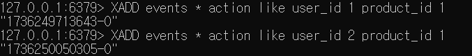
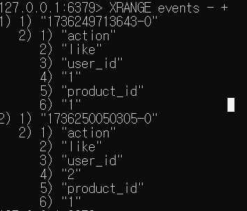
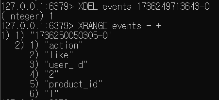

# ***What is Streams?***

*append-only log에 Consumer groups과 같은 기능을 더한 자료 구조* 

*unique id를 통해 하나의 entry를 읽을 때, O(1) 시간 복잡도 
Consumer Group을 통해 분산 시스템에서 다수의 consumer가 event 처리*

# ***Redis Streams 명령어***

***[XADD] Redis Streams에 새로운 데이터를 추가할 때 사용***

```shell
 XADD events * action like user_id 1 product_id 1
 XADD events * action like user_id 2 product_id 1
```

- *데이터를 시간순으로 추가하며, 각 항목은 고유한 ID와 함께 저장*
- *timestamp-sequence 형식의 고유 ID 생성* 
- *Streams는 Append-only Log 기반이기 때문에 항상 Streams 끝에 추가된다.* 
- *ID 자동 생성 →* *`*`* 
- *사용자가 ID를 지정할 수 있지만 보통* *`*`**를 사용하는 게 일반적이다.*

| **ID** | **Fields** | **Values** |
| --- | --- | --- |
| `1674567890123-0` | `action`, `user_id`, `product_id` | `like`, `1`, `1` |
| `1674567890456-0` | `action`, `user_id`, `product_id` | `like`, `2`, `1` |



***[XRANGE] Stream에서 특정 범위에 해당하는 항목들을 조회할 때 사용하는 명령어***

```shell
XRANGE events - + 
```



- *ID를 통해서 범위 지정이 가능하다.*

```shell
XRANGE mystream 1674567890123-0 1674567890456-0
```

***[XDEL] 이벤트 삭제***

```shell
XDEL events 1736249713643-0
```



