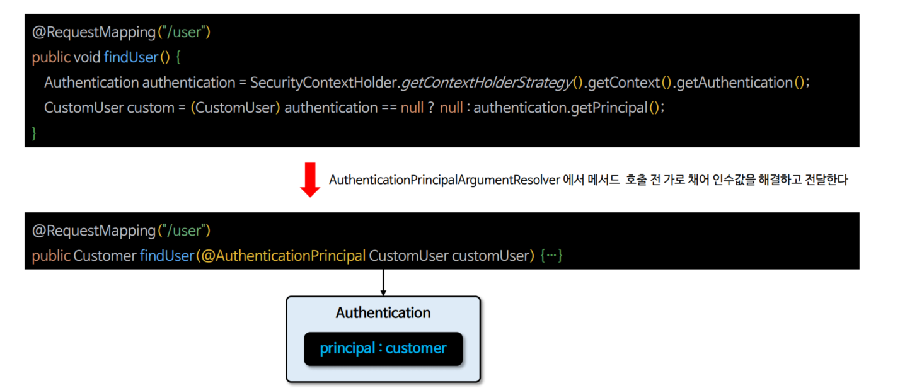
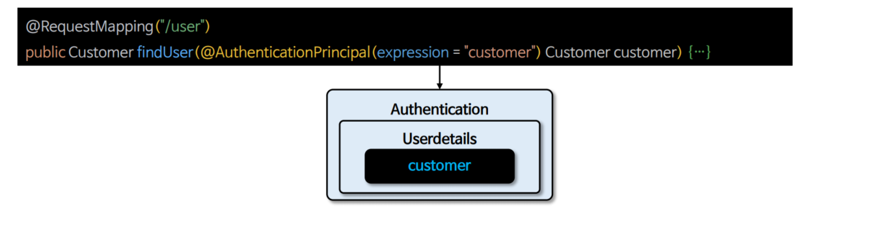
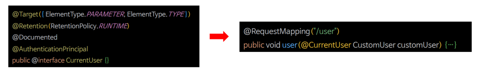

# ***개요***

- *Spring Security는 Spring MVC 인수에 대한 현재 Authentication.getPrincipal()을 자동으로 해결 할 수 있는* ***AuthenticationPrincipalArgumentResolver*** *를 제공한다*
- *Spring MVC 에서 @AuthenticationPrincipal 을 메서드 인수에 선언하게 되면 Spring Security 와 독립적으로 사용할 수 있다*



- *Authentication.getPrincipal()*

# ***@AuthenticationPrincipal(expression="표현식")***

- Principal 객체 내부에서 특정 필드나 메서드에 접근하고자 할 때 사용할 수 있으며 사용자 세부 정보가 Principal 내부의 중첩된 객체에 있는 경우 유용하다
- Principal == UserDetails



# ***@AuthenticationPrincipal 메타 주석***



- *@AuthenticationPrincipal을 자체 주석으로 메타 주석화 하여 Spring Security에 대한 종속성을 제거할 수도 있다*

***나의 의문점***

```java
*@AuthenticationPrincipal을 자체 주석으로 메타 주석화 하여 
Spring Security에 대한 종속성을 제거할 수도 있다

이게 종속성을 제거하는걸까?

종속성 제거보단 의존성을 감추는 캡슐화 효과가 아닐까 싶다*
```

# *테스트*

```java
AuthenticationTrustResolverImpl trustResolver = new AuthenticationTrustResolverImpl();
@GetMapping("/")
public String index(){
    Authentication authentication = SecurityContextHolder.getContextHolderStrategy().getContext().getAuthentication();
    return trustResolver.isAnonymous(authentication) ? "anonymous":"authenticated";
}
```

- *`AuthenticationTrustResolverImpl`* 
- *Authentication 객체가 어떤 객체인지 알 수 있는 API를 제공한다.* 
  - *isAnonymous → 익명 사용자인지 boolean return*

```java
@GetMapping("/user2")
public User user2(@AuthenticationPrincipal User user){
    return user;
}
```

- *스프링 시큐리티가 제공하는 UserDetails 구현체인 User를*  *`@AuthenticationPrincipal`* *통해서 가져왔다.*
- *이는 Authentication.getPrincipal()과 동일하다.*
- ***AuthenticationPrincipalArgumentResolver:*** *매개변수에* *`@AuthenticationPrincipal`* *있는지 판별해서 있으면  Authentication.getPrincipal() 통해 가져온다.* 

```java
@GetMapping("/username")
public String username(@AuthenticationPrincipal(expression = "username") String username){
    return username;
}
```

- *expression을 통해서 UserDetails(User) 객체에 있는 필드를 가져올 수 있다.*

```java
@Target({ ElementType.PARAMETER, ElementType.TYPE })
@Retention(RetentionPolicy.RUNTIME)
@Documented
@AuthenticationPrincipal
public @interface CurrentUser {
}

@GetMapping("/user3")
public User user3(@CurrentUser User user){
    return user;
}
```

- *메타 주석을 활용*  
- *결과는 @AuthenticationPrincipal 단독 사용과 동일*

```java
@Target({ ElementType.PARAMETER, ElementType.TYPE })
@Retention(RetentionPolicy.RUNTIME)
@Documented
@AuthenticationPrincipal(expression = "#this == 'anonymousUser' ? null : username")
public @interface CurrentUserName {
}

@GetMapping("/username2")
public String username2(@CurrentUserName String username){
    return username;
}
```

- *@AuthenticationPrincipal(expression = "#this == 'anonymousUser' ? null : username")*
- *여기서 this는 UserDetails를 말한다.* 
  - *만약 익명 사용자면 null 반환*
  - *인증된 사용자면 username 반환한다.*

