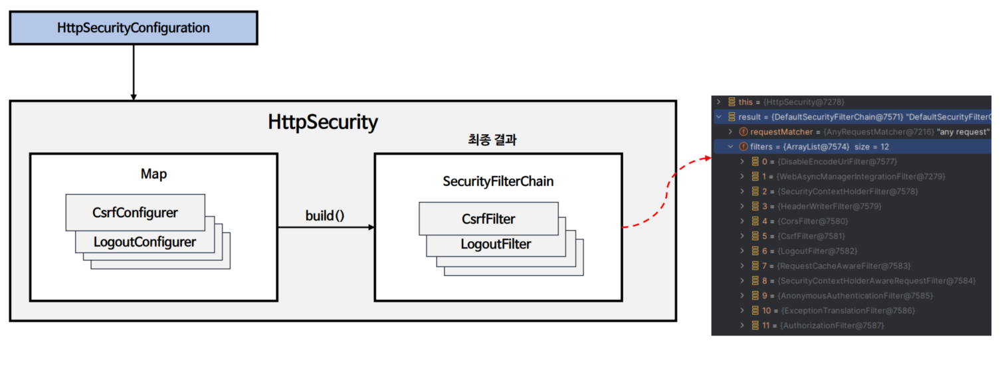

# HttpSecurity

- HttpSecurityConfiguration에서 HttpSecurity를 생성하고 초기화를 진행한다 
- HttpSecurity는 보안에 필요한 각 설정 클래스와 필터들을 생성하고 최종적으로 SecurityFilterChain 타입의 빈을 생성한다 

# SecurityFilterChain

**SecurityFilterChain matches(HttpServletRequest)**

SecurityFilterChain은 FilterChainProxy가 1개 이상을 가질 수 있다. 

이때 현재 요청이 SecurityFilterChain에 의해 처리되어야 하는지 여부를 결정한다 

이는 다중 보안(SecurityFilterChain ≥2)에서 중요하다 

# WebSecurity

- WebSecurityConfiguration에서 WebSecurity를 생성하고 초기화를 진행 
- WebSecurity는 HttpSecurity에서 생성한 SecurityFilterChain 빈을 SecurityBuilder에 저장 
- WebSecurity가 build()를 실행하면 SecurityBuilder에서 SecurityFilterChain을 꺼내서 FilterChainProxy 생성자에게 전달한다 


