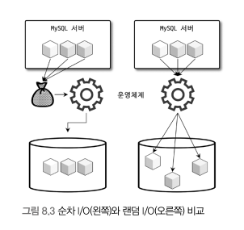

**랜덤(Random) I/O**, **순차(Sequential) I/O** 같은 디스크 읽기 방식을 먼저 알아보자.

많이 발전했지만 여전히 데이터 저장 매체는 컴퓨터에서 가장 느린 부분이라는 사실에는 변함이 없다.

데이터베이스의 성능 튜닝은 어떻게 디스크 I/O를 줄이느냐가 관건일 때가 상당히 많다.

---

# 8.1.1 하드 디스크 드라이브(HDD)와 솔리드 스테이트 드라이브(SSD)

CPU, 메모리 같은 주요 장치는 대부분 전자식 장치지만 HDD는 기계식 장치이다.

그래서 데이터베이스 서버에는 항상 디스크 장치가 병목이 된다. 요즘은 HHD를 대체하기 위해 전자식 전장 매체인 SSD가 많이 출시되고 있다. SSD는 기존 HDD와 같은 인터페이스(SATA, SAS)를 지원한다.

SSD는 기존 HDD에서 데이터 저장용 플레터(원판)를 제거하고 그 대신 플레시 메모리를 장착하고 있다.

그래서 디스크 원판을 회전시킬 필요가 없어 아주 빨리 데이터를 읽고 쓸 수 있다.

컴퓨터의 메모리(D-Ram)보다는 느리지만 기계식 HDD보다는 훨씬 빠르다.

디스크의 헤더를 움직이지 않고 한 번에 많은 데이터를 읽는 순차 I/O에서는 SSD가 HDD보다 조금 빠르거나 비슷한 성능을 보이기도 한다. **하지만 SSD의 장점은 HDD보다 랜덤 I/O가 훨씬 빠르다는 것이다.** 

데이터베이스에서 순차 I/O 작업은 그다지 비중이 크지 않고 랜덤 I/O를 통해 작은 데이터를 읽고 쓰는 작업이 대부분이다. 그래서 SSD가 DBMS용 스토리지에 최적이다.

책에서 테스트한 결과로는 SSD는 초당 436개 HDD는 초당 60개의 트랜잭션밖에 처리하지 못한다. 

---

# 8.1.2 랜덤 I/O VS 순차 I/O



랜덤 I/O는 HDD의 플래터(원판)를 돌려서 읽어야 할 데이터가 저장된 위치로 디스크 헤더를 이동시킨 다음 데이터를 읽는 것을 의미하는데, 순차 I/O 또한 작업 과정은 동일하다.

순차 I/O는 3개의 페이지(3 * 16KB)를 디스크에 기록하기 위해 시스템 콜을 1번 요청했지만, 랜덤 I/O는 3개의 페이지를 디스크에 기록하기 위해 시스템 콜을 3번 요청했다.

즉, 디스크에 기록해야 할 위치를 찾기 위해 순차 I/O는 디스크 헤더를 1번 움직였고, 랜덤 I/O는 3번 움직였다.

디스크에 데이터를 쓰고 읽는 데 걸리는 시간은 디스크 헤더를 움직여서(회전 지연 시간) 읽고 쓸 위치로 옮기는 단계에서 결정된다.

즉, 디스크의 성능은 디스크 헤더의 위치 이동 없이 얼마나 많은 데이터를 한 번에 기록하느냐에 의해 결정된다고 볼 수 있다.

그래서 여러 번 쓰기 또는 읽기를 요청하는 랜덤 I/O 작업이 작업 부하가 훨씬 더 크다.

데이터베이스 대부분의 작업은 작은 데이터를 빈번히 읽고 쓰기 때문에 MySQL 서버에서는 그룹 커밋이나 바이너리 로그 버퍼, InnoDB 로그 버퍼 등의 기능이 내장돼 있다.

## **그룹 커밋 (Group Commit)**

  - **의미**: 여러 트랜잭션의 로그 flush 작업을 **한 번의 디스크 I/O로 묶는 기술**
  - **적용 대상**
- **바이너리 로그 버퍼** (MySQL 레벨)
    - **InnoDB 리두 로그 버퍼** (스토리지 엔진 레벨)
  - **결론**: 트랜잭션 커밋 자체가 아니라, 커밋과 함께 발생하는 **로그 동기화 작업을 묶는 것**.

> "트랜잭션 커밋 동기화"라기보단, 커밋 시 발생하는 디스크 flush 작업을 병렬로 최적화한다고 이해하자.

---

## **InnoDB 로그 버퍼 = 리두 로그 버퍼 (메모리)**

  - 시스템 변수 `innodb_flush_log_at_trx_commit`에 따라 **디스크 플러시 시점**이 달라짐.

| 값 | 의미 | 정합성 수준 | 성능 |
| --- | --- | --- | --- |
| 0 | 로그 버퍼는 1초마다 디스크에 flush | 낮음 | 빠름 |
| 1 (기본값) | 트랜잭션 커밋 시마다 flush | 높음 (ACID 보장) | 느림 |
| 2 | 커밋 시 OS 버퍼까지만 flush, 디스크 flush는 1초마다 | 중간 | 중간 |

---

## **리두 로그 파일 크기와 데이터 페이지 플러시 시점**

  - 리두 로그 파일은 **디스크에 저장된 실제 로그**.
  - 리두 로그 공간이 가득 차면 더 이상 새로운 트랜잭션 로그를 기록할 수 없음 ⇒ **체크포인트(Checkpoint)** 발생.

> 즉, 리두 로그 파일의 크기는 "얼마나 많은 더티 페이지를 오래 버퍼 풀에 유지할 수 있는가"에 영향을 준다.

### 권장 사항

  - `innodb_log_file_size * innodb_log_files_in_group`의 총합이
버퍼 풀의 **25%~50%** 수준이면 적절 (InnoDB 공식 문서 기준).

---

## **데이터 페이지 플러시 시점**

InnoDB의 더티 페이지(메모리 상에서 수정된 페이지)는 **즉시 디스크에 기록되지 않음**.

플러시는 아래 조건에서 발생

### 주요 플러시 시점

  1. **MySQL 서버 종료**
  1. **체크포인트 발생 (4번 어댑티브 기능 활성화 시 사용 X)**
  1. **리두 로그 공간 부족 (쓰기 폭주 발생 가능)**
  1. **Adaptive Checkpointing**
- InnoDB가 I/O 부하를 고려해 더티 페이지를 미리 플러시
    - Adaptive 알고리즘 기반 특정 용량 이상부터 활성화
  1. **flush 리스트를 따라 백그라운드에서 지속적인 페이지 플러시**

---

디스크 원판을 가지지 않는 SSD는 순차 I/O와 랜덤 I/O 차이가 없을 것으로 예측하지만, 실제로는 그렇지 않다.

SSD 드라이브에서도 랜덤 I/O는 여전히 순차 I/O 보다 처리량이 떨어진다.

쿼리를 튜닝해서 랜덤 I/O를 순차 I/O로 바꿔서 실행할 방법은 많지 않다.

**일반적으로 쿼리를 튜닝하는 것은 랜덤 I/O 자체를 줄여주는 것이 목적이라고 할 수 있다.**

즉, 쿼리를 처리하는 데 꼭 필요한 데이터만 읽도록 쿼리를 개선하는 것을 의미한다.

**참고**

```
보조 인덱스 레인지 스캔은 주로 데이터를 읽기 위해 랜덤 I/O 사용
풀 테이블 스캔은 순차 I/O 사용
그래서 큰 테이블의 레코드 대부분을 읽는 작업에서는 인덱스를 사용하지 않고 풀 테이블 스캔을 사용하도록
유도할 때도 있다.
이는 순차 I/O 보다 랜덤 I/O가 훨씬 빨리 많은 레코드를 읽어올 수 있기 때문이다.
```

| 조건 | 동작 방식 | I/O 성격 |
| --- | --- | --- |
| PK 기준으로 레인지 스캔 | 클러스터 인덱스 스캔 | **순차 I/O** 가능 |
| 보조 인덱스 기준 레인지 스캔 | 보조 → 클러스터 인덱스 점프 | **랜덤 I/O** |

| 인덱스 타입 | 스캔 흐름 | I/O 성격 |
| --- | --- | --- |
| 클러스터 인덱스 | `root → branch → leaf → next leaf...` | 순차 I/O 유리 |
| 보조 인덱스 (일반) | `root → branch → leaf → PK 점프 → 다시 root → ...` | 랜덤 I/O |
| 보조 인덱스 (커버링) | `root → branch → leaf → next leaf...` | 순차 I/O 유리 |

### 클러스터 인덱스의 구조적 이점

1. **PK 기준 정렬된 B+Tree**
- 리프 노드들이 **논리적으로도 순서대로 연결**되어 있고,
  - 디스크 상에서도 가능한 한 **인접한 페이지에 배치**하려고 노력(InnoDB의 페이지 분할 및 공간 관리 정책)
1. **레코드 탐색**
- `WHERE id BETWEEN 100 AND 200` 같은 쿼리는 B+Tree를 통해 시작 지점을 찾고,
  - 이후 리프 노드들을 **옆으로 차례로 읽어가며** 데이터를 가져온다.
1. **물리적 연속성**
- 페이지가 꼭 완벽히 연속된 블록에 있지는 않지만,
  - **순차적으로 접근하기 유리한 구조**로 설계돼 있어서 순차 I/O로 동작할 가능성이 높다.

---

