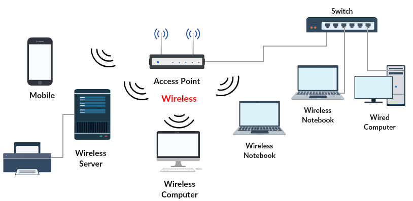
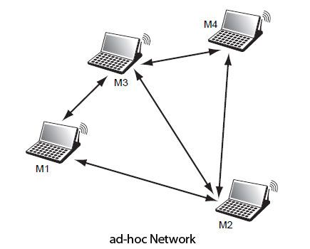

무선 랜을 구성하는 방식에는 인프라스트럭처와 애드혹 2가지가 있다.

**인프라스트럭처(Infrastructure)방식은 무선 랜 네트워크에 연결된 모든 장치가 무선 엑세스 포인트에 연결되는 방식이다.** 즉, 모든 장치가 무선 엑세스 포인트와 통신하며 무선 엑세스 포인트(공유기)가 장치들 간의 통신을 중재한다. 이 방식은 대부분의 집과 사무실에서 사용되며 안정적이고 안전한 무선 네트워크 환경을 제공한다.

**애드혹(Ad-hoc)방식은 무선 엑세스 포인트 없이 장치 간에 직접 통신을 한다.** 이 방식은 다음 그림과 같이 컴퓨터들끼리 서로 연결되어 정보를 교환하고 통신할 수 있다. 따라서 애드혹 네트워크는 보통 작은 범위 내에서 사용되는 경우가 많다.

**Ad-hoc vs Infrastructure** 

| **방식** | **AP(공유기) 필요 여부** | **기기 연결 구조** | **예시** | **ad-hoc 여부** |
| --- | --- | --- | --- | --- |
| Infrastructure | 필요 | AP 중심 연결 | 일반 가정/회사 Wi-Fi | X |
| Ad-hoc | 불필요 | 기기 간 직접 연결 | 노트북-노트북 직접 연결 | O |
| Wi-Fi 핫스팟 | 불필요(기기 자체 AP) | AP 중심 연결 | 스마트폰 핫스팟 | X (infrastructure) |
| 블루투스 테더링 | 불필요 | 기기 간 직접 연결 | 스마트폰-노트북 블루투스 연결 | O |

