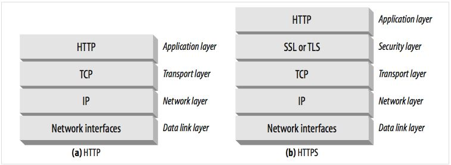
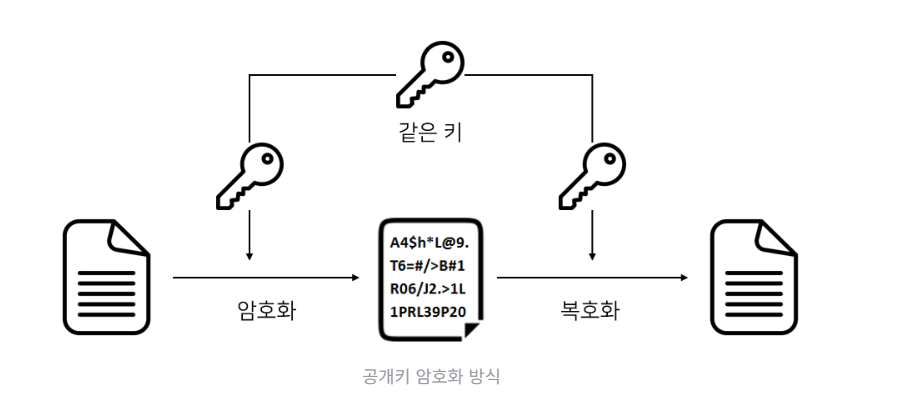
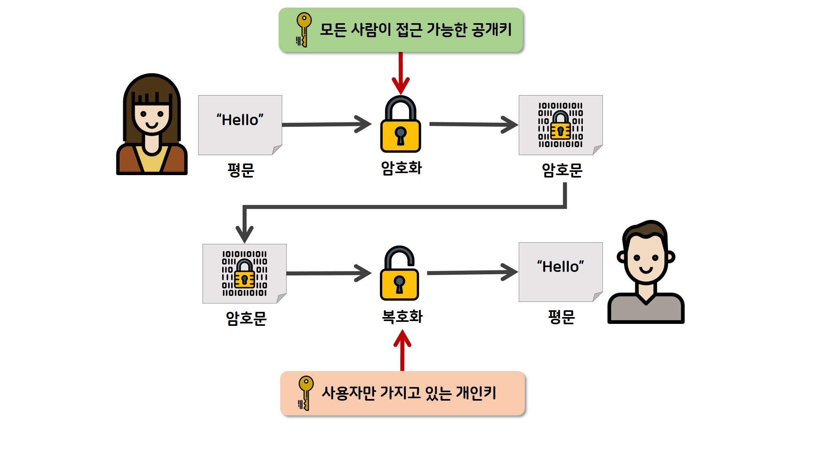

# 14.1 HTTP를 안전하게 만들기

웹은 안전한 방식의 HTTP를 필요로 한다. (ex: 인터넷 뱅킹, 쇼핑몰)

이전장에서는 다이제스트 인증, 기본 인증 관련 내용을 학습했지만 보다 더욱 강력한 보안 솔루션이 필요하다.

즉, HTTP와 디지털 암호화 기술을 결합해야 한다.

디지털 암호화 기술 특징

- 서버 인증: 클라이언트에게 자신이 위조된 서버가 아님을 증명
- 클라이언트 인증: 서버에게 자신이 진짜 사용자임을 증명
- 무결성: 데이터 위조로부터 안전
- 암호화: 도청 걱정 없이 HTTP 트랜잭션 전송
- 효율: 알고리즘은 충분히 빨라야 한다.
- 확장성, 적응성, 생존성 등등 ..

---

## 14.1.1 HTTPS

HTTPS는 가장 인기 있는 HTTP 보안 솔루션이다. 거의 모든 주류 브라우저와 서버에서 지원한다.

웹 페이지에 HTTP가 아닌 HTTPS로 접근하고 있는 경우, [https://로](https://xn--2o2b/) 시작한다.

**HTTPS를 사용하면 모든 HTTP 요청과 응답 데이터는 네트워크로 보내지기 전에 암호화된다.**

HTTPS는 전송 레벨 암호 보안 계층에서 동작한다.

이 보안 계층은 Secure Sockets Layer(SSL) 또는 Transport Layer Security(TLS)을 이용하여 구현된다.

어려운 인코딩, 디코징 작업은 대부분 SSL 라이브러리 안에서 일어나기 때문에 보안 HTTP를 사용하기 위해 기존 로직을 크게 변경할 필요 없다. 약간의 보안 설정은 필요하다.

---

# 14.2 디지털 암호학 

HTTPS를 이해하려면 암호 인코딩 기법에 대해서 먼저 알아야 한다.

대칭키

- 인코딩과 디코딩에 같은 키를 사용하는 알고리즘

비대칭키

- 인코딩과 디코딩에 다른 키를 사용하는 알고리즘

공개키

- 비밀 메시지를 전달하는 수백만 대의 컴퓨터를 쉽게 만들 수 있는 시스템

디지털 서명

- 메시지가 위조 혹은 변경되지 않았음을 입증하는 체크섬

디지털 인증서

- 신뢰할 만한 조직에 의해 서명되고 검증된 신원 확인 정보

---

## 14.2.2 암호(cipher)

암호법은 비밀 코드에 기반한다.

암호란 메시지를 인코딩하는 특정한 방법과 비밀 메시지를 디코딩하는 방법이다.

율리우스 카이사르는 **Rotate-by-3 암호**를 사용했는데 메시지의 각 글자를 해당 글자의 알파벳 순서상 세 번 뒤의 글자로 교체하는 순환 암호를 사용했다.

**평문: HELLO**

- **H → K (H → I → J →  K)**
- **E → H (E → F → G → H)**
- **L → O (L → M → N → O)**
- **L → O (L → M → N → O)**
- **O → R (O → P → Q → R)**

결과: HELLO → KHOOR

**암호문: KHOOR**

- **K → H (K → J → I → H)**
- **H → E (H → G → F → E)**
- **O → L (O → N → M → L)**
- **O → L (같음)**
- **R → O (R → Q → P → O)**

**결과: KHOOR → HELLO**

---

## 14.2.3, 14.2.4 암호 기계와 키가 있는 암호

암호 기계는 평문을 암호화하기 위해 사용된다.

사람들이 깨뜨리기 어렵게 하기 위해 단순히 회전하는게 아닌 글자를 대체하고, 순서를 바꾸고,

자르고 토막내었다.

또한 암호 기계에 키를 넣어 암호화하기 시작했다. 예를 들어 율리우스 카이사르 방식의 암호화 기계가 존재하고 암호화하는 사람이 키 값을 6으로 설정하면 알파벳 순서상 6번 뒤의 알파벳으로 기계는 메시지를 암호화한다.

실제 암호화 기계는 더 복잡했으며 이런 방식 덕분에 기계를 훔쳐가도 키를 모르면 평문으로 즉, 디코딩할 수 없었다.

참고로 2차 세계 대전에서는 독일이 애니그마라는 암호 기계를 사용했는데, 영화 이미테이션 게임을 보면

주인공이 암호화 키(”히틀러 만세”)를 찾아 결국 애니그마를 파해하는 장면이 나온다.

---

## 14.2.5 디지털 암호

디지털 계산의 도래로, 기계 장치의 한계를 벗어나 복잡한 인코딩 및 디코딩이 가능해졌다.

기계 장치의 물리적인 금속 키나 다이얼 설정과 다르게 디지털 키는 그냥 숫자에 불과하다.

예를 들어 평문 메시지 P, 인코딩 함수 E, 디지털 인코딩 키 e가 주어지면 암호문 C가 만들어진다.

또한 암호문 C는 디코더 함수 D와 디코딩 키 d를 사용하여 원래의 평문 p로 도로 디코딩할 수 있다.

*C = E(P, e) P = D(C, d)*

서로 다른 키를 사용하니 이는 비대칭 키(공개 키) 방식이다.

---

# 14.3 대칭키 암호법

**대칭키 암호법은 인코딩을 할 때 사용하는 키가 디코딩할 때 사용하는 키와 동일하다.**

이 키를 k라고 부르도록 하자.

대칭키 암호에서, 발송자와 수신자 모두 통신을 위해 비밀 키 k를 똑같이 공유할 필요가 있다.

발송자는 공유된 비밀 키를 통해 메시지를 암호화하고 그 결과문인 암호문을 수신자에게 발송한다.

수신자는 마찬가지로 비밀 키를 통해 메시지를 평문으로 디코딩한다.

잘 알려진 대칭키 암호 알고리즘으로는 DES, Triple-DES, RC2, RC4 등이 있다.

**대칭키는 비대칭키(공개키)에 비해 속도가 매우 빠르지만 키 관리 및 배포의 문제점을 가진다.**

---

## 14.3.1 키 길이와 열거 공격

열거 공격이란 무차별적으로 모든 키 값을 대입해보는 공격을 열거 공격이라고 한다.

만약 가능한 키 값이 몇 가지 밖에 없다면 공격자는 결국 모든 시도를 하고 암호를 깨게 될 것이다.

만약 키 길이가 2비트라면 경우의 수는 겨우 4가지 이므로 바로 뚫린다.

하지만 가능한 키 값이 매우 많다면 매우 오랜 시간 또는 영원히 풀지못한다.

만약 40비트 키라면 약 1조가지가 가능하다.

하지만 40비트는 초당 수십억 번의 계산이 가능한 오늘날 쉽게 깨질 수 있다.

그래서 128비트를 많이 사용한다. 128비트의 경우 무차별 대입으로는 실질적으로 깨뜨릴 수 없다고 알려져 있다.

하지만 키가 탈취당하면 아무리 키 길이가 길어도 의미없다.

---

# 14.4 공개키 암호법

대칭키와 다르게 공개키 암호 방식은 두 개의 비대칭 키를 사용한다.

**하나는 메시지를 인코딩하기 위해 하나는 메시지를 디코딩하기 위한 것이다.**

**그리고 인코딩 키는 모두를 위해 공개되어 있다. 그래서 공개키 암호 방식이라고 이름이 붙었다.**

---

## 14.4.2 혼성 암호 체계와 세션 키

비대칭 키 방식은 누구나 공개키만 알면 그 키에 대응하는 공개 서버에 안전하게 메시지를 보낼 수 있게 해주므로 서버의 부담이 매우적다. 대칭키 같은 경우 각 클라이언트마다 키를 관리해야 한다.

하지만 공개키 암호 방식의 알고리즘 계산은 느린 경향이 있다. 그래서 실제로는 대칭키 방식과 비대칭키 방식을 섞어서 사용한다.

먼저 공개 키 방식으로 의사소통 채널을 수립하고 이후 안전한 채널을 통해 대칭 키를 교환하고 이후 나머지 데이터를 대칭키를 통해 인코딩 및 디코딩하여 대화한다.

---

# 14.5 디지털 서명

디지털 서명은 전자 문서나 메시지의 무결성과 신원을 증명하기 위한 암호학적 방법이다. 

송신자는 자신의 개인키로 메시지의 일정한 길이의 해시값을 암호화하여 “서명”을 생성하면, 수신자는 송신자의 공개키로 이 서명을 복호화해 본문에서 계산한 해시값과 비교함으로써 메시지의 위변조 여부와 송신자의 신원을 검증할 수 있다.

**JWT과 디지털 서명**

사용자가 로그인 등 인증 절차를 거치면 서버가 JWT를 생성하여 클라이언트에게 전달한다. 

이 토큰은 서버가 개인키 또는 비밀키로 서명(Signature)한 형태로, 클라이언트는 이후 요청 시 이 JWT를 서버에 보내 인증을 증명한다. 서버는 JWT에 포함된 서명을 검증하여 토큰의 무결성과 진위를 확인한 후 해당 사용자의 권한을 판단한다.

즉, JWT 생성 및 서명은 서버(발행자)가 수행하며, 클라이언트는 이 서명된 토큰을 받아 요청에 사용한다. 서버는 이를 검증하는 쪽 역할도 같이 한다.

만약 공격자가 JWT를 위조하여 서버로 보낸다면 서버에서는 해당 JWT를 서명으로 파싱할 때 위조됐음을 확인하고 해당 사용자에 대한 요청을 거부한다.

Header(base64), Payload(base64), Signature(Payload + Header + Signature(서버 비밀 키) → 해싱)
만약 공격자가 Payload를 수정해서 보내도 서버에서는 Header + Payload + 비밀 키로 Signature를 만들고 비교를 해보면 기존 Signature와 다르기 때문에 서버는 위조됐음을 알 수 있다.

---

# **서버 / 인증 기관: CA(Certificate Authority) / 클라이언트 관계**

### 1. 서버 공개키/비밀키 생성과 인증서 발급 요청

- 서버는 공개키와 비밀키 한 쌍(key pair)을 생성한다.
- 서버는 자신의 공개키와 서버 정보를 인증 기관(CA, Certificate Authority)에 전달한다.
- 인증 기관은 서버의 신원을 확인한 후, 자신의 비밀키로 서버의 공개키와 서버 정보를 암호화하여 디지털 인증서(certification)를 만든다. (이 인증서는 서버의 공개키가 진짜 서버 것임을 보증한다)

### 2. 인증서 전달 및 검증

- 서버는 클라이언트에게 디지털 인증서를 전송한다.
- 클라이언트는 인증 기관의 공개키를 이용해 받은 인증서를 복호화하여 인증서의 유효성을 검증한다.
- 클라이언트는 인증서에 포함된 서버의 공개키와 서버 정보를 확인하여, 진짜 인증 기관에서 발급한 것인지, 그리고 서버가 신뢰할 만한 주체인지를 판단한다.

### 3. 대칭키 교환 및 안전한 통신 시작

- 클라이언트는 자신의 대칭키(세션 키)를 생성하고, 이를 서버의 공개키로 암호화하여 서버에 보낸다.
- 서버는 자신의 비밀키로 암호화된 대칭키를 복호화하여 공유된 세션 키를 갖게 된다.
- 이후 양측은 이 대칭키를 이용해 효율적으로 데이터를 암호화 및 복호화하며 안전한 통신을 진행한다.

**해당 과정은 TCP 3-way handshake 과정 이후 진행되며, 이런 과정을 TLS/SSL 3-way handshake라고 부른다. 즉, HTTPS는 TLS/SSL 기반이며 혼성 암호 체계를 사용하고 제 3자인 인증 기관이 필요하다.**

---

# 14.9 프록시를 통한 보안 트래픽 터널링

클라이언트는 종종 웹 프록시 서버를 이용한다. (캐시 용도, 게이트웨이(프로토콜 변환) 등등 …)

만약 클라이언트가 서버로 보낼 데이터를 서버의 공개키로 암호화하기 시작했다면

프록시는 더이상 HTTP 헤더를 읽을 수 없다. 그래서 프록시는 어디에 요청을 보내야 하는지 알 수 없다.

**참고로 서버의 공개키로 암호화는 키 교환때만 이루어지고 그 이후에는 클라이언트가 생성한 대칭키로 암호화한다.**

**프록시는 모두 이해 불가**

HTTPS가 프록시와 잘 동작할 수 있게 하기 위해, 클라이언트는 프록시에게 어디에 접속하려고 하는지(서버 주소)말해주는 방법을 수정해야 한다.

이때 HTTPS SSL 터널링 프로토콜을 사용하며, 클라이언트는 먼저 자신이 연결하고자 하는 서버의 호스트와 포트를 말해준다. 이는 암호화가 시작되기 전에 평문으로 말해준다.

**HTTP는 CONNECT이라는 확장 메서드를 이용해서 보낸다.**

CONNECT 메서드는 프록시에게 희망하는 주소로 연결을 해달라고 사용되며, 그것이 완료되면 클라이언트와 서버 사이에서 데이터가 직접적으로 오갈 수 있게 해주는 터널을 만든다.

먼저 커넥션을 수립하기 위한 3-way handshake가 성공하면 이어서 SSL 데이터 전송이 시작된다.

이후 인증 기관에게 서버의 인증서 확인 및 키 교환이 이루어지고 마침내 안전한 HTTPS 프로토콜로 데이터 교환이 시작된다.

**커넥션 수립 이후 동작 요약**

| **단계** | **설명** | **프록시 역할 및 프록시가 볼 수 있는 정보** |
| --- | --- | --- |
| 1. CONNECT 요청 | 클라이언트가 접속하려는 서버의 주소와 포트를 알려줌 | 프록시는 목적지 정보(서버 주소, 포트) 확인 가능 |
| 2. 터널 생성 | 프록시가 서버와 연결을 열고 클라이언트와 서버 간 터널 구성 | 프록시는 암호화된 데이터를 단순히 전달 중계 |
| 3. SSL/TLS 핸드셰이크 | 클라이언트와 서버가 키 교환 및 인증서 검증 수행 | 프록시는 암호화 때문에 데이터 내용 못 봄 |
| 4. HTTPS 데이터 전송 | 대칭키로 암호화된 안전한 데이터 교환 | 프록시는 암호문 전달만, 내용 파악 불가 |

---

