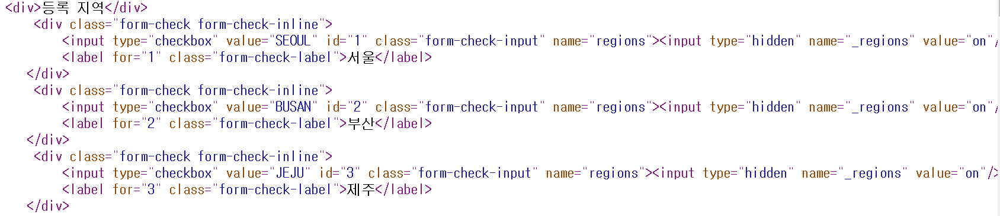

# ***타임리프 스프링 통합***

*타임리프는 스프링 없이도 동작하지만, 스프링과 통합을 위한 다양한 기능을 편리하게 제공한다.* 

*이런 부분은 스프링으로 백엔드를 개발하는 개발자 입장에서 타임리프를 선택하는 하나의 이유가 된다.*

***스프링 통합으로 추가되는 기능들***

| **기능 영역** | **추가된 기능** | **설명** |
| --- | --- | --- |
| **SpringEL 문법 통합** | `${@myBean.doSomething()}` | SpringEL을 통해 스프링 빈 호출 및 메소드 실행을 지원 |
| **폼 관리 기능 강화** | `th:object` | 폼 커맨드 객체를 쉽게 선택하고 바인딩 가능 |
|  | `th:field`, `th:errors`, `th:errorclass` | 폼 필드 바인딩, 검증 오류 메시지 처리, 오류 시 특정 클래스 추가 가능 |
| **폼 컴포넌트 지원** | Checkbox, Radio Button, List 등의 컴포넌트 | 편리한 폼 컴포넌트 생성 및 관리 지원 |
| **스프링 메시지 통합** | 메시지 및 국제화 | 스프링의 메시지 소스 및 국제화 기능과의 편리한 연동 |
| **스프링 검증 및 오류 처리 통합** | 스프링 Validator와 BindingResult 지원 | 검증 결과 및 오류 메시지를 Thymeleaf 템플릿에서 쉽게 처리 가능 |
| **스프링 변환 서비스 통합** | `ConversionService` | 객체 변환 및 형식 변환 기능을 Thymeleaf 템플릿에서 쉽게 사용할 수 있도록 통합 |

# ***입력 폼 처리***

- ***th:object :*** *커맨드 객체를 지정한다.*
- ****{...} :*** *선택 변수 식이라고 한다.* ***th:object****에서 선택한 객체에 접근한다.*
- ***th:field:*** *HTML 태그의 id , name , value 속성을 자동으로 처리해준다.*

***렌더링 전***

`<input type="text" th:field="*{itemName}"/>` 

***렌더링 후***

`<input type="text" id="itemName" name="itemName" value="itemName"/>`

```html
<form action="item.html" th:action th:object="${item}" method="post">
	 <div>
			 <label for="id">상품 ID</label>
			 <input type="text" id="id" th:field="*{id}" class="form-control" readonly>
	 </div>
	 <div>
			 <label for="itemName">상품명</label>
			 <input type="text" id="itemName" th:field="*{itemName}" class="formcontrol">
	 </div>
		 <div>
			 <label for="price">가격</label>
			 <input type="text" id="price" th:field="*{price}" class="form-control">
	 </div>
	 <div>
			 <label for="quantity">수량</label>
			 <input type="text" id="quantity" th:field="*{quantity}" class="formcontrol">
	 </div>
```

- `th:object="${item}"` : *<form>에서 사용할 객체를 지정한다. 선택 변수 식 *{…}을 적용할 수 있다.*
- `th:field="*{itemName}"` 
- ***th:field****는 id , name , value 속성을 모두 자동으로 만들어준다*

# HTTP 요청 메시지 로깅

***applicaiton.preperties***

```plain text
logging.level.org.apache.coyote.http11=trace
```

- *HTTP 요청 메시지를 서버에서 보고 싶으면 다음 설정을 추가*

# ***체크 박스 - 단일1***

```html
<div>판매 여부</div>
<div>
		 <div class="form-check">
				 <input type="checkbox" id="open" name="open" class="form-check-input">
				 <label for="open" class="form-check-label">판매 오픈</label>
		 </div>
</div>
```

*Item 클래스 필드에 상품 판매 여부 필드를 나타내는 boolean open 존재*

***체크 박스 check case***

*체크 박스를 체크하면 HTML FORM에서* *`open=on`* *이라는 값이 넘어간다.*

*스프링은* *`on`* *이라는 문자를* *`true`* *타입으로 변환해준다. (스프링 타입 컨버터)*

***체크 박스 uncheck case***

*HTML에서 체크 박스를 선택하지 않고 폼을 전송하면* *`open`**이라는 필드 자체가 서버로 전송되지 않는다*

*해당 문제를 해결하기 위해서 스프링 MVC는 트릭을 사용한다.*

*히든 필드를 만들어서* *`_open`* *처럼 기존 체크 박스 이름 앞에* *`_`* *를 붙여서 전송하면 체크를 해제했다고 인식할 수 있다. 히든 필드는 항상 전송된다.*

*따라서 체크를 해제할 경우 여기서는* *`open`* *은 전송되지 않고* *`_open`* *만 전송되는데 이 경우 스프링 MVC는 체크를 해제했다고 판단한다.*

***체크 해제를 인식하기 위한 히든 필드***

`<input type="hidden" name="_open" value="on"/>`

***기존 코드에 히든 필드 추가***

```html
<div>판매 여부</div>
<div>
		 <div class="form-check">
				 <input type="checkbox" id="open" name="open" class="form-check-input">
				 <input type="hidden" name="_open" value="on"/>
				 <label for="open" class="form-check-label">판매 오픈</label>
		 </div>
</div>
```

- ***체크 박스 체크***
- `open=on&_open=on` 
  - *체크 박스를 체크하면 스프링 MVC가* `open`*에 값이 있는 것을 확인하고 사용한다. 이때* *`_`*`open`*은 무시*
- ***체크 박스 미체크***
- `_open=on` 
  - *체크 박스를 체크하지 않으면 스프링 MVC가* `_open`*만 있는 것을 확인하고,* `open`*의 값이 체크되지 않았다고 인식한다.*

# ***체크 박스 - 단일2***

*개발할 때 마다 이렇게 히든 필드를 추가하는 것은 상당히 번거롭다.* 

*타임리프가 제공하는 폼 기능을 사용하면 이런 부분을 자동으로 처리할 수 있다.*

***타임리프 - 체크 박스 코드 추가***

```html
<div>판매 여부</div>
<div>
		 <div class="form-check">
				 <input type="checkbox" id="open" th:field="*{open}" class="form-check-input">
				 <label for="open" class="form-check-label">판매 오픈</label>
		 </div>
</div>
```

- *렌더링을 하면* `<input type="hidden" name="_open" value="on"/>` *자동으로 넣어준다.*

***체크박스 read only 같은 동작*** 

```html
<input type="checkbox" id="open" th:field="${item.open}" class="formcheck-input" disabled>
```

- *disabled*

# ***체크 박스 - 멀티***

*체크 박스를 멀티로 사용해서, 하나 이상을 체크할 수 있도록 해보자.*

## ⭐***@ModelAttribute 특별한 사용법*** 

*등록 폼, 상세화면, 수정 폼에서 모두 서울, 부산, 제주라는 체크 박스를 반복해서 보여주어야 한다.*

*이렇게 하려면 각각의 컨트롤러에서 model.addAttribute(...) 을 사용해서 체크 박스를 구성하는 데이터를 반복해서 넣어주어야 한다.*

```java
@ModelAttribute("regions")
public Map<String, String> regions() {
		Map<String, String> regions = new LinkedHashMap<>();
		regions.put("SEOUL", "서울");
		regions.put("BUSAN", "부산");
		regions.put("JEJU", "제주");
		return regions;
}
```

- ***@ModelAttribute****는 이렇게 컨트롤러에 있는 별도의 메서드에 적용할 수 있다.*
- *이렇게하면 해당 컨트롤러를 요청할 때 regions에서 반환한 값이 자동으로 모델(model)에 담기게 된다. 물론 이렇게 사용하지 않고, 각각의 컨트롤러 메서드에서 모델에 직접 데이터를 담아서 처리해도 된다*

```html
<div>
		<div>등록 지역</div>
		<div th:each="region : ${regions}" class="form-check form-check-inline">
				<input type="checkbox" th:field="*{regions}" th:value="${region.key}" class="form-check-input">
				<label th:for="${#ids.prev('regions')}" th:text="${region.value}" class="form-check-label">서울</label>
		</div>
</div>
```

- *regions → Map.Entty<String, String>*
- `th:for="${#ids.prev('regions')}"` 
- *생성된 HTML 태그 속성에서 name은 같아도 되지만, id는 모두 달라야 한다.*

## ***내 개인적인 생각?***

*<input> 태그 id와 <label> 태그 id는 같아야 한다.* 

`th:for="${#ids.prev('regions')}"` *이 방식은 명시적이지 않다.* 

*th:each 방식에서는 상태를 유지시켜준다. → regionStat*

*regionStat index 또는 count 값을 <input> 태그나 <label> 태그에 적용하면 명시적이고 for문을 돌면서 증가하니 괜찮지 않을까 싶다* 

```html
<div>
     <div>등록 지역</div>
     <div th:each="region : ${regions}" class="form-check form-check-inline">
         <input type="checkbox" th:field="*{regions}" th:value="${region.key}" th:id="${regionStat.count}" class="form-check-input">
         <label th:for="${regionStat.count}" th:text="${region.value}" class="form-check-label">서울</label>
     </div>
</div>
```

***실제 랜더링 결과***



# ***라디오 버튼***

*라디오 버튼은 여러 선택지 중에 하나를 선택할 때 사용할 수 있다.* 

*라디오 버튼을 자바 ENUM을 활용해서 개발해보자.*

***@ModelAttribute - Model 추가*** 

```java
@ModelAttribute("itemTypes")
public ItemType[] itemTypes() {
		 return ItemType.values();
}
```

```html
<div>
	<div>상품 종류</div>
	<div th:each="type : ${itemTypes}" class="form-check form-check-inline">
				<input type="radio" th:field="*{itemType}" th:value="${type.name()}" class="form-check-input">
				<label th:for="${#ids.prev('itemType')}" th:text="${type.description}" class="form-check-label">BOOK
				</label>
	</div>
</div>
```

*체크 박스는 수정시 체크를 해제하면 아무 값도 넘어가지 않기 때문에, 별도의 히든 필드로 이런 문제를 해결했다.* 

*라디오 버튼은 이미 선택이 되어 있다면, 수정시에도 항상 하나를 선택하도록 되어 있으므로 체크 박스와 달리 별도의 히든 필드를 사용할 필요가 없다*

## ***타임리프에서 ENUM 직접 사용하기***

`<div th:each="type : ${T(hello.itemservice.domain.item.ItemType).values()}">` 

- *스프링EL 문법으로 ENUM을 직접 사용할 수 있다.*
- ***FQCN(Fully Qualified Class Name) 사용***
-  *ENUM에 values() 를 호출하면 해당 ENUM의 모든 정보가 배열로 반환된다.*
- **이렇게 사용하면 ENUM의 패키지 위치가 변경되거나 할때 자바 컴파일러가 타임리프까지 컴파일 오류를 잡을수 없다. → 굳이 사용하지 말자** 

# ***셀렉트 박스***

```html
<div>
		<div>배송 방식</div>
		<select th:field="*{deliveryCode}" class="form-select">
				<option value="">==배송 방식 선택==</option>
				<option th:each="deliveryCode : ${deliveryCodes}" th:value="${deliveryCode.code}" th:text="${deliveryCode.displayName}">FAST</option>
		</select>
</div>
```

*보기 전용은* *`diabled`* *사용 하자*

```html
<select th:field="${item.deliveryCode}" class="form-select" disabled>
```

