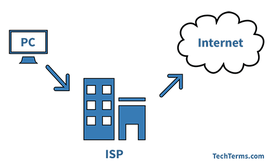

### IP & ISP

랜 환경에서는 스위치를 이용해 MAC 주소로 통신한다.

왠 환경에서는 라우터를 이용해 IP 주소로 통신한다.

**IP(Internet Protocol) 주소는 인터넷상에 있는 컴퓨터의 고유한 주소이다.**

따라서 IP를 통해서 한 컴퓨터에서 다른 컴퓨터로 데이터를 주고받을 수 있다. IP 주소는 어떻게 할당받는 것일까?

분명 컴퓨터를 구매할 때 자동으로 부여된 번호는 랜 카드 주소(MAC 주소)뿐이었다.

우리가 인터넷을 하기 위해서는 **인터넷 서비스 제공자(ISP, Internet Service Provider)**라고 하는 SKT, KT, LG U+ 등과 같은 회사에 인터넷 설치를 신청한다. 그럼 인터넷 서비스 제공자와 내 컴퓨터가 연결되며, 더불어 공인 IP가 하나 부여된다. 공엔 IP가 인터넷을 할 수 있는 IP 주소이다.



---

### 공인 IP & 사설 IP

네트워크에서 사용 목적과 방법에 따라 공인 IP와 사설 IP가 있다.

**공인 IP(Public IP)**

공인 IP는 인터넷 서비스 제공자에 의해 전 세계적으로 고유하게 할당되는 IP 주소이다.

이 주소를 이용해서 전 세계의 컴퓨터와 통신을 할 수 있다. 대부분의 인터넷 서비스 제공자들은 유동적으로 공인 IP 주소를 할당한다. 한마디로 한번 제공받은 공인 IP는 영구적으로 사용할 수 있는 것이 아니라 주기적으로 변경된다는 의미이다.

**사설 IP(Private IP)**

사설 IP는 주로 기업 내부에서만 사용되는 IP 주소로, 기업 밖에 위치한 컴퓨터와는 통신이 되지 않는다. 

---

### IP 형식

부여된 IP 형식은 다음과 같은 형식을 갖는다.

11000000 10101000 00000010 01111100 (32비트)

하지만 명령 프롬프트 창에서 ipconfig라고 입력하면 다른 형식이 나온다.

1. 11000000 10101000 00000010 01111100 
1. 192.168.2.124

이 둘은 동일한 의미를 다르게 표현했을 뿐이다. 1번은 2진수로 표현한 것이고, 2번은 10진수로 표현한 것뿐이다.

IP 주소 길이는 4바이트, 즉 32비트로 되어있다. IP 주소를 표기할 때는 2진수가 아닌 10진수로 표기하기 때문에

IP 주소의 범위는 0.0.0.0~255.255.255.255 이다.

**보통 1바이트의 가장 작은 수인 0과 가장 큰 수인 255는 용도가 정해져 있기 때문에 컴퓨터 IP 주소로 사용하지 않는다.** 아래와 같이 **마지막 1바이트가 0인 주소를 네트워크 주소라고 한다. 네트워크 주소는 일반적으로 하나의 네트워크를 통칭하기 위해 사용되는 주소이다.**

```
# 네트워크 주소
192.168.2.0
```

예를 들어 하나의 라우터에 묶여 있는 컴퓨터들의 IP가 192.168.2.11 ~ 192.168.2.14 라고 가정해 보자.

그러면 네트워크 주소는 192.168.2.0이 된다. IP 192.168.2.11 ~ 192.168.2.14는 같은 IP 대역을 사용한다.

또한, 다음과 같이 **마지막 1바이트가 255인 경우를 브로드캐스트 주소라고 한다. 브로드캐스트 주소는 네트워크에 연결된 컴퓨터에 데이터를 한 번에 일괄적으로 전송할 때 사용하는 주소**이다.

```
# 브로드캐스트 주소 
192.168.2.255
```

예를 들어 192.168.2.0이라는 네트워크 주소를 갖는 네트워크가 있다고 가정해 보자. 192.168.2.10이라는 IP를 갖는 컴퓨터가 자신이 속해 있는 모든 컴퓨터에 데이터를 보내고자 할 때 사용되는 IP 주소는 192.168.2.255가 된다.

---

